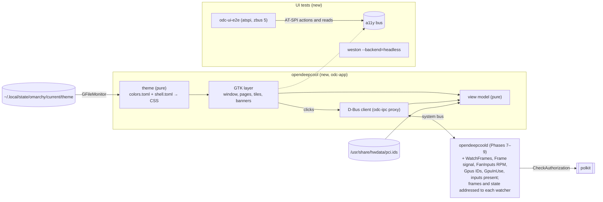

# Phase 10: the settings app: one GTK4 window that mirrors the cooler, follows the Omarchy theme live, and is tested through AT-SPI in a headless display

**Plan ID:** `phase-10-settings-app`
**Source PRD:** `docs/prp/prds/opendeepcool-lp360.prd.md` (repository-relative: an absolute path would name the owner's home folder, AGENTS.md rule 10)
**PRD Phase:** `10 — Settings app`
**Source Issue:** `None`
**Plan Publication:** `None`

## Outcome

**Problem:** After Phases 7–9 every setting can be changed only with `busctl`. Nobody can see what the cooler shows without looking at the pump. Nothing follows the Omarchy theme.

**Affected user:**
- The owner, and any user at the PC: the settings belong to the PC.
- Nobody in a remote or inactive session: OpenDeepCool is used only from the active session at the PC (owner, 2026-10-26). There the app says so and shows nothing else.

**User outcome:**
- `OpenDeepCool` opens from the launcher onto the current settings.
- A live preview shows exactly what the cooler shows.
- **One click changes the cooler at once:** a mode tile (23 of them, in four groups), the unit, the rotation, the GPU, the fan and pump inputs, peak dots and the two falloff sliders.
- **Refresh** restarts the picture.
- **Status:** the window shows whether the cooler is connected, whether the service runs, and, in Music, whether sound comes in. Unavailable modes are disabled, with their reason.
- **Theme:** colours follow the current Omarchy theme and change live with `omarchy-theme-set`. Elsewhere, the app's own default theme applies.

**Invariant:**
- **Every mode and setting is reachable:** each control maps to exactly one D-Bus call, and each tile to exactly one spec mode (rule 11).
- **The preview is the cooler:** it shows only frames the service publishes.
- **Changes are the service's:** the app never writes settings itself and never shows a change the service refused. In a remote or inactive session it reads and changes nothing, because the service refuses it everything.
- **No other hardware:** no hardware information beyond the display's pictures and the cooler's fan and pump RPM (rule 8).
- **Theme:** colours come from the current Omarchy theme or the default theme, never hard-coded in widgets. The app never sets window opacity or blur.
- **Idle cost:** no polling. The preview redraws only on a changed frame.

**Success signal:** The app follows `omarchy-theme-set` live, shows the default theme when it finds no Omarchy theme, and every setting is reachable (PRD Phase 10). The proof is the unattended AT-SPI run: it reaches every item of the design's coverage check, in every state, through the real app.

**Approach:**
- **A new crate, `odc-app`, builds the binary `opendeepcool`** (gtk4-rs, plain GTK4), in three layers:
  - a pure **view model** turns the service's state into what each screen shows;
  - a pure **theme** module turns `colors.toml` and `shell.toml` into one CSS string;
  - a thin GTK layer builds the design's widgets.
- **The service gains the five additions the design needs:**
  1. the current frame as a signal addressed to each watcher, while watched;
  2. the RPM per fan input;
  3. GPU IDs and a rule flag;
  4. the GPU in use;
  5. whether each saved input is present.

  There's no `CanChangeSettings()` (owner, 2026-10-26): only the active local session can use the service, so a refused `GetState()` tells the app it's in another session.
- **Tests, in the PRD's layers:**
  - layer 1: the view model and the theme, pure Rust;
  - layer 3: the app's widgets in-process, in headless weston, against fakes;
  - layer 4: the real app driven through AT-SPI in headless weston, against a fake service everywhere and against the real dev service on the owner's PC.
  - Layer 2 (differential against DeepCreative) has nothing to compare: OpenDeepCool's app has its own design.

## Recommendation

**Build exactly the design** (`docs/design/settings-app.md`, decisions D1–D8 and the pass-1 answers).
- The owner delegated the UI choices on 2026-10-25, so the plan doesn't reopen them.
- The design's "unverified" GTK points are settled in Task 1 against docs.gtk.org and a minimal gtk4-rs program, each with its design fallback. A failed check changes a widget, never the behaviour.

**The view model is the app's logic, and it is pure.**
- `odc_app::model::view(&ServiceState, &Ui) -> View` returns a plain description of what is shown: tiles (enabled, selected, flagged, reason), banners, captions, status items, dropdown entries and control states.
- `ServiceState` is everything the service publishes: the state from `GetState()` and `StateChanged`, the frame, whether the bus name has an owner, and whether the service refused this session.
- The GTK layer only renders a `View` and turns clicks into `odc-ipc` calls. So every state in the design's States table is a unit test with no display.
- **Instant apply works the same way.** A click sends the call, and nothing changes on screen until the service's `StateChanged` arrives. So the app never shows a change the service refused.

**The preview mirrors the service; tiles are drawn locally.**
- **The preview:** the service gains `WatchFrames()` and `UnwatchFrames()`, and a `Frame(ay)` signal: 196 bytes, 0 or 1, row-major, exactly the frame written to the cooler after rotation.
  - It is emitted only while at least one watcher holds a watch, and only when the frame differs from the last one sent.
  - Each `Frame` is addressed to one watcher alone, never broadcast, and only to watchers that pass Phase 7's one-second check (polkit `use`, the active local session; owner, 2026-10-26).
  - Watches end when the watcher leaves the bus (`NameOwnerChanged`), so a crashed app can't keep the service sending.
  - At most 10 signals a second, so the cost is nil while nobody watches.
  - The preview is then exactly the cooler, spectrum and Dancer included, with no second copy of the engine.
- **Back from standby** (owner, 2026-10-26): nothing in the app. Its bus connection and its watches survive a sleep, the session stays active while the screen is off or locked, and the preview follows the frames as soon as they come back.
- **The tiles** are drawn by the app with `odc_render::picture` and `odc_render::music` from fixed sample values (design, Display page). That is the same code the service uses, with no audio and no clock.

**The other contract additions, each the smallest shape that serves the design:**
- `FanInputs` becomes `a(ssusd)`: chip, device path, input, label, RPM (capped at 9999, like every value; owner, 2026-10-25). `StateChanged` with it goes once a second only to frame watchers, so an app that isn't open costs nothing.
- `Gpus` becomes `a(sssqqb)`: PCI address, driver, kind, PCI vendor ID, PCI device ID, has a reading rule. The app looks up the product name in `/usr/share/hwdata/pci.ids` (package `hwdata`, present on this PC, 2026-10-25). The service, which is sandboxed, reads nothing new.
- `GpuInUse` (s): the GPU the readings come from, next to `ChosenGpu`, the saved choice.
- `CoolerFanInputPresent` and `PumpInputPresent` (b).
- **Not available in this session** (owner, 2026-10-26): when `GetState()` is refused with `NotAuthorized`, the app is in a remote or inactive session and shows only the design's not-available state.
  - It tries again when its window becomes active and when the service's name gets a new owner, with no polling.
  - An admin's polkit rule could allow reads but refuse changes; a change then fails with `NotAuthorized`, shown like any refused change.

**The UI tests drive the real app through AT-SPI, in headless weston.**
- **Spike, 2026-10-25,** on this PC (GTK 4.24.1, at-spi2-core 2.62.1, weston 15.0.1; throwaway code in the session scratchpad, not kept):
  - a GTK4 window in `weston --backend=headless` showed up on the accessibility bus with its full tree: frame, label, button, combo box;
  - its button offered a `click` action, and `do_action` ran the app's handler. No synthetic input and no GNOME-only daemon were needed. dogtail needs `gnome-ponytail-daemon` for input on Wayland, which is why it isn't used.
- **The driver is our own small Rust program, `odc-ui-e2e`,** using `atspi` 0.30 (pure Rust, zbus-based).
  - `atspi` 0.30 depends on zbus 5 while the workspace uses zbus 6, so the driver is its own binary crate and never links `odc-ipc`.
  - It talks to the fake service through files the harness writes, not D-Bus. If a newer `atspi` uses zbus 6 by implementation time, the split stays anyway: it keeps the driver independent of the app.
- **Lessons from the spike that the driver must follow:**
  - **One action, then wait:** three `do_action` calls in a row showed one count. Each action waits until its expected effect is visible: fresh reads with AT-SPI's cache bypassed, polled every 50 ms, up to 5 s. Whether the cause was coalesced actions or a stale cache is unverified, so this rule covers both.
  - **Name controls in Rust:** a custom accessible name set through the Python bindings didn't take. Task 1 checks `gtk4-rs`'s `update_property(&[Property::Label(…)])`, and the names table is tested.
  - **One weston per run:** a weston left from an earlier run kept its socket. The harness gives each run its own socket name and kills weston from a drop guard.
- **The renderer:** headless runs set `GSK_RENDERER=cairo`, GTK's documented fallback renderer (docs.gtk.org, Running GTK applications). It gives deterministic pictures and avoids the Vulkan warnings the spike printed. That's a GTK environment setting, not one of our program's options; our options stay flags (AGENTS.md rule 5).

**Test-only flags on the app, like the service's `--dev`:**
- `--service-address <D-Bus address>`: talk to a fake service on a private bus instead of the system bus.
- `--omarchy-state <dir>`: read the theme from that directory instead of `~/.local/state/omarchy`.
- Any other argument is an error.
- The packaged desktop entry passes neither.

### Evidence

- `docs/design/settings-app.md`: Decisions D1–D8 and the pass-1 answers; Window; Preview column; Display page; Configuration page; Banners; Refresh; States; Theme (how it's applied, tokens, default theme with contrast ratios); Keyboard; Accessible names; What the Phase 10 plan must add to the D-Bus contract; Coverage check; Unverified.
- `docs/design/mockups/` (14 states) and `docs/design/mockups-src/gen.py` (regenerates them exactly; checked 2026-10-25).
- `docs/spec/settings.md` What the settings app must offer:
  - instant apply;
  - no app-only settings;
  - the configuration screen;
  - the Music settings;
  - GPU names from `hwdata`;
  - availability;
  - status, including Music sound;
  - the theme.
- PRD:
  - Technical Approach → Theme, the Omarchy files and the live switch by folder move;
  - Settings app ↔ service (D-Bus, polkit `allow_active`);
  - Phase 10;
  - Decisions Log (GTK4 via gtk4-rs, no libadwaita);
  - Testing Strategy.
- Phase 7 plan Tasks 4 and 7: `odc-ipc`, the change steps and polkit. Phase 9 plan Task 3: `AudioConnected` and the Music setters.
- crates.io, 2026-10-25: `gtk4` 0.11.5, `atspi` 0.30.0 (zbus ^5.5), `atspi-proxies` 0.14.0.
- docs.gtk.org: `GSK_RENDERER=cairo` (Running GTK applications); GTK CSS custom properties since 4.16 (design, Theme).
- This PC, 2026-10-25:
  - **packages:** weston 15.0.1 (installed by the owner for these tests), gtk4 4.24.1, at-spi2-core 2.62.1 with `org.a11y.Bus` on the session bus, python-gobject 3.58.1, `dbus-daemon` and `dbus-run-session` (dbus 1.16.2), `/usr/share/hwdata/pci.ids` (hwdata 0.412);
  - **not installed:** libadwaita isn't needed.

### Alternatives considered

- **dogtail** (Python, AT-SPI): its Wayland input needs GNOME's `gnome-ponytail-daemon`, and the project's code and tests are Rust. AT-SPI actions alone did the job in the spike.
- **Tests only inside the app's process** (gtk4-rs): fast, but they never prove the packaged binary, its flags, its D-Bus client or its accessible names. That's why layer 4 drives the real binary.
- **Running the UI tests on the owner's desktop:** windows would appear on the owner's screen, and it wouldn't work in CI. Headless weston is invisible and runs anywhere.
- **The app polling the service, or rendering the preview from readings:** polling costs idle CPU, and rendering locally can't show the spectrum or the Dancer, because the sound reaches only the service.
- **The app asking polkit itself:** that would be a second authorization path that could disagree with the service's.

## Visuals

## Implementation Context

### Mandatory reading

| File | Why it matters |
|---|---|
| `docs/design/settings-app.md` (all) | The app to build: structure, widgets, states, theme, keyboard, accessible names, contract additions, coverage |
| `docs/design/mockups/*.html` | Each state as drawn; open one with `?theme=dark` or `?theme=light` |
| `docs/spec/settings.md` What the settings app must offer | Every requirement the coverage check reaches |
| `docs/spec/display.md`, `docs/spec/music.md` | What the preview and the tiles show |
| `docs/prp/plans/phase-7-service-settings-load-mode.plan.md` Tasks 4, 7, 8, 9 | `odc-ipc`, the change steps, polkit, the dev copy, `odc-e2e` |
| `docs/prp/plans/phase-9-music.plan.md` Task 3 | Music setters, `AudioConnected` |
| PRD Technical Approach → Theme | Omarchy's files and how a theme switch replaces them |

### Existing patterns and primitives

- **Pure core, thin I/O:** `odc-render`'s `picture` and `Marquee` (Phase 7). The view model and the theme module follow it.
- **The change steps:** authorize, validate, store, apply, emit (Phase 7 Task 7). The new service members follow it; frame watches check `Authorizer` with `Use`, like every read.
- **Fakes on p2p D-Bus:** Phase 7 Task 7's tests. The fake service of layer 4 implements the same `odc-ipc` interface on a private `dbus-daemon`.
- **`odc-e2e` areas and flags** (Phases 5–9): this phase adds `--only app`.

### Integration points

- `odc_ipc`: the new members, and the state-key shape changes of `FanInputs` and `Gpus`. Everything is still `v1`: Phase 10 runs before any release, so nothing outside the repository depends on the old shapes.
- `odc_render::{picture, music}`: called by the app for the tiles.
- `scripts/dev/setup.sh`, `teardown.sh`: the app binary, the desktop entry and the icon in the dev copy.

## Scope

### In scope

- The app as designed: both pages, the preview column, banners, Refresh, every state, keyboard and shortcuts, accessible names, the Omarchy theme with live reload, the default theme dark and light.
- The six service and contract additions.
- The desktop entry and an app icon (a simple 14 × 14 dot motif, our own).
- Tests in all four layers, the headless weston harness, and the CI job.

### Not building

- **Following other desktops' themes, or a theme-source setting:** after v1 (PRD).
- **App-only settings** (start at login, language) **and translations:** not in v1 (settings.md).
- **Fan or pump speed control,** and anything outside the cooler (rule 8).
- **A start-the-service button:** the app explains and shows the command (design, Banners).
- **The final package and `/usr` paths:** Phase 11. The dev copy installs under `/usr/local`.

## Delivery Considerations

| Concern | Decision and owned work |
|---|---|
| Compatibility / migration | `FanInputs` and `Gpus` change shape before any release; `busctl` examples in the README that read them are updated (Task 2) |
| Rollout / reversibility | The dev copy gains the app binary, the desktop entry and the icon, all in the manifest; `teardown.sh` removes them. Each `pkexec` run is shown to the owner first (rule 7) |
| Observability | The app logs to stderr (the journal when started from the launcher): the theme source and every reload, a fallback key by name, the service appearing or vanishing. Never readings or settings values beyond the mode number |
| Documentation | README: starting the app, its two test flags, and the dev footprint; AGENTS.md: the `docs/design/` folder and the new test commands; PRD System Footprint: the desktop entry, the icon and weston as a dev tool (installed by the owner 2026-10-25, not by OpenDeepCool) |

## Implementation

Each task ends with its own commit (rule 4) after its tests pass. Tasks 4–8 are each one screen or one feature, so one commit each.

### 1. Settle the GTK facts the design left unverified

**Files and integration points**
- `docs/design/settings-app.md` "Unverified": UPDATE, each point answered with its source, or the design's fallback chosen.
- A throwaway gtk4-rs program in the session scratchpad, never committed.

**Implementation**
- Check against docs.gtk.org, and where the docs don't say, with the throwaway program in headless weston read through AT-SPI:
  - `update_property(&[Property::Label(…)])` gives a widget its accessible name, and `Property::Description` and `Property::ValueText` (for the scales) reach AT-SPI;
  - the default roles of `GtkFlowBoxChild`, `GtkDrawingArea` and labels;
  - whether insensitive widgets show tooltips;
  - arrow keys between grouped `GtkToggleButton`s;
  - live updates of an item inside an open `GtkDropDown`;
  - `GtkScale` snapping to whole stops while dragging;
  - whether `gtk_style_context_add_provider_for_display` is deprecated, and its replacement;
  - the GTK 4.24 switch for a dark or light base;
  - gradient border colours in GTK CSS;
  - whether Hyprland honours the window's minimum size when it tiles. Check it in the owner's session with the throwaway window for a few seconds, or mark it unverified if it can't be checked unattended;
  - whether `GtkWindow:is-active` turns true again when the user switches back to their session under Hyprland (design, Not available in this session). If it doesn't, the app also follows logind's change signal for its session's `Active` property, still without polling.
- **When a check fails, the design's fallback is taken:**
  - each toggle button a Tab stop;
  - RPM refreshed when the dropdown reopens;
  - the stop applied on release;
  - the gradient's first colour.
  - The design document records each such choice.

**Validation**
- `docs/design/settings-app.md` has no point left marked "unverified" without a recorded fallback.

### 2. The service and the contract gain what the app needs

**Files and integration points**
- `crates/odc-ipc/`: UPDATE.
- `crates/odc-service/src/dbus.rs`, `engine.rs`, `status.rs`: UPDATE.
- `docs/spec/settings.md` "What the settings app must offer": UPDATE (Phase 7 Agent Notes: the app's contract lives there for the designer).
- `docs/spec/dbus.md`: UPDATE, in the same commit: `WatchFrames`, `UnwatchFrames`, `Frame`, and the new and changed state keys (solution review P4-04).
- `README.md` `busctl` examples: UPDATE.

**Implementation**
- **Frame watching:**
  - `WatchFrames()` and `UnwatchFrames()`: reads, checked with polkit `use` like every read (Phase 7), so only the active local session watches frames (owner, 2026-10-26; solution review P10-01). Frame watchers count toward Phase 7's watcher caps (8 per user, 32 in all) and its one-second re-check;
  - the `Frame(ay)` signal, 196 bytes, 0 or 1, row-major, after rotation;
  - the engine hands each written frame to the D-Bus side over a bounded channel of 1, newest wins, so a slow bus never delays a tick;
  - the D-Bus side sends each `Frame` to each authorized watcher alone, only while watchers exist and only on change;
  - watchers are tracked by unique name and dropped on `NameOwnerChanged`.
- **New and changed state keys:**
  - `FanInputs` `a(ssusd)` (RPM added, capped at 9999), in `StateChanged` once a second only to frame watchers;
  - `Gpus` `a(sssqqb)` (vendor ID, device ID, has rule; from the Phase 6 `Registry`, whose GPU scan already reads the PCI device);
  - `GpuInUse` (s); `CoolerFanInputPresent`, `PumpInputPresent` (b).

**Tests** (layer 3, p2p D-Bus with a fake `Authorizer`, as Phase 7 Task 7)
- **No watcher:** no `Frame` signal at all over 50 ticks.
- **One watcher:**
  - exactly one signal per changed frame, the bytes equal to the frame `Lp360` wrote, rotation included;
  - none for unchanged frames;
  - a `100%` scroll gives 10 a second;
  - the watcher leaving the bus stops them;
  - a second `WatchFrames()` from the same watcher changes nothing (the app repeats it on every window activation).
- **Two watchers:** one leaving keeps the signal for the other.
- **Only authorized watchers:** `WatchFrames` from a refused caller → `NotAuthorized`; a watcher the authorizer stops allowing gets no frames until it passes again. On a private `dbus-daemon`, a connection with a match rule for `Frame` but no watch receives nothing.
- **The frame channel:** a blocked bus connection never delays the engine's tick (fake clock: frames stay on the 100 ms grid).
- **State keys:**
  - `FanInputs` RPM follows `FakeReadings`;
  - the `Gpus` IDs and rule flag come from a fake sysfs tree (Phase 6 fixtures);
  - `GpuInUse` differs from `ChosenGpu` when the saved GPU is missing;
  - the present flags follow a fan input vanishing.

**Validation**
- `cargo test -p odc-ipc -p odc-service`: passes.

### 3. `odc-app`: the view model and the theme, pure, and the headless test harness

**Files and integration points**
- `crates/odc-app/`: CREATE, a library plus the binary `opendeepcool`; `gtk4 = "0.11"`, `toml`, `odc-ipc`, `odc-render`.
  - `src/model.rs`: `ServiceState`, `Ui` (the page, the open dropdown) → `View`.
  - `src/pci_ids.rs`: parses `pci.ids` vendor and device lines.
  - `src/theme.rs`: `colors.toml` + `shell.toml` → `Tokens` → CSS string; the default theme dark and light.
- `crates/odc-testkit/src/weston.rs`: CREATE. `Weston::headless()` starts `weston --backend=headless --socket=odc-test-<pid>-<n>`, waits for the socket, and exposes `WAYLAND_DISPLAY`. Drop kills it and removes the socket. `Absent` when `weston` isn't installed, as a hardware capability (Phase 5 Task 9).
  - Every test that starts it is behind `odc-app`'s `weston-tests` cargo feature (owner, 2026-10-27; solution review P4-05, P10-04). `cargo test --workspace`, the guard and the PKGBUILD's `check()` run without it and need no display; CI runs `cargo test -p odc-app --features weston-tests`.
- `crates/odc-testkit/src/fake_service.rs`: CREATE. A fake `opendeepcoold`: the full `odc-ipc` interface served on a private `dbus-daemon --session --print-address` bus.
  - Its state comes from a JSON file the test writes.
  - Every call it receives goes to a log file the test reads.
  - So `odc-ui-e2e` (zbus 5) drives it without linking zbus 6.

**Implementation**
- **`model::view` covers every row of the design's States table:**
  - tiles: 23 in four groups, with selected, insensitive, "Unavailable", "Reading lost", and the group reason lines (each reason once);
  - banners in their order;
  - the caption and status items, with "Music sound" only in Music modes;
  - fan and pump rows: RPM, "Choose input", "Input not found", "No fan sensors found", "—";
  - the GPU row only with more than one GPU, or when the saved GPU is missing; labels `<kind> · <product>` or `<kind> · <driver> · <address>`; the order dedicated, integrated, unknown, no-rule last;
  - not available in this session (a refused `GetState()`): only the design's message, with no values, no preview and no controls.
- **The theme:**
  - the token table of the design;
  - alphas computed into `rgba()` literals;
  - one missing key → that token from the default theme, with a log line naming the key;
  - `colors.toml` missing or unreadable → the whole default theme;
  - `mode` chooses dark or light;
  - a gradient border → its first colour (or Task 1's answer);
  - no `opacity` anywhere in the CSS.

**Tests** (layer 1, CI, no display)
- **`model`:** one test per States row, from a `ServiceState` built for it, asserting the whole `View`. The tile set is checked against the design's tile table, typed into the test independently.
- **`model` properties:**
  - exactly one tile per mode 1–23;
  - a CPU tile never maps to a GPU mode (rule 11);
  - no `View` shows a hardware value other than the cooler's fan and pump RPM.
- **`pci_ids`:** a made-up `pci.ids` fixture (fictional vendor and device IDs and names), plus comment lines, subsystem lines, and an unknown ID → `None`.
- **`theme`:**
  - a sample Omarchy theme fixture (made-up colours) → the exact expected CSS `:root` block;
  - each key missing in turn → the default's value, and the log line;
  - a light theme;
  - no `colors.toml` → the default dark;
  - the CSS contains no `opacity`, no `transition` other than `none`, and no colour literal outside `:root`.
- **Contrast:** `contrast.py`'s ratios re-computed in Rust for the default palettes match the design's table. A changed palette must keep text 4.5:1 and borders 3:1.
- **`Weston`:** starts and stops; a second instance in the same test gets its own socket; a killed test leaves no socket (checked by a child-process test).

**Validation**
- `cargo test -p odc-app --lib -p odc-testkit`: passes.

### 4. The window, the preview column and the banners

**Files and integration points**
- `crates/odc-app/src/ui/window.rs`, `preview.rs`, `banners.rs`, `client.rs`, `main.rs`: CREATE.

**Implementation**
- **`main.rs`:**
  - parses its two test flags and rejects anything else;
  - application ID `io.github.dtmarangoni.OpenDeepCool`, one instance per user (GTK's default).
- **`client.rs`:**
  - the `odc-ipc` proxy on a zbus thread;
  - updates reach the GTK main loop through a `glib` channel (gtk4-rs book, the main event loop);
  - service ownership is watched with `NameOwnerChanged`;
  - `WatchFrames` while the window is mapped, `UnwatchFrames` when it isn't;
  - `Watch()`, then `GetState()`, so no change falls between them; the reply and the `StateChanged` signals are applied in the order they arrive (design, Talking to the service);
  - again on each activation of the window and whenever the service's name gets a new owner, in every state, not only after a refusal: both calls are harmless to repeat, and this renews a watch after a session switch;
- **The window:**
  - header bar with the switcher (Ctrl+1/2), Refresh (F5, Ctrl+R) and the "Refreshed" confirmation;
  - the preview column;
  - banners;
  - window close on Ctrl+W/Q.
- **The preview:** a `GtkDrawingArea` that draws the last `Frame`, calling `queue_draw()` only when it differs, and once on a theme change.
- **Accessible names and descriptions** exactly as the design's table.

**Tests** (layer 3, CI, in-process, in `Weston::headless()` with `GSK_RENDERER=cairo`, against a fake client)
- **Preview pixels:**
  - each case of `docs/spec/frames/mode-001.txt`, `mode-010.txt` (scrolling) and `mode-013.txt` (silence), fed as `Frame`s in all four rotations, rendered to a texture through `gtk::WidgetPaintable` and a cairo `gsk::Renderer`;
  - the colour at each dot's centre is lit or unlit exactly as the frame says;
  - an unchanged frame causes no redraw (a draw counter).
- **Banners and states:** the service and cooler banners, and the not-available state, show exactly in the design's states, in its order, with its text. With the service gone, the service state shows first, whatever the session.
- **The names table:** every accessible name and role in the design's table is set (`gtk::Accessible` reads in-process).

**Validation**
- `cargo test -p odc-app --test window` (headless): passes.

### 5. The Display page: unit and the tile gallery

**Files and integration points**
- `crates/odc-app/src/ui/display_page.rs`, `tiles.rs`: CREATE.

**Implementation**
- **The unit:** the `°C`/`°F` toggle group.
- **The four `GtkFlowBox`es:**
  - they act as one radio group;
  - activation (Enter, Space or a click) calls `SetMode`; focus alone never does;
  - tiles are drawn from `odc_render` with the design's sample values, upright, in the current unit, with the current peak setting;
  - they redraw only on a unit, peak or theme change;
  - group reason lines under each heading;
  - "Reading lost" on the saved tile.

**Tests**
- **Layer 3:**
  - each tile's texture, at dot centres, equals `odc_render`'s picture for its mode and sample values;
  - a unit change redraws only the temperature tiles;
  - no `SetMode` is sent on focus moves.
- **Layer 1:** the click → call mapping for all 23 tiles, and the unit.

**Validation**
- `cargo test -p odc-app --test display_page`: passes.

### 6. The Configuration page: rotation, GPU, inputs, Music

**Files and integration points**
- `crates/odc-app/src/ui/config_page.rs`, `dropdowns.rs`: CREATE.

**Implementation**
- **Rotation:** the four toggles → `SetRotation`.
- **The GPU `GtkDropDown`:**
  - a list-item factory, with the labels and order from the view model;
  - "— not found" and the hint naming the GPU in use;
  - the "no readings" mark and hint.
- **Fan and pump `GtkDropDown`s:**
  - `None` first, live RPM with tabular figures (or refreshed on reopen, per Task 1);
  - "— not found" and its warning border;
  - insensitive with the note when there are no sensors.
- **Music:**
  - the `GtkSwitch` → `SetMusicPeaks`;
  - two `GtkScale`s 0–4 with the five named marks → `SetMusicBarFall` and `SetMusicPeakFall` by stop name, on a new stop (or on release, per Task 1);
  - the value text is the stop's name.

**Tests**
- **Layer 3:**
  - every control → its call with the right argument;
  - the GPU row's presence for one GPU, several GPUs, and a missing saved GPU;
  - the dropdown entries and their accessible names (without RPM) and descriptions (RPM).
- **Layer 1:** the scale stops map to the five names, both ways.

**Validation**
- `cargo test -p odc-app --test config_page`: passes.

### 7. The theme in the window: Omarchy live, and the default theme

**Files and integration points**
- `crates/odc-app/src/ui/theme.rs`: CREATE. One `GtkCssProvider` at APPLICATION priority (or Task 1's replacement call), loaded from `theme::css()`.

**Implementation**
- **Source:** `--omarchy-state` or `~/.local/state/omarchy`, then `current/theme/colors.toml` and `shell.toml`.
- **Live reload:** a `GFileMonitor` on `current/`. After 150 ms of quiet: re-read, regenerate, reload the same provider, repaint the preview and the tiles, and keep the page and scroll position.
- **The base variant:** dark or light from `mode` (Task 1's switch).
- **Logging:** the source and every reload.

**Tests** (layer 3)
- **The sample Omarchy fixture** applied: the colours at known points (window background, a card, the selected tile's border, a lit preview dot) are the fixture's.
- **A theme switch done as Omarchy does it** (staging folder, then a move over `current/theme`, PRD Theme): the colours change to the second fixture within 1 s, with the same page and scroll position, and the log names the reload.
- **No Omarchy folder:** the default dark theme; then a light `colors.toml` with one key missing → the light default fills that key, logged.
- The window's opacity is 1.0 in every case.

**Validation**
- `cargo test -p odc-app --test theme`: passes.

### 8. Layer 4: the real app in headless weston, driven through AT-SPI against a fake service

**Files and integration points**
- `crates/odc-ui-e2e/`: CREATE, a binary (`atspi = "0.30"`, no workspace zbus).
  - `src/driver.rs`: `find(role, name)`, `press(name)`, `select(dropdown, item)`, `set_value(scale, n)`, `read(name)`.
  - **Each action waits for its expected effect:** fresh reads with the AT-SPI cache bypassed, polled every 50 ms, up to 5 s. One action at a time (spike lesson).
  - `src/scenarios.rs`: one scenario per row of the design's coverage check and States table.
- `crates/odc-e2e/src/app.rs`: CREATE, the `--only app` area. It starts `Weston::headless()`, the fake service, and `opendeepcool --service-address … --omarchy-state <temp>` with `GSK_RENDERER=cairo`, then runs `odc-ui-e2e` with the paths of the fake's state and call log.

**Implementation**
- **Every coverage item through the real binary:**
  - each of the 23 tiles → the fake logs `SetMode(n)` once; the unit, each rotation, the GPU, both inputs, peak dots, both scales at each stop and Refresh → their calls;
  - the keyboard shortcuts (Ctrl+1/2, F5) through AT-SPI's key events. If key events need input synthesis on headless weston (unverified), they stay covered by layer 3 only, and the report says so.
- **Every state** set through the fake's state file, then read through AT-SPI:
  - service not running (the fake leaves the bus) → the service banner text and insensitive controls; the fake returning → the pages come back with no action;
  - not available (the fake refuses `GetState`) → only the not-available message, no control and no preview, and no call reaches the fake; the fake allowing it again and the window activated → the pages come back;
  - cooler disconnected; an unavailable metric (reason lines once per group); the reading lost; one GPU; missing input and missing GPU; no fan sensors; first start.
- **Instant apply:** after each press, the control's new state appears only after the fake's `StateChanged`. A fake that refuses (`ModeUnavailable`) leaves the old selection, and the feedback label says "Not changed." with the service's reason; a refused Refresh says "Not refreshed."; `NotAuthorized` gives the app's own reason, "This session may not change settings." (design, Refused changes).
- **Theme:** start with no Omarchy folder → the log says default; create the fixture by staging and moving → the log says reloaded, and the window is still there with the same page.
- **Fake mode** (`weston` Absent): the area fails with "install weston (pacman -S weston)". It doesn't fall back, because a UI test without a display proves nothing (rule 5: present but unusable fails with its fix; here the tool itself is the requirement).

**Validation**
- `cargo run -p odc-e2e -- --only app --require weston`: passes, and prints every scenario with its time.

### 9. Layer 4, real: the real app against the real dev service, and the dev copy

**Files and integration points**
- `packaging/applications/io.github.dtmarangoni.OpenDeepCool.desktop`: CREATE (`Name=OpenDeepCool`, `Exec=opendeepcool`, `Icon=io.github.dtmarangoni.OpenDeepCool`, `Categories=Settings;HardwareSettings;`).
- `packaging/icons/io.github.dtmarangoni.OpenDeepCool.svg`: CREATE, our own 14 × 14 dot motif.
- `scripts/dev/setup.sh`, `teardown.sh`, `check.sh`: UPDATE.
  - The app goes to `/usr/local/libexec/opendeepcool-dev/opendeepcool`, the desktop entry to `/usr/local/share/applications/` with `Exec` there, and the icon to `/usr/local/share/icons/hicolor/scalable/apps/`.
  - All recorded in the manifest.
- `crates/odc-e2e/src/app.rs`: UPDATE, the real mode.

**Implementation**
- **Real mode** (`--require dev-service,weston`): the same scenarios that need no fake state, against the real dev service on the system bus, the app running in headless weston in the owner's session (so polkit's active-session rule applies):
  - each tile → the dev recording shows that mode's frame within 3 ticks, with readings fixed by `OverrideReadings`;
  - the rotation → the recording turns;
  - Refresh → the picture restarts from home;
  - the `Frame` signals the app receives (logged by the app) equal the recording's frames.
  - Afterwards the owner's saved settings are restored, as in Phases 7–9.
- **Attended tour** (optional, never a gate): `odc-e2e --attended --only app` opens the real app on the owner's desktop for a look at both pages in the current theme, and asks for y, n or r.

**Validation**
- After the owner approves the dev copy update: `scripts/dev/check.sh` exits 0, and the launcher lists OpenDeepCool.
- `cargo run -p odc-e2e -- --only app --require dev-service,weston`: passes.

### 10. CI and records

**Files and integration points**
- `.github/workflows/ci.yml`: UPDATE. Every job already runs in the `archlinux:base-devel` container (Phase 5; solution review P4-05), whose GTK is new enough for the CSS custom properties (4.16 or later; design, Theme).
  - Packages added: `gtk4 weston at-spi2-core dbus hwdata`.
  - A UI job runs `cargo test -p odc-app --features weston-tests` (layer 3, headless) and `cargo run -p odc-e2e -- --only app --require weston`. `cargo test --workspace` stays display-free.
- `AGENTS.md`:
  - Repository layout gains `docs/design/` (the app's design and mockups);
  - Commands gain the app's tests, `--only app`, and the rule that a UI change updates `docs/design/` first.
- `README.md`: the app, its launcher entry, its two test flags, the dev footprint.
- `docs/prp/prds/opendeepcool-lp360.prd.md` System Footprint:
  - the desktop entry and the icon (product and dev rows);
  - weston as a development and test tool the owner installed (2026-10-25), not installed or removed by OpenDeepCool.

**Validation**
- `.githooks/pre-commit` and CI pass.

## Acceptance

1. **AC1 — Everything reachable:** every row of the design's coverage check is reached through the real app in layer 4, with the exact D-Bus call logged by the fake, and each tile maps to exactly one mode (Tasks 3, 5, 6, 8).
2. **AC2 — Instant apply, the service's word:** a control shows its new state only after the service confirms it; a refused change leaves the old state; a remote or inactive session shows only the not-available state and sends nothing (Tasks 3, 8).
3. **AC3 — The preview is the cooler:** the preview draws exactly the frames the service writes, in every rotation, scrolling, Music and the Dancer included. With no watcher the service sends no frames, and frames reach only authorized watchers, never broadcast (Tasks 2, 4, 9).
4. **AC4 — Every state as designed:** each row of the design's States table shows its banners, captions, reason lines, insensitive controls and labels, in unit tests and through AT-SPI (Tasks 3, 4, 8).
5. **AC5 — Theme:**
   - the Omarchy theme's colours apply and follow an `omarchy-theme-set`-style folder move within a second, keeping the page;
   - with no Omarchy theme the default dark theme applies; a missing key falls back alone and is logged;
   - no window opacity is ever set (Tasks 3, 7, 8).
6. **AC6 — Contract additions:** `WatchFrames`/`Frame`, the RPM in `FanInputs`, the `Gpus` IDs and rule flag, `GpuInUse` and the present flags behave as Task 2 specifies, frames go to authorized watchers alone, and `docs/spec/dbus.md` and settings.md list them (Task 2).
7. **AC7 — Accessible and keyboard-usable:** every name in the design's table is set; focus never applies a tile; the shortcuts work (Tasks 4–6, 8).
8. **AC8 — Real system, unattended:** on the owner's PC the real app changes the real dev service's frames, unattended and invisible (headless), and leaves the owner's settings as found. The launcher entry opens the app (Task 9).
9. **AC9 — Records:** AGENTS.md, README, the PRD footprint, the design document's answered points and CI match what was built (Tasks 1, 10).

## Validation

| Gate | Command or procedure | Proves |
|---|---|---|
| Format, lint | `cargo fmt --all --check`; `cargo clippy --workspace --all-targets -- -D warnings` | Style; no warnings |
| Layers 1 + 3 | `cargo test --workspace` (layer 3 starts headless weston itself) | AC2–AC7 |
| Layer 4, fake service | `cargo run -p odc-e2e -- --only app --require weston` | AC1, AC2, AC4, AC5, AC7 |
| Layer 4, real (local) | `cargo run -p odc-e2e -- --only app --require dev-service,weston` | AC3, AC8 |
| Dev copy | `scripts/dev/check.sh`; the launcher lists OpenDeepCool | AC8 |
| Attended tour (optional) | `cargo run -p odc-e2e -- --attended --only app` | The owner's own look; never a gate |
| CI | GitHub Actions, `archlinux` container | Layers 1 and 3, layer 4 against the fake |

## Risks and Decisions

| Decision or risk | Recommendation | Evidence / mitigation | Consequence if different |
|---|---|---|---|
| The UI choices (D1–D8, the pass-1 answers) | Done, delegated by the owner (2026-10-25); the plan builds them as designed | `docs/design/settings-app.md` | Reopening them would redo the design and mockups |
| AT-SPI actions might not reach every widget kind (dropdown items, scales) | Task 1 checks each with the throwaway program before Task 8; where an action is missing, the widget's own AT-SPI interfaces (Selection, Value) are used, and failing that the item stays a layer 3 check, listed in the report | Spike: buttons' `click` worked; the combo box showed its toggle | A few controls proven only in-process (layer 3) |
| Keyboard shortcuts through AT-SPI on headless weston may need synthetic input (unverified) | Try AT-SPI key events in Task 1; otherwise layer 3 covers the shortcuts and the report says so | dogtail's need for a GNOME input daemon suggests input synthesis is the hard part on Wayland | Shortcuts proven in-process only |
| `atspi` uses zbus 5, the workspace zbus 6 | A separate binary crate that never links `odc-ipc`; it talks to the fake through files | crates.io, 2026-10-25 | Linking both would compile two zbus versions into one binary |
| CI's GTK must be 4.16 or newer | An `archlinux` container | Design, Theme: CSS custom properties since 4.16 | An older GTK would ignore the theme variables |
| Frames on the system bus | Each `Frame` is addressed to one authorized watcher (polkit `use`, the active local session only), never broadcast (owner, 2026-10-26; solution review P10-01) | D-Bus specification: a unicast signal reaches its destination only; dbus-broker has no eavesdropping | A broadcast would let any local process follow the picture, and in Music the active user's sound |
| Hyprland might ignore the window's minimum size when tiling | Task 1 checks; the pages scroll and the tile rows reflow anyway | Design, Window | A cramped but working window on very small tiles |

## Related Plans

- **Depends on:** the Phase 7 plan (service, `odc-ipc`, polkit, dev copy), the Phase 8 plan, and the Phase 9 plan (Music setters, `AudioConnected`).
- **Followed by:** the Phase 11 plan (packaging: the desktop entry and the icon at their `/usr` paths, uninstall).

## Agent Notes

- Any change to the app's UI updates `docs/design/settings-app.md` and, when a state changes, the mockups through `docs/design/mockups-src/gen.py`, before the code.
- Mode names in the app: Load, Temperature, Power, Music; never "Guardian" or "… Mode" (owner, 2026-10-24).
- Fixtures use made-up chips, GPU names, PCI IDs and colours. Nothing from `docs/local/` goes into tests or commits (rule 10).
- The UI tests run headless and never open a window on the owner's desktop, except the optional attended tour.
