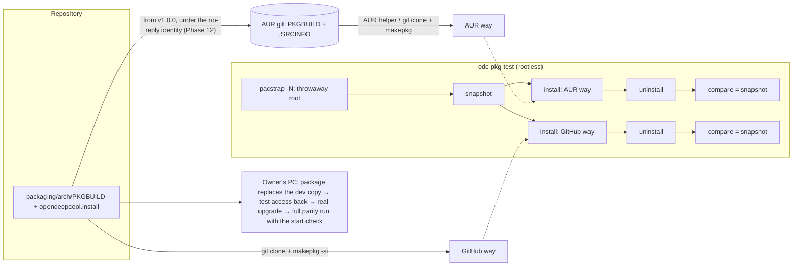

# Phase 11: one PKGBUILD, installed from the AUR or from GitHub, that removes everything it brought, proven in a rootless throwaway container; then the full parity run on the owner's PC

**Plan ID:** `phase-11-packaging-final-validation`
**Source PRD:** `docs/prp/prds/opendeepcool-lp360.prd.md` (repository-relative: an absolute path would name the owner's home folder, AGENTS.md rule 10)
**PRD Phase:** `11 — Packaging & final validation`
**Source Issue:** `None`
**Plan Publication:** `None`

> **Changed by the owner on 2026-10-27:** the releases and DeepCreative's deletion move to a new Phase 12, planned when this phase is done (PRD, Phase 12). The alpha and the beta are GitHub pre-releases, each for one month and until every open bug is fixed; `v1.0.0` then comes out on GitHub and, for the first time, on the AUR. This phase ends with the full parity run on the owner's PC, against the installed package.

## Outcome

**Problem:** After Phases 5–10 OpenDeepCool runs only as the owner's dev copy, installed by scripts under `/etc` and `/usr/local`. Nobody else can install it, nothing proves that uninstalling leaves the system as it was, and the parity checklist has never been run whole against an installed build.

**Affected user:**
- Every Arch user with an LP360, who installs from the AUR or from a GitHub clone.
- The owner, whose PC moves from the dev copy to the package.
- Future maintainers, who need a reproducible release.

**User outcome:**
- **Installing:** `yay -S opendeepcool` (or any AUR helper), or `git clone` plus `makepkg -si`, installs OpenDeepCool. The cooler shows the default mode at once, with no extra step, and from then on at every boot.
- **The install message** lists what was enabled and how to turn it off (`systemctl mask`).
- **Uninstalling:** `pacman -R opendeepcool` removes everything OpenDeepCool installed or created: files, the account and group, enable links, udev access, saved settings, and an lm-sensors configuration that OpenDeepCool's detection created.
- **The dev copy:** installing the package removes it first.
- **The final validation:** the parity checklist runs whole against the package installed on the owner's PC. Phase 12 then releases it in stages and deletes DeepCreative (owner, 2026-10-27).

**Invariant:**
- **A clean round trip:** install then uninstall leaves the system exactly as it was, every path, owner, mode, account, group and enable link. Only the documented exceptions remain: a loaded sensor driver until the next boot, the journal, a core dump of an OpenDeepCool program that crashed until systemd cleans it up, pacman's own log and cache.
- **The same package both ways:** the AUR and the GitHub clone build the identical package from the same PKGBUILD.
- **No hidden copies:** no dev-copy file survives the package install or hides a packaged one.
- **Ready after install, no further step:** the service is enabled by symlinks the package ships, and started by the package's post-transaction hook once systemd's hooks have created its account and reloaded systemd, udev and D-Bus (owner, 2026-10-26).
- **Root trusts no file the service account can change:** the detection's record lives in its own root-only directory, and `post_remove` reads only its yes/no fields (owner, 2026-10-26).

**Success signal:** The checklist is at 100 % against the installed package, and uninstalling leaves nothing behind (PRD Phase 11).

**Approach:**
- **The package:** one PKGBUILD in `packaging/arch/`, plus an `.install` file and three pacman hooks (owner, 2026-10-26; solution review OV-02):
  - the units are enabled by symlinks the package ships under `/usr/lib/systemd/`, which pacman installs and removes;
  - systemd's own pacman hooks create the account and reload systemd, udev and D-Bus;
  - then the package's post-transaction hook starts the service on install, or restarts it and the users' audio helpers on upgrade; a pre-transaction hook stops them before removal;
  - `post_install` only removes a dev copy (from its manifest) and prints the message;
  - `post_remove` deletes what the detection's root-only record says it created, the state directories, then the account.
- **The test:** a small Rust program, `odc-pkg-test`. It builds a throwaway Arch root **rootless**, with `pacstrap -N` and `arch-chroot -N` (unshare mode as a regular user), so no password prompt ever interrupts a run. It then:
  1. snapshots the root;
  2. installs both ways (AUR-style and GitHub-style);
  3. uninstalls;
  4. compares the root with the snapshot.

  Nothing is booted (owner, 2026-10-25: no boot testing).
- **On the owner's PC:**
  1. the package, built from the committed release candidate, replaces the dev copy;
  2. the owner's test access comes back, with one approved step (owner, 2026-10-27);
  3. a real upgrade restarts the service and the owner's audio helper;
  4. the full parity run, against the installed package.
- **The releases** (alpha, beta, `v1.0.0`, the AUR repository) and DeepCreative's deletion belong to Phase 12 (owner, 2026-10-27).

## Recommendation

**One PKGBUILD, two ways in, one test for both.**
- **The AUR** holds only a PKGBUILD and `.SRCINFO`, never binaries (AUR submission guidelines, read 2026-10-25: "It does not contain any binary packages").
- **A GitHub clone** carries the same PKGBUILD in `packaging/arch/`, so `makepkg -si` there builds exactly what the AUR builds: the latest published tag, fetched through git (owner, 2026-10-27; solution review P11-17). The AUR gets it from `v1.0.0`; the alpha and the beta are installed this way only (Phase 12).
- **A release candidate,** before its tag exists, is built by the package test from a temporary copy of the PKGBUILD whose source is the local repository at the committed HEAD (`git+file://…#commit=<hash>`). It refuses a tree with uncommitted changes, so no build ever includes them.
- **One shared file:** both install the same `.install` file and package the same files, so a single file list and a single removal logic serve both.
- **The name `opendeepcool`** isn't in the official repositories, as the AUR rules require. Because the package builds from source, it takes no `-bin` suffix (AUR submission guidelines).

**Let systemd's pacman hooks do the system bookkeeping.** These are present on this PC, systemd's own, 2026-10-25:
- `20-systemd-sysusers.hook` (Install, Upgrade on `usr/lib/sysusers.d/*.conf`) creates `opendeepcool` from the packaged `sysusers.d` file;
- `35-systemd-udev-reload.hook` (Install, Upgrade, Remove on `usr/lib/udev/rules.d/*`) reloads udev, so the cooler's access starts and ends at once;
- `30-systemd-daemon-reload-system.hook` and `-user.hook` reload systemd.
- `dbus-reload.hook` (Install, Upgrade, Remove on the D-Bus policy directories) reloads the bus, so the service may own its name. All of them are `When = PostTransaction` (read on this PC, 2026-10-26).

**pacman runs an install script before those hooks, so nothing is started from it** (owner, 2026-10-26; solution review OV-02).
- A transaction runs `post_install` first, then ":: Running post-transaction hooks…" (Arch Linux dev blog, "On scripts and hooks", 2026, with a transaction log).
- A `systemctl enable --now` in `post_install` would start the service before its account, its udev rule and its D-Bus policy exist, and systemd's default start limit could then give up for good.
- The same article advises keeping install scripts minimal ("it is probably advisable to minimize the custom code in the scripts as much as possible") and enabling units declaratively, by symlinks in `/usr/lib/systemd/` or by presets, instead of `systemctl enable` in a script.

**Enabling: symlinks in the package.**
- The package ships two enable links:
  - `/usr/lib/systemd/system/multi-user.target.wants/opendeepcool.service` → `../opendeepcool.service`;
  - `/usr/lib/systemd/user/default.target.wants/opendeepcool-audio.service` → `../opendeepcool-audio.service`, for every user.
- pacman installs and removes them with the package: no script runs `systemctl enable` or `disable`, and no enable link is left behind in `/etc`.
- The one-shots need no link: the service pulls them in with `Wants=`.
- A user turns OpenDeepCool off with `systemctl mask --now opendeepcool.service` and `systemctl --global mask opendeepcool-audio.service`; the install message says so.

**Starting, restarting and stopping: three small hooks and one script.**
- **`/usr/share/libalpm/hooks/opendeepcool-install.hook`:** `Type = Path`, `Operation = Install`, `Target = usr/lib/opendeepcool/opendeepcoold`, `When = PostTransaction`. It runs `/usr/share/libalpm/scripts/opendeepcool-hook start`, which does `systemctl start --no-block opendeepcool.service` unless the unit is masked.
- **`opendeepcool-upgrade.hook`:** the same, with `Operation = Upgrade`. It runs `opendeepcool-hook restart`, which does `systemctl try-restart --no-block opendeepcool.service`, then the same `try-restart` of each logged-in user's audio helper (below). The new binaries run at once, and a service the user stopped stays stopped.
- **`opendeepcool-remove.hook`:** `Operation = Remove`, `When = PreTransaction`. It runs `opendeepcool-hook stop` before the files go: the service, then each logged-in user's audio helper.
- **Each logged-in user's helper** (owner, 2026-10-27; solution review P11-05, P11-20): for every user `loginctl list-users` shows, the script runs `systemctl --user --machine=<user>@.host try-restart` or `stop` on `opendeepcool-audio.service`. That's the form systemctl(1) documents for reaching one user's service manager (read 2026-10-27).
  - Whether it works from a pacman hook is checked on the owner's PC: in Task 5's real upgrade, and at the first real uninstall (Phase 12).
  - If it doesn't, the owner chooses then between two fallbacks: the helper exits by itself once its program file is replaced or removed; or the docs say that an old helper keeps running until the next login after an upgrade, and waits idle until logout after an uninstall, since it waits for the service rather than exiting (Phase 9).
- **Order:** "Hooks are run in alphabetical order of their file name" (alpm-hooks(5)).
  - `opendeepcool-…` sorts after systemd's numbered hooks and after `dbus-reload.hook`. So by the time it runs, the account exists, systemd has reloaded, udev has applied and triggered the rule, and the bus has the policy.
  - The Arch article notes that hooks have no documented numbering yet. The service's restart backoff (Phase 7) is the safety net if anything is late.
- **First install:** a post-transaction hook shipped in the package being installed runs in that same transaction; the article's log shows it on a first install. A pre-transaction hook doesn't, which is why the dev-copy removal stays in `post_install`.
- **`--no-block`:** pacman never waits for the one-shots (sensor detection, GPU ranking).
- **The script** skips its work in a chroot or when systemd isn't booted, the way systemd's own `systemd-hook` does.

**The `.install` file keeps only what is specific to this package:**
- **`post_install`:**
  1. If `/var/lib/opendeepcool-dev/manifest` exists, remove exactly what it lists (owner, 2026-10-24: no dev copy survives or hides a packaged file), one entry at a time and never recursively: a file or link with `rm`, an empty directory with `rmdir`, each removal printed (solution review P11-03). It's the same logic as `scripts/dev/teardown.sh`, which shares the code. The detection's record in `/var/lib/opendeepcool-detect/` isn't in the manifest; the package takes it over.
  2. Print what is enabled, how to turn it off with `systemctl mask`, and that Music sound starts at each user's next login (owner, 2026-10-25: enable at install, against Arch's convention that "Arch Linux … does not enable most services on installation", Arch Wiki, systemd).

  It enables and starts nothing.
- **`post_upgrade`:** a message only when there's something to say; the upgrade hook restarts the service and the helpers. Upgrades never delete the account or the settings. A later version that renames or removes a unit or a polkit action cleans up the old one in its upgrade hook, and the upgrade test covers that path (solution review P11-05).
- **`post_remove`,** files first, then the account, so no file is left owned by a number a later account could be given (solution review P11-11):
  - the detection's record, `/var/lib/opendeepcool-detect/sensors-detect.json`, is read only if it's a regular file owned by root, never a symbolic link (solution review OV-01). From its yes/no fields only:
    - remove `/etc/conf.d/lm_sensors` if `created_conf_d`;
    - remove `/etc/modprobe.d/lm_sensors.conf` if `created_modprobe_d`;
    - disable `lm_sensors.service` unless `lm_sensors_enabled_before`.

    No path is ever taken from the record, and a configuration that existed before is never touched;
  - `rm -rf /var/lib/opendeepcool-detect /var/lib/opendeepcool`;
  - `userdel opendeepcool`, then the group if it's left, because pacman's sysusers hook only creates (Install and Upgrade only, above).

  systemd's hooks then reload systemd, udev (with its trigger) and D-Bus, so the group's device access ends at once. No script re-triggers udev itself.

**The throwaway system is rootless, so the test stays unattended.**
- **Spike, 2026-10-25,** on this PC (arch-install-scripts 31, unprivileged user namespaces on, subordinate ID ranges for the owner's account):
  - `pacstrap -N -c` built a base Arch root in 6 s from the host's package cache (593 MB);
  - `arch-chroot -N` ran commands as root inside, with no prompt;
  - `systemd-sysusers` created a `u!` account; `systemctl enable` and `systemctl --global enable` created the links and `disable` removed them; `userdel` removed the account and group; a normal build user ran commands;
  - the root was deleted afterwards. Throwaway code only.
- **Two errors in the spike, both harmless:**
  - `-K` (an empty keyring) failed because the GPG agent can't start in unshare mode, so the test copies the host's keyring (pacstrap's default);
  - the initramfs hook had no kernel to work on.
- **Why not `systemd-nspawn`:** it needs root, so a password prompt on every run (AGENTS.md rule 3).

**The parity run uses the installed package itself.**
- The packaged binary is the same one the dev copy ran. Its `--dev` switch only turns on the dev interface and the recording (Phase 7).
- For the final run, a **runtime** drop-in in `/run/systemd/system/opendeepcool.service.d/odc-e2e.conf` adds `--dev` for the duration. If the product keeps `UMask=0077` and `StateDirectoryMode=0700` (Phase 7; solution review P7-09), the drop-in relaxes them as the dev drop-in does, so the tests can read the recording. `/run` is gone at the next boot, and the run removes it at the end anyway.
- Creating it is the run's one privileged step, approved by the owner with `pkexec` (rule 7). Everything after it is unattended.
- **The tests' access** (owner, 2026-10-27):
  - the dev interface checks that the caller is in group `opendeepcool`, and the tests read the recording through that group (Phase 7);
  - the reconnect test needs the dev reconnect rule (Phase 5);
  - installing the package removes all of that with the dev copy, so Task 5 puts it back: the owner's account in the package's group and the reconnect rule, recorded in the dev manifest.

### Evidence

- PRD:
  - Phase 11 (scope, tests) and Phase 12 (the releases, the last step of v1);
  - System Footprint (the finished app's table, "Removed by", and the dev rows);
  - Technical Approach → Packaging (owner, 2026-10-25: AUR plus GitHub, enable at install);
  - Decisions Log (Distribution, Service at install, Boot testing, Uninstall).
- Arch Wiki, read 2026-10-25:
  - **Arch User Repository:** moving to `extra` needs popularity, "at least 10 votes", and "a package maintainer willing to maintain the package";
  - **AUR submission guidelines:** no binaries; not already in the official repositories; `-bin` for prebuilt; commits authored with the global git identity, so set it per repository;
  - **Arch package guidelines:** "never" install to `/usr/local/`; important messages through an `.install` file;
  - **systemd:** "does not enable most services on installation".
- Arch Linux dev blog, "On scripts and hooks" (2026-08-09), read 2026-10-26:
  - the transaction log: `post_install`, then the post-transaction hooks, including a hook shipped in the same package, on its first install;
  - minimise custom code in install scripts;
  - enable units by vendor symlinks or presets rather than `systemctl enable` in a script.
- alpm-hooks(5), read 2026-10-26: "Hooks are run in alphabetical order of their file name, where the ordering ignores the suffix."
- Read 2026-10-27, at the solution review's cross-check:
  - systemctl(1): `--user --machine=<user>@.host` connects to that user's service manager;
  - systemd.resource-control(5): `DeviceAllow=` takes a `char-<group>` name from `/proc/devices`, and groups that don't resolve when the unit starts "are not added";
  - Arch Linux developer manual, Rust package guidelines: `cargo fetch --locked --target host-tuple` in `prepare()`; `cargo build --frozen --release --all-features`; `cargo test --frozen --all-features`, with `--workspace` in a workspace and without `--release`;
  - makepkg's own code (`/usr/share/makepkg/source/git.sh`): the checksum of a `#tag=` or `#commit=` git source is taken over `git archive --format tar`;
  - GitHub Docs, "Downloading source code archives": the compression of generated archives may change, and "GitHub will give at least six months' notice";
  - `vercmp` on this PC: `1.0.0alpha.2` < `1.0.0alpha.10` < `1.0.0beta.1` < `1.0.0`, while `1.0.0.alpha.1` and `1.0.0_alpha.1` sort after `1.0.0`;
  - Arch's file list of `nvidia-utils`: it ships `libnvidia-ml.so` and `libcuda.so`;
  - systemd's tmpfiles rule for `/var/lib/systemd/coredump`: core dumps are removed after two weeks.
- This PC, 2026-10-25:
  - the systemd pacman hooks listed above, with their targets and operations;
  - `pacstrap -N` and `arch-chroot -N` in their `-h` output;
  - the spike;
  - `/proc/sys/kernel/unprivileged_userns_clone` = 1, and subordinate ID ranges present.
- Plans:
  - Phase 5 Task 8: dev scripts and manifest;
  - Phase 6 Tasks 6–7: the powercap udev line, the detection unit and `sensors-detect.json`, and `created` lists;
  - Phase 7 Task 8: the unit, sandbox, D-Bus and polkit files, and NVIDIA device nodes deferred to here;
  - Phase 9 Task 4: the audio helper's user unit;
  - Phase 10 Task 9: the desktop entry and icon.

### Alternatives considered

- **The official repositories directly:** not possible. A Package Maintainer has to adopt the package (Arch Wiki).
- **A GitHub release with a prebuilt package, or an install script without pacman:** the owner chose clone plus `makepkg` (2026-10-25). One build path means one test.
- **`systemd-nspawn` or a VM for the throwaway system:** both need root or a hypervisor setup. The rootless unshare root does the job unattended.
- **Not enabling at install** (Arch convention): the owner chose the cooler working with no extra step.

## Visuals

## Implementation Context

### Mandatory reading

| File | Why it matters |
|---|---|
| PRD System Footprint, Phase 11, Decisions Log | Every item the package installs or creates, and how each is removed |
| `scripts/dev/setup.sh`, `teardown.sh`, the manifest format (Phase 5 Task 8) | The dev copy the package removes; the shared removal logic |
| `packaging/` (Phases 5–10) | Every file the package ships: unit files, sysusers, udev, D-Bus and polkit policy, user unit, desktop entry, icon |
| Phase 6 plan Tasks 6–7 | What the detection unit creates and records |
| Arch Wiki: Arch package guidelines, AUR submission guidelines, PKGBUILD, `.install` scriptlets | The packaging rules the package follows |

### Existing patterns and primitives

- **The dev manifest** (Phase 5 Task 8): one list of everything created, removed exactly. The package's `post_install` and `teardown.sh` share its removal.
- **`created` records** (Phase 6 Task 7, `sensors-detect.json`): what the detection made, so removal touches only that.
- **`odc-e2e` areas and capabilities:** this phase adds `--only package` and the `container` capability.

### Integration points

- `packaging/arch/`: CREATE, the PKGBUILD and the `.install` file.
- The service's unit, for NVIDIA device access (below).
- `scripts/dev/setup.sh`, `install-root.sh`: UPDATE, the `--test-access` mode (Task 5).
- `README.md` "Installed on your system", install and uninstall sections.

## Scope

### In scope

- The PKGBUILD (built as Arch's Rust package guidelines say: `cargo fetch --locked` in `prepare()`, `cargo build --frozen --release` of the shipped crates, and `check()` running the layer 1 and layer 3 tests that need no hardware and no display), the `.install` file, the three pacman hooks and their script, the enable symlinks, and the final file paths from the footprint.
- NVIDIA device access in the unit, from NVIDIA's documentation (Phase 7 deferred it here).
- `odc-pkg-test`: the rootless container, the snapshot, both install ways, uninstall, the comparison.
- Install and uninstall documentation; the README footprint.
- The owner's PC on the package, with its test access back and a real upgrade.
- The full parity run against the installed package; the Phase 11 report with the checklist at 100 %.

### Not building

- **The releases** (alpha, beta, `v1.0.0`), the AUR repository and DeepCreative's deletion: Phase 12 (owner, 2026-10-27).
- **Signed tags** (owner, 2026-10-27; solution review P11-06): the checksum in the PKGBUILD pins the code, and the same person controls the repository and the AUR.
- **Boot tests** of any kind (owner, 2026-10-25).
- **Official-repository submission** (not possible directly), prebuilt release packages, a non-pacman installer.
- **Other distributions:** Arch only (PRD).

## Delivery Considerations

| Concern | Decision and owned work |
|---|---|
| Compatibility / migration | The owner's dev copy is removed by `post_install` from its manifest; saved settings in `/var/lib/opendeepcool` are kept by the package (the dev copy used the same state directory and the same `settings.toml` v1), so the owner's choices survive the move |
| Rollout / reversibility | `pacman -R` undoes the install completely (the test proves it); `scripts/dev/setup.sh` can bring the dev copy back |
| Observability | The install message lists what was enabled; the journal shows the service from its first start; `pacman -Ql opendeepcool` lists every file |
| Documentation / communication | README: install from GitHub, and from the AUR once `v1.0.0` is there; uninstall; "Installed on your system" (generated from the same list the test checks); the AUR page's description, ready for Phase 12. Release notes come with Phase 12's releases |

## Implementation

Each task ends with its own commit (rule 4) after its tests pass.

### 1. The final file list, with NVIDIA access settled

**Files and integration points**
- `packaging/FILES.md`: CREATE. Every path the package installs, its owner and mode, plus every item it creates at install or run time and what removes it. This is the System Footprint table made exact.
- `packaging/systemd/opendeepcool.service`: UPDATE, NVIDIA device access.
- `docs/prp/prds/opendeepcool-lp360.prd.md` System Footprint: UPDATE from `FILES.md` (no more "proposed").

**Implementation**
- **Paths:**
  - binaries in `/usr/bin` (`opendeepcool`) and `/usr/lib/opendeepcool/` (`opendeepcoold`, `opendeepcool-audio`, the GPU-rank and detection helpers): the service binaries aren't for users to run, so they stay off `PATH`;
  - units in `/usr/lib/systemd/{system,user}`;
  - `sysusers.d`, `udev/rules.d`, `/usr/share/dbus-1/system.d`, `/usr/share/polkit-1/actions`, `/usr/share/applications`, `/usr/share/icons/hicolor/scalable/apps`, `/usr/share/licenses/opendeepcool/LICENSE`;
  - the enable symlinks `/usr/lib/systemd/system/multi-user.target.wants/opendeepcool.service` and `/usr/lib/systemd/user/default.target.wants/opendeepcool-audio.service`;
  - the pacman hooks `/usr/share/libalpm/hooks/opendeepcool-{install,upgrade,remove}.hook` and their script `/usr/share/libalpm/scripts/opendeepcool-hook`;
  - created at run time: `/var/lib/opendeepcool` (the service's state directory) and `/var/lib/opendeepcool-detect` (root, 0700, the detection's), both removed by `post_remove`;
  - nothing in `/usr/local` (Arch package guidelines) and nothing in `/etc`.
- **NVIDIA:** from NVIDIA's documentation for the device files NVML opens (`/dev/nvidiactl`, `/dev/nvidia<N>`), the unit adds `DeviceAllow=` entries.
  - They use the `char-<group>` form, with the group names NVIDIA's driver registers in `/proc/devices`, taken from NVIDIA's documentation. systemd.resource-control(5) documents the form (read 2026-10-27; solution review P11-13): groups that don't resolve when the unit starts "are not added", so the entries are safe on a PC without NVIDIA's driver. They cover only a driver loaded before the service starts.
  - Unverified on hardware: no NVIDIA card is available for testing (see `docs/local/`). Phase 6's fake trees and NVML fakes cover the reading. The report and the README say NVIDIA support is untested.

**Validation**
- `systemd-analyze verify packaging/systemd/*.service` passes; every path in `FILES.md` exists in `packaging/` or is a build output.

### 2. The PKGBUILD and the `.install` file

**Files and integration points**
- `packaging/arch/PKGBUILD`: CREATE.
  - `pkgname=opendeepcool`, `arch=(x86_64)`, `license=(MIT)`;
  - `pkgver` is the release's version without its hyphen: `1.0.0-alpha.1` is written `1.0.0alpha.1`, because pacman forbids hyphens. `vercmp` then orders `alpha.2` < `alpha.10` < `beta.1` < `1.0.0` (checked 2026-10-27); a dot or an underscore before `alpha` would sort after `1.0.0`;
  - `depends=(gtk4 hwdata lm_sensors pipewire-audio polkit dbus systemd)`, `makedepends=(cargo git)`, and `optdepends=('nvidia-utils: GPU readings and GPU kind on NVIDIA cards')`, the package that ships NVML and CUDA (solution review P11-12);
  - `source=` the published tag through git, `git+<repository URL>#tag=v<version>`, with the `sha256sums` makepkg computes over the tag's files (`git archive`).
    - GitHub's generated archive isn't used: GitHub may change its compression, with six months' notice (solution review P11-06, P11-17).
    - The checksum can't be part of the tag it describes, so the PKGBUILD that carries it is committed after the tag (Phase 12);
  - the functions follow Arch's Rust package guidelines (solution review P11-07, P11-21), each with `RUSTUP_TOOLCHAIN=stable` and `CARGO_TARGET_DIR=target`:
    - `prepare()`: `cargo fetch --locked --target host-tuple`;
    - `build()`: `cargo build --frozen --release`, with `-p` for exactly the five crates whose binaries ship (`odc-service`, `odc-app`, `odc-audio`, `odc-gpu-rank`, `odc-sensors-detect`), so no test-only crate is compiled on a user's PC;
    - `check()`: `cargo test --frozen --workspace --exclude odc-e2e --exclude odc-ui-e2e --exclude odc-pkg-test`, the tests that need no hardware and no display, without `--release`, as the guidelines advise;
    - neither uses the guidelines' `--all-features`, which would switch on the weston tests (solution review P4-05, P10-04, P11-08);
    - `package()` installs `FILES.md`'s list, the two enable symlinks included;
  - `install=opendeepcool.install`;
  - no `pkgver()`: a release candidate is built from a temporary copy (Recommendation).
- `packaging/arch/opendeepcool.install`: CREATE, with `post_install`, `post_upgrade` and `post_remove` as in the Recommendation. There's no `pre_remove`: the remove hook stops the service.
- `packaging/arch/hooks/opendeepcool-install.hook`, `opendeepcool-upgrade.hook`, `opendeepcool-remove.hook`, and their script `packaging/arch/hooks/opendeepcool-hook`: CREATE, as in the Recommendation.
- `scripts/dev/lib-manifest.sh`: CREATE, the manifest removal shared by `teardown.sh` and `post_install`. The `.install` file carries a copy, because pacman scriptlets can't source repository files; a test checks the copies are identical. It refuses a malformed manifest before removing anything, with Phase 5's checks (solution review P4-08).
- `packaging/arch/.SRCINFO`: CREATE, generated by `makepkg --printsrcinfo`; a test checks it's current.

**Implementation**
- **`post_install` order:**
  1. the dev-copy removal, while the packaged files are already on disk. pacman installs files before the scriptlet, and the dev copy's files are all in `/etc` and `/usr/local`, so no packaged file is touched. systemd's hooks, which run after the scriptlet, then see only the packaged files;
  2. the message.

  It enables and starts nothing: the symlinks enable, and the install hook starts (Recommendation).
- **Inside a chroot,** the hook script skips its work, as systemd's `systemd-hook` does ("Skipped: Running in chroot", seen in the spike's hook output). Task 3 checks it.
- **The helpers in the upgrade and remove hooks:** `loginctl list-users`, then `systemctl --user --machine=<user>@.host` for each (Recommendation). The container has no user manager, so it can't show this; Task 5 checks it on the owner's PC.
- **`namcap` on the PKGBUILD and the built package:** no errors. Each warning is explained in the report.

**Tests**
- `makepkg -f` in a clean clone builds the package; `namcap` runs on both.
- A shellcheck run on the `.install` file, `lib-manifest.sh` and the hook script.
- Static checks:
  - no scriptlet contains `systemctl enable`, `disable`, `start` or `restart`;
  - the hooks' file names sort after `dbus-reload.hook` and systemd's numbered hooks;
  - the two symlinks point at their units;
  - `build()`'s `-p` list names exactly the crates whose binaries `package()` installs;
  - the workspace's `rust-version` is at or below the version of Arch's `rust` package (`pacman -Si rust`), so AUR users can build it. It runs in CI's Arch container (solution review P11-07; `1.99` and `1:1.99.1` on 2026-10-27).
- The two manifest-removal copies are identical, and `.SRCINFO` matches `makepkg --printsrcinfo`.

**Validation**
- `cd packaging/arch && makepkg -f && namcap PKGBUILD *.pkg.tar.zst`: builds and reports no errors.

### 3. `odc-pkg-test`: install and uninstall, both ways, in a rootless throwaway root

**Files and integration points**
- `crates/odc-pkg-test/`: CREATE, a binary run by `odc-e2e --only package`.
- `crates/odc-testkit/src/hardware.rs`: UPDATE, capability `container`. It is Real when `pacstrap` and `arch-chroot` with `-N` work for this user: unprivileged user namespaces on, subordinate IDs present.

**Implementation**
- **Build:**
  - `pacstrap -N -c <tmp>/root base base-devel git`, plus the package's runtime dependencies, so the comparison later sees only OpenDeepCool's own changes (solution review P11-10). It uses the host's cache, and copies the host's keyring, since `-K` fails rootless (spike);
  - the root bind-mounted on itself inside the namespace, because `arch-chroot` warns when the root isn't a mount point (spike);
  - a build user created inside.
- **Snapshot:** every path under the root, with its type, mode, owner, group, size, link target and a SHA-256 of regular files, plus `getent passwd`, `group`, `shadow` and `gshadow`, and `find /etc/systemd -type l`.
- **The AUR way:**
  - before publication, from a local bare git repository holding exactly the files the AUR will hold (`PKGBUILD`, `.SRCINFO`, `opendeepcool.install`, `LICENSE`), its PKGBUILD pointed at the candidate in the same way as the GitHub way's;
  - after publication (Phase 12, from `v1.0.0`), from `https://aur.archlinux.org/opendeepcool.git`;
  - in both cases: `git clone`, then `makepkg -si --noconfirm` as the build user.
- **The GitHub way:**
  - before a tag exists, the release candidate: the temporary copy of the PKGBUILD pinned to the committed HEAD (Recommendation); a tree with uncommitted changes is refused;
  - from Phase 12's first tag, a clone of `main`, whose PKGBUILD builds the latest published tag;
  - `makepkg -si --noconfirm` in `packaging/arch/`.
- **After each install:**
  - every path of `FILES.md` exists with its owner and mode;
  - `getent passwd opendeepcool` is a locked, no-login system account;
  - the enable symlinks exist under `/usr/lib/systemd/`, `systemctl is-enabled opendeepcool.service` reports it enabled, and nothing was added under `/etc/systemd`;
  - the install hook ran and skipped its work in the chroot, starting nothing;
  - the installed rank helper unit has `StateDirectory=opendeepcool`, so its first run works on a fresh system, and both helper units have `TimeoutStartSec=` (unit inspection, since nothing boots here; solution review P6-03, P6-14);
  - the install message was printed.
- **A dev copy:** one run first installs the dev copy's files from a recorded manifest (Phase 5 format) into the root. After the package install, none of them remain.
- **A malformed manifest** (solution review P4-08): one with an empty line, `/`, a `..` component or a path outside the dev locations makes `post_install` remove nothing and say why; the install itself completes.
- **Uninstall:** `pacman -R --noconfirm opendeepcool`.
- **Then the root must equal the snapshot.** The only allowed differences are a fixed, commented list:
  - `/var/log/pacman.log`;
  - pacman's cache and sync database;
  - the build user's home and the build directory, which are removed and checked;
  - the `-` backup files `passwd-`, `group-`, `shadow-` and `gshadow-`, whose content must equal the snapshot's originals;
  - the packages makepkg installed as build dependencies, which are removed with `pacman -Rns` and checked;
  - caches that pacman's hooks rebuild, such as the icon theme cache and the desktop database: compared by content after both runs rebuilt them, and one that still differs is listed with its reason (solution review P11-10).
  - Any other difference fails with a diff.
- **Upgrade check** (solution review P11-05): install the previous published version, then the candidate; before Phase 12's first tag, the candidate, then the same build with a raised `pkgrel`.
  - The enable links, the account, the detection record and `settings.toml` survive.
  - The settings file survives byte for byte, since nothing runs in the container to rewrite it. How the service treats a field an older version didn't know is Phase 7's test (P7-12).
- **The lm-sensors case:** with a made-up record in `/var/lib/opendeepcool-detect/sensors-detect.json` saying OpenDeepCool's detection created `/etc/conf.d/lm_sensors`, uninstall removes it. With the file present before install, uninstall leaves it untouched.
- **A forged record** (solution review OV-01): a record that is a symbolic link, isn't owned by root, or has an unknown or path-valued field makes uninstall remove nothing it names.
- **Fake mode:** `container` Absent fails with the fix ("enable unprivileged user namespaces and subordinate IDs, or install arch-install-scripts"). No fallback, because a package test needs a system to install into.

**Validation**
- `cargo run -p odc-e2e -- --only package --require container`: passes both ways and prints every check.

### 4. Documentation

**Files and integration points**
- `README.md`:
  - Install: from GitHub (`git clone …; cd OpenDeepCool/packaging/arch; makepkg -si`), and from the AUR (`yay -S opendeepcool` or any helper) once `v1.0.0` is published (Phase 12);
  - Uninstall: `sudo pacman -R opendeepcool`;
  - "Installed on your system": generated from `FILES.md` by a small script, so it can't drift;
  - what the install enables and how to disable it;
  - that, on a PC with no lm-sensors configuration and no fan reading yet, installing runs `sensors-detect --auto` once to find the chip that measures the cooler's fans and pump, which probes the PC's sensor buses (owner, 2026-10-27; solution review P6-02);
  - that NVIDIA support is untested on real hardware (solution review P11-13, OV-15).
- `packaging/arch/README` for the AUR page: a short description, the same note about `sensors-detect`, and a link to the repository.
- `AGENTS.md` Commands: `--only package`. The release steps come with Phase 12.

**Validation**
- The script regenerating "Installed on your system" changes nothing (a test).

### 5. The owner's PC moves to the package

**Files and integration points**
- `scripts/dev/setup.sh`, `install-root.sh`: UPDATE, a `--test-access` mode (owner, 2026-10-27).
  - It adds the owner's account to the package's group and installs the reconnect rule (`71-opendeepcool-dev-reconnect.rules`).
  - It records only those two entries, in a new dev manifest. There's no group entry, because the group belongs to the package, so `teardown.sh` never deletes it.

**Implementation** (owner approves each privileged step, rule 7)
1. Build the package from the release candidate (the temporary PKGBUILD pinned to the committed HEAD, Task 2).
2. `sudo pacman -U` it. `post_install` removes the dev copy from its manifest, including the dev account and group and the owner's membership (PRD dev footprint), and keeps `/var/lib/opendeepcool` with the owner's settings. The detection's record in `/var/lib/opendeepcool-detect/` is taken over too.
3. Right after `pacman -U` returns, with no manual step:
   - `systemctl is-active opendeepcool.service` is `active`;
   - `GetState` from the owner's session shows the cooler connected and the saved mode.

   The dev account was removed in step 2, so systemd's sysusers hook created the package's. This proves on a real system that the install hook ran after systemd's hooks, which the container can't show. Neither check needs the test access.
4. Check that nothing from the manifest remains and that `pacman -Qk opendeepcool` is clean.
5. **The test access comes back** (owner, 2026-10-27): `scripts/dev/setup.sh --test-access`, one `pkexec` step. It takes effect at the owner's next login, which the rest of this phase waits for.
6. **A real upgrade,** after that login: the same candidate with a raised `pkgrel`.
   - The upgrade hook restarts the service and the owner's audio helper on the new binary: their main PIDs change, and the settings survive.
   - This checks the per-user `systemctl --user --machine=<user>@.host` from a real hook (Recommendation). If it fails, the owner chooses the fallback before Task 7.
7. The start check reads the recorded frames, and the UI's real run (`odc-e2e --only app --require dev-service,weston`) needs the dev interface, so both run within Task 7's runtime drop-in.

**Validation**
- `pacman -Qk opendeepcool` reports no missing files.
- The service was active right after the install, with the cooler connected.
- No path from the old manifest exists; the new dev manifest lists only the membership and the reconnect rule.
- After the upgrade, the service's and the helper's main PIDs changed.

### 6. Moved to Phase 12: the releases

The owner moved the releases to a phase of their own on 2026-10-27 (PRD, Phase 12). Its plan, written when this phase is done, takes over what this task held:
- the versions (`1.0.0-alpha.N`, `1.0.0-beta.N`, `1.0.0`), `CHANGELOG.md` and the tags on `main`, pushed only with the owner's explicit OK, over HTTPS with the gh login (see `docs/local/`);
- the alpha and the beta as GitHub pre-releases, each for one month and until every open bug is fixed with its test; then `v1.0.0` on GitHub and the AUR;
- after each tag, the PKGBUILD's checksum committed and `.SRCINFO` regenerated;
- the release notes are the CHANGELOG's section for the version, so the guard has checked them before they're published (solution review P11-14);
- the AUR repository, from `v1.0.0` (outward-facing; the owner confirms first):
  - the owner's AUR account and SSH key, set up by the owner;
  - `user.name` and `user.email` set to the project's no-reply identity in that repository only (AUR guidelines: commits carry the global identity otherwise; rule 10);
  - its commits pass the same identity and value checks as the main repository's push-time check (owner, 2026-10-27; solution review P2-04);
- before the beta, before `v1.0.0` and before each later AUR release, a real uninstall and fresh install on the owner's PC (owner, 2026-10-27; solution review P11-09);
- Task 3's package test against each published tag, and against the AUR from `v1.0.0`.

### 7. The full unattended parity run against the installed package

**Implementation**
1. The owner approves one `pkexec` step that writes the runtime drop-in `/run/systemd/system/opendeepcool.service.d/odc-e2e.conf` and restarts the service. The drop-in adds `--dev` and relaxes the recording's modes as the dev drop-in does.
   - A drop-in left by an earlier run that was killed is reported at start and in the summary, and this step replaces it (solution review P11-18).
   - The tests use the owner's test access from Task 5.
2. **The whole `odc-e2e`, every area, every `--require` that applies on the owner's PC** (the list in `docs/local/`):
   - device (start-up, reconnect, and `reset`, the device side of the wake-up from standby);
   - sensors;
   - service (on the real cooler, one example of each mode and of each test type, and the start check; every case of the matrix and every scenario run in-process; owner, 2026-10-26). It also checks access on the installed package: `GetState` from the owner's session passes, and the polkit policy holds `use`, `change-settings` and `feed-audio`, each `allow_active` only;
   - music (the delay);
   - app;
   - package.
   It's unattended. The real-cooler part, one example of each kind, should take well under an hour (estimate); the summary prints each area's time.
3. The drop-in is removed and the service restarted, by a drop guard. The summary confirms `/run/systemd/system/opendeepcool.service.d/` is empty again.
4. **The parity checklist:** every row marked `test` gets the name of the test that proved it; every `replaced` row points at rows that passed; `device` rows need no test (the checklist's OpenDeepCool column; owner, 2026-10-27; solution review P3-06). The checklist must be at 100 %.

**Validation**
- The run passes. The Phase 11 report holds the checklist table at 100 % and every area's summary.

### 8. Phase 11 closes

**Implementation**
- The Phase 11 report, with the checklist table at 100 % and every area's summary.
- The PRD table at `complete` through Phase 11, via `/prp-core:prp-prd-update`.

**Moved to Phase 12, after `v1.0.0`** (owner, 2026-10-27): DeepCreative leaves the owner's PC. What this plan had worked out, for Phase 12's plan:
- **The list** (owner, 2026-10-23: the owner confirms it before anything is deleted):
  - `research/wine/`, `research/app/`, `research/static/` and `research/tools-static/`;
  - the captures in `research/logs/`;
  - the hooks that only work with DeepCreative in `research/hook/`;
  - `research/downloads/`, including the installer copy;
  - any DeepCreative path outside `research/` that `docs/local/` names.

  It's printed with sizes, and nothing is deleted until the owner says yes.
- **Kept:** the oracle generator, in the repository in `tools/oracle/` since Phase 5 Task 0 (owner, 2026-10-27; solution review P3-01, P11-19). Only what's left of it in `research/hook/` goes: `render-check.py`'s DeepCreative renderer and the capture checks. So the expected frames stay reproducible after DeepCreative is gone.
- **Records:** the PRD's dev footprint rows for Wine, the prefix and the research workspace are marked removed, with the date.
- **Checks:** `du -sh research` shows only what the owner chose to keep, and `find ~ -iname '*deepcreative*'` prints nothing outside it.

**Validation**
- The PRD table shows Phases 1–11 complete, and Phase 12 next.

## Acceptance

1. **AC1 — Installs both ways:** the AUR way (from a local copy of the files the AUR will hold) and the GitHub way build the same package and install every file of `FILES.md` with its owner and mode; the service is enabled by the package's symlinks and started by its install hook on a real system, after systemd's hooks; the audio helper is enabled for all users; the message says how to turn them off (Tasks 2, 3, 5).
2. **AC2 — Uninstall leaves nothing:** after install and uninstall, both ways, the throwaway root equals its snapshot except the listed, commented exceptions; an upgrade keeps the enable links, the account, the detection record and the settings; the lm-sensors configuration is removed only when OpenDeepCool's detection created it, according to its root-only record, whose fields are yes/no facts; a forged record removes nothing (Task 3).
3. **AC3 — The dev copy disappears:** installing the package removes every path of the dev manifest, in the container and on the owner's PC, and keeps the owner's settings (Tasks 3, 5).
4. **AC4 — Packaging rules:** nothing in `/usr/local` or `/etc`; `namcap` reports no errors; `.SRCINFO` is current; the files for the AUR hold no binaries and no personal identity (Tasks 1, 2).
5. **AC5 — Parity at 100 %:** the full unattended run passes against the installed package; every checklist row is proven by a test, replaced by a recorded owner decision, or the cooler's own behaviour (its OpenDeepCool column); the runtime drop-in is gone afterwards (Task 7).
6. **AC6 — Test access and a real upgrade:** after the package replaces the dev copy, the owner's test access is back, recorded in the dev manifest, and a real upgrade restarts the service and the owner's audio helper on the new binary (Task 5).
7. **AC7 — Only committed code is built:** the PKGBUILD builds a published tag the same way both ways, a release candidate only from the committed HEAD, and a tree with uncommitted changes is refused (Tasks 2, 3).
8. **AC8 — Records:** README install, uninstall and footprint sections, `FILES.md`, the PRD footprint and table, AGENTS.md Commands, and the Phase 11 report match what was built (Tasks 1, 4, 8).

## Validation

| Gate | Command or procedure | Proves |
|---|---|---|
| Unit files | `systemd-analyze verify packaging/systemd/*.service` | AC4 |
| Package build | `makepkg -f` in `packaging/arch/`; `namcap PKGBUILD *.pkg.tar.zst` | AC1, AC4 |
| Package test (rootless) | `cargo run -p odc-e2e -- --only package --require container` | AC1, AC2, AC3 |
| Owner's PC | `pacman -Qk opendeepcool`; active and connected right after the install; the new dev manifest; a real upgrade | AC1, AC3, AC6 |
| Full parity run | the whole `odc-e2e` with the owner's `--require` list, within the runtime drop-in, the start check included | AC5 |
| Candidate builds | a tree with uncommitted changes is refused; the GitHub way and the AUR copy build the same package | AC7 |
| CI | GitHub Actions: build, layers 1 and 3, `makepkg` and `namcap` in an `archlinux` container | AC4 |

## Risks and Decisions

| Decision or risk | Recommendation | Evidence / mitigation | Consequence if different |
|---|---|---|---|
| AUR plus GitHub clone, tested in a container; enable at install; no boot tests (owner, 2026-10-25) | Done: the PRD records them | Decisions Log | — |
| Enabling at install goes against Arch convention; AUR users may comment | Keep (owner); enabled declaratively by symlinks, as Arch's dev blog suggests; the install message says how to turn it off (`systemctl mask`) | Arch Wiki, systemd; Arch dev blog, 2026 | Users might ask for a no-enable option later |
| Hook order rests on file names (alpm has no documented numbering yet) | Names that sort after systemd's numbered hooks and `dbus-reload.hook`. The service's restart backoff (Phase 7) recovers if anything is late, and Task 5 proves the order on a real system (owner, 2026-10-26) | alpm-hooks(5); Arch dev blog, 2026 | A start before the policies exist would only delay the service by a restart or two |
| Restarting and stopping each user's audio helper from the hooks | `systemctl --user --machine=<user>@.host`, checked on the owner's PC in Task 5; if it fails there, the owner chooses between the helper exiting by itself and documenting it (owner, 2026-10-27) | systemctl(1), read 2026-10-27; Phase 9: the helper waits for the service | An old helper runs until the next login after an upgrade, or waits idle until logout after an uninstall |
| The tests' access once the package replaces the dev copy | Re-added by one approved step, effective from the next login (owner, 2026-10-27) | The dev interface checks the caller's group; the reconnect test needs the dev rule (Phases 5, 7) | Without it, Task 7 can't reach the dev interface, the recording or the reconnect switch |
| The source is a published tag through git, not GitHub's generated archive, and unsigned | makepkg's checksum over the tag's files (owner, 2026-10-27; solution review P11-06, P11-17) | makepkg's `git.sh`; GitHub Docs | A checksum over GitHub's archive would break when GitHub changes its compression |
| NVIDIA device access can't be tested here | From NVIDIA's documentation and systemd.resource-control(5); never exercised, and the report and the README say so | See `docs/local/` | An NVIDIA user might see GPU metrics unavailable until fixed |
| The oracle generator in the public repository | Decided: committed in Phase 5 Task 0 (owner, 2026-10-27; solution review P3-01) | It reads only the spec; the parts that read captures stay local | — |
| The final run needs one privileged step | One `pkexec` for the runtime drop-in, approved by the owner; `/run` vanishes at reboot anyway | Rule 7 | — |

## Related Plans

- **Depends on:** the Phase 8, 9 and 10 plans, and through them Phases 5–7.
- **Followed by:** Phase 12, the releases and DeepCreative's deletion, planned when this phase is done (owner, 2026-10-27).

## Agent Notes

- Never push to the AUR or tag a release without the owner's explicit OK in that session (outward-facing).
- The AUR repository's git identity is the project's no-reply one, set in that repository only. Never the owner's personal identity (rule 10).
- Nothing from `docs/local/` goes into `FILES.md`, the PKGBUILD or the AUR files.
- Deleting DeepCreative is Phase 12's, and irreversible: show the exact list with sizes and wait for the owner's yes.
