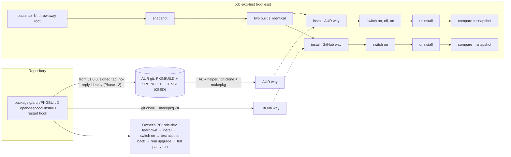

# Phase 11: one PKGBUILD that follows Arch's guidelines, installed from the AUR or from GitHub, as secure as each part allows, that removes everything it brought, proven in a rootless throwaway container; then the full parity run on the owner's PC

**Plan ID:** `phase-11-packaging-final-validation`
**Source PRD:** `docs/prp/prds/opendeepcool-lp360.prd.md` (repository-relative: an absolute path would name the owner's home folder, AGENTS.md rule 10)
**PRD Phase:** `11 — Packaging & final validation`
**Source Issue:** `None`
**Plan Publication:** `None`

> **Changed by the owner on 2026-10-27:** the releases and DeepCreative's deletion move to a new Phase 12, planned when this phase is done (PRD, Phase 12). The alpha and the beta are GitHub pre-releases, each for one month and until every open bug is fixed; `v1.0.0` then comes out on GitHub and, for the first time, on the AUR. This phase ends with the full parity run on the owner's PC, against the installed package.
>
> **Changed by the owner on 2026-11-10, before Task 1** (solution review, "Before Task 1"): the package follows Arch's official guidelines "in terms of security, system design, system philosophy and maintainability", and is made "the most secure possible following Arch guidelines, Linux security best practices, software engineering security best practices". This supersedes the earlier choices to enable the service at install (2026-10-25/26), to remove the dev copy from the package's install script (2026-10-24, OV-02), the Rust pacman-hook program (2026-10-28) and unsigned tags (2026-10-27, P11-06). The tasks were renumbered; the review's "Before Task 1" section maps the old numbers to the new.

## Outcome

**Problem:** After Phases 5–10 OpenDeepCool runs only as the owner's dev copy, installed by scripts under `/etc` and `/usr/local`. Nobody else can install it, nothing proves that uninstalling leaves the system as it was, and the parity checklist has never been run whole against an installed build.

**Affected user:**
- Every Arch user with an LP360, who installs from the AUR or from a GitHub clone.
- The owner, whose PC moves from the dev copy to the package.
- Future maintainers, who need a reproducible, verifiable release.

**User outcome:**
- **Installing:** `yay -S opendeepcool` (or any AUR helper), or `git clone` plus `makepkg -si`, installs OpenDeepCool. Like every Arch package, it turns nothing on by itself (Arch Wiki, systemd: Arch "does not enable most services on installation").
- **Turning it on, once:** the settings app's **Start at boot** switch, which asks for the administrator's password, or two commands the install message prints:
  - `sudo systemctl enable --now opendeepcool.service`, the display service, now and at every boot;
  - `sudo systemctl --global enable opendeepcool-audio.service`, the sound helper for the Music modes, at every user's login.

  From then on the cooler shows the saved mode from boot, until someone turns it off with the switch or `systemctl disable`.
- **Uninstalling:** `pacman -R opendeepcool` removes everything OpenDeepCool installed or created: files, the account and group, enable links, udev access, the CPU power counters' group, saved settings, and an lm-sensors configuration that OpenDeepCool's detection created.
- **The dev copy:** the owner removes it with `odc-dev teardown` before installing the package. The package never touches files it didn't install.
- **The final validation:** the parity checklist runs whole against the package installed on the owner's PC. Phase 12 then releases it in stages and deletes DeepCreative (owner, 2026-10-27).

**Invariant:**
- **A clean round trip:** install, turn on, then uninstall leaves the system exactly as it was, every path, owner, mode, account, group and enable link. Only the documented exceptions remain: a loaded sensor driver until the next boot, the journal, a core dump of an OpenDeepCool program that crashed until systemd cleans it up, pacman's own log and cache.
- **The same package both ways:** the AUR and the GitHub clone build the identical package from the same PKGBUILD, and two builds of the same source are identical (reproducible).
- **Nothing on by itself:** no package file, script or hook enables or starts a unit at install; only the user does, with the switch or the commands.
- **Least privilege everywhere:** each unit keeps only the rights its job needs, pinned by tests; the one new root program does exactly two things, only after the administrator's password, for each change.
- **Root trusts no file the service account can change:** the detection's record lives in its own root-only directory, and `post_remove` reads only its yes/no fields (owner, 2026-10-26).

**Success signal:** The checklist is at 100 % against the installed package, and uninstalling leaves nothing behind (PRD Phase 11).

**Approach:**
- **The package:** one PKGBUILD in `packaging/arch/`, an `.install` file, and one pacman hook:
  - systemd's own pacman hooks create the account and reload systemd, udev and D-Bus;
  - the package ships no enable links and starts nothing; the install message prints the two commands;
  - on upgrade, one hook restarts a running service with Arch's own `systemd-hook restart`, as openssh does;
  - `pre_remove` stops and disables what the user turned on; `post_remove` deletes what the detection's root-only record says it created, resets the CPU power counters, then the state directories and the account.
- **The switch:** a small Rust root program, `opendeepcool-boot`, run through `pkexec` under its own polkit action, which asks for the administrator's password at every change. It takes only `on` or `off`.
- **Hardening:** every unit as tight as its job allows, each one's `systemd-analyze security` score capped by a test; full RELRO, PIE and no executable stack checked by namcap; overflow checks in release builds.
- **The test:** a small Rust program, `odc-pkg-test`. It builds a throwaway Arch root **rootless**, with `pacstrap -N` and `arch-chroot -N` (unshare mode as a regular user), so no password prompt ever interrupts a run. It then:
  1. snapshots the root;
  2. builds twice and requires identical packages;
  3. installs both ways (AUR-style and GitHub-style), turns the units on with the switch's program, then uninstalls;
  4. compares the root with the snapshot.

  Nothing is booted (owner, 2026-10-25: no boot testing).
- **On the owner's PC:**
  1. `odc-dev teardown` removes the dev copy, the owner's saved settings with it;
  2. the package, built from the committed release candidate, is installed, and the owner turns it on with the app's switch;
  3. the owner's test access comes back, with one approved step (owner, 2026-10-27);
  4. a real upgrade restarts the service, and the sound helper moves to its new program by itself;
  5. the full parity run, against the installed package.
- **The releases** (alpha, beta, `v1.0.0`, the signing key, the AUR repository) and DeepCreative's deletion belong to Phase 12 (owner, 2026-10-27).

## Recommendation

**One PKGBUILD, two ways in, one test for both.**
- **The AUR** holds only a PKGBUILD, `.SRCINFO`, the `.install` file and a license, never binaries (AUR submission guidelines, read 2026-10-25 and 2026-11-10).
- **A GitHub clone** carries the same PKGBUILD in `packaging/arch/`, so `makepkg -si` there builds exactly what the AUR builds: the latest published, signed tag, fetched through git (owner, 2026-10-27 and 2026-11-10; solution review P11-17). The AUR gets it from `v1.0.0`; the alpha and the beta are installed this way only (Phase 12).
- **A release candidate,** before its tag exists, is built by the package test from a temporary copy of the PKGBUILD whose source is the local repository at the committed HEAD (`git+file://…#commit=<hash>`). It refuses a tree with uncommitted changes, so no build ever includes them.
- **One shared file:** both install the same `.install` file and package the same files, so a single file list and a single removal logic serve both.
- **The name `opendeepcool`** isn't in the official repositories, as the AUR rules require. Because the package builds from source, it takes no `-bin` suffix (AUR submission guidelines).

**Arch's guidelines decide the design** (owner, 2026-11-10). Read 2026-11-10:
- **Arch Wiki, systemd:** "By default, Arch Linux does not make use of systemd presets, and does not enable most services on installation." Arch ships `/usr/lib/systemd/system-preset/99-default.preset` containing `disable *`, "such that when a new package is installed, the user must manually enable the unit" (that file is on this PC). The links Arch packages ship under `/usr/lib/systemd/system/multi-user.target.wants/` on this PC are only the system's own parts (D-Bus, logind, getty).
- **Arch package guidelines:**
  - "Avoid using `/usr/libexec/` for anything. Use `/usr/lib/$pkgname/` instead";
  - "All important messages should be echoed during install using an .install file. For example, if a package needs extra setup to work, directions should be included";
  - "Sources should be verified using PGP signatures wherever possible";
  - "Do not rely on transitive dependencies"; "List all direct library dependencies"; namcap "will warn you about bad permissions, missing dependencies, redundant dependencies";
  - "Arch is working on making all packages reproducible".
- **Arch developer manual, Security package guidelines:** "If a systemd service file is shipped with the package due to upstream not providing any, look into applying the following systemd service hardening features", checked with `systemd-analyze security`; "Namcap also reports some security issues".
- **Arch developer manual, Rust package guidelines:** `prepare()`, `build()`, `check()` and `package()` as in Task 4.
- **AUR submission guidelines:** "Add a LICENSE file and/or a REUSE.toml file to your repository. You are encouraged to … license your submission under the 0BSD license."
- **pacman(8), "Handling config files"** (this PC): pacman never overwrites a file the administrator changed; it installs the new one as `.pacnew`. Files in `/etc` and `/usr/local` belong to the administrator, and systemd's design lets `/etc` override `/usr/lib` on purpose. So the package never deletes or rewrites what it didn't install, the dev copy included (owner, 2026-11-10). This also removes the solution review's P11-03: a package that deletes "whatever the manifest lists, as root, on every user's PC".

**Let systemd's pacman hooks do the system bookkeeping.** These are present on this PC, systemd's own (read 2026-10-25, 2026-10-26 and 2026-11-10):
- `20-systemd-sysusers.hook` (Install, Upgrade on `usr/lib/sysusers.d/*.conf`) creates `opendeepcool` from the packaged `sysusers.d` file;
- `35-systemd-udev-reload.hook` (Install, Upgrade, Remove on `usr/lib/udev/rules.d/*`) reloads udev and triggers a `change`, so the cooler's access starts and ends at once;
- `30-systemd-daemon-reload-system.hook` and `-user.hook` reload systemd;
- `dbus-reload.hook` (Install, Upgrade, Remove on the D-Bus policy directories) reloads the bus, so the service may own its name.

All of them are `When = PostTransaction`. Because nothing starts at install, the old ordering problem (solution review OV-02: a start in `post_install` would come before the account, the udev rule and the D-Bus policy exist) is gone: by the time a user flips the switch or types the command, every hook has run.

**Upgrades: Arch's own restart, as openssh does.**
- `/usr/share/libalpm/hooks/opendeepcool-restart.hook`: `Type = Package`, `Operation = Upgrade`, `Target = opendeepcool`, `When = PostTransaction`, `Exec = /usr/share/libalpm/scripts/systemd-hook restart opendeepcool.service`.
- That script is the systemd package's, marked "For use by other packages"; `restart` runs `systemctl try-restart`, so only a running service restarts, and it skips its work in a chroot or when the root isn't booted (read on this PC, 2026-11-10). openssh ships the same pattern (`70-openssh-restart-sshd.hook`, on this PC).
- "Hooks are run in alphabetical order of their file name" (alpm-hooks(5)): `opendeepcool-restart.hook` sorts after systemd's numbered hooks and after `dbus-reload.hook`, so the restart sees the new unit, rule and policy.
- **No pacman step reaches into users' sessions** (owner, 2026-11-10). The sound helper moves to its new program by itself instead: when its program file is replaced or removed, it exits with a failure, and its unit's `Restart=on-failure` starts the new one after an upgrade, while after an uninstall there's no unit left to start (Task 4). This was the owner's fallback of 2026-10-27 (solution review P11-05, P11-20); it's now the design.

**The `.install` file keeps only what is specific to this package,** minimal as the Arch dev blog advises ("On scripts and hooks", 2026: "it is probably advisable to minimize the custom code in the scripts as much as possible"):
- **`post_install`:** prints the two commands, that the app's switch does the same, and that the first start runs the sensor detection when the PC has no lm-sensors configuration yet. It enables and starts nothing.
- **`post_upgrade`:** a message only when there's something to say. Upgrades never delete the account or the settings. A later version that renames or removes a unit or a polkit action cleans up the old one here, and the upgrade test covers that path (solution review P11-05).
- **`pre_remove`** (AGENTS.md rule 7: uninstalling removes the enabled units too):
  - `systemctl --global disable opendeepcool-audio.service` and `systemctl disable opendeepcool.service`, which work on the files without a running systemd (spike, 2026-10-25);
  - when systemd is running and this isn't a chroot (the checks `systemd-hook` makes), `systemctl stop opendeepcool.service` first, so no process of the account outlives it.
- **`post_remove`,** files first, then the account, so no file is left owned by a number a later account could be given (solution review P11-11):
  - the detection's record, `/var/lib/opendeepcool-detect/sensors-detect.json`, is read only if it's a regular file owned by root, never a symbolic link (solution review OV-01). From its yes/no fields only:
    - remove `/etc/conf.d/lm_sensors` if `created_conf_d`;
    - remove `/etc/modprobe.d/lm_sensors.conf` if `created_modprobe_d`;
    - disable `lm_sensors.service` unless `lm_sensors_enabled_before`.

    No path is ever taken from the record, and a configuration that existed before is never touched;
  - **the CPU power counters:** for each powercap zone whose `name` starts with `package-`, `energy_uj` gets group `root` back and loses the group's read (found 2026-11-10: the udev rule changes them with `chgrp` and `chmod` through `RUN`, which a udev reload can't undo, so the deleted group's number could read them until a reboot). Skipped in a chroot, which must never touch the host's `/sys`;
  - `rm -rf /var/lib/opendeepcool-detect /var/lib/opendeepcool`;
  - `userdel opendeepcool`, then the group if it's left, because pacman's sysusers hook only creates (Install and Upgrade only, above).

  systemd's hooks then reload systemd, udev (with its trigger) and D-Bus, so the group's device access ends at once.

**The Start at boot switch** (owner, 2026-11-10: "Lots of apps do this, it seems nice"; still the Arch way, because the user chooses).
- **The program:** `/usr/lib/opendeepcool/opendeepcool-boot`, Rust with `std` only and `#![forbid(unsafe_code)]`, from a new crate `odc-boot`.
  - It runs only as root under `pkexec` (`PKEXEC_UID` set), and takes exactly one argument, `on` or `off`; anything else is refused before it does anything.
  - `on`: `systemctl enable opendeepcool.service`, `systemctl --global enable opendeepcool-audio.service`, then `systemctl start opendeepcool.service`. `off`: `systemctl --global disable …`, then `systemctl disable --now opendeepcool.service`.
  - `systemctl` by its full path, `/usr/bin/systemctl`, with an emptied environment; no path, unit name or option ever comes from its caller.
- **The polkit action** `io.github.dtmarangoni.OpenDeepCool1.start-at-boot`, in the package's policy file: `allow_any` and `allow_inactive` `no`, `allow_active` `auth_admin`, the administrator's password at every change, stricter than systemd's own `auth_admin_keep` for its unit actions (read on this PC); `org.freedesktop.policykit.exec.path` names the program, so `pkexec` runs nothing else under it.
- **The app:**
  - it reads the switch's state from systemd over D-Bus (`GetUnitFileState`), which needs no password, so a change made in a terminal shows too;
  - a flip runs `pkexec /usr/lib/opendeepcool/opendeepcool-boot on|off`, then starts or stops the sound helper in the user's own session through the user's service manager, which needs no password;
  - with no polkit agent in the session, or a refused password, the switch goes back and the app shows the two commands;
  - the service-not-running banner shows `sudo systemctl enable --now opendeepcool.service` in place of today's `start`.
- **Its look** comes from the `ui-ux-designer` agent first, then the design document and the mockups, then the code (CLAUDE.md; owner, 2026-11-06: UI details delegated).

**The throwaway system is rootless, so the test stays unattended.**
- **Spike, 2026-10-25,** on this PC (arch-install-scripts 31, unprivileged user namespaces on, subordinate ID ranges for the owner's account):
  - `pacstrap -N -c` built a base Arch root in 6 s from the host's package cache (593 MB);
  - `arch-chroot -N` ran commands as root inside, with no prompt;
  - `systemd-sysusers` created a `u!` account; `systemctl enable` and `systemctl --global enable` created the links and `disable` removed them; `userdel` removed the account and group; a normal build user ran commands;
  - the root was deleted afterwards. Throwaway code only.
- **Two errors in the spike, both harmless:**
  - `-K` (an empty keyring) failed because the GPG agent can't start in unshare mode, so the test copies the host's keyring (pacstrap's default);
  - the initramfs hook had no kernel to work on.
- **Why not `systemd-nspawn`:** it needs root, so a password prompt on every run (AGENTS.md rule 3).

**The parity run uses the installed package itself.**
- The packaged binary is the same one the dev copy ran. Its `--dev` switch only turns on the dev interface and the recording (Phase 7).
- For the final run, a **runtime** drop-in in `/run/systemd/system/opendeepcool.service.d/odc-e2e.conf` adds `--dev` for the duration. The product keeps `UMask=0077` and `StateDirectoryMode=0700` (Phase 7; solution review P7-09), so the drop-in relaxes them as the dev drop-in does, so the tests can read the recording. `/run` is gone at the next boot, and the run removes it at the end anyway.
- Creating it is the run's one privileged step, approved by the owner with `pkexec` (rule 7). Everything after it is unattended.
- **The tests' access** (owner, 2026-10-27):
  - the dev interface checks that the caller is in group `opendeepcool`, and the tests read the recording through that group (Phase 7);
  - the reconnect test needs the dev reconnect rule (Phase 5);
  - the teardown before the install removes all of that with the dev copy, so Task 7 puts it back: the owner's account in the package's group and the reconnect rule, recorded in the dev manifest.

### Evidence

- PRD:
  - Phase 11 (scope, tests) and Phase 12 (the releases, the last step of v1);
  - System Footprint (the finished app's table, "Removed by", and the dev rows);
  - Technical Approach → Packaging;
  - Decisions Log (Distribution, Service at install, Packaging guidelines, Release source, Boot testing, Uninstall).
- Arch Wiki and developer manual, read 2026-10-25 and again 2026-11-10:
  - **Arch User Repository:** moving to `extra` needs popularity, "at least 10 votes", and "a package maintainer willing to maintain the package";
  - **AUR submission guidelines:** no binaries; not already in the official repositories; `-bin` for prebuilt; commits authored with the global git identity, so set it per repository; a license file, 0BSD encouraged; a `# Maintainer:` line;
  - **Arch package guidelines:** "never" install to `/usr/local/`; `/usr/lib/$pkgname/` instead of `/usr/libexec/`; important messages and setup directions through an `.install` file; PGP-verified sources; direct dependencies; reproducible builds;
  - **Security package guidelines:** systemd hardening and `systemd-analyze security`; namcap's security checks;
  - **Rust package guidelines:** `cargo fetch --locked --target host-tuple` in `prepare()`; `cargo build --frozen --release --all-features`; `cargo test --frozen --all-features`, with `--workspace` in a workspace and without `--release`; `libgcc` and `glibc` "typically dependencies";
  - **systemd:** "does not enable most services on installation"; `99-default.preset`'s `disable *`.
- Arch Linux dev blog, "On scripts and hooks" (2026-08-09), read 2026-10-26: `post_install` runs before the post-transaction hooks; minimise custom code in install scripts.
- On this PC, 2026-11-10:
  - `/usr/share/libalpm/scripts/systemd-hook` (`restart` → `systemctl try-restart`, "For use by other packages"; skips in a chroot or when not booted) and openssh's `10-openssh-mark-sshd-for-restart.hook` and `70-openssh-restart-sshd.hook`;
  - `/usr/lib/systemd/system-preset/99-default.preset`: `disable *`;
  - systemd's polkit actions `manage-unit-files` and `manage-units`: `allow_active` `auth_admin_keep`;
  - PKGBUILD(5): `validpgpkeys` ("makepkg will only accept signatures from the keys listed here"; full uppercase fingerprints) and the `?signed` source query, "currently only supported by Git";
  - pacman(8), "Handling config files";
  - namcap 3.6.0's rules: `elfgnurelro` (full RELRO), `elfnopie`, `elfexecstack`, `elftextrel`, `elfnoshstk` (shadow stack), `rpath`, `runpath`, `elfpaths`, `sodepends`;
  - `/etc/makepkg.conf.d/rust.conf`: `RUSTFLAGS="-C force-frame-pointers=yes"`;
  - `systemd-analyze security --offline=true` on the four units: the display service 0.5 "SAFE", the GPU helper 5.5 "MEDIUM", the detection 9.4 "UNSAFE", the sound helper 7.9 "EXPOSED";
  - `/usr/share/libalpm/hooks/` holds no hook of any other package that enables a unit.
- alpm-hooks(5), read 2026-10-26: "Hooks are run in alphabetical order of their file name, where the ordering ignores the suffix."
- Read 2026-10-27, at the solution review's cross-check:
  - systemd.resource-control(5): `DeviceAllow=` takes a `char-<group>` name from `/proc/devices`, and groups that don't resolve when the unit starts "are not added";
  - makepkg's own code (`/usr/share/makepkg/source/git.sh`): the checksum of a `#tag=` or `#commit=` git source is taken over `git archive --format tar`;
  - GitHub Docs, "Downloading source code archives": the compression of generated archives may change, and "GitHub will give at least six months' notice";
  - `vercmp` on this PC: `1.0.0alpha.2` < `1.0.0alpha.10` < `1.0.0beta.1` < `1.0.0`, while `1.0.0.alpha.1` and `1.0.0_alpha.1` sort after `1.0.0`;
  - Arch's file list of `nvidia-utils`: it ships `libnvidia-ml.so` and `libcuda.so`;
  - systemd's tmpfiles rule for `/var/lib/systemd/coredump`: core dumps are removed after two weeks.
- This PC, 2026-10-25: `pacstrap -N` and `arch-chroot -N` in their `-h` output; the spike; `/proc/sys/kernel/unprivileged_userns_clone` = 1, and subordinate ID ranges present.
- Plans:
  - Phase 5 Task 8: dev tool and manifest;
  - Phase 6 Tasks 6–7: the powercap udev line, the detection unit and `sensors-detect.json`, and `created` lists;
  - Phase 7 Task 8: the unit, sandbox, D-Bus and polkit files, and NVIDIA device nodes deferred to here;
  - Phase 9 Task 4: the audio helper's user unit;
  - Phase 10: the settings app, its design, and Task 9's desktop entry and icon.

### Alternatives considered

- **The official repositories directly:** not possible. A Package Maintainer has to adopt the package (Arch Wiki).
- **A GitHub release with a prebuilt package, or an install script without pacman:** the owner chose clone plus `makepkg` (2026-10-25). One build path means one test.
- **`systemd-nspawn` or a VM for the throwaway system:** both need root or a hypervisor setup. The rootless unshare root does the job unattended.
- **Enabling at install, by links the package ships** (the owner's choice of 2026-10-25/26): against Arch's convention, and `systemctl is-enabled` then calls the unit "disabled", as it does any unit enabled only by a link under `/usr/lib` (checked in a scratch root and with an Arch timer linked that way, 2026-11-10). Superseded on 2026-11-10.
- **The package removing the dev copy from its manifest** (2026-10-24, OV-02): a root deletion driven by a file on every user's PC (P11-03), for a copy that exists on one. Superseded on 2026-11-10.
- **Restarting each user's sound helper from a pacman hook** (`systemctl --user --machine=<user>@.host`, 2026-10-27): reaches into users' sessions, which no Arch package does. Superseded on 2026-11-10 by the helper following its own program file.
- **The switch through systemd's D-Bus API** (`EnableUnitFiles`, no program of ours): systemd has no D-Bus call for `--global`, which `systemctl` does on the files itself, so the sound helper would still need root code, and two polkit actions would mean two password prompts. *Unverified:* that `--global` never goes through the manager; Task 3 checks it before building the program.
- **The switch enabling the sound helper for the current user only** (`systemctl --user enable`, no password): the link lands in the user's home folder, which no package script may touch, so the uninstall couldn't remove it (rule 7).
- **Signing with an SSH key:** git can, but makepkg checks `?signed` sources with GnuPG and `validpgpkeys`; an SSH key needs custom code in the PKGBUILD (Arch package guidelines). A PGP key is makepkg's own path.
- **`makerepropkg` (devtools) for the reproducibility check:** Arch's own tool, but it builds through `arch-nspawn`, which needs root. Two rootless builds in the throwaway root compare the same thing unattended.

## Visuals

## Implementation Context

### Mandatory reading

| File | Why it matters |
|---|---|
| PRD System Footprint, Phase 11, Decisions Log | Every item the package installs or creates, and how each is removed |
| `odc-dev` (`tools/dev/`) and `odc-manifest` (Phase 5 Task 8) | The dev copy the teardown removes before the package, and the test access Task 7 adds back |
| `packaging/` (Phases 5–10) | Every file the package ships: unit files, sysusers, udev, D-Bus and polkit policy, user unit, desktop entry, icon |
| Phase 6 plan Tasks 6–7 | What the detection unit creates and records |
| `docs/design/settings-app.md` and `crates/odc-app/` | Where the switch goes, and the banner's command |
| Arch Wiki and developer manual: Arch package guidelines, Security and Rust package guidelines, AUR submission guidelines, PKGBUILD, `.install` scriptlets | The packaging rules the package follows |

### Existing patterns and primitives

- **The dev manifest** (Phase 5 Task 8): `odc-dev teardown` removes exactly what it lists, and resets the cooler's USB switch and the power counters. The package carries none of it.
- **`created` records** (Phase 6 Task 7, `sensors-detect.json`): what the detection made, so removal touches only that.
- **A `std`-only root one-shot with refusal tests:** `odc-sensors-detect` (Phase 6), the model for `odc-boot`.
- **Unit-file tests:** each crate's tests that read its unit (`crates/odc-gpu-rank/tests/unit_file.rs`, `crates/odc-audio/tests/unit.rs`, `crates/odc-sensors-detect/tests/detect.rs`, `crates/odc-service/tests/packaging.rs`).
- **`odc-e2e` areas and capabilities:** this phase adds `--only package` and the `container` capability.

### Integration points

- `packaging/arch/`: CREATE, the PKGBUILD, the `.install` file, the restart hook and the AUR copy's 0BSD `LICENSE`.
- `packaging/systemd/*.service`, `packaging/systemd-user/opendeepcool-audio.service`: UPDATE, the paths, the hardening, NVIDIA device access.
- `packaging/polkit/`: UPDATE, the `start-at-boot` action.
- `crates/odc-boot/`: CREATE, the switch's root program.
- `crates/odc-app/`, `crates/odc-ui-e2e/`, `docs/design/`: UPDATE, the switch and the banner's command.
- `crates/odc-audio/`: UPDATE, it exits when its program file is replaced or removed.
- `Cargo.toml`: UPDATE, `overflow-checks` in the release profile.
- `tools/dev/` (`odc-dev`'s `setup` and `install-root`): UPDATE, the `--test-access` mode (Task 7).
- `crates/odc-e2e/`, `crates/odc-testkit/`: UPDATE, the package's paths and the `container` capability.
- `README.md` "Installed on your system", install, turn-on and uninstall sections.

## Scope

### In scope

- The PKGBUILD (built as Arch's Rust package guidelines say), the `.install` file, the restart hook, and the final file paths from the footprint.
- Every unit hardened as far as its job allows; overflow checks in release builds; namcap's binary checks.
- The Start at boot switch: its design, its root program, its polkit action, the app.
- NVIDIA device access in the unit, from NVIDIA's documentation (Phase 7 deferred it here).
- `odc-pkg-test`: the rootless container, the snapshot, the reproducibility check, both install ways, the switch's program, uninstall, the comparison; the signed-tag check with a throwaway key.
- Install, turn-on and uninstall documentation; the README footprint.
- The owner's PC on the package, with its test access back and a real upgrade.
- The full parity run against the installed package; the Phase 11 report with the checklist at 100 %.

### Not building

- **The releases** (alpha, beta, `v1.0.0`), the owner's signing key, the AUR repository and DeepCreative's deletion: Phase 12 (owner, 2026-10-27).
- **Enabling or starting anything at install,** and any pacman step that reaches into users' sessions (owner, 2026-11-10).
- **Boot tests** of any kind (owner, 2026-10-25).
- **Official-repository submission** (not possible directly), prebuilt release packages, a non-pacman installer.
- **Other distributions:** Arch only (PRD).

## Delivery Considerations

| Concern | Decision and owned work |
|---|---|
| Compatibility / migration | The owner runs `odc-dev teardown` before the install; it deletes the dev copy's saved settings with the rest, and the owner chooses them again in the app (owner, 2026-11-10). The detection's record in `/var/lib/opendeepcool-detect/` isn't in the dev manifest, so it stays, and the package takes it over |
| Rollout / reversibility | `pacman -R` undoes the install completely (the test proves it); `odc-dev setup` can bring the dev copy back after it |
| Observability | The install message prints the commands; the switch shows the real state; the journal shows the service from its first start; `pacman -Ql opendeepcool` lists every file |
| Security | Least privilege per unit, capped by tests; one root program with two fixed actions, behind the administrator's password; signed tags; reproducible builds; namcap's binary checks; `cargo deny` and hash-pinned actions in CI (Phase 5) |
| Documentation / communication | README: install from GitHub, and from the AUR once `v1.0.0` is there; turning it on; uninstall; "Installed on your system", checked against `FILES.md` by a Rust test; the AUR page's description, ready for Phase 12. Release notes come with Phase 12's releases |

## Implementation

Each task ends with its own commit (rule 4) after its tests pass; a task with several implementations makes one commit for each.

### 1. The final file list and paths, with NVIDIA access settled

**Files and integration points**
- `packaging/FILES.md`: CREATE. Every path the package installs, its owner and mode, plus every item it creates at install or run time, or when the user turns it on, and what removes it. This is the System Footprint table made exact.
- `packaging/systemd/*.service`, `packaging/systemd-user/opendeepcool-audio.service`: UPDATE, `ExecStart=` under `/usr/lib/opendeepcool/`, and NVIDIA device access in the service's unit.
- The four tests that pin `/usr/bin/` today: `crates/odc-gpu-rank/tests/unit_file.rs`, `crates/odc-audio/tests/unit.rs` (`EXEC`), `crates/odc-sensors-detect/tests/detect.rs`, `crates/odc-service/tests/packaging.rs`: UPDATE.
- `docs/prp/prds/opendeepcool-lp360.prd.md` System Footprint: UPDATE from `FILES.md` (no more "proposed").

**Implementation**
- **Paths:**
  - `/usr/bin/opendeepcool`, the settings app, the only program for users to run;
  - `/usr/lib/opendeepcool/`: `opendeepcoold`, `opendeepcool-audio`, `odc-gpu-rank`, `odc-sensors-detect` and `opendeepcool-boot`, off `PATH`, as the Arch package guidelines say for programs that aren't for users ("Use `/usr/lib/$pkgname/`");
  - units in `/usr/lib/systemd/{system,user}`, and no enable links;
  - `sysusers.d`, `udev/rules.d`, `/usr/share/dbus-1/system.d`, `/usr/share/polkit-1/actions`, `/usr/share/applications`, `/usr/share/icons/hicolor/scalable/apps`, `/usr/share/licenses/opendeepcool/LICENSE`;
  - the pacman hook `/usr/share/libalpm/hooks/opendeepcool-restart.hook`;
  - created when the user turns it on: `/etc/systemd/system/multi-user.target.wants/opendeepcool.service` and `/etc/systemd/user/default.target.wants/opendeepcool-audio.service`, removed by `pre_remove`;
  - created at run time: `/var/lib/opendeepcool` (the service's state directory) and `/var/lib/opendeepcool-detect` (root, 0700, the detection's), both removed by `post_remove`;
  - nothing in `/usr/local` (Arch package guidelines), and nothing in `/etc` from the package itself.
- The dev copy's drop-ins set `ExecStart=` themselves, so the dev copy keeps working until the teardown.
- **NVIDIA:** from NVIDIA's documentation for the device files NVML opens (`/dev/nvidiactl`, `/dev/nvidia<N>`), the unit adds `DeviceAllow=` entries.
  - They use the `char-<group>` form, with the group names NVIDIA's driver registers in `/proc/devices`, taken from NVIDIA's documentation. systemd.resource-control(5) documents the form (read 2026-10-27; solution review P11-13): groups that don't resolve when the unit starts "are not added", so the entries are safe on a PC without NVIDIA's driver. They cover only a driver loaded before the service starts.
  - Unverified on hardware (see `docs/local/`). Phase 6's fake trees and NVML fakes cover the reading. The report and the README say NVIDIA support is untested.
  - NVML inside the service's sandbox is untested too: `MemoryDenyWriteExecute=yes` or `SystemCallFilter=@system-service` may refuse something it does (solution review P6-06, OV-15). The unit always sets `SystemCallErrorNumber=EPERM` (Phase 7), so a refused call fails instead of killing the service, and a library that can't be loaded or started gives its own message (Phase 6) (owner, 2026-10-27; overview review's cross-check).

**Validation**
- `systemd-analyze verify packaging/systemd/*.service` passes; every path in `FILES.md` exists in `packaging/` or is a build output; the unit-file tests pass with the new paths.

### 2. Every unit and every binary as tight as its job allows

The owner asked for "the most secure possible" (2026-11-10). One commit per unit, and one for the release profile.

**Files and integration points**
- `packaging/systemd/opendeepcool-gpu-rank.service`, `opendeepcool-sensors-detect.service`, `packaging/systemd-user/opendeepcool-audio.service`, and `opendeepcool.service` where something is still open: UPDATE.
- Each crate's unit-file test: UPDATE, every hardening option pinned, and `systemd-analyze security --offline=true` under a ceiling for that unit (`--threshold=`, if this systemd has it; checked first).
- `Cargo.toml` `[profile.release]`: `overflow-checks = true`, so an arithmetic overflow stops the program (`panic = "abort"`, Phase 7) instead of wrapping silently, as the tests already run.

**Implementation**
- **Each option is kept only where the program's job needs its right; each one left open is written in the unit with its reason.** Starting points, all from systemd.exec(5) and the Security package guidelines, each checked against what the program does:
  - **the GPU helper** (the service's account): `PrivateTmp`, `ProtectKernelTunables`, `ProtectKernelModules`, `ProtectKernelLogs`, `ProtectControlGroups`, `ProtectClock`, `ProtectHostname`, `ProtectProc=invisible`, `RestrictAddressFamilies=` as narrow as NVML allows, `RestrictNamespaces`, `RestrictRealtime`, `RestrictSUIDSGID`, `LockPersonality`, `SystemCallArchitectures=native`, `SystemCallFilter=@system-service` with `SystemCallErrorNumber=EPERM`, `IPAddressDeny=any`, `UMask=0077`, `RemoveIPC`; `MemoryDenyWriteExecute` only if NVML is known to work with it (P6-06), otherwise left open with the reason;
  - **the detection** (root; it runs lm-sensors' `sensors-detect`, which loads drivers, reads the board's identity and probes its sensor buses, writes `/etc/conf.d/lm_sensors` or `/etc/modprobe.d/lm_sensors.conf`, and enables `lm_sensors.service`): `CapabilityBoundingSet=` only what those need, `ProtectSystem=strict` with `ReadWritePaths=` for exactly those folders and systemd's unit folder, `ProtectHome`, `PrivateTmp`, `PrivateNetwork`, `NoNewPrivileges`, `DevicePolicy=closed` with `DeviceAllow=` for exactly the device files it opens, `RestrictAddressFamilies=AF_UNIX`, and the rest of the list above where `sensors-detect` allows. What `sensors-detect --auto` touches is read from its source first (rule 1);
  - **the sound helper** (each user's): what a user manager allows (systemd.exec(5): sandboxing there implies `PrivateUsers=`), checked against `pw-record`, the system bus and the user's PipeWire socket;
  - **the display service**: already 0.5 "SAFE"; anything still open is checked, and the offline check's `UMask=` line explained (it reported "group-readable" although the unit sets `UMask=0077`).
- **Proven as far as this PC allows:**
  - the GPU helper and the sound helper in their new sandboxes run on the owner's PC in Task 7 (the first start ranks the GPUs, because the teardown deleted the ranking) and in Task 9's music area;
  - the detection runs only on a PC with no lm-sensors configuration and no fan reading, and the owner's PC has both since 2026-10-29, so its sandbox is proven by the static checks and its score. The report says so.

**Tests**
- Each unit's options pinned; each score under its ceiling; `systemd-analyze verify` passes.
- After the release-profile change, the workspace's tests and `--only service` pass, and Task 9's baseline is compared with Phase 10's (0.53 % of one core).

**Validation**
- `systemd-analyze security --offline=true` prints each unit under its ceiling; the scores go into the report.

**As built** (2026-11-10):
- Scores, before → after: the display service 0.5 → 0.4 (`PrivateUsers=yes`, the one setting left open that its job allows); the GPU helper 5.5 → 0.4; the detection 9.4 → 1.7; the sound helper 7.9 → 0.6.
- The tests read the level `systemd-analyze security --offline=true` prints, for a copy of the unit under a name no drop-in matches (`odc_testkit::units`). On this PC the dev copy's drop-in (`UMask=0027`) had made the service's `UMask=` line fail; scored alone, it passes. `--threshold=` exists, but counts in tenths.
- The GPU helper's NVIDIA wildcard became `nvidiactl`, `nvidia` and `nvidia-uvm`: NVIDIA's container library gives "compute" programs, CUDA's, UVM's devices besides the GPUs' (libnvidia-container, `nvc_mount.c`, read 2026-11-10).
- The detection needs `i2c-dev` and `cpuid`, which register their device groups only once loaded, and systemd allows only groups that exist when a unit starts. A new one-shot, `opendeepcool-sensors-detect-modules.service`, loads both just before it, under its conditions (score 1.3). `modprobe@` units weren't used: a unit's `Wants=` are started even when its conditions skip it, so they would load at every boot.
- The detection's and the helper's system calls are `@system-service`, without `@privileged` and `@resources`, with `@module` back. The sound helper keeps `@resources`, because PipeWire's client may change its threads' priority.
- Checked on the owner's PC after `odc-dev setup` (owner's OK), 2026-11-10:
  - the service and the sound helper run with `PrivateUsers=yes` and no restarts;
  - `--only service --require dev-service` passed its 144 checks (timing mean 100.000 ms), and during its Music modes the owner's sandboxed helper captured and the service attached its sound (journal);
  - `--only music --require dev-service,pipewire` passed on its third run (delay median 49.7 ms, p95 95.0 ms). The first two runs each failed one check, differently. First "the capture stream isn't at 100 %", read perhaps before WirePlumber had set it. Then a frame 357 ms into the tone showed the tone's start, against the check's 300 ms margin with delays up to 124 ms. The check runs its own helper outside the unit, so the sandbox isn't involved.
- **The music check, fixed** (owner, 2026-11-11: fix its margins, then run it several times in a row, before Task 3):
  - **Why the tone's start showed:** the tone starts with a click. Played in process through the spectrum at 600 points of the 100 ms tick, the click falls inside an analysed window at 143 of them and lifts peak dots in nearby columns, which then fall at the default "slow" rate. Frames stay off the steady rows for up to 1,027 ms after the tone's first sample, so run 2's frame at 357 ms was one of those.
  - **The margin, derived:** a click may set a dot anywhere up to the top (levels stop at 1), and at the default peak fall a dot at the top reaches the floor in 15 ticks (`music.md` point 6; the test `a_dot_at_the_top_falls_to_the_floor_in_fall_ticks`). With 300 ms for a frame to show a sample (twice the delay target), frames are compared from 1.8 s after the tone's start and after its end, the margin its end already had. The tone lasts 4 s instead of 2 s, so 22 frames are still compared.
  - **The volume:** the check waits until the capture stream reads 100 % (3 s at most), names the volume it read when it doesn't, and reads it again after the tone, so a volume restored late can't pass. Why run 1 read it below 100 % is unverified.
  - Then 5 runs in a row passed, 2026-11-11, all real (no setup needed: only `odc-e2e` changed): the capture compared 22 frames during the tone each time, and the delay's median was 48.3–50.1 ms, its 95th percentile 93.2–95.2 ms and its maximum 102.4–135.9 ms. Each run set everything back: no null sink left, the owner's helper running, WirePlumber's saved `pw-record` volume 1.0.

### 3. The Start at boot switch

Three commits: the design, the program with its polkit action, the app.

**Files and integration points**
- `docs/design/settings-app.md`, `tools/mockups/src/lib.rs`, `docs/design/mockups/`: UPDATE, from the `ui-ux-designer` agent's design (CLAUDE.md): where the switch sits, its states (off, on, changing, refused, no polkit agent), and the service-not-running banner, whose command becomes `sudo systemctl enable --now opendeepcool.service`.
- `crates/odc-boot/` (binary `opendeepcool-boot`): CREATE, `std` only, `#![forbid(unsafe_code)]` (Recommendation).
- `packaging/polkit/io.github.dtmarangoni.OpenDeepCool1.policy`: UPDATE, the `start-at-boot` action.
- `crates/odc-app/`: UPDATE, the switch, the state read from systemd, the flip through `pkexec`, the helper in the user's session, the banner's command.
- `crates/odc-ui-e2e/`, `crates/odc-testkit/` (the fake service and private buses): UPDATE, a fake systemd on the private system bus and a fake program in place of `pkexec`, chosen by a test-only app flag (flags, never environment variables; owner, 2026-10-24).
- `docs/prp/solution-reviews/project-overview.review.md`, the entry-points table: UPDATE, the new entry point and what it refuses (AGENTS.md rule 5).

**Implementation**
- First, check that `systemctl --global enable` works on the files without asking the manager, the reason for a program of our own (Alternatives); if systemd has a D-Bus call for it after all, stop and bring the simpler design back to the owner (rule 2).
- The program refuses, before doing anything: not root; no `PKEXEC_UID`; no argument, two arguments, or one other than `on` or `off`. Every refusal names its cause and exits non-zero.
- It never takes a path, a unit or an option from its caller, and runs `/usr/bin/systemctl` with an emptied environment. A failed step stops it, and it reports which step failed.
- In a chroot or without a running systemd it enables or disables only (the links), and starts or stops nothing, like `systemd-hook`. The package test uses that (Task 5).

**Tests**
- The program's refusals, each one; the commands it would run for `on` and `off`, through a fake `systemctl` (a Rust test program, rule 13).
- The policy file: the action, its `exec.path` annotation equal to the installed path, `allow_active` `auth_admin`, `allow_any` and `allow_inactive` `no`; the other three actions unchanged.
- The app, through AT-SPI in the headless weston (Phase 10): the switch shows the fake systemd's state; a flip runs the fake `pkexec` with exactly the program's path and `on` or `off`; a refusal sets the switch back and shows the commands; the banner shows `enable --now`.

**Validation**
- `cargo test -p odc-boot`, `cargo test -p odc-app --features weston-tests`, `cargo run -p odc-e2e -- --only app --require weston` pass; `cargo run -p odc-mockups -- docs/design/mockups` changes nothing after the design commit.

### 4. The PKGBUILD, the `.install` file and the restart hook

**Files and integration points**
- `packaging/arch/PKGBUILD`: CREATE.
  - `# Maintainer:` the project's GitHub handle and its no-reply address, never the owner's name (AUR submission guidelines; rule 10);
  - `pkgname=opendeepcool`, `arch=(x86_64)`, `license=(MIT)`;
  - `pkgver` is the release's version without its hyphen: `1.0.0-alpha.1` is written `1.0.0alpha.1`, because pacman forbids hyphens. `vercmp` then orders `alpha.2` < `alpha.10` < `beta.1` < `1.0.0` (checked 2026-10-27); a dot or an underscore before `alpha` would sort after `1.0.0`;
  - `depends=` every library the binaries link directly, found with namcap's `sodepends` and `ldd`, `gcc-libs` and `glibc` among them, plus the programs they run: `hwdata`, `lm_sensors`, `pipewire-audio`, `polkit`, `dbus`, `systemd` (Arch package guidelines: "Do not rely on transitive dependencies"). `makedepends=(cargo git)`; `optdepends=('nvidia-utils: GPU readings and GPU kind on NVIDIA cards')`, the package that ships NVML and CUDA (solution review P11-12);
  - `source=` the published tag through git, `git+<repository URL>?signed#tag=v<version>`, with `validpgpkeys=` the owner's key's full fingerprint, and the `sha256sums` makepkg computes over the tag's files (`git archive`).
    - GitHub's generated archive isn't used: GitHub may change its compression, with six months' notice (solution review P11-06, P11-17).
    - The key, the fingerprint and the checksum come with Phase 12's first tag; the checksum can't be part of the tag it describes, so the PKGBUILD that carries it is committed after the tag (Phase 12). Until then the PKGBUILD's source line is the template, and the candidate's temporary copy is what's built;
  - the functions follow Arch's Rust package guidelines (solution review P11-07, P11-21), each with `RUSTUP_TOOLCHAIN=stable` and `CARGO_TARGET_DIR=target`:
    - `prepare()`: `cargo fetch --locked --target host-tuple`;
    - `build()`: `cargo build --frozen --release`, with `-p` for exactly the six crates whose binaries ship (`odc-service`, `odc-app`, `odc-audio`, `odc-gpu-rank`, `odc-sensors-detect`, `odc-boot`), so no test-only crate is compiled on a user's PC;
    - `check()`: `cargo test --frozen --workspace --exclude odc-e2e --exclude odc-ui-e2e --exclude odc-pkg-test`, the tests that need no hardware and no display, without `--release`, as the guidelines advise;
    - neither uses the guidelines' `--all-features`, which would switch on the weston tests (solution review P4-05, P10-04, P11-08);
    - `package()` installs `FILES.md`'s list with `install -Dm`, and the license;
  - `install=opendeepcool.install`;
  - no `pkgver()`: a release candidate is built from a temporary copy (Recommendation).
- `packaging/arch/opendeepcool.install`: CREATE, with `post_install`, `post_upgrade`, `pre_remove` and `post_remove` as in the Recommendation.
- `packaging/arch/hooks/opendeepcool-restart.hook`: CREATE, as in the Recommendation.
- `packaging/arch/LICENSE`: CREATE, the 0BSD text Arch publishes for package sources, for the AUR repository's files (AUR submission guidelines; owner, 2026-11-10: follow Arch's guidelines). The program stays MIT.
- `packaging/arch/.SRCINFO`: CREATE, generated by `makepkg --printsrcinfo`; a test checks it's current.
- `crates/odc-audio/`: UPDATE, its own commit: the helper exits with a failure when its program file is replaced or removed, so `Restart=on-failure` starts the new one after an upgrade and nothing after an uninstall (Recommendation). How it notices, without polling (Phase 9: it waits for events), is checked first: an inotify watch on `/usr/lib/opendeepcool/` for its own name (*unverified* until then).

**Implementation**
- **namcap on the PKGBUILD and the built package: no errors.** Its binary checks must all pass: full RELRO, PIE, no executable stack, no text relocations, no RPATH or RUNPATH. Each warning is explained in the report. A shadow-stack warning (`elfnoshstk`) is expected, because stable Rust can't build shadow-stack support yet (*unverified* until namcap runs); it's recorded as a known gap.
- **The scriptlets enable and start nothing:** a static check fails on `systemctl enable` or `start` in any of them, and allows `disable` and `stop` only in `pre_remove`.
- **shellcheck** on the `.install` file, and on the PKGBUILD with makepkg's variables declared, locally and in CI.

**Tests**
- `makepkg -f` in a clean clone builds the package; `namcap` runs on both.
- Static checks:
  - the restart hook's file name sorts after `dbus-reload.hook` and systemd's numbered hooks, and it runs `systemd-hook restart opendeepcool.service`;
  - no enable link anywhere in the package;
  - `build()`'s `-p` list names exactly the crates whose binaries `package()` installs;
  - the workspace's `rust-version` is at or below the version of Arch's `rust` package (`pacman -Si rust`), so AUR users can build it. It runs in CI's Arch container (solution review P11-07; `1.99` and `1:1.99.1` on 2026-11-10).
- `.SRCINFO` matches `makepkg --printsrcinfo`.
- The sound helper: replacing and removing its program file in a test folder makes it exit with a failure; `--only music` passes after `odc-dev setup` (owner's OK).

**Validation**
- `cd packaging/arch && makepkg -f && namcap PKGBUILD *.pkg.tar.zst`: builds and reports no errors.

### 5. `odc-pkg-test`: build twice, install and uninstall both ways, in a rootless throwaway root

**Files and integration points**
- `crates/odc-pkg-test/`: CREATE, a binary run by `odc-e2e --only package`.
- `crates/odc-testkit/src/hardware.rs`: UPDATE, capability `container`. It is Real when `pacstrap` and `arch-chroot` with `-N` work for this user: unprivileged user namespaces on, subordinate IDs present.

**Implementation**
- **Build:**
  - `pacstrap -N -c <tmp>/root base base-devel git`, plus the package's runtime dependencies, so the comparison later sees only OpenDeepCool's own changes (solution review P11-10). It uses the host's cache, and copies the host's keyring, since `-K` fails rootless (spike);
  - the root bind-mounted on itself inside the namespace, because `arch-chroot` warns when the root isn't a mount point (spike);
  - a build user created inside.
- **Snapshot:** every path under the root, with its type, mode, owner, group, size, link target and a SHA-256 of regular files, plus `getent passwd`, `group`, `shadow` and `gshadow`, and `find /etc/systemd -type l`.
- **Reproducible:** the candidate is built twice, in the same folder of the root, with `SOURCE_DATE_EPOCH` set to the commit's time, and the two packages must be identical byte for byte. If they differ, the test prints which files differ and how; a difference that can't be removed is recorded with its cause in the report.
- **Signed tags:** in a local repository inside the root, a throwaway key made for the test signs a tag, and a copy of the PKGBUILD with `?signed` and that key's fingerprint must build it; the same build must refuse an unsigned tag and a tag signed by another throwaway key. The owner's key isn't needed until Phase 12.
- **The AUR way:**
  - before publication, from a local bare git repository holding exactly the files the AUR will hold (`PKGBUILD`, `.SRCINFO`, `opendeepcool.install`, `LICENSE`), its PKGBUILD pointed at the candidate in the same way as the GitHub way's;
  - after publication (Phase 12, from `v1.0.0`), from `https://aur.archlinux.org/opendeepcool.git`;
  - in both cases: `git clone`, then `makepkg -si --noconfirm` as the build user.
- **The GitHub way:**
  - before a tag exists, the release candidate: the temporary copy of the PKGBUILD pinned to the committed HEAD (Recommendation); a tree with uncommitted changes is refused;
  - from Phase 12's first tag, a clone of `main`, whose PKGBUILD builds the latest published tag;
  - `makepkg -si --noconfirm` in `packaging/arch/`.
- **After each install:**
  - every path of `FILES.md` exists with its owner and mode;
  - `getent passwd opendeepcool` is a locked, no-login system account;
  - nothing is enabled: no link under `/etc/systemd` or `/usr/lib/systemd/*/*.wants` names an OpenDeepCool unit;
  - the install message was printed, with both commands;
  - the installed rank helper unit has `StateDirectory=opendeepcool`, so its first run works on a fresh system, and both helper units have `TimeoutStartSec=` (unit inspection, since nothing boots here; solution review P6-03, P6-14).
- **The switch's program, inside the root:** `opendeepcool-boot on` run as root with `PKEXEC_UID` set creates exactly the two enable links and starts nothing (no systemd runs here); `off` removes them; `on` again before the uninstall, so the uninstall must remove them. Run without `PKEXEC_UID`, or with another argument, it refuses and changes nothing.
- **Uninstall:** `pacman -R --noconfirm opendeepcool`.
- **Then the root must equal the snapshot.** The only allowed differences are a fixed, commented list:
  - `/var/log/pacman.log`;
  - pacman's cache and sync database;
  - the build user's home and the build directory, which are removed and checked;
  - the `-` backup files `passwd-`, `group-`, `shadow-` and `gshadow-`, whose content must equal the snapshot's originals;
  - the packages makepkg installed as build dependencies, which are removed with `pacman -Rns` and checked;
  - caches that pacman's hooks rebuild, such as the icon theme cache and the desktop database: compared by content after both runs rebuilt them, and one that still differs is listed with its reason (solution review P11-10).
  - Any other difference fails with a diff.
- **Upgrade check** (solution review P11-05): install the previous published version, then the candidate; before Phase 12's first tag, the candidate, then the same build with a raised `pkgrel`.
  - The enable links the switch made, the account, the detection record and `settings.toml` survive.
  - The settings file survives byte for byte, since nothing runs in the container to rewrite it. How the service treats a field an older version didn't know is Phase 7's test (P7-12).
  - The restart hook ran and skipped its work in the chroot.
- **The lm-sensors case:** with a made-up record in `/var/lib/opendeepcool-detect/sensors-detect.json` saying OpenDeepCool's detection created `/etc/conf.d/lm_sensors`, uninstall removes it. With the file present before install, uninstall leaves it untouched.
- **A forged record** (solution review OV-01): a record that is a symbolic link, isn't owned by root, or has an unknown or path-valued field makes uninstall remove nothing it names.
- **The power counters:** `post_remove` skips them in the chroot, and the host's `/sys` is unchanged afterwards; their reset is checked on the owner's PC in Phase 12's first real uninstall (P11-09).
- **Fake mode:** `container` Absent fails with the fix ("enable unprivileged user namespaces and subordinate IDs, or install arch-install-scripts"). No fallback, because a package test needs a system to install into.

**Validation**
- `cargo run -p odc-e2e -- --only package --require container`: passes both ways and prints every check.

### 6. Documentation

**Files and integration points**
- `README.md`:
  - Install: from GitHub (`git clone …; cd OpenDeepCool/packaging/arch; makepkg -si`), and from the AUR (`yay -S opendeepcool` or any helper) once `v1.0.0` is published (Phase 12);
  - importing the signing key once, from Phase 12;
  - **Turning it on:** the app's Start at boot switch, or the two commands; turning it off the same ways;
  - Uninstall: `sudo pacman -R opendeepcool`;
  - "Installed on your system", the section AGENTS.md rule 7 names, today headed "What it will install": every path of `FILES.md`, checked by a Rust test, like the oracle's and the mockups' checks (rule 13), so it can't drift;
  - that, on a PC with no lm-sensors configuration and no fan reading yet, the first start runs `sensors-detect --auto` once to find the chip that measures the cooler's fans and pump, which probes the PC's sensor buses (owner, 2026-10-27; solution review P6-02);
  - that NVIDIA support is untested on real hardware, NVML inside the service's sandbox included (solution review P11-13, OV-15).
- `packaging/arch/README` for the AUR page: a short description, how to turn it on, the same note about `sensors-detect`, and a link to the repository.
- `AGENTS.md`: Commands, `--only package`; the repository layout, the new crates `odc-boot` and `odc-pkg-test`. The release steps come with Phase 12.

**Validation**
- The README test passes: every `FILES.md` path is in "Installed on your system", and nothing else is.

### 7. The owner's PC moves to the package

**Files and integration points**
- `tools/dev/` (`odc-dev`'s `setup` and `install-root`): UPDATE, a `--test-access` mode (owner, 2026-10-27).
  - It adds the owner's account to the package's group and installs the reconnect rule (`71-opendeepcool-dev-reconnect.rules`).
  - It records only those two entries, in a new dev manifest. There's no group entry, because the group belongs to the package, so `odc-dev teardown` never deletes it.

**Implementation** (the owner approves each privileged step, rule 7)
1. Build the package from the release candidate (the temporary PKGBUILD pinned to the committed HEAD, Task 4).
2. `odc-dev teardown` (one `pkexec` step): it removes the dev copy, its account, group and the owner's membership, the saved settings and ranking, and resets the cooler's USB switch and the power counters (Phase 5–7). The detection's record stays.
3. `sudo pacman -U` the package. Then, with no other step:
   - nothing is enabled or running (`systemctl is-enabled` says `disabled`, `is-active` `inactive`);
   - `pacman -Qk opendeepcool` is clean, and no path of the old manifest exists.
4. **Turn it on with the app's switch** (the owner types the password): the service becomes `enabled` and `active`, the sound helper `enabled` globally and running in the owner's session, and `GetState` from the owner's session shows the cooler connected in the default mode. The first start ranks the GPUs in the helper's new sandbox. This proves on a real system the switch, its polkit action and a first start after systemd's hooks, which the container can't show. The owner then chooses their settings again in the app.
5. **The test access comes back** (owner, 2026-10-27): `odc-dev setup --test-access`, one `pkexec` step. It takes effect at the owner's next login, which the rest of this phase waits for.
6. **A real upgrade,** after that login: the same candidate with a raised `pkgrel`.
   - The restart hook restarts the service on the new binary: its main PID changes, and the settings survive.
   - The owner's sound helper exits by itself and is started again on its new program within its `RestartSec=`: its main PID changes. If it doesn't, the owner decides before Task 9.
7. The start check reads the recorded frames, and the UI's real run (`odc-e2e --only app --require dev-service,weston`) needs the dev interface, so both run within Task 9's runtime drop-in.

**Validation**
- `pacman -Qk opendeepcool` reports no missing files.
- Nothing was on after the install; the switch turned both on, with the cooler connected.
- No path from the old manifest exists; the new dev manifest lists only the membership and the reconnect rule.
- After the upgrade, the service's and the helper's main PIDs changed.

### 8. Moved to Phase 12: the releases

The owner moved the releases to a phase of their own on 2026-10-27 (PRD, Phase 12). Its plan, written when this phase is done, takes over what this task held:
- **The signing key** (owner, 2026-11-10): one PGP key, created once by the owner, named with the project's GitHub handle and no-reply address (rule 10), with a passphrase and an end date that is extended rather than replaced, so its fingerprint never changes; its revocation certificate and a backup kept offline; its public key on the owner's GitHub account. Every release tag is signed with it (`git tag -s`), and the PKGBUILD's `validpgpkeys` holds its fingerprint;
- the versions (`1.0.0-alpha.N`, `1.0.0-beta.N`, `1.0.0`), `CHANGELOG.md` and the tags on `main`, pushed only with the owner's explicit OK, over HTTPS with the gh login (see `docs/local/`);
- the alpha and the beta as GitHub pre-releases, each for one month and until every open bug is fixed with its test; then `v1.0.0` on GitHub and the AUR;
- after each tag, the PKGBUILD's checksum committed and `.SRCINFO` regenerated;
- the release notes are the CHANGELOG's section for the version, so the guard has checked them before they're published (solution review P11-14);
- the AUR repository, from `v1.0.0` (outward-facing; the owner confirms first):
  - the owner's AUR account and SSH key, set up by the owner;
  - `user.name` and `user.email` set to the project's no-reply identity in that repository only (AUR guidelines: commits carry the global identity otherwise; rule 10);
  - its commits pass the same identity and value checks as the main repository's push-time check (owner, 2026-10-27; solution review P2-04);
- before the beta, before `v1.0.0` and before each later AUR release, a real uninstall and fresh install on the owner's PC (owner, 2026-10-27; solution review P11-09), the power counters' reset checked in the uninstall;
- Task 5's package test against each published tag, and against the AUR from `v1.0.0`.

### 9. The full unattended parity run against the installed package

**Files and integration points**
- `crates/odc-e2e/`, `crates/odc-testkit/src/hardware.rs`: UPDATE, its own commit first. With the package installed:
  - the music check runs the packaged helper, `/usr/lib/opendeepcool/opendeepcool-audio`, where the dev helper is gone (`music.rs`'s `DEV_HELPER`);
  - the fixes it prints name the package's way (the runtime drop-in, `odc-dev setup --test-access`) as well as `odc-dev setup`.

**Implementation**
1. The owner approves one `pkexec` step that writes the runtime drop-in `/run/systemd/system/opendeepcool.service.d/odc-e2e.conf` and restarts the service. The drop-in adds `--dev` and relaxes the recording's modes as the dev drop-in does.
   - A drop-in left by an earlier run that was killed is reported at start and in the summary, and this step replaces it (solution review P11-18).
   - The tests use the owner's test access from Task 7.
2. **The whole `odc-e2e`, every area, every `--require` that applies on the owner's PC** (the list in `docs/local/`):
   - device (start-up, reconnect, and `reset`, the device side of the wake-up from standby);
   - display (every drawn mode's examples on the cooler);
   - gpu-rank;
   - sensors;
   - service (on the real cooler, one example of each mode and of each test type, and the start check, which now finds the unit enabled by the switch; every case of the matrix and every scenario run in-process; owner, 2026-10-26). It also checks access on the installed package: `GetState` from the owner's session passes, and the polkit policy holds `use`, `change-settings` and `feed-audio`, each `allow_active` only, and `start-at-boot`, `allow_active` `auth_admin`;
   - music (the delay);
   - app;
   - package;
   - then `--only baseline`, compared with Phase 10's.
   It's unattended. The real-cooler part, one example of each kind, should take well under an hour (estimate); the summary prints each area's time.
3. The drop-in is removed and the service restarted, by a drop guard. The summary confirms `/run/systemd/system/opendeepcool.service.d/` is empty again.
4. **The parity checklist:** every row marked `test` gets the name of the test that proved it; every `replaced` row points at rows that passed; `device` rows need no test (the checklist's OpenDeepCool column; owner, 2026-10-27; solution review P3-06). The checklist must be at 100 %.

**Validation**
- The run passes. The Phase 11 report holds the checklist table at 100 %, every area's summary and the baseline.

### 10. Phase 11 closes

**Implementation**
- The Phase 11 report, with the checklist table at 100 %, every area's summary, each unit's security score, namcap's warnings explained, and the reproducibility result.
- The PRD table at `complete` through Phase 11, via `/prp-core:prp-prd-update`.

**Moved to Phase 12, after `v1.0.0`** (owner, 2026-10-27): DeepCreative leaves the owner's PC. What this plan had worked out, for Phase 12's plan:
- **The list** (owner, 2026-10-23: the owner confirms it before anything is deleted):
  - `research/wine/`, `research/app/`, `research/static/` and `research/tools-static/`;
  - the captures in `research/logs/`;
  - the hooks that only work with DeepCreative in `research/hook/`;
  - `research/downloads/`, including the installer copy;
  - any DeepCreative path outside `research/` that `docs/local/` names.

  It's printed with sizes, and nothing is deleted until the owner says yes.
- **Kept:** the oracle generator, the Rust program in `tools/oracle/` since Phase 5 Task 0 (owner, 2026-10-27 and 2026-10-28; solution review P3-01, P11-19). All of `research/hook/` goes, the Python generator it was ported from included. So the expected frames stay reproducible after DeepCreative is gone.
- **Records:** the PRD's dev footprint rows for Wine, the prefix and the research workspace are marked removed, with the date.
- **Checks:** `du -sh research` shows only what the owner chose to keep, and `find ~ -iname '*deepcreative*'` prints nothing outside it.

**Validation**
- The PRD table shows Phases 1–11 complete, and Phase 12 next.

## Acceptance

1. **AC1 — Installs both ways, on only when the user says so:** the AUR way (from a local copy of the files the AUR will hold) and the GitHub way build the same package and install every file of `FILES.md` with its owner and mode; nothing is enabled or started by the install; the message prints both commands; the switch's program, and on the owner's PC the app's switch, turns both units on and off (Tasks 3, 4, 5, 7).
2. **AC2 — Uninstall leaves nothing:** after install, turning on and uninstall, both ways, the throwaway root equals its snapshot except the listed, commented exceptions; an upgrade keeps the enable links, the account, the detection record and the settings, and restarts only a running service; the lm-sensors configuration is removed only when OpenDeepCool's detection created it, according to its root-only record, whose fields are yes/no facts; a forged record removes nothing (Task 5).
3. **AC3 — The package touches only its own files:** no scriptlet or hook deletes or changes a file the package didn't install, apart from what the detection's record names and the enable links the user made; on the owner's PC, `odc-dev teardown` removes every path of the dev manifest before the install (Tasks 4, 5, 7).
4. **AC4 — Packaging rules:** nothing in `/usr/local`, and nothing in `/etc` from the package; `namcap` reports no errors, and full RELRO, PIE, no executable stack and no RPATH on every binary; `.SRCINFO` is current; the files for the AUR hold no binaries and no personal identity, with a 0BSD license (Tasks 1, 4).
5. **AC5 — Parity at 100 %:** the full unattended run passes against the installed package; every checklist row is proven by a test, replaced by a recorded owner decision, or the cooler's own behaviour (its OpenDeepCool column); the runtime drop-in is gone afterwards (Task 9).
6. **AC6 — Test access and a real upgrade:** after the package replaces the dev copy, the owner's test access is back, recorded in the dev manifest, and a real upgrade restarts the service and the owner's sound helper on the new binaries (Tasks 4, 7).
7. **AC7 — Only committed, verifiable code is built:** the PKGBUILD builds a published, signed tag the same way both ways and refuses an unsigned or wrongly signed one; a release candidate only from the committed HEAD, and a tree with uncommitted changes is refused; two builds are identical (Tasks 4, 5).
8. **AC8 — Least privilege:** every unit's hardening options pinned and its `systemd-analyze security` score under its ceiling; the switch's program refuses everything but `on` and `off` under `pkexec`, and its action asks for the administrator's password every time; release builds check overflows (Tasks 2, 3).
9. **AC9 — Records:** README install, turn-on, uninstall and footprint sections, `FILES.md`, the PRD footprint and table, AGENTS.md, the design and its mockups, the entry-points table, and the Phase 11 report match what was built (Tasks 1, 3, 6, 10).

## Validation

| Gate | Command or procedure | Proves |
|---|---|---|
| Unit files | `systemd-analyze verify packaging/systemd/*.service`; `systemd-analyze security --offline=true` under each ceiling | AC4, AC8 |
| The switch | `cargo test -p odc-boot`; `cargo test -p odc-app --features weston-tests`; `--only app --require weston` | AC1, AC8 |
| Package build | `makepkg -f` in `packaging/arch/`; `namcap PKGBUILD *.pkg.tar.zst`; shellcheck on the `.install` file | AC1, AC4 |
| Package test (rootless) | `cargo run -p odc-e2e -- --only package --require container` | AC1, AC2, AC3, AC7 |
| Owner's PC | teardown; `pacman -Qk opendeepcool`; nothing on after the install; the switch turns it on; the new dev manifest; a real upgrade | AC1, AC3, AC6 |
| Full parity run | the whole `odc-e2e` with the owner's `--require` list, within the runtime drop-in, the start check and the baseline included | AC5 |
| Candidate builds | a tree with uncommitted changes is refused; the GitHub way and the AUR copy build the same package; two builds identical | AC7 |
| CI | GitHub Actions: build, layers 1 and 3, `makepkg`, `namcap` and shellcheck in an `archlinux` container | AC4 |

## Risks and Decisions

| Decision or risk | Recommendation | Evidence / mitigation | Consequence if different |
|---|---|---|---|
| AUR plus GitHub clone, tested in a container; no boot tests (owner, 2026-10-25) | Done: the PRD records them | Decisions Log | — |
| Nothing on at install; the user turns it on with the switch or two commands (owner, 2026-11-10) | Done: Arch's convention, and `systemctl` reports the truth | Arch Wiki, systemd; `99-default.preset` | A user who misses the message sees the app's banner with the command and the switch |
| A root program of our own for the switch | `std` only, no unsafe, two fixed actions, `pkexec` with `exec.path`, `auth_admin` at every change, refusal tests, an entry in the entry-points table | Phase 6's `odc-sensors-detect` pattern; systemd's own actions use `auth_admin_keep` | A bug there runs as root: the smallest program that can do the job, and nothing from its caller but one word |
| The sound helper follows its program file instead of being restarted by pacman | It exits on replacement or removal; `Restart=on-failure` brings the new one (owner, 2026-11-10; the 2026-10-27 fallback) | Phase 9's helper waits for events; inotify checked first in Task 4 | An old helper would run until the next login, possibly against a newer service |
| Hardening may refuse something a program does (NVML above all) | Each option checked against the program's job; `SystemCallErrorNumber=EPERM` so a refused call fails instead of killing; each option left open has its reason | Security package guidelines; systemd.exec(5); P6-06 | NVIDIA readings could fail with a named cause until fixed; NVIDIA is untested anyway |
| The detection's sandbox can't run on the owner's PC | Static checks and the score; the report says so | Its conditions: no lm-sensors configuration, no fan reading | A first run on another PC could hit a refused right, and fails with its message instead of detecting |
| Reproducibility of Rust builds | Two builds in the same folder with `SOURCE_DATE_EPOCH`; any difference printed and explained | Arch package guidelines, Reproducible builds | Unexplained differences are recorded, and Phase 12 decides |
| Signed tags (owner, 2026-11-10; supersedes P11-06) | One long-lived PGP key the owner holds, from Phase 12; the mechanism tested now with throwaway keys | Arch package guidelines; PKGBUILD(5) | AUR users import the key once; a lost key means one fingerprint change, announced |
| The tests' access once the package replaces the dev copy | Re-added by one approved step, effective from the next login (owner, 2026-10-27) | The dev interface checks the caller's group; the reconnect test needs the dev rule (Phases 5, 7) | Without it, Task 9 can't reach the dev interface, the recording or the reconnect switch |
| The source is a published tag through git, not GitHub's generated archive | makepkg's checksum over the tag's files, and the tag's signature (owner, 2026-10-27 and 2026-11-10; solution review P11-06, P11-17) | makepkg's `git.sh`; GitHub Docs | A checksum over GitHub's archive would break when GitHub changes its compression |
| NVIDIA device access, and NVML inside the sandbox, are untested on hardware | From NVIDIA's documentation and systemd.resource-control(5); never exercised, and the report and the README say so. A call the system-call filter refuses fails instead of killing the service (`SystemCallErrorNumber=EPERM`), and a library that won't load or start names its cause | See `docs/local/` | An NVIDIA user might see GPU metrics unavailable, with the reason, until fixed |
| Shadow stacks | Recorded as a known gap if namcap warns | Stable Rust can't build it yet (*unverified* until namcap runs) | — |
| The oracle generator in the public repository | Decided: committed in Phase 5 Task 0 (owner, 2026-10-27; solution review P3-01) | It reads only the spec; the parts that read captures stay local | — |
| The final run needs one privileged step | One `pkexec` for the runtime drop-in, approved by the owner; `/run` vanishes at reboot anyway | Rule 7 | — |

## Related Plans

- **Depends on:** the Phase 8, 9 and 10 plans, and through them Phases 5–7.
- **Followed by:** Phase 12, the releases and DeepCreative's deletion, planned when this phase is done (owner, 2026-10-27).

## Agent Notes

- Never push to the AUR, create a key or tag a release without the owner's explicit OK in that session (outward-facing).
- The AUR repository's git identity is the project's no-reply one, set in that repository only. Never the owner's personal identity (rule 10); the PKGBUILD's `# Maintainer:` line names the handle and the no-reply address.
- Nothing from `docs/local/` goes into `FILES.md`, the PKGBUILD or the AUR files.
- For every packaging or system-design choice, check Arch's official guidelines first and take the most secure option they allow (owner, 2026-11-10); where that contradicts an earlier decision, say so and ask.
- Deleting DeepCreative is Phase 12's, and irreversible: show the exact list with sizes and wait for the owner's yes.
