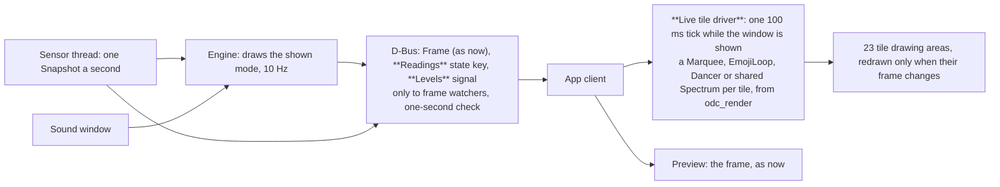

# Phase 11a: the settings app's UI review: fans and pump leave the product, the window and its pages are rebuilt, the tiles go live, and two pictures are centred on the cooler

**Plan ID:** `phase-11a-settings-app-ui-review`
**Source PRD:** `docs/prp/prds/opendeepcool-lp360.prd.md` (repository-relative: an absolute path would name the owner's home folder, AGENTS.md rule 10)
**PRD Phase:** `11a — Settings app UI review`
**Source Issue:** `None`
**Plan Publication:** `None`

> **Numbering.** The PRD (Phase 12 scope; Decisions Log, "When the owner reviews the settings app") put the owner's review of the settings app after Phase 11 and before Phase 12. This phase is that review's work, written on 2026-11-18 after the owner's review. It is 11a so that Releases stays Phase 12: renumbering would change about sixty references in the completed phases' plans, reports and reviews, which stay as written.
>
> **Evidence read** on 2026-11-18 at `main` = `1a6a4e9` (Phase 11 complete). The owner's decisions D1–D4 below were given the same day, in answer to four questions about the owner's draft review. The draft itself is not part of the repository.

## Outcome

**Problem:** The owner reviewed the Phase 10 app as built and found:
- it measures, lists and shows the cooler's fans and pump, which the owner doesn't want in OpenDeepCool at all;
- its window tiles like any window and keeps a 1040 × 720 default, its header carries a page switcher and a bordered Refresh, the temperature unit sits apart from the other settings, and its switches are large;
- its 23 tiles are still pictures drawn from fixed sample values, though the service already reads every metric once a second;
- on the cooler, the two-value modes are right-sided, and the Dancer stands on rows 3–14 instead of being centred;
- there is no way to choose between the system's theme and a dark or light theme of our own.

**Affected user:** The owner, and any user with an LP360 on Arch or an Arch-based distribution.

**User outcome:**
- The product is the display and nothing else: no fan or pump reading, service or screen.
- `opendeepcool` opens at the size of its content, with scrollbars where the content wouldn't fit the screen, and asks the window manager for a floating window where that is possible.
- The header has the title in the middle, and a gear and a close icon at the right. The Configuration page has a back icon, the temperature unit after Rotation, labels beside their controls, and a Theme card first.
- Refresh is an icon on the display page.
- Every mode tile shows its mode drawn with the live readings, and all tiles move together. The Music tiles and the Dancer's follow the sound when the cooler is already in a Music mode.
- On the cooler, a pair of values is centred as one block, and the Dancer stands on rows 2–13.

**Invariant:**
- **Only the cooler's display** (owner, 2026-11-18): outside the kept spec file `docs/spec/fans-and-pump.md` and the completed phases' own records, no live file mentions reading, showing or choosing the cooler's fans or pump, and nothing in the service, the package or the tests reads them.
- **Every mode and setting stays reachable**, each control still one D-Bus call, each tile still one spec mode, and every tile shows the metric it names (rule 11).
- **The preview is the cooler:** it shows only frames the service publishes.
- **Cooler frames change only where the owner decided:** modes 4, 5, 6, 9 and 12, and the Dancer. The expected frames of every other mode stay byte for byte, and the oracle's regeneration shows no other difference.
- **Sound is captured as now:** only while a Music mode is shown. The live tiles add no capture.
- **Colours come from the theme** or from the default theme, never hard-coded in a widget, and the app never sets window opacity or blur.
- **Nothing assumes Omarchy or a window manager** except the Omarchy theme the app follows when it finds one (rule 14).
- **Uninstalling leaves the system as it was** (rule 7). The only thing the new app writes outside the service's own folders is one small per-user file, listed in the footprint, and only after the user changes the theme (Task 10).
- **The service's access rules don't widen:** the new data goes only to a caller that watches frames and passes the same one-second check, and a client that doesn't know it ignores it.

**Success signal:** The owner reviews the new build (Task 17) and signs the phase off. Behind that, every acceptance criterion below passes unattended: the app's AT-SPI run on every scenario, `--only display` on every mode, `--only service`, `--only package`, and the full parity run on the installed package.

**Approach:**
- **Remove first** (the owner's order): keep the fans-and-pump facts in one spec file, then take the feature out of the app, the service with its contract and the sensors, the package (the sensor detection exists only for the fan chip), and the documents.
- **Rebuild the app's structure** (header, pages, window size, theme card), design first (the `ui-ux-designer` agent), then code.
- **Centre two cooler pictures** with one rule change in `odc-render` and in the oracle, and a Dancer redrawn one row up.
- **Make the tiles live by sending the app two more things and drawing every tile with the code the service already uses:** the readings, as a state key, and the sound's 14 column levels, as a signal, both only to frame watchers. `odc-render` stays the only drawing code, in the service and in the app (`crates/odc-render/src/lib.rs:1-5`).
- **Close with the owner's own steps:** a whole-design review by the designer, a review of all the app's code, a new build, and the owner's review.

### The owner's decisions of 2026-11-18

Given in answer to four questions about the owner's draft review; each is in the PRD's Decisions Log and in a "decided, not yet built" note in the spec.

| # | Decision | Choice |
|---|---|---|
| D1 | The completed phases' plans, reports and solution reviews that mention fans and pump | **Keep history, strip the rest.** Fans and pump go from the PRD body, `AGENTS.md`, the README, the spec, the design, the code and the packaging. Their facts move to `docs/spec/fans-and-pump.md`. The completed phases' own records stay as written, with one note in the PRD |
| D2 | Two-value modes (4, 5, 6, 9, 12) on the cooler | **Centred as one block:** the wider value by the one-value rule (the extra spare column on the left), the shorter value's last digit under the wider one's. One-value modes were already centred in both directions |
| D3 | The Dancer's rows | **Centre the standing figure:** rows 2–13, one spare row above and below; the jump rises one row, the squat sinks one row; poses 4 and 10 are redrawn; sideways it is already centred (head on columns 7–9) |
| D4 | The Music and Dancer tiles when the tiles go live | **Real sound only if already captured:** they show the live spectrum while the cooler is in a Music mode, and a still sample otherwise. When sound is captured doesn't change |

## Recommendation

**One data path for the live tiles, and no second engine.**
- The app already links `odc-render`, and the tiles already draw with it (`crates/odc-app/src/ui/tiles.rs:56-76`). What it lacks is the data: today it gets the current mode's frame only.
- `Values::of(&Snapshot)` (`crates/odc-render/src/lib.rs:67`) and the state machines that the engine owns (`Marquee`, `EmojiLoop`, `Dancer`, `Spectrum`: `crates/odc-service/src/engine.rs:140-143,348-364`) are pure and have no clock, so the app can step one of each per tile on its own tick.
- The invariant "a tile is the cooler's picture for that mode" then holds by construction, and a test proves it: a tile's home frame equals the frame the service writes for the same readings.
- The alternative, the service drawing 23 frames a tick, would need 23 engines' state and 23 frames a tick on the bus.

**Fans and pump sit behind one seam, so removal is deletion.**
- In `odc-sensors` they are `fans.rs`, the two `Fan` fields of `Snapshot` (`model.rs:175-198`) and `Registry::choose_fans` (`registry.rs:125-136,167-170`).
- In the service they are two saved keys (`settings.rs:130-132`), `fan_rpms` in the sensor thread (`runtime.rs:422,471-474`), and 2 methods and 7 state keys in the contract (`docs/spec/dbus.md`; `crates/odc-ipc/src/state.rs:23-29`).
- The sensor detection (`crates/odc-sensors-detect`, two root units, its record, the install script's undo, a package dependency on `lm_sensors`) exists, by the spec's own account, only to load the driver of the chip that measures them (`docs/spec/sensors.md:64-75`); the CPU, GPU and memory rules read drivers the kernel loads by itself. It goes whole.

**The two centring changes are one rule each.**
- The one place that decides a picture's home column is `crates/odc-render/src/picture.rs:102-113`, mirrored by the oracle at `tools/oracle/src/rules.rs:203-211`. Today one value is centred and two values end at column 14. The owner's decision is that both are centred, and the spare column of an odd split goes on the left.
- The Dancer's poses are typed from `docs/spec/music.md`, which the oracle also parses (`tools/oracle/src/dancer.rs:12,34-45`), so a redrawn pose changes the spec's picture, `crates/odc-render/src/dancer.rs:11` and the frames together.

### Evidence

- `crates/odc-app/src/ui/tiles.rs:28-76` — the tiles are drawn from `sample_values()` and a fixed `SAMPLE_BARS`; they redraw only on unit, peak or theme changes. The live version replaces this input, not the drawing.
- `crates/odc-render/src/marquee.rs:22,37,59`, `emoji.rs:167,190`, `dancer.rs:287`, `spectrum.rs:170,184,201,240` — the pure state machines and `Spectrum::at`, which the app already uses.
- `crates/odc-service/src/dbus.rs:1409-1473` — `tell_watchers` sends `StateChanged` and withholds `FanInputs` from anyone who doesn't watch frames; `tell_frame_watchers` sends `Frame` to each frame watcher alone after the one-second check. The new data copies this pattern, and takes over the withheld key's slot.
- `crates/odc-service/src/settings.rs:141-143` — a `#[serde(flatten)] later: toml::Table` keeps fields this build doesn't know and writes them back. Left alone, the two retired fan keys would stay in the file for good, so they are dropped at load (Task 4).
- `packaging/arch/opendeepcool.install:92-137,160-162` and `crates/odc-pkg-test/src/run.rs:30-33,185-265,582-587` — the package undoes the detection on removal, from its root-only record, and the package test proves it. Removing the old package on the development PC therefore undoes the detection under rule 7 with code that is already tested, so the new package carries no migration code.
- `docs/spec/settings.md:108-110` — the owner decided on 2026-11-17 that the default theme follows the system's dark or light preference and that the app gets a dark/light option, and left two points to this review: which interface the app reads (the XDG portal's `color-scheme`, or GTK 4.20's `gtk-interface-color-scheme`, which `crates/odc-app/Cargo.toml:22` already enables with `v4_20`), and what "no preference" shows.
- `crates/odc-testkit/src/weston.rs:36,93-94` — the headless output is 1280 × 800 and weston takes `--width` and `--height`, so a small screen can be tested.
- The owner's review items, with the codes this plan uses for them, are mapped to tasks under [Scope](#scope).

### Alternatives considered

- **Service-drawn tiles (23 frames a tick):** loses on state and bus cost (above).
- **A theme choice held by the service** (a PC-wide setting, with polkit and a contract change): keeps uninstall simple, but one user's theme would change another's session, and it grows the contract for a visual preference. The recommendation is a per-user file; the footprint consequence is a decision in Risks.
- **Renumbering Releases to Phase 13:** about sixty edits to completed phases' records. Not worth it.
- **Migration code in the package for the detection's leftovers:** the only package that ever ran the detection is the development PC's; `pacman -R` of that package already undoes it. Code that runs for one installation is not worth shipping.

## Visuals

### The app, before and after

| Surface | Before | After | User impact |
|---|---|---|---|
| Header | Title at the left, a Display / Configuration switcher in the middle, a bordered "Refresh" at the right | Title centred; a gear and a close icon at the right, no borders | Fewer controls; the page change is one icon |
| Configuration page | A tab; four cards (Display, Cooler, Music settings, Startup); a label at the far left and its control at the far right | Reached by the gear, with a back icon; cards Theme, Display (with the unit after Rotation), Music settings, Startup; each label next to its control | Settings are together and readable |
| Display page | Unit toggles, then the four tile groups | The tile groups, and Refresh as an icon at the top right; every tile live | The page shows the cooler's whole range at once |
| Preview column | Picture, caption, "Shown on the cooler now", status, fan and pump RPM | Picture, caption, status | No fans, no repeated line |
| Window | 1040 × 720 default, 720 × 560 minimum, tiled | The size of its content, scrolling on a small screen, floating where the window manager allows | Fits any monitor |

### The live data's path (new or changed in bold)

The service stays the only reader of sensors and sound, and the only authority on who may watch. The app adds no polling of the bus: the tick drives only the tiles' own animation.

## Implementation Context

### Mandatory reading

| File | Why it matters |
|---|---|
| `AGENTS.md` (rules 1–5, 7, 8, 10, 13, 14; Commands) | The rules every task obeys: one implementation, one commit; tests with every step; refusal tests at every entry point; no machine data; Rust everywhere; Arch, not Omarchy |
| `docs/design/settings-app.md` | The current design the designer changes: Window, Preview column, Display page, Configuration page, Banners, Refresh, Start at boot, States, Theme, Keyboard, Accessible names, Coverage check |
| `docs/spec/display.md` (Static layout, "OpenDeepCool: alignment"; Scrolling layout), `docs/spec/music.md` (Dancer) | The rules Tasks 11 and 12 change |
| `docs/spec/dbus.md` (Methods, State, Watchers) and `docs/prp/solution-reviews/project-overview.review.md` ("Entry points after the cross-check") | The contract Task 13 adds to, and the refusal tests it needs |
| `docs/prp/solution-reviews/phase-10-settings-app.review.md` (P10-01) | Why `Frame` goes to each watcher alone, after a one-second check: the new signal follows it |
| `crates/odc-app/src/ui/window.rs:35-36,197-262,331-460,520-530,739-768` | The sizes, the header, the page stack and actions, and the rules for when the switcher and Refresh show |
| `crates/odc-app/src/model.rs` (fans: 159-203, 272-335, 369-414, 748-800; caption: 505) | The pure view model, which most of Task 3 deletes from |
| `crates/odc-app/src/ui/config_page.rs`, `display_page.rs`, `tiles.rs`, `startup.rs`, `theme.rs`; `crates/odc-app/src/theme.rs:174-203` | The pages, the tiles and the theme the later tasks change |
| `crates/odc-service/src/dbus.rs:1409-1500`, `engine.rs:140-143,348-364`, `status.rs:71-74`, `runtime.rs:417-474,559-584`, `settings.rs:104-200` | Where fans leave, and where the live data comes from |
| `crates/odc-render/src/picture.rs:74-121`, `tools/oracle/src/rules.rs:188-215`, `crates/odc-render/src/dancer.rs:11-60`, `tools/oracle/src/dancer.rs:12-45,283` | Where the centring rules live |
| `packaging/` and `crates/odc-pkg-test/src/run.rs` | The package, its install script and the test that proves install and uninstall |

### Existing patterns and primitives

- **Watcher signals addressed to one caller:** `tell_frame_watchers` and `signal_frame` (`crates/odc-service/src/dbus.rs:1452-1482`), with the watchers' cap and check in `crates/odc-service/src/watchers.rs`. `Readings` and `Levels` use them; there is no new method and no new cap.
- **Retiring a saved key:** none exists yet. The flatten table at `settings.rs:141-143` is where a retired key lands, so the loader removes the two keys from it, and a test loads a file that still has them.
- **A per-user file:** none exists yet. Model it on the service's `SettingsStore` (`settings.rs`, MAX_FILE 64 KiB, an invalid file moved aside, atomic write), without the service's directory rules.
- **Headless display tests:** `odc_testkit::weston` (`crates/odc-testkit/src/weston.rs`), the fake service (`odc-testkit`) and the AT-SPI driver (`crates/odc-ui-e2e`), whose scenarios are listed at `scenarios.rs:485-515`.
- **Generated mockups:** `cargo run -p odc-mockups -- docs/design/mockups` from the states in `tools/mockups/src/lib.rs` (Rust) and the sources in `docs/design/mockups-src/` (`app.js`, `app.css`); `cargo test -p odc-mockups` fails when a committed mockup differs.

### Integration points

- `crates/odc-ipc/src/state.rs:23-29` and `STATE_KEYS` — a state key is added here and in `docs/spec/dbus.md` together; the contract tests (`crates/odc-ipc/tests/contract.rs`) check the two agree.
- `crates/odc-testkit/src/fake_service.rs` — the app's fake service must emit everything the real one does, or the app's tests prove nothing.
- `tools/oracle/src/scenarios.rs`, `docs/spec/frames/` — regenerated by `cargo run -p odc-oracle -- docs/spec/frames`; the committed files are the unit tests' expected frames.

## Scope

### In scope

- The owner's review: every item below, the decisions D1–D4, and the owner's closing steps (a design review, a code review, a new build and the owner's review).
- The documents that change with them: PRD, spec, design and mockups, README, `AGENTS.md`, the designer's brief, the package's footprint.

| Code | The owner's item (2026-11-18) | Task |
|---|---|---|
| R1 | Fans and pump leave the product: no reading, no service, no display, no mention; their facts stay in a spec file (D1) | 2–6 |
| R2 | Remove the "Shown on the cooler now" line under the preview | 8 |
| R3 | Remove the Display tab | 7 |
| R4 | Remove the second sentence of the Start at boot hint, "Each change asks for the administrator's password." | 8 |
| C1 | The window launches outside tiling mode, at the smallest size that fits its content; scrollbars on a small screen | 9 |
| C2 | The app title is centred in the top bar | 7 |
| C3 | Configuration becomes a gear icon at the right, beside a close icon; a back icon on the Configuration page; no borders on the gear, the X or the back icon | 7 |
| C4 | Labels sit next to their controls on the Configuration page, left-aligned | 8 |
| C5 | Refresh is a borderless icon at the top right of the display page | 7 |
| C6 | The temperature unit moves to Configuration, Display section, after Rotation | 7 |
| C7 | The switches are a little smaller | 8 |
| C8 | Every mode tile shows live values, all animating together (D4: Music tiles live only with sound already captured) | 13, 14 |
| C9 | Modes 1–12 centred on the cooler, the Music modes unchanged; the odd spare column goes on the left (D2) | 11 |
| C10 | The Dancer centred horizontally and vertically (D3) | 12 |
| A1 | A Theme card, first in Configuration: "use system theme", and a dark / light toggle | 10 |

### Not building

- **Fan or pump readings or control** in any form, here or later in v1. Their facts stay in `docs/spec/fans-and-pump.md`.
- **Real sound captured while the window is open** outside a Music mode (owner, 2026-11-18, D4).
- **Following other desktops' themes beyond their dark or light preference** (rule 8): "use system theme" means the Omarchy theme or the system's dark/light preference, nothing else.
- **A Hyprland window rule shipped by the package** (rule 14). A rule in the owner's own configuration would be a separate change the owner approves (rule 7).
- **Creative Mode, ARGB, hidden display settings** (rule 8): unchanged.

## Delivery Considerations

| Concern | Decision and owned work |
|---|---|
| Compatibility / migration | No release exists yet, so the D-Bus contract (frozen at `v1.0.0`) and the settings file can still change. A settings file that still holds the two fan keys loads, and its keys are dropped at the first save (Task 4, with a test). The only package that ever ran the sensor detection is the development PC's: the owner removes it with `pacman -R` before this phase's service tests, and that removal undoes the detection from its record (rule 7; the package test proves it), so the new package carries no migration code (Tasks 4 and 5) |
| Rollout / reversibility | Everything lands on a phase branch, one commit per task, and moves to `main` at sign-off. Each commit builds and passes its tests, so a task can be reverted alone. The development PC moves from the package to the dev copy for the service tests and back to the new package at the end (Task 17); each step is a system change the owner approves first |
| Discoverability | The README's screenshots and text name no fans or pump, and its "Installed on your system" and "What the app writes" lists change (Tasks 5, 6, 10) |
| Documentation / communication | The design, the mockups, the spec, the PRD, `AGENTS.md` (crate list, layout, commands) and the designer's brief change in the task that changes their subject. Task 6 sweeps what is left |
| Observability | `opendeepcool --report` (spec `docs/spec/report.md`) loses its fan lines in Task 3 |

## Implementation

Each task is one implementation and **one commit** (rule 4), after its own tests pass, with its documents changed in the same commit. A UI task goes in this order: the `ui-ux-designer` agent first updates `docs/design/settings-app.md` and the sources in `docs/design/mockups-src/` and reads the current app code and design again; then the implementer encodes the mockup states in `tools/mockups/src/lib.rs`, regenerates the mockups, and writes the code and tests. The designer has no shell and writes no Rust, so it never builds, tests or commits. Each task ends by ticking its row in the table at the end of the phase's report.

Real runs that need the changed service use the dev copy (Tasks 4, 11 to 14); see Delivery Considerations, and ask the owner before each system step.

### 1. Settle the open points before they harden

**Files and integration points**
- `docs/design/settings-app.md` — UPDATE — a section "Unverified points, answered (Phase 11a Task 1)", as Phase 10's Task 1 did.
- A throwaway gtk4-rs program under the scratchpad (never committed) for the checks that need a window.

**Implementation**
- Answer each point against docs.gtk.org (Context7 or Firecrawl, then the page itself), then with the minimal program in headless weston, and give each a fallback that changes a widget and never the behaviour:
  1. **The system's dark/light preference:** what `GtkSettings:gtk-interface-color-scheme` reads under headless weston with and without a portal, whether GTK fills it from the XDG portal's `color-scheme` itself, and whether the app can test its `UNSUPPORTED`, `DEFAULT`, `DARK` and `LIGHT` with a fake `org.freedesktop.portal.Desktop` on the tests' private session bus, with no test flag. Recommendation to confirm: read the GTK property, `DEFAULT` and `UNSUPPORTED` show the dark default theme, and "system theme found" means an Omarchy theme or a property that isn't `UNSUPPORTED`.
  2. **A window that fits its content:** how a `GtkScrolledWindow`'s natural size propagates to the window (`propagate-natural-width/height`, `max-content-width/height`), and how to cap it to the monitor before the window is mapped on Wayland.
  3. **A floating window:** whether a window with a fixed size (`resizable` false), or with another hint GTK can give, is floated by Hyprland, read once from the owner's session with `hyprctl clients -j` and recorded as `system:` evidence in the report; never a test, because rule 14 forbids tests that assume Omarchy. If nothing GTK can say floats it, the design says so, and the owner decides (Risks).
  4. **A header with our own close icon:** `GtkHeaderBar::show-title-buttons` false with our own gear, back and close buttons, so desktops that draw window buttons don't show two.
  5. **Smaller switches:** which CSS on `switch` and `slider` shrinks a `GtkSwitch` under the app's stylesheet.
  6. **The cost of 23 live tiles, and what stops them:** a program drawing 23 `GtkDrawingArea`s of 14 × 14 dots at 10 Hz under weston, measured with `/proc/<pid>/stat`, once driven by a `glib` timeout and once by a `Widget::add_tick_callback` counted to 100 ms, with the window shown, hidden and unmapped. The frame clock is expected to stop for a surface the compositor doesn't draw, such as a window on another workspace, which a timeout doesn't (**unverified**). Also whether `gtk-enable-animations` can be read and followed live.
  7. **The remaining sources' drivers without lm-sensors:** whether the kernel loads, by itself, the drivers the CPU temperature, CPU power and memory rules read (`coretemp`, `k10temp`, the powercap RAPL driver), from the kernel's module alias tables and the Arch wiki, since the detection also loaded such drivers on a PC where they weren't. Where one doesn't autoload, the modes that need it are disabled with their reason, as the spec already says, and the README names the driver to load; the product loads none (**unverified**).
- The first task also compares this plan with what Phases 5–11 built: the names, files and commands above were read from the tree on 2026-11-18.

**Tests**
- None in the repository; the answers are evidence in the design.

**Validation**
- `cargo test -p odc-mockups` — still passes (the design text changed, the states didn't).

### 2. Keep the facts about fans and pump

**Files and integration points**
- `docs/spec/fans-and-pump.md` — CREATE — everything the project learned about measuring and showing the cooler's fan and pump speeds, in one document, so that a later version can bring them back.
- `docs/spec/README.md` — UPDATE — its index row.

**Implementation**
- Copy, with their evidence labels and dates, from: `docs/spec/sensors.md` ("Fan and pump speed", and the "Board sensor driver" detection with its sandbox, record and evidence), `docs/spec/settings.md` (the fan inputs, their RPM, the two pickers' rules), `docs/spec/dbus.md` (`FanInputs`, the two input keys and their present flags, the two RPM keys, the two setter methods), `docs/design/settings-app.md` (the Cooler card and the RPM rows, as a description of what the app showed), `docs/spec/parity-checklist.md` (S9, T1's fan part), the PRD's decisions about fan inputs, the detection and fan control, and `AGENTS.md` rule 8's `pwm*` note.
- Machine-specific facts (which input is which on the owner's board) stay in `docs/local/` and are not copied (rule 10).
- A banner at the top: removed from OpenDeepCool on 2026-11-18 (owner); kept for a later version; nothing here is built; the sources are `docs/spec` at commit `1a6a4e9`.

**Tests**
- None; `cargo run -p odc-guard -- history` checks the commit like any other.

**Validation**
- Every fact in the old sections is in the new file or is named as dropped: a diff of the sections against the file, read by the implementer, with the list in the commit message's body.

### 3. The settings app stops showing and choosing fans and pump

**Files and integration points**
- `docs/design/settings-app.md`, `docs/design/mockups-src/app.js`, `tools/mockups/src/lib.rs` — UPDATE (designer, then implementer) — the preview column's RPM rows, the Cooler card, the "missing input" and "no fan sensors" states, the coverage check and the accessible names go. Two mockups (`missing-input`, `no-fan-sensors`) go; the others lose the rows.
- `crates/odc-app/src/model.rs:159-203,272-335,369-414,748-800`, `ui/window.rs` (`SpeedRow`), `ui/config_page.rs`, `ui/mod.rs:30-32`, `client.rs:107,246-252`, `report.rs` and `docs/spec/report.md` — UPDATE — the view model, the rows, the Cooler card, the two requests and the report's fan lines go.
- `crates/odc-app/src/model/tests.rs`, `tests/config_page.rs`, `tests/common/mod.rs`, `tests/window.rs`, `crates/odc-ui-e2e/src/scenarios.rs` (`inputs`, `missing_input`, `no_fan_sensors`, and the `names` list), `crates/odc-ui-e2e/src/fake.rs` — UPDATE — the tests that exercised them go with them.

**Implementation**
- The app stops calling `SetCoolerFanInput` and `SetPumpInput` and ignores the fan keys; the service still publishes them until Task 4, which keeps the build green at this commit. The preview column keeps its picture, caption and status items.

**Tests**
- The view model's tests no longer mention fans; the preview column's words are asserted without the RPM rows; `--only app` runs the remaining scenarios.

**Validation**
- `cargo test -p odc-app` and `cargo test -p odc-mockups` — pass.
- `cargo run -p odc-e2e -- --only app --require weston` — every remaining scenario passes.

### 4. Fans and pump leave the service, the contract and the sensors

**Files and integration points**
- `crates/odc-sensors/src/fans.rs` (DELETE), `model.rs:175-198`, `registry.rs:8,61-62,90-91,125-136,167-170`, `lib.rs:7,19,24`, `tests/fans.rs` (DELETE), `tests/model.rs` — UPDATE — `Fan`, the two `Snapshot` fields, `choose_fans`, `fan_inputs` and `fan_rpm` go.
- `crates/odc-ipc/src/lib.rs:12,87-90`, `state.rs:23-29,120-172`, `tests/contract.rs` — UPDATE — `SetCoolerFanInput`, `SetPumpInput`, the seven keys and the types `FanInput`, `FanSpeed` and `Input` go.
- `crates/odc-service/src/settings.rs:107-132,141-143,190-198,227-260`, `runtime.rs:417-474,559-584`, `status.rs:71-74`, `service.rs:35-37,175,208`, `main.rs:13,85-99,146-166`, `engine.rs:67,80-100,154,203-208`, `dbus.rs:317-330,616-685,1435-1438`, and `tests/dbus.rs`, `tests/settings.rs` — UPDATE.
- `crates/odc-testkit/src/{fake_service,fixtures,hardware}.rs`, `tests/fake_service.rs`, `tests/hardware_probe.rs` — UPDATE.
- `crates/odc-e2e/src/sensors.rs`, `src/lib.rs:35`, `tests/flags_and_fakes.rs` — UPDATE — the `board-fans` capability, the `fans` check and the fan part of the timing check (`sensors.rs:867-900`) go; `sensors-tool` stays, because the CPU check uses `sensors -j`.
- `docs/spec/dbus.md`, `docs/spec/settings.md`, `docs/spec/sensors.md`, and the entry-points table in `docs/prp/solution-reviews/project-overview.review.md` ("The service's D-Bus methods": the two setters leave its list) — UPDATE.
- `docs/spec/parity-checklist.md` — UPDATE — in this commit, because `crates/odc-testkit/tests/parity_checklist.rs` checks that every test a row links still exists: row S9 links four fan tests (`crates/odc-sensors/tests/fans.rs`, and `fan_speeds_reach_only_frame_watchers_and_follow_the_readings` in `crates/odc-service/tests/dbus.rs`), which this task deletes. Row S9 is deleted (its text is in `docs/spec/fans-and-pump.md` from Task 2), and row T1 loses "no fan inputs".

**Implementation**
- The settings loader removes `cooler_fan_input` and `pump_input` from the flatten table, so an old file loads and loses the keys at its next save; `check_input` and `check_device_path`, used only for them, go (`check_pci` stays: the GPU choice uses it). `VERSION` stays 1: the file's form didn't change, only two optional keys left.
- With the package installed the service tests can't run (`odc-dev setup` refuses), so the owner removes the package first (`sudo pacman -R opendeepcool`), which undoes the detection from its record, then runs `cargo run -p odc-dev -- setup`. Both are system changes: ask first (rule 7).

**Tests**
- A settings file with both keys loads, the service uses the defaults for them, and the next save has no trace of them. An unknown method or key from an older client is refused as before. The contract test shows the state keys equal the spec's table. Property tests on the sensors' snapshot are unchanged.

**Validation**
- `cargo build --workspace && cargo test --workspace && cargo clippy --workspace --all-targets -- -D warnings && cargo fmt --all --check` — pass.
- `cargo run -p odc-e2e -- --only sensors --require <this PC's list from docs/local/, minus board-fans>` — passes.
- `cargo run -p odc-e2e -- --only service --require dev-service` — passes, after `odc-dev setup`.

### 5. The sensor detection leaves the package

**Files and integration points**
- `crates/odc-sensors-detect/` (DELETE, whole crate), `packaging/systemd/opendeepcool-sensors-detect.service` and `…-detect-modules.service` (DELETE), `packaging/systemd/opendeepcool.service:4,7-8` — UPDATE — `Wants=` and `After=` drop the detection and `lm_sensors.service`.
- `packaging/arch/PKGBUILD:18,28,59,79-90`, `.SRCINFO`, `opendeepcool.install:16-17,46,73-78,82-137,160-162`, `packaging/FILES.md`, `crates/odc-service/tests/packaging.rs` — UPDATE — the `lm_sensors` dependency, the program and the two units, the install message and the undo of the detection go.
- `crates/odc-pkg-test/src/{main,run}.rs`, `Cargo.toml` — UPDATE — the lm-sensors cases, their constants and the detection record helper go; the install, upgrade and uninstall cases stay, and the unit score no longer reads the two units.
- `AGENTS.md` (the crate table), `README.md` ("Installed on your system"), the PRD's System Footprint (the detection rows and the lm-sensors list), and the entry-points table in `docs/prp/solution-reviews/project-overview.review.md` (the row "The detection record") — UPDATE.

**Implementation**
- The new package never creates `/etc/conf.d/lm_sensors`, a modprobe file, a root-only record or an enabled `lm_sensors.service`, so its uninstall has nothing to undo, and nothing in it runs as root at every boot (the PRD's "service model" no longer has that exception).
- On the development PC the owner removes the old package before Task 4's service runs (above); this task needs nothing more there.

**Tests**
- The package test proves the system is left exactly as before, installed and removed, both ways. `packaging.rs` proves `FILES.md` lists every file under `packaging/` and every unit's `ExecStart=` names an installed program.

**Validation**
- `cargo test --workspace`, `cargo clippy …`, `cargo fmt --all --check` — pass.
- `cargo run -p odc-e2e -- --only package --require container` — passes, after the commit and before the push (about ten minutes; it refuses an uncommitted tree).

### 6. The documents drop fans and pump

**Files and integration points**
- `docs/prp/prds/opendeepcool-lp360.prd.md` — UPDATE — the body and its tables (problem and scope text, What We're NOT Building, Core Capabilities, Technical Approach, Risks, the Phase 6, 10 and 11 descriptions, System Footprint) lose fans, pump and the detection. The Decisions Log rows about fan inputs, fan control, the detection and the product scope are replaced by the one row of 2026-11-18 (D1), plus one dated note that the completed phases' plans, reports and reviews still describe them.
- `AGENTS.md` (the opening scope line and rule 8), `README.md`, `.claude/agents/ui-ux-designer.md` (the earlier briefs' fan lines), `docs/spec/{settings,sensors,dbus,display}.md`, `docs/hardware/deepcool-lp360.md` — UPDATE — whatever still says OpenDeepCool reads, shows or chooses fans or the pump. (The parity checklist's rows S9 and T1 went in Task 4, with the tests they link; the "100% of parity items" metric counts only the rows that remain.)

**Implementation**
- Rule 8's ban on writing `pwm*` stays as one sentence, as a safety rule: the product writes no fan or power setting (Risks).
- The hardware notes about the LP360's own cables stay: they describe the cooler, and say nothing of OpenDeepCool reading them.
- Completed phases' plans, reports and reviews are not edited (D1).

**Tests**
- A check, run by the implementer and in the report: `grep -rniE "\bfans?\b|\bpump\b|fan_input|pump_input|sensors-detect|lm_sensors|lm-sensors" .` over live files (not `docs/prp/{plans,reports,solution-reviews}`, not `docs/spec/fans-and-pump.md`, not `docs/local`, not `target`) finds only `AGENTS.md` rule 8's one sentence, the PRD's note, and `docs/hardware/deepcool-lp360.md`'s own cable facts.

**Validation**
- The grep above; `cargo test -p odc-service --test packaging`, `cargo run -p odc-guard -- history` — pass.

### 7. Header and pages: no Display tab, title in the middle, gear and close icons, back icon, Refresh and the unit moved

**Files and integration points**
- `docs/design/settings-app.md` (Window, Display page, Configuration page, Refresh, Keyboard, Accessible names, States, Coverage check), `docs/design/mockups-src/*`, `tools/mockups/src/lib.rs` — UPDATE (designer, then implementer).
- `crates/odc-app/src/ui/window.rs:69-86,197-262,331-460,520-530,739-768` — UPDATE — the header, the page stack, the actions and the visibility rules.
- `crates/odc-app/src/ui/display_page.rs:61-250` (the unit toggles, `unit_request`) — UPDATE — the unit leaves; the page keeps the tile groups and holds the Refresh icon at its top right.
- `crates/odc-app/src/ui/config_page.rs` — UPDATE — the Display card gains the unit after Rotation, and a back icon heads the page.
- `crates/odc-app/tests/{window,display_page,config_page}.rs`, `crates/odc-ui-e2e/src/scenarios.rs` (`names`, `unit`, `refresh`, `shortcuts`, `service_down`, `first_start`, `not_available`) — UPDATE.

**Implementation**
- R3, C2, C3, C5 and C6 together, because they share the header and the stack.
- The header shows the title in the middle (`set_title_widget`), and a gear and a close icon at the right, both without frames and with fixed accessible names; `show-title-buttons` is off if Task 1's check says so, so no desktop draws a second close button. A back icon heads the Configuration page without a frame; the designer picks its side by the GNOME and KDE human-interface guidelines.
- Refresh is an icon without a frame at the top right of the display page. It keeps its accessible name, its tooltip, `F5` and `Ctrl+R`, and its rules from `window.rs:739-768`: absent when the app isn't available in this session, insensitive while the service isn't running.
- The gear stays usable on the service-off screen, where Start at boot lives, as the switcher is today.
- The unit's request and the mode tiles' follow-the-unit redraw (`tiles.rs` `follows_unit`) keep their behaviour, now from the Configuration page.

**Tests**
- The view model and window tests assert each state of the header (normal, service off, not available), that the gear opens Configuration and the back icon returns, that the unit sits after Rotation and still sends `SetTemperatureUnit`, and that Refresh sends `Refresh`.
- The AT-SPI scenarios drive the same, with the new names.

**Validation**
- `cargo test -p odc-app`, `cargo test -p odc-app --features weston-tests`, `cargo test -p odc-mockups` — pass.
- `cargo run -p odc-e2e -- --only app --require weston` — passes.

### 8. Smaller changes: no caption line, no second sentence, labels beside controls, smaller switches

**Files and integration points**
- Design, mockups and tools as in Task 7.
- `crates/odc-app/src/model.rs:505` (the caption line's "Shown on the cooler now") and its test (`model/tests.rs:322`) — UPDATE.
- `crates/odc-app/src/boot.rs:243-244` and `boot/tests.rs:705`, `tools/mockups/src/lib.rs:324`, `docs/design/mockups-src/app.js:359` — UPDATE — the hint's second sentence goes; the "Turning on…" lines keep theirs.
- `crates/odc-app/src/ui/config_page.rs`, `ui/startup.rs:70`, `crates/odc-app/src/app.css` (included at `src/theme.rs:15`), `docs/design/mockups-src/app.css` — UPDATE — rows lay out label and control side by side, left-aligned; the switches are a little smaller.

**Implementation**
- R2: the line goes. The warning lines that say the cooler isn't reachable stay, since they are not "shown on the cooler now" and nothing else says them in the column (the designer may fold them into the status items; the design records which).
- R4, C4, C7 as the owner wrote them. "Switches" means the two `GtkSwitch`es (Start at boot, Peak dots); the unit and rotation buttons keep their size.

**Tests**
- The preview column's words in every cooler state; the Startup card's hint; each row's label and control in one box, left-aligned; the stylesheet test that no value is hard-coded still passes.

**Validation**
- As Task 7.

### 9. The window opens at the size of its content, and asks to float

**Files and integration points**
- `docs/design/settings-app.md` (Window), `crates/odc-app/src/ui/window.rs:35-36,205-214` — UPDATE — `DEFAULT_SIZE` and `MIN_SIZE` go. The pages' `scrolled()` helper (`window.rs:188-195`) gets Task 1's natural-size settings.
- `crates/odc-testkit/src/weston.rs` — UPDATE — `Weston::start` takes the output's size, so a test can start a small screen; the default stays 1280 × 800.
- `crates/odc-app/tests/window.rs`, `crates/odc-ui-e2e` — UPDATE.

**Implementation**
- The window takes the natural size of the visible page; where that is larger than the monitor, the page scrolls (C1). The floating request is whatever Task 1 proved GTK can give; if none, the window is as the compositor makes it and the design says so.
- No compositor rule, no Hyprland call and no Omarchy check in the app (rule 14).

**Tests**
- On a 1280 × 800 output the window opens at its natural size, with no scrollbar; on a small output (such as 640 × 480) it fits the output and each page has a vertical scrollbar. A window never opens wider than the output.

**Validation**
- `cargo test -p odc-app --features weston-tests`, `cargo run -p odc-e2e -- --only app --require weston` — pass.
- The owner's session check from Task 1 is repeated on the built window and recorded in the report.

### 10. A Theme card: use the system theme, or choose dark or light

**Files and integration points**
- `docs/design/settings-app.md` (Configuration page, Theme, Accessible names, States), `docs/spec/settings.md` (the "No app-only settings in v1" line and the Theme bullets), mockups and tools — UPDATE (designer, then implementer).
- `crates/odc-app/src/appearance.rs` — CREATE — the pure part: `Appearance { use_system: bool, dark: bool }`, its file `appearance.toml` in `opendeepcool/` under `$XDG_CONFIG_HOME`, or under `$HOME/.config` when that variable is unset, empty or relative (the XDG Base Directory Specification, read 2026-11-18: the default is `$HOME/.config`, a relative path is invalid and skipped, and a folder the app creates gets mode 0700 while an existing one's mode is left alone). Parsing refuses what isn't two booleans, a file over 64 KiB or an unknown key (it logs and takes the defaults); the file is opened without following a symbolic link; the write is atomic (temporary file, `rename`), mode 0600, on the first change only.
- `crates/odc-app/src/theme.rs:174-203`, `ui/theme.rs:37-151`, `ui/config_page.rs`, `main.rs:35-60` — UPDATE — the resolved theme is one of: the Omarchy theme as today; our default theme dark or light, from the system's preference; our default theme dark or light, chosen.
- `crates/odc-testkit` — UPDATE — a fake `org.freedesktop.portal.Desktop` on the tests' private session bus, if Task 1 proves GTK reads it in headless weston; otherwise a test flag `--system-scheme` (the flag list in `flags.rs:9-40` and the entry-points table grow by it). Either way, a `--config-dir` test flag points the file somewhere a test owns.

**Implementation**
- **Use system theme** on (the default when a system theme is found): an Omarchy theme if one is found, else the system's dark/light preference applied to our default palette (Task 1's interface). It disables the dark/light toggle, which shows what the system gives. The live Omarchy monitors (`ui/theme.rs`) and the property's notify keep it live.
- **No system theme found** (no Omarchy theme and an unsupported preference): the toggle is disabled and off, a warning says OpenDeepCool can't find the system's theme and is using its own, and the dark/light toggle is enabled.
- **Use system theme** off: the dark/light toggle is enabled and picks our default theme dark or light, whatever Omarchy says.
- Nothing is written until the user changes one of the two. The file is per user; it is not the service's setting (the app still changes no service setting itself).
- The footprint gains one per-user file (Risks): the README's "Installed on your system" and the PRD's System Footprint name it, and the uninstall text says to delete it by hand, since no pacman step reaches into a home folder.

**Tests**
- Pure: every combination of (Omarchy found, preference, use_system, dark) gives the expected theme; a malformed, oversized, unknown-key, wrong-type or symbolic-link file gives the defaults and is never read as a theme; a relative `XDG_CONFIG_HOME` is ignored; the write is atomic. The contrast checks of the default palettes (`theme.rs` tests) still pass for both.
- Widgets: the card's states (system found; not found with the warning; toggle off), the dark/light toggle's sensitivity, a change saved, and the theme changing live.
- AT-SPI: the `theme` scenario drives the card against a private config folder and the fake portal, and a live Omarchy theme switch still reloads.
- Entry points: the appearance file's refusals are listed in the entry-points table ("The settings app").

**Validation**
- `cargo test -p odc-app`, `… --features weston-tests`, `cargo run -p odc-e2e -- --only app --require weston` — pass.

### 11. Pairs of values are centred as one block on the cooler (D2)

**Files and integration points**
- `docs/spec/display.md` (Static layout, "OpenDeepCool: alignment", the sentence on `°C` moving one column, and Scrolling layout's home) — UPDATE — the rule becomes: one value or two, the picture is placed by its width, with the extra spare column of an odd split on the left; two values end at the same column, so a pair is centred as the wider value would be, and the shorter keeps its last digit under the wider one's.
- `crates/odc-render/src/picture.rs:102-113` and `tools/oracle/src/rules.rs:203-211` — UPDATE — the `bands.len() == 1` branch goes; `left = spare - spare / 2` for every picture that fits.
- `docs/spec/frames/` — REGENERATE — `cargo run -p odc-oracle -- docs/spec/frames`. Only the frames of modes 4, 5, 6, 9 and 12 and their scenarios change.
- `crates/odc-render/tests/differential_{load,temperature,power,music}.rs` (`differs()`), `docs/spec/parity-checklist.md` — UPDATE — the places where a pair now differs from DeepCreative's capture are listed as differing by decision, with the reason, as the existing rows are; a row about a pair's alignment takes the `test: …; ours: ID` kind that `parity_checklist.rs` already checks, and its links must still name existing test functions.

**Implementation**
- Examples, for the spec and the tests: `42%` over `7%` doesn't move (the wider value is 13 columns); `5%` over `7%` (9 columns) moves from columns 6–14 to columns 4–12; a `°C` pair of two-digit values (12 columns) takes columns 2–13.
- A stopped picture is re-centred at its home when its width changes, which the movement rules already say (`display.md`, Movement, precisely): they use `home()`, so they follow.
- The rows of both bands, the one-value modes and the Music modes (`layout_at` with its own tops) don't change.
- One rule, one implementation, one commit, though five modes' frames change (Risks).

**Tests**
- The unit matrices of modes 4, 5, 6, 9 and 12 (`tests/matrix_*.rs`, `scenarios_*.rs`) compare each case with the regenerated frames; a property test says a pair's block is centred as the rule says for every pair of widths; `cargo test -p odc-oracle` fails if a committed frame differs from the oracle; every other mode's file is unchanged (the commit's diff shows it).
- Layer 2 (local): `cargo test -p odc-render --test differential_load --test differential_temperature --test differential_power --test differential_music -- --ignored --nocapture`.

**Validation**
- `cargo test -p odc-render -p odc-oracle`, `cargo run -p odc-oracle -- docs/spec/frames` (no diff after the commit) — pass.
- `cargo run -p odc-e2e -- --only display --modes 4-6,9,12 --require lp360`, `--only service --modes 4-6,9,12 --require dev-service` — pass: the real cooler shows the new frames.

### 12. The Dancer stands on rows 2–13 (D3)

**Files and integration points**
- `docs/spec/music.md` (Dancer: the figure's rows, the eleven pictures, the rise and sink) — UPDATE.
- `crates/odc-render/src/dancer.rs:11-60` (`POSES`) and `Pose::STILL`, `tools/oracle/src/dancer.rs:12-45,283`, `docs/spec/frames/mode-023.txt` and its scenarios, `crates/odc-render/tests/dancer.rs`, `crates/odc-app/src/ui/tiles.rs` (the Dancer tile uses `Pose::STILL`) — UPDATE.

**Implementation**
- **Stop for the owner first.** The first commit-free step writes the proposed pictures into `music.md`: nine poses one row higher and the two redrawn ones, squat (4) sinking one row and jump (10) rising one row, with the legs' rows shown. The owner approves them as they approved the first Dancer (2026-10-25); no code before.
- Then the same pictures go into `POSES`, and the oracle's assertion about the figure's rows (`oracle/src/dancer.rs:283`) says rows 2–13.

**Tests**
- The oracle and `odc-render` agree on every pose and every tick; the existing rule tests (silence, beat, sway, the big-move routine) pass unchanged, since the rules pick poses and don't know their rows; a new test says every pose fits rows 1–14, the standing figure fills rows 2–13 and is centred sideways.

**Validation**
- `cargo test -p odc-render -p odc-oracle`, `cargo run -p odc-oracle -- docs/spec/frames` — pass.
- `cargo run -p odc-e2e -- --only display --modes 23 --require lp360`, `--only service --modes 23 --require dev-service` — pass.

### 13. The service sends the app the readings and the sound's levels

**Files and integration points**
- `docs/spec/dbus.md` (State: a `Readings` key, in the withheld key's place; Methods and signals: `Levels`; the watchers' text), and the entry-points table in `docs/prp/solution-reviews/project-overview.review.md` — UPDATE first.
- `crates/odc-ipc/src/state.rs`, `lib.rs`, `tests/contract.rs` — UPDATE — the key, its type and the signal in the proxy.
- `crates/odc-service/src/dbus.rs:1409-1500` (the key goes only to frame watchers, as `FanInputs` did; `tell_level_watchers`, modelled on `tell_frame_watchers`), `engine.rs:348-364` (the engine keeps the latest levels, as it keeps the latest frame in `shared.frames`), `status.rs` — UPDATE.
- `crates/odc-testkit/src/fake_service.rs`, `tests/fake_service.rs` — UPDATE — the fake emits both.
- `crates/odc-e2e/src/` (the service checks), `docs/spec/settings.md` — UPDATE.

**Implementation**
- **`Readings`:** one entry per metric that has a value, in the spec's metric names (as `Diagnostics` writes them), each as the exact fraction the display rounds from (`Exact`'s numerator and denominator), never floating point (`display.md`, Values). The exact D-Bus type is fixed in `dbus.md` before the code. It changes at most once a second, with the sensor thread's snapshot, and goes only to a watcher of frames, which `StateChanged` already withholds `FanInputs` from.
- **`Levels`:** the 14 column levels the engine analysed this tick, as `ad`, addressed to each frame watcher alone, only while a Music mode is shown and sound is attached, and only after the same one-second check. No new method and no new watcher cap. NaN or infinite values are never sent (the analysis already bounds them; a test proves it).
- A frame watcher already may see the Music modes' spectrum through `Frame`; `Levels` shows nothing more than that.

**Tests**
- Contract: the keys equal the spec's table; `Readings` round-trips every metric's exact value, including a metric with no value.
- Refusals (rule 5): a caller polkit refuses gets neither; a caller that doesn't watch frames gets neither; a watcher that fails its one-second check gets nothing until it passes; no `Levels` with no sound attached or outside a Music mode; a watcher that left the bus is dropped.
- Integration with the fake clock and audio: `Readings` equals the snapshot the engine drew; `Levels` equal `analyse` of the sound window.

**Validation**
- `cargo test --workspace`, `cargo clippy …`, `cargo fmt --all --check` — pass.
- `cargo run -p odc-e2e -- --only service --require dev-service` — passes, after `odc-dev setup`; it also checks that, for the shown mode, `odc_render::picture` over the service's `Readings` has the home frame the service wrote.

### 14. The tiles go live

**Files and integration points**
- `docs/design/settings-app.md` (Display page: Tile content, Selection; Window: "No motion in the chrome"; Preview column), `docs/design/mockups-src/*`, `tools/mockups/src/lib.rs` — UPDATE (designer, then implementer): tiles show live values; the static mockups show one moment; a still sample stands for the Music tiles without sound; the design's "tiles redraw only when…" and "the preview is the only thing that moves" rules change to the new ones.
- `crates/odc-app/src/live.rs` — CREATE — the pure part: given the readings, the unit, the music settings, the levels and a tick, every mode's frame, with a `Marquee` for each tile whose picture is wider than the screen or must scroll, an `EmojiLoop` for modes 14–17, a `Dancer` stepped by the levels, and one `Spectrum` shared by the Music tiles.
- `crates/odc-app/src/ui/tiles.rs:28-76` (`sample_values`, `picture`), `ui/display_page.rs`, `client.rs`, `model.rs` — UPDATE — the tile takes its frame from the pure part; the sample values stay as the picture before the first readings, and while the service is down.
- `crates/odc-ui-e2e/src/{scenarios,fake}.rs` — UPDATE — a `tiles_live` scenario and a `tile_cost` check.

**Implementation**
- One tick of 100 ms steps every tile's state machine together, so all tiles animate in step. It comes from the window's frame clock (`add_tick_callback`, counted to 100 ms) if Task 1 shows that clock stops for a window the compositor doesn't draw, so a window left on another workspace costs nothing; otherwise from a `glib` timeout stopped when the window is hidden or minimised, as `WatchFrames` does today. A tile queues a redraw only when its frame differs from the last. The tick also stops while `gtk-enable-animations` is off (read, never changed): the tiles then show their still frames and take a new reading once a second.
- Value tiles draw with the live `Readings` in the current unit. A reading the service has no value for shows dashes, as the cooler does (`display.md`, Unavailable values), with the tile's existing "Unavailable" and "Reading lost" flags.
- **Music and Dancer tiles** (D4): while `AudioConnected` is true and a Music mode is shown, the shared `Spectrum` is updated with each `Levels` and the Dancer stepped by it; otherwise the tiles show the still sample, as today. The emoji tiles play their loops always. Nothing asks the service for sound.
- The app's idle cost is measured in Task 1 and checked here: with the window shown and nothing changing, the tick is the only work.

**Tests**
- Pure: for every mode, unit, peak setting and readings, a tile's home frame equals `odc_render::picture`'s; the matrix is complete, not sampled (rule 5), each metric with its own distinct non-zero value; scrolling tiles scroll in step; emoji loops start together; a reading that changes keeps a scrolling tile's position; without sound the Music tiles equal today's sample; with levels the Dancer follows `Dancer::tick`.
- Widgets: no redraw without a changed frame; the timer stops when unmapped and restarts at home when shown; a dash tile.
- AT-SPI: against the fake service, a changing reading changes its tile and no other; against the dev service, the preview and its own tile agree.
- `tile_cost`: the app's CPU over ten seconds with the window shown, under a ceiling about sixty times what is measured here, so slower PCs pass (owner, 2026-11-17).

**Validation**
- `cargo test -p odc-app`, `… --features weston-tests`, `cargo test -p odc-mockups` — pass.
- `cargo run -p odc-e2e -- --only app --require weston`, then `--require dev-service,weston` — pass.

### 15. The designer reviews the whole design

**Files and integration points**
- `docs/design/settings-app.md`, `docs/design/mockups/`, `docs/design/mockups-src/` — UPDATE — whatever the review finds.

**Implementation**
- The `ui-ux-designer` agent reads the current design and the mockups as a whole and checks them against modern, minimal and clean: hierarchy, spacing, alignment, density, contrast, the empty and error states, keyboard and accessible names, and consistency between the Display page and the Configuration page. Anthropic's Frontend Design is used for its quality floor and its restraint only; its custom palette, chosen type and motion don't apply where the brief fixes the system font and theme and no motion in the chrome. The agent can't run the app, so the mockups and the design are its surface; the owner's review of the build (Task 17) is the visual check of the real window.
- Each change the review finds is applied by the designer in the design and mockups, and by the implementer in the code, each its own commit if it changes code.

**Tests**
- `cargo test -p odc-mockups` — the palettes still meet the design's contrast table; `--only app` — still passes.

**Validation**
- The designer's written verdict, with each finding and what was done, is in the report.

### 16. Review all the app's code

**Files and integration points**
- `crates/odc-app/`, `crates/odc-ui-e2e/`, `crates/odc-testkit/` (the fakes), `tools/mockups/`, `docs/design/`, `docs/spec/`, `README.md` — UPDATE — what the review finds.

**Implementation**
- Check, as the owner listed: **no leftovers** of the removals and changes (fans, pump, RPM, `sensors-detect`, the switcher, the unit toggles on the display page, the sample-only tile code, dead styles, dead test helpers, flags no test uses); **documents** that need an update (the app's and the project's); **comments** and function documents that say what the code no longer does (module headers such as the one at the top of `ui/tiles.rs` and `ui/window.rs` name the old behaviour); **clean code**: modularity, reuse, maintainability, performance, as the project's rules ask (`window.rs` is 980 lines; split it if the header's new code makes it worse).
- Run the repository's review (`/code-review`, or `/prp-core:prp-review` on the phase's diff) and a grep sweep of the patterns above.

**Tests**
- Whatever it finds gets its test; the sweep leaves `cargo test --workspace` green.

**Validation**
- `cargo build --workspace && cargo test --workspace && cargo clippy --workspace --all-targets -- -D warnings && cargo fmt --all --check` — pass; the findings and their fixes are in the report.

### 17. A new build, the owner's review, and the sign-off

**Files and integration points**
- `docs/prp/reports/phase-11a-settings-app-ui-review.report.md` — CREATE.
- `docs/prp/prds/opendeepcool-lp360.prd.md` (the phase row), `README.md` (Status), `AGENTS.md` (counts and commands that changed: the mockups, the crates, the `--require` names), `docs/design/settings-app.md` — UPDATE.
- `.github/workflows/` — UPDATE only if CI's pinned actions have newer releases (sign-off rule).

**Implementation**
- With the owner's OK for each system step: build the release package from the committed HEAD (`cargo run -p odc-pkg-test -- --repo . --work target/pkg-work --export <dir>`), remove the dev copy (`cargo run -p odc-dev -- teardown`), install the package (`pacman -U`), set the test access again (`odc-dev setup --test-access`), and run the full parity run on the installed package, as Phase 11's Task 9 did.
- The owner reviews the build and the mockups and says what is left. Anything they list goes into this plan as a new task or a note first.
- At sign-off: push the branch, wait for CI, fast-forward `main` to it and push; the PRD row becomes `complete`, with `-` in the PR column (AGENTS.md, How to work).

**Tests**
- Nothing new: the validation gates below are the proof.

**Validation**
- Every gate in the table below passes on the installed package; the report lists each with its result.

## Acceptance

1. **AC1 — Only the display:** the grep in Task 6 finds nothing outside the allowed places; the service, the contract, the sensors, the package and the tests have no fan, pump or sensor-detection code; the PRD's Decisions Log has the 2026-11-18 row.
2. **AC2 — The package:** it installs and uninstalls leaving the system exactly as it was, both ways, with no detection program, units, dependency or record; the footprint lists the per-user appearance file as the only thing the app writes outside the service's folders.
3. **AC3 — The app's structure:** title centred; gear and close icons without frames at the right; a back icon on the Configuration page; no Display tab; no "Shown on the cooler now" line; Refresh an icon at the top right of the display page; the unit after Rotation on the Configuration page; no second sentence in Start at boot's hint; labels beside their controls; smaller switches. Every scenario of the AT-SPI run passes.
4. **AC4 — The window:** it opens at the size of its content, scrolls where the screen is smaller, and its floating behaviour is as Task 1 proved and the report records.
5. **AC5 — The theme card:** first on the Configuration page; "use system theme" follows an Omarchy theme or the system's preference live and disables the dark/light toggle; with no system theme found it is disabled with a warning; the toggle off lets dark or light be chosen; the choice survives a restart; a malformed file gives the defaults.
6. **AC6 — The cooler:** the frames of modes 4, 5, 6, 9 and 12 and of the Dancer follow the new rules on the real LP360 (one example each) and in every in-process case; every other mode's frames are byte for byte as before; the Music spectrum stays at the bottom.
7. **AC7 — Live tiles:** every tile shows its mode with the live readings in the current unit and all move together; the Music and Dancer tiles follow the sound only while the cooler is in a Music mode, and are still samples otherwise; sound is captured only while a Music mode is shown; the tiles stop when the window is hidden; the app's cost stays under its ceiling.
8. **AC8 — The contract:** `Readings` and `Levels` go only to frame watchers that pass the one-second check; each refusal in Task 13 is tested.
9. **AC9 — The documents agree:** the design, the mockups, the spec, the PRD, `AGENTS.md`, the README and the designer's brief say what is built, with no fan or pump text and no "decided, not yet built" note left.
10. **AC10 — The owner's review:** the owner reviews the new build and signs the phase off.

## Validation

| Gate | Command or procedure | Proves |
|---|---|---|
| Build, tests, lint, format | `cargo build --workspace && cargo test --workspace && cargo clippy --workspace --all-targets -- -D warnings && cargo fmt --all --check` | AC2, AC8, AC9; run before every commit (the guard runs them) |
| The app's display tests | `cargo test -p odc-app --features weston-tests` | AC3–AC5, AC7 in-process |
| Expected frames | `cargo run -p odc-oracle -- docs/spec/frames` (no diff after the commit) and `cargo test -p odc-oracle` | AC6, and that no other mode changed |
| Mockups | `cargo run -p odc-mockups -- docs/design/mockups` and `cargo test -p odc-mockups` | AC9 |
| Layer 2, local | `cargo test -p odc-render --test differential_load --test differential_temperature --test differential_power --test differential_music -- --ignored --nocapture` | AC6: every difference from DeepCreative is a listed one |
| Real cooler | `cargo run -p odc-e2e -- --only display --require lp360` (and `--modes` for a task's modes) | AC6 |
| Sensors | `cargo run -p odc-e2e -- --only sensors --require <the PC's list, minus board-fans>` | AC1: the remaining metrics are untouched |
| The service | `cargo run -p odc-e2e -- --only service --require dev-service` | AC6, AC8 |
| Sound | `cargo run -p odc-e2e -- --only music --require dev-service,pipewire` | AC7: sound capture is as before |
| The app, headless | `cargo run -p odc-e2e -- --only app --require weston`, and with `dev-service,weston` | AC3–AC5, AC7 |
| The package | `cargo run -p odc-e2e -- --only package --require container` | AC2 |
| The full parity run | `cargo run -p odc-e2e -- --dev-interface --require <the PC's list, minus board-fans>` on the installed package | Every capability still passes after the phase |
| Baseline | `cargo run -p odc-e2e -- --dev-interface --only baseline --require dev-service` | The service's cost is not worse than Phase 11's |
| Leftovers | The grep of Task 6 and Task 16's sweep | AC1, AC9 |
| The owner's review | The owner runs the new build | AC10 |

## Risks and Decisions

| Decision or risk | Recommendation | Evidence / mitigation | Consequence if different |
|---|---|---|---|
| **Who does what.** The draft makes the `ui-ux-designer` agent do every task | The designer owns the design, mockups and design reviews; the implementer owns code, tests and commits | The agent's definition says it writes no Rust and has no shell (`.claude/agents/ui-ux-designer.md`); AGENTS.md rule 4 needs builds and tests before each commit | Giving the agent a shell would change its definition and let a designer commit code |
| **A floating window** can't be ordered from GTK | Try the window's own hints (Task 1), record what the owner's session does, ship no compositor rule | Rule 14; Hyprland's handling of a fixed-size window is **unverified** | If nothing floats it, the owner decides between a rule in their own config (a system change) and a tiled window of its content's size |
| **Where the theme choice lives** | A small per-user file the app writes only after a change | The XDG norm; one user's choice must not change another's session; no service contract or polkit for a visual preference | Held by the service: simple uninstall, but a contract change, a polkit action and a shared choice. Per-user needs a stated exception to rule 7's "uninstall removes saved data": pacman can't reach a home folder (PRD: no step reaches into users' sessions), so the README says to delete it |
| **Which interface reports the system's preference, and what "no preference" shows** (left to this review by `settings.md:110`) | Read `GtkSettings:gtk-interface-color-scheme`; `DEFAULT` and `UNSUPPORTED` show our dark default theme | The app already enables GTK 4.20; Task 1 confirms against docs.gtk.org and a program | The portal read directly: one more bus dependency in the app |
| **Rule 8's ban on writing `pwm*`** | Keep one sentence as a safety rule | The ban protects hardware and costs nothing; the draft asks for "everything related to fans" gone | Removing it leaves no written rule against a fan write |
| **One commit for five modes** (rule 4) | One commit for the centring rule | It is one implementation: one rule in two places, and five modes' frames follow; per-mode commits would each leave the other four inconsistent with the spec | Five commits, each with the rule applied to one mode: contrived, and the spec would be wrong in between |
| **The detection's leftovers on the development PC** | The owner removes the old package (`pacman -R`), which undoes the detection from its record | The package test proves that undo; no release has the detection | Migration code in the new package: code for one installation |
| **Redrawn Dancer poses** | Written into `music.md` and approved by the owner before any code (Task 12) | The first Dancer was approved on a preview page (2026-10-25) | Coding first risks redrawing the owner's art twice |
| **The development PC's package** | Remove it for the dev-copy runs (Tasks 4–14) and install the new one at the end (Task 17), each step with the owner's OK | AGENTS.md: `odc-dev setup` refuses while the package is installed; `--dev-interface` drives the packaged service, which wouldn't have the new code | Running the new service tests needs a new package per task: ten minutes each |
| **`docs/local/machine.md`'s `--require` list** names `board-fans` | The owner edits it by hand | It is local and not committed (rule 10) | `odc-e2e --require board-fans` would fail as an unknown capability |
| **Phase numbering** | 11a | Sixty references to Phase 12 in history stay valid | Renumbering touches every completed phase's record |

## Related Plans

- **Depends on:** `docs/prp/plans/phase-10-settings-app.plan.md` (the app), `docs/prp/plans/phase-11-packaging-final-validation.plan.md` (the package and its test).
- **Followed by:** Phase 12, the releases, whose plan is written after this phase signs off.

## Agent Notes

- The owner's draft review is deliberately not in the repository; its items are the tasks above, with R1–R4 the removals, C1–C10 the changes and A1 the addition. D1–D4 are the owner's four answers of 2026-11-18, recorded in the PRD's Decisions Log and in the spec notes, each marked "decided, not yet built" until its task lands.
- Chat sessions that continue this plan should re-read Task N before starting it, and tell the owner which task they are on (AGENTS.md, Start of every session).
