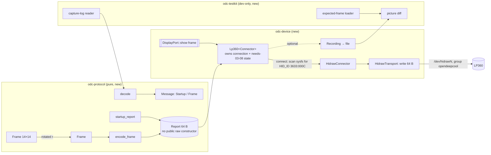

# Phase 5: frames reach the LP360 byte-exact, without root, and keep reaching it after a reconnect

**Plan ID:** `phase-5-device-protocol-core`
**Source PRD:** `docs/prp/prds/opendeepcool-lp360.prd.md` (repository-relative: an absolute path would name the owner's home folder, AGENTS.md rule 10)
**PRD Phase:** `5 — Device & protocol core`
**Source Issue:** `None`
**Plan Publication:** `None`

## Outcome

**Problem:** Every later phase (Load Mode, Guardians, Music, Creative, the service) ends in the same act: a 14×14 picture becomes a USB report that the LP360 shows. Nothing in the repository does that yet. There is no Rust workspace and no encoder. Nothing gets the device node without root, and nothing survives the cooler disappearing. The tests of Phases 7–12 need the expected-frame loader and the picture diff, which don't exist either.

**Affected user:** The owner, whose display must work from boot without root. Also the agents building Phases 6–12 on this core.

**User outcome:**
- A tested core turns any picture, in any of the four rotations, into the exact bytes DeepCreative sends, and writes them to the LP360 as an unprivileged user.
- It finds the cooler on any PC by its USB ID, sends `03 08` before the first frame of every connection, and keeps finding it after a disconnect.
- Every test runs without a person, the real-cooler tests included.

**Invariant:**
- Only messages documented in `docs/spec/protocol.md` ever reach the device: the start-up command `03 08` and frames (AGENTS.md rule 9). The type system enforces it: the device code accepts only reports built by the encoder.
- For every message DeepCreative was captured sending, OpenDeepCool's encoder produces the identical 64 bytes.
- The device is found by USB ID `3633:000c`, never by hidraw number (rule 12, `protocol.md` Device).
- No test needs a person (rule 3).

**Success signal:** All test layers pass unattended, on the real cooler, without root (PRD Phase 5).

**Approach:**
- A Cargo workspace of three crates:
  - `odc-protocol`: pure frame, rotation and report code;
  - `odc-device`: the display port, the LP360 hidraw adapter that reconnects, a recorder;
  - `odc-testkit`: dev-only expected-frame loader, picture diff and capture-log reader.
- Device I/O is plain `write(2)` on the hidraw node found through sysfs, using only `std`.
- The udev rule plus the `opendeepcool` group give access. Two dev scripts install and remove the dev copies.
- GitHub Actions and the pre-commit guard run layers 1 and 3. Layers 2 and 4 run locally, unattended, before each commit that touches them.

## Recommendation

**Direct hidraw writes with `std`, no HID crate.**
- The kernel documents the whole contract: the first byte of a `write()` is the report number, and the rest is the report (docs.kernel.org, "HIDRAW"). The kernel source shows that a write to a vanished device returns `ENODEV` (`drivers/hid/hidraw.c`: `hidraw_send_report`, `hidraw_write`).
- The node is found by reading `HID_ID=0003:00003633:0000000C` from `/sys/class/hidraw/*/device/uevent`. The kernel writes that line as `HID_ID=%04X:%08X:%08X` (`drivers/hid/hid-core.c`, `hid_uevent`), and it's what this PC shows for the LP360.
- So there is nothing for `hidapi` to add except a C library (or libudev) dependency and a second device-discovery path.
- Sysfs and `/dev` roots are constructor parameters. The real adapter therefore runs in CI against fake trees, where a regular file stands in for the device node. No uhid device is needed (`/dev/uhid` is root-only).

**One type for "a message we may send".**
- `Report` (64 bytes) has no public constructor from raw bytes. Only `startup_report()` and `encode_frame(&Frame)` make one, and `Transport::write_report` accepts only `&Report`.
- Rule 9 then holds by construction rather than by review.
- `decode()` turns 64 raw bytes into a `Message` (start-up or frame), for tests and recordings. It never yields a `Report`.

**Reconnect owned by one struct, `Lp360<C: Connector>`.**
- It owns three things: the open transport, the "need `03 08`" state, and the rescan on every call while disconnected. Each new connection sends `03 08` before its first frame (owner, 2026-10-24, `protocol.md` Disconnect and reconnect).
- No timer and no background thread. The caller (Phase 7's scheduler, or a test) calls `show(frame)` about every 104 ms. A failed write drops the connection, and the next call rescans sysfs, which is a few small file reads.
- This avoids DeepCreative's behaviour of three tries, then giving up (`protocol.md` Disconnect and reconnect).

**The oracle is the spec, never Rust.**
- Encoding is checked against the spec's bit table (`protocol.md` Frame) and the exact start-up bytes (`protocol.md` Start-up command). Locally, it's also checked byte for byte against every captured DeepCreative message: the owner checked those pictures on the cooler in Phase 3.
- Rotation is checked against `docs/spec/frames/mode-101.txt` and `mode-100.txt`.
- On the real cooler, the recording of what was actually written is decoded and compared with the same expected frames. Nobody looks at the display.

**The test-pattern binary in the PRD scope is dropped** (owner, 2026-10-24). It existed for the owner's look at the pump. The unattended real-device test now writes the same test image in all four rotations and checks every report.

### Evidence

- `docs/spec/protocol.md:18-32`: 64-byte layout, checksum over bytes 1 … 4+N, terminator `0x16`, zero padding.
- `docs/spec/protocol.md:38-43`: `03 08`, whole report `10 68 01 05 02 03 08 7b 16` + zeros, once before any frame.
- `docs/spec/protocol.md:45-66`: frame bit table: row pairs → bits `0x10 0x20 0x40 0x80 0x01 0x02 0x04`; odd rows columns 1→14, even rows columns 14→1; bit `0x08` never set.
- `docs/spec/protocol.md:68-78`: frames every ~104 ms, continuously; the cooler blanks about 10 s after frames stop.
- `docs/spec/protocol.md:80-91`: reconnect test of 2026-10-24.
  - The cooler returns under another hidraw number.
  - DeepCreative retries 3 times, then drops it.
  - OpenDeepCool keeps looking and sends `03 08` after every reconnect.
- `docs/spec/display.md:143-156`: rotation value *r* turns the whole finished frame *r* × 90° clockwise; 0–3.
- `docs/spec/frames/README.md:7-18`: expected-frame file format (static, 21-frame scrolling, emoji loops with durations, `?` wildcard).
  - 24 files (`mode-001` … `mode-022`, `mode-100`, `mode-101`), 292 `##` cases in all (counted 2026-10-24).
  - `mode-101.txt` holds the stored test image before its first case.
- `docs/spec/settings.md:25-33`: start-up sends `03 08`, then the saved picture at once.
- `docs/prp/prds/opendeepcool-lp360.prd.md:226-249`: Testing Strategy. Layer 2 includes the Phase 5 re-encode; layer 4 is unattended.
- Kernel docs and source, read 2026-10-24:
  - hidraw `write()` takes the report ID as its first byte;
  - `hidraw_write` returns `-ENODEV` once the device is gone, and rejects writes longer than `HID_MAX_BUFFER_SIZE`;
  - `hid_uevent` prints `HID_ID=%04X:%08X:%08X`.
- Community cross-check, read 2026-10-24: Nortank12/deepcool-digital-linux matches the LP Series as vendor 13875 (`0x3633`), product 12 (`0x000c`), and its README's udev rule matches `SUBSYSTEM=="hidraw", ATTRS{idVendor}=="3633"`.
- This PC, 2026-10-24 (the machine facts behind these observations are in `docs/local/`):
  - `udevadm info -a` on the LP360 node shows `ATTRS{idVendor}=="3633"` and `ATTRS{idProduct}=="000c"` on its USB parent.
  - The dev udev rule (installed 2026-10-24) gave the node `root:opendeepcool 0660`, and gave it again to the new node after a reconnect.
  - The owner's account reaches it through `newgrp opendeepcool` without a password.
  - `udevadm verify --resolve-names=never` passes the rule.
- Arch Wiki, Backlight, read 2026-10-24: the documented udev pattern for giving a group write access to a sysfs attribute is `RUN+="/usr/bin/chgrp …"` plus `RUN+="/usr/bin/chmod g+w …"`. `man udev`: `%p` is the device's devpath.
- Cargo Book, environment variables, read 2026-10-24: `CARGO_TARGET_TMPDIR` is set for integration tests, as a directory they may freely write to.
- crates.io and GitHub, read 2026-10-24:
  - `proptest` 1.12.0;
  - `actions/checkout` v7 (7.0.1);
  - `jdx/mise-action` v5 (5.2.3). Since v5.0.0, an unpinned mise is the newest release at least 24 h old.
- `mise.toml:3`: Rust 1.99 with clippy and rustfmt; `cargo 1.99.1` on this PC.
- Local, git-ignored captures:
  - `research/logs/lp360-hidraw.log`: 176,110 messages, every one an `out 64` line in the format `<unix ns> <pid> <tid> out 64 <hex>`;
  - `research/logs/reconnect-20261024.log`: 244 messages.

### Alternatives considered

- **`hidapi` crate:** adds a native library and a second discovery mechanism. Its features (enumeration on other operating systems, Windows/macOS backends) are out of scope, because the PRD supports Arch Linux only.
- **One crate with modules:** fewer manifests, but the PRD splits the workspace by concern, and `odc-testkit` must stay a dev-dependency so test-only parsing never ships in the service.
- **A uhid virtual LP360 for integration tests:** `/dev/uhid` is root-only, which breaks unattended tests. Fake sysfs trees exercise the same adapter code without root.
- **A background reconnect thread or udev monitor:** more state and synchronization for no gain. The caller already ticks every ~104 ms, and a sysfs rescan per tick costs a few reads.

## Visuals



Phase 7's scheduler will call `DisplayPort::show` about every 104 ms; in Phase 5 the tests are the callers. `odc-testkit` is only ever a dev-dependency.

## Implementation Context

### Mandatory reading

| File | Why it matters |
|---|---|
| `docs/spec/protocol.md:5-91` | The whole wire contract, timing, and the reconnect behaviour this plan implements |
| `docs/spec/display.md:143-156` | Rotation semantics and which way is clockwise |
| `docs/spec/frames/README.md:1-35` | Expected-frame file format the loader must parse |
| `docs/spec/frames/mode-101.txt`, `mode-100.txt`, `mode-007.txt`, `mode-014.txt` | One file of each shape: stored image + static cases, blank cases, 21-frame scrolling, emoji loop with durations |
| `docs/spec/settings.md:25-33` | Start-up sequence: `03 08`, then the picture at once |
| `docs/prp/prds/opendeepcool-lp360.prd.md:149-249` | Architecture (ports and adapters, display port, access without root) and the four test layers |
| `AGENTS.md:33-70` | Rules 3 (no person), 4 (one commit per implementation), 5, 7, 9, 10, 12 |
| `.githooks/pre-commit:1-75` | The guard this phase extends with fmt, clippy, tests and the udev check |
| `research/hook/decode-frames.py:16-40` (local) | Our own decoder of the capture format: field layout of each log line |

### Existing patterns and primitives

- **Device lookup by USB ID:** `research/hook/launch-deepcreative.sh:27-33` (local) scans `/sys/class/hidraw/hidraw*/device/uevent` for `HID_ID=0003:00003633:0000000C`. The Rust connector does the same with injectable roots, and parses the three hex fields instead of matching text, so letter case can't matter.
- **Capture line format:** `<unix ns> <pid> <tid> out <len> <hex>` (`research/hook/hidraw-log.c:9-12`, local). The capture-log reader parses this format. The recorder writes a compatible line, `<unix ns> 0 0 out 64 <hex>`, so one reader serves captures and recordings.
- **Commit guard structure:** `.githooks/pre-commit:31-75` collects failures in `fail` and rejects at the end. The Rust checks are appended in the same style.

### Integration points

- `Cargo.toml` (new, repository root): the workspace that Phases 6–12 add crates to.
- `odc_device::DisplayPort`: the port Phase 7's scheduler drives.
- `odc_testkit::{expected, diff, capture}`: what the renderer tests of Phases 7–10 compare against.
- `packaging/udev/70-opendeepcool.rules`, `packaging/sysusers/opendeepcool.conf`: the product files Phase 7 (service user) and Phase 12 (package) build on.
- `.github/workflows/ci.yml`: the CI every later phase relies on.

## Scope

### In scope

- The Cargo workspace and its commands: AGENTS.md Commands, README Development.
- `odc-protocol`: `Frame`, `Rotation`, `Report`, `encode_frame`, `startup_report`, `decode`.
- `odc-testkit`: expected-frame loader, picture diff, capture-log reader.
- `odc-device`:
  - `DisplayPort`, `Transport`, `Connector`, `Lp360`;
  - the hidraw connector and transport;
  - the recording wrapper;
  - fakes for tests.
- The product udev rule and group file, and dev setup, teardown and check scripts, including the dev-only reconnect permission (owner, 2026-10-24).
- Tests in all four layers (below), CI, and the pre-commit guard.
- Records: PRD dev footprint, AGENTS.md (Commands, Repository layout), README.

### Not building

- **The test-pattern binary:** dropped by the owner on 2026-10-24. The real-device test covers its purpose.
- **Frame pacing, the scheduler, the service, logging to the journal, the settings file:** Phase 7. The 104 ms interval appears only as a test constant here, citing `protocol.md` Timing.
- **Renderers:** Phases 7–10. Phase 5 covers only the matrix cases that need no renderer: Creative Mode 100 and 101, rotations 0–3.
- **Sensors:** Phase 6.
- **The service account (`u!` line), packaging and the uninstall removal script:** Phases 7 and 12. The group-only `g` line here is what the dev setup needs today.
- **A uhid virtual device:** root-only, so not unattended.
- **Several LP360s on one PC:** out of scope. The connector picks the lowest-numbered matching node, deterministically.

## Implementation

Each task ends with its own commit (AGENTS.md rule 4), after its tests pass. The commit hook runs the guard (Task 10 extends it).

### 1. The workspace builds, and its commands are documented

**Files and integration points**
- `Cargo.toml`: CREATE. `[workspace]` with `members = ["crates/*"]`, `resolver = "3"`.
  - `[workspace.package]`: `edition = "2024"`, `rust-version = "1.99"`, `license = "MIT"`, `publish = false`.
  - `[workspace.lints.rust]`: `unsafe_code = "forbid"`.
  - `[workspace.dependencies]`: `proptest = "1.12"`.
- `crates/odc-protocol/`, `crates/odc-device/`, `crates/odc-testkit/`: CREATE, each a library crate with `lints.workspace = true` and a crate doc comment stating its role.
  - `odc-device` depends on `odc-protocol`.
  - `odc-testkit` depends on `odc-protocol`.
  - Every crate takes `odc-testkit` and `proptest` as dev-dependencies only.
- `AGENTS.md:109-112`: UPDATE Commands with the exact commands in [Validation](#validation).
- `AGENTS.md`: UPDATE the Repository layout table: `crates/`, `packaging/`, `scripts/dev/`, `.github/workflows/`.
- `README.md:43-57`: UPDATE Development: build and test commands, and the dev setup script.

**Implementation**
- No code beyond empty crates that compile. `Cargo.lock` is committed, since the workspace ships binaries later.

**Tests**
- None yet; the build is the check.

**Validation**
- `cargo build --workspace && cargo clippy --workspace --all-targets -- -D warnings && cargo fmt --all --check`: all succeed.

### 2. A picture is a `Frame`, and rotation turns it clockwise

**Files and integration points**
- `crates/odc-protocol/src/frame.rs`: CREATE.
- `crates/odc-protocol/src/lib.rs`: UPDATE, re-exports.

**Implementation**
- `Frame`: 14 rows × 14 columns of on/off, stored as `[u16; 14]` (bit *c*−1 of row *r*−1 is pixel (*r*, *c*)).
  - `Frame::blank()`.
  - `get(row, col)` and `set(row, col, on)` with 1-based indices, as the spec numbers them. Out-of-range indices panic, because they're programming errors.
  - `Frame::from_rows(&[&str; 14])` for `#`/`.` text, used by tests.
  - `Debug` prints the picture.
- `Rotation`: four values matching the setting 0–3 (`display.md` Rotation).
  - `Rotation::from_setting(u8) -> Option<Rotation>`.
  - `Rotation::next()`: one press of Rotate Screen; 3 wraps to 0 (parity T3, `settings.md:9`).
- `Frame::rotated(Rotation) -> Frame`: turns the whole frame *r* × 90° clockwise, with value 1 = 90° clockwise. The direction is proven against `mode-101.txt` in Task 3, not asserted here from memory.

**Tests** (unit, `proptest` for random frames)
- Four quarter turns give back the original.
- Turning by *r* equals *r* single quarter turns.
- Turning keeps the number of lit pixels.
- `next()` cycles 0→1→2→3→0, and `from_setting(4)` is `None`.

**Validation**
- `cargo test -p odc-protocol`: passes.

### 3. Tests can load every expected frame and print a clear picture diff

**Files and integration points**
- `crates/odc-testkit/src/expected.rs`: CREATE, the loader.
- `crates/odc-testkit/src/diff.rs`: CREATE, the picture diff.
- `crates/odc-protocol/tests/rotation_expected.rs`: CREATE.

**Implementation**
- `expected::load_mode(mode: u16) -> ModeFrames`. It reads `docs/spec/frames/mode-NNN.txt` from `concat!(env!("CARGO_MANIFEST_DIR"), "/../../docs/spec/frames")`.
- `ModeFrames` contains:
  - the title;
  - any pictures before the first case (the stored test image of `mode-101.txt`);
  - `cases: Vec<Case>`.
- `Case` contains:
  - `rotation: Rotation`;
  - `unit: Option<Unit>`: `°C` or `°F`, when the heading names one;
  - `readings: Vec<(String, u32)>`, metric names exactly as written (for example `CPU Usage`, `Gpu temperature`). Phases 7–9 map them to their metric type.
  - `kind`, one of:
    - `Static(Picture)`;
    - `Scrolling(Vec<Picture>)`: 21 pictures in time order;
    - `Loop(Vec<(Duration, Picture)>)`.
- `Picture`: 14×14 of `On` / `Off` / `Any` (`?`). `Picture::matches(&Frame)`: `Any` matches either value.
- **Parsing rules from `frames/README.md`:**
  - a picture block is 14 rows;
  - a row holding several pictures splits on two spaces;
  - scrolling blocks follow the line "21 frames in time order…" in 3 blocks of 7;
  - loops follow "one loop, picture durations in order: …", whose list gives one duration per picture.
- **Parse failures panic** with the file and line number. A mis-parsed oracle must never pass silently.
- `diff::assert_matches(expected: &Picture, actual: &Frame, context: &str)`: on mismatch it panics with both pictures side by side and the differing pixels marked. That is the "failure prints both pictures" requirement (PRD layer 1).

**Tests**
- **Loader self-check:** all 24 files load, and the total is 292 cases.
  - Every `Scrolling` has exactly 21 pictures.
  - Every `Loop` has as many durations as pictures.
  - Every picture is 14×14.
  - `mode-101` has exactly one stored picture before its cases.
  - No picture outside the Music Mode files (modes 13–22) contains `?`.
- **Diff self-check:** a one-pixel difference panics with a message containing both pictures, checked with `#[should_panic(expected = …)]` on a stable marker string.
- **Rotation against the oracle (matrix cases):**
  - mode 101: the stored image `rotated(r)` matches each of its 4 cases;
  - mode 100: `Frame::blank().rotated(r)` matches each of its 4 cases.

  That's 8 of the 116 matrix cases, the only ones that need no renderer.

**Validation**
- `cargo test -p odc-testkit && cargo test -p odc-protocol --test rotation_expected`: passes. Flipping the rotation direction in Task 2 must make the mode-101 test fail.

### 4. Frames and the start-up command become the exact 64-byte reports

**Files and integration points**
- `crates/odc-protocol/src/report.rs`: CREATE.

**Implementation**
- `pub struct Report([u8; 64])`.
  - Its field and constructors are private to the crate.
  - `as_bytes(&self) -> &[u8; 64]`.
  - No `From<[u8; 64]>`, and no public `new`.
- `startup_report() -> Report`: payload `03 08`.
- `encode_frame(&Frame) -> Report`: payload `01` + 28 pixel bytes.
- **Layout from `protocol.md:18-66`:**
  - header `10 68 01 05`, then the payload length N;
  - the checksum is the sum of bytes 1 … 4+N mod 256, then `0x16`, then zeros;
  - pixel (*r*, *c*), with pair *k* = (*r*+1) div 2: odd *r* → bit *k* of pixel byte *c*; even *r* → bit *k* of pixel byte 29−*c*;
  - bits `[0x10, 0x20, 0x40, 0x80, 0x01, 0x02, 0x04]`.
- `decode(&[u8; 64]) -> Result<Message, DecodeError>`, with `Message::{Startup, Frame(Frame)}`.
  - It rejects a wrong report ID or header, an unknown payload, a bad length, checksum or terminator, non-zero padding, and bit `0x08` set.
  - Each rejection is a distinct `DecodeError` variant, so a failing capture line says why.

**Tests** (unit; the vectors are typed from the spec, not computed by the encoder)
- `startup_report()` is exactly `10 68 01 05 02 03 08 7b 16` followed by 55 zeros (`protocol.md:40`).
- Single-pixel frames, each giving exactly one set bit at the spec's position, with the checksum and terminator in place:
  - (1, 1) → pixel byte 1, `0x10`;
  - (2, 1) → pixel byte 28, `0x10`;
  - (13, 14) → pixel byte 14, `0x04`;
  - (14, 14) → pixel byte 15, `0x04`;
  - (7, 5) → pixel byte 5, `0x80`;
  - (10, 3) → pixel byte 26, `0x01`.
- A blank frame: payload `01` + 28 zeros, checksum `(0x68+0x01+0x05+0x1d+0x01) mod 256`.
- Property: `decode(encode_frame(f)) == Ok(Frame(f))` for random frames, and bit `0x08` is never set in any pixel byte.
- `decode` rejects one mutated byte in each region (header, length, checksum, terminator, padding, `0x08` bit) with the matching error.

**Validation**
- `cargo test -p odc-protocol`: passes.

### 5. The encoder reproduces every captured DeepCreative message (layer 2, local)

**Files and integration points**
- `crates/odc-testkit/src/capture.rs`: CREATE, the capture-log reader.
- `crates/odc-protocol/tests/differential_captures.rs`: CREATE.

**Implementation**
- `capture::read(path) -> impl Iterator<Item = Captured>`, with `Captured { unix_ns, dir, bytes }`. It parses the line format above and panics with the line number on a malformed line.
- The test is `#[ignore = "needs the local DeepCreative captures in research/logs (git-ignored)"]`.
  - It reads `research/logs/lp360-hidraw.log` and `research/logs/reconnect-20261024.log`, or the paths in `ODC_CAPTURES` (colon-separated).
  - When run, it **fails** if a file is missing. It never skips silently.
- **For every `out` message of 64 bytes:**
  - `decode` succeeds;
  - re-encoding the decoded message (`startup_report()` or `encode_frame`) gives the identical 64 bytes.
- It prints the totals: messages, start-ups, frames.

**Tests**
- This is the test. It must report 0 mismatches over all 176,110 + 244 messages present when this plan was written, or the current totals.

**Validation**
- `cargo test -p odc-protocol --test differential_captures -- --ignored`: passes and prints the totals. A one-bit change in the encoder's bit table must make it fail.

### 6. `Lp360` keeps the cooler fed: `03 08` first on every connection, rescan after any failure

**Files and integration points**
- `crates/odc-device/src/port.rs`: CREATE.
  - `pub trait DisplayPort { fn show(&mut self, frame: &Frame) -> Link; }`
  - `pub enum Link { Connected, Disconnected }`
- `crates/odc-device/src/lp360.rs`: CREATE.
  - `pub trait Transport { fn write_report(&mut self, r: &Report) -> io::Result<()>; }`
  - `pub trait Connector { type Transport: Transport; fn connect(&mut self) -> io::Result<Option<Self::Transport>>; }`
  - `pub struct Lp360<C: Connector>`.
- `crates/odc-device/src/record.rs`: CREATE.
  - `Recording<C>` wraps any `Connector`. Each successful write appends `<unix ns> 0 0 out 64 <hex>` to a file, in the capture format, so `odc_testkit::capture` reads it back.
- `crates/odc-device/src/fake.rs`: CREATE, public, for this crate's tests and Phase 7's.
  - `FakeConnector` holds a script of presences: absent, present, or a write failure after *n* writes.
  - It keeps a shared log of what each connection received.

**Implementation**
- `Lp360::show(frame)`:
  1. **No open transport:** call `connect()`.
     - `Ok(None)` or `Err`: return `Disconnected` without writing.
     - `Ok(Some(t))`: write `startup_report()` first.
  2. Write `encode_frame(frame)`.
  3. **Any write error:** drop the transport and return `Disconnected`. The next `show` starts again at step 1, so every new connection gets `03 08` before its first frame.
- There is no retry limit and no sleeping: the caller's tick paces rescans (`protocol.md` Disconnect and reconnect).
- `Lp360::new(connector)`. `Lp360::state_changed()` reports whether the last `show` changed `Link`, so Phase 7 can log transitions without logging every tick.

**Tests** (integration, CI, `crates/odc-device/tests/reconnect.rs`, using `FakeConnector`)
- **Absent at start:** `show` returns `Disconnected` and nothing is written; when the device appears, the first two writes are `03 08` then the frame.
- **Steady:** three `show` calls give exactly one `03 08`, then three frames.
- **Failure:** after a write fails, the next `show` rescans and writes `03 08` then the frame, on the new connection.
- **Vanish and return:** the device is absent for N ticks, then returns. No writes happen while it's absent, and the returning connection starts with `03 08`.
- **Recording:** the file holds exactly the successful writes, in order. `odc_testkit::capture` plus `decode` read them back as `Startup`, `Frame(f)`, …
- **Type check:** a `compile_fail` doctest shows that `Report` can't be built from raw bytes outside the crate.

**Validation**
- `cargo test -p odc-device`: passes.

### 7. The hidraw adapter finds the LP360 by USB ID under any node name

**Files and integration points**
- `crates/odc-device/src/hidraw.rs`: CREATE.
  - `HidrawConnector { sysfs: PathBuf, dev: PathBuf }`, with `HidrawConnector::system()` = `/sys`, `/dev`.
  - `HidrawTransport(File)`.

**Implementation**
- `connect()`:
  - list `<sysfs>/class/hidraw/`; for each entry, read `device/uevent` and parse its `HID_ID=` line as three hex numbers (bus, vendor, product);
  - accept bus `0x0003` (USB), vendor `0x3633`, product `0x000c`;
  - choose the lowest hidraw number among matches;
  - open `<dev>/<name>` write-only with `O_CLOEXEC`;
  - `Ok(None)` when nothing matches.
  - An entry whose uevent can't be read is skipped, not fatal: devices come and go during a scan.
  - A matching node that can't be opened (for example, permission denied) returns `Err` naming the path and the error, so Phase 7 can tell "no cooler" from "no access".
- `write_report()`: one `write` of the 64 bytes (`hidraw.html`: the report ID comes first).
  - A short write is an error.
  - `ENODEV` and every other error go to `Lp360`, which drops the connection.

**Tests** (integration, CI, `crates/odc-device/tests/hidraw_fake_tree.rs`)
- Fake trees are built under `env!("CARGO_TARGET_TMPDIR")`, one directory per test. A regular file stands in for each `/dev/hidrawN`.
- **Nothing to find:** no `class/hidraw` → `Ok(None)`; several non-LP360 devices with made-up IDs → `Ok(None)`.
- **The LP360 among others** (as `hidraw5`): it's found, and `Lp360` writes `03 08` and a frame into the stand-in file, which decode back correctly.
- **Letter case:** an LP360 whose uevent shows the IDs in lower case is still found.
- **Moved node:** the LP360 moves from `hidraw1` to `hidraw6` between ticks, and its old stand-in file is removed. After a write error is injected, the next `show` writes `03 08` and the frame to `hidraw6`.
- **Unreadable node:** the file isn't writable → `connect` returns `Err` naming the path.
- **Unrelated USB IDs:** uevents with vendor `0x3633` but another product, and with product `0x000c` but another vendor, are not matched.

**Validation**
- `cargo test -p odc-device --test hidraw_fake_tree`: passes.

### 8. The udev rule and group are product files; dev scripts install and remove the dev copies

**Files and integration points**
- `packaging/udev/70-opendeepcool.rules`: CREATE, the product rule:

  ```
  SUBSYSTEM=="hidraw", ATTRS{idVendor}=="3633", ATTRS{idProduct}=="000c", GROUP="opendeepcool", MODE="0660"
  ```

  Its content matches today's dev copy in `/etc/udev/rules.d/`.
- `packaging/sysusers/opendeepcool.conf`: CREATE, `g opendeepcool -`. Phase 7 replaces it with the service account's `u!` line.
- `scripts/dev/reconnect.rules`: CREATE, the dev-only reconnect permission (owner, 2026-10-24); never packaged:

  ```
  ACTION=="add", SUBSYSTEM=="usb", ENV{DEVTYPE}=="usb_device", ATTR{idVendor}=="3633", ATTR{idProduct}=="000c", RUN+="/usr/bin/chgrp opendeepcool /sys%p/authorized", RUN+="/usr/bin/chmod g+w /sys%p/authorized"
  ```

- `scripts/dev/setup.sh`: CREATE, run with `pkexec`. It's idempotent: it reproduces the 2026-10-24 manual install and adds the reconnect rule. It:
  - installs the sysusers file to `/etc/sysusers.d/` and runs `systemd-sysusers`;
  - installs the product rule as `/etc/udev/rules.d/70-opendeepcool.rules` and the dev rule as `71-opendeepcool-dev-reconnect.rules`;
  - reloads udev and triggers the LP360's hidraw node and USB device, both found by USB ID;
  - adds `$PKEXEC_UID`'s user to the group.
- `scripts/dev/teardown.sh`: CREATE, `pkexec`. It reverses every step: removes the three files, removes the user from the group, deletes the group, then reloads and re-triggers udev so access ends at once.
- `scripts/dev/check.sh`: CREATE, unprivileged. It reports:
  - each installed file and whether it equals the repository copy;
  - the group and your membership;
  - the LP360 node's group and mode;
  - whether the `authorized` file is group-writable.

  It exits non-zero on any mismatch.
- `docs/prp/prds/opendeepcool-lp360.prd.md`: UPDATE.
  - The dev footprint gets the reconnect rule row.
  - The three existing dev rows now say "installed by `scripts/dev/setup.sh`, removed by `scripts/dev/teardown.sh`".
  - The Phase 5 scope line already drops the test-pattern binary; it was updated with this plan.

**Implementation**
- The scripts find devices by USB ID only. They never hard-code a hidraw number, USB port or user name.
- Running `setup.sh` is a system change: the implementing agent shows its commands and asks the owner before running it with `pkexec` (rule 7). The owner already agreed to it on 2026-10-24.

**Tests**
- `udevadm verify --resolve-names=never packaging/udev/70-opendeepcool.rules scripts/dev/reconnect.rules` passes. It runs in the guard and in CI.
- `bash -n` on the three scripts.
- After running `setup.sh`, `scripts/dev/check.sh` exits 0, including after an unattended reconnect (Task 9). This proves the `authorized` permission survives a deauthorize and authorize, which is unverified until then.

**Validation**
- `scripts/dev/check.sh`: exit 0.

### 9. Layer 4 end to end: the real LP360 where one is attached, fakes otherwise (local)

**Files and integration points**
- `crates/odc-testkit/src/hardware.rs`: CREATE, the hardware probe that every phase's end-to-end tests share (owner, 2026-10-24: the dev program runs on other computers too).
  - `Capability`: an enum, starting with `Lp360` and `Lp360Reconnect`. Phases 6–12 add theirs.
  - `probe(cap) -> Probe`:
    - `Real`: the device exists and this account can use it;
    - `Absent { reason }`: the device doesn't exist;
    - `Unusable { reason, fix }`: it exists but can't be used, for example no write access.
  - It finds devices the way the product does: USB ID, driver name, PCI class.
  - `ODC_E2E_REQUIRE`: an optional comma-separated list (`lp360,lp360-reconnect,…`). A listed capability that probes `Absent` is a failure. On the owner's PC it's set from `docs/local/` (git-ignored); other computers leave it unset.
  - `Summary`: collects every capability's mode (real, fake, or failed with the reason) and prints it as a table at the end of the run.
- `crates/odc-device/tests/hardware.rs`: CREATE.
  - Every test is `#[ignore = "layer 4: run locally with --ignored --test-threads=1"]`. They touch real hardware when present, so they never run in CI.

**Implementation**
- **Each test probes its capability first:**
  - `Real` → the real device;
  - `Absent` → the same scenario through the fakes, with the mode recorded as fake: `HidrawConnector` over a fake tree (Phase 5 Task 7), or a `FakeConnector` for reconnect;
  - `Unusable` → fail with the fix, for example "run `scripts/dev/setup.sh`, then log in again or use `newgrp opendeepcool`". It never falls back to fakes, so a broken setup can't pass.
- **`test_images_all_rotations`:**
  - `Lp360` over `Recording<…>`, writing to `target/e2e/hardware-<unix ns>.log`;
  - shows mode 100 (blank), then the mode-101 stored image in rotations 0, 1, 2, 3, each for 20 frames at a fixed 104 ms interval (`protocol.md` Timing);
  - every `show` must return `Connected`.
  - Afterwards it reads the recording back:
    - the first message is `Startup`, and the only one;
    - then come exactly the 100 frames, in order, each matching its expected case from `mode-100.txt` and `mode-101.txt` (`odc_testkit::diff`);
    - nothing else was written.
- **`reconnect`:** `Lp360Reconnect` is `Real` only when the LP360's USB `authorized` file is group-writable (`scripts/dev/reconnect.rules`).
  - Real:
    - find the LP360's USB device directory by `idVendor`/`idProduct` under `/sys/bus/usb/devices`;
    - show frames, write `0` to `authorized`, and keep calling `show` every 104 ms until it returns `Disconnected` (at most 2 s);
    - write `1`, and keep calling `show` until `Connected` (at most 10 s).

    A drop guard writes `1` to `authorized` on every exit path, so a failing test never leaves the cooler disconnected.
  - Fake: the same sequence with the device removed from, then restored to, a fake tree under a new hidraw number.
  - Either way, the recording must show `Startup`, frames, then a **second** `Startup` directly before the first frame after reconnecting.
- Only `startup_report()` and `encode_frame` output reach the device; `Report` makes anything else impossible (rule 9).
- The research rig must not run at the same time, because DeepCreative would write to the cooler too. The test file's doc comment says so.

**Tests**
- These are the tests, plus unit tests of the probe against fake trees:
  - no LP360 → `Absent`;
  - an LP360 node without write access → `Unusable`, with the setup fix;
  - an `ODC_E2E_REQUIRE` entry that probes `Absent` → failure.

**Validation**
- `cargo test -p odc-device --test hardware -- --ignored --test-threads=1`: passes, and prints the summary. On the owner's PC, with `ODC_E2E_REQUIRE=lp360,lp360-reconnect`, both capabilities run real. Run it in a session where `id -nG` lists `opendeepcool`, or through `newgrp opendeepcool -c '…'` until the next login.
- Then `scripts/dev/check.sh`: exit 0.

### 10. CI and the commit guard run the automated layers

**Files and integration points**
- `.github/workflows/ci.yml`: CREATE. On `push` and `pull_request`, `ubuntu-latest`:
  - `actions/checkout@v7`;
  - `jdx/mise-action@v5`, which installs the Rust pinned in `mise.toml`;
  - `cargo fmt --all --check`;
  - `cargo clippy --workspace --all-targets -- -D warnings`;
  - `cargo test --workspace`, layers 1 and 3: ignored tests don't run;
  - `udevadm verify --resolve-names=never` on both rules files. This needs systemd 254 or later on the runner; if the runner's `udevadm` lacks `verify`, the task stops and asks rather than dropping the check.
- `.githooks/pre-commit`: UPDATE. After the existing checks, when `Cargo.toml` exists:
  - run the same fmt, clippy and test commands, plus the `udevadm verify` and `bash -n` checks;
  - add each failure to `fail` in the existing style.
  - The header comment says these run on the working tree, so unrelated unstaged changes must not be present when committing.
- `AGENTS.md`: UPDATE Commands with the local layer 2 and layer 4 commands and when to run them: before any commit that touches `odc-protocol` encoding or `odc-device`.

**Tests**
- A deliberately misformatted line makes the guard reject a commit, checked once by hand, then reverted.
- The workflow passes on the branch push. The push goes over HTTPS as in `docs/local/`, with the owner's OK, because pushing is outward-facing.

**Validation**
- `.githooks/pre-commit` exits 0 on the clean branch, and the GitHub Actions run is green.

## Acceptance

1. **AC1 — Byte-exact encoding:**
   - the spec vectors pass in CI;
   - every captured DeepCreative message (all of `research/logs/lp360-hidraw.log` and `reconnect-20261024.log`) decodes and re-encodes to the identical 64 bytes (Tasks 4–5).
2. **AC2 — Only documented messages:**
   - outside `odc-protocol`, a `Report` can only come from `startup_report()` or `encode_frame` (a `compile_fail` test);
   - the real-device recording holds only start-up commands and frames (Tasks 4, 6, 9).
3. **AC3 — Rotation:**
   - rotation property tests pass;
   - the mode-100 and mode-101 matrix cases (8 of 116) match `docs/spec/frames/` in all four rotations, in unit tests and on the real cooler (Tasks 2, 3, 9).
4. **AC4 — Reusable oracle:**
   - all 24 expected-frame files load into 292 typed cases;
   - a mismatch prints both pictures (Task 3).
5. **AC5 — Start-up and reconnect:**
   - every connection starts with `03 08` before its first frame;
   - after the cooler disappears, `show` keeps rescanning and reconnects to it under a new hidraw number;
   - proven with fakes in CI and on the real cooler (Tasks 6, 7, 9).
6. **AC6 — Without root:**
   - the layer 4 tests run as a member of `opendeepcool`, with no `sudo`;
   - both udev rules pass `udevadm verify`;
   - `scripts/dev/check.sh` passes before and after a reconnect (Tasks 8, 9).
7. **AC7 — Unattended:**
   - every layer runs with no person;
   - CI and the pre-commit guard run layers 1 and 3;
   - layers 2 and 4 have documented local commands (Task 10).
8. **AC8 — Real where present, fake where absent:**
   - the layer 4 run probes each capability on the PC it runs on;
   - present and usable means real; absent means the same checks against fakes; present but unusable fails with the setup fix;
   - capabilities listed in `ODC_E2E_REQUIRE` must run real;
   - every run prints which mode each capability used (Task 9).
9. **AC9 — Records:**
   - AGENTS.md Commands and Repository layout, the README Development section, and the PRD's dev footprint match what was built (Tasks 1, 8, 10).

## Validation

| Gate | Command or procedure | Proves |
|---|---|---|
| Format | `cargo fmt --all --check` | Style, in the guard and CI |
| Lint | `cargo clippy --workspace --all-targets -- -D warnings` | No warnings, in the guard and CI |
| Layers 1 + 3 | `cargo test --workspace` | AC1 (spec vectors), AC2, AC3, AC4, AC5 (fakes) |
| udev rules | `udevadm verify --resolve-names=never packaging/udev/70-opendeepcool.rules scripts/dev/reconnect.rules` | AC6 (syntax) |
| Layer 2 (local) | `cargo test -p odc-protocol --test differential_captures -- --ignored` | AC1 (captures) |
| Layer 4 (local, unattended) | `cargo test -p odc-device --test hardware -- --ignored --test-threads=1`, as a member of `opendeepcool` | AC2, AC3, AC5, AC6 on the real cooler where attached; AC8 |
| Dev access state | `scripts/dev/check.sh` | AC6 |
| CI | GitHub Actions run on the pushed branch | AC7 |

### Test matrix covered in this phase

| Matrix cases | Layer | Where |
|---|---|---|
| Mode 100 × rotations 0–3 | 1 (unit), 4 (real cooler, or fakes where none is attached) | Task 3 `rotation_expected`, Task 9 |
| Mode 101 × rotations 0–3 | 1 (unit), 4 (real cooler, or fakes where none is attached) | Task 3 `rotation_expected`, Task 9 |
| All 116 cases (292 sections) | loader only | Task 3: every file parses into typed cases for Phases 7–10 |

The other 108 matrix cases need renderers and belong to Phases 7–10, which compare their output with the same loader and diff.

## Risks and Decisions

| Decision or risk | Recommendation | Evidence / mitigation | Consequence if different |
|---|---|---|---|
| Crate names `odc-protocol`, `odc-device`, `odc-testkit` | Keep: short, and the PRD leaves the names to the plans | PRD Architecture Notes ("names finalised in the plans") | Renaming later touches every `Cargo.toml` and import |
| The `authorized` permission may not survive a reconnect | Check it in Task 8/9 with `check.sh` after the real reconnect test | Deauthorize unconfigures the device but should keep the USB device itself (kernel authorization docs); unverified on this PC | If it's lost, the rule needs a different trigger, decided with the owner before Task 9 is committed |
| The pre-commit guard tests the working tree, not the staged snapshot | Accept, and document it in the guard's header | Stashing unstaged work inside a hook risks losing it | A commit could pass with unstaged fixes present; CI catches it on push |
| GitHub CI exists after Task 10; AGENTS.md says to revisit merging without PRs then | Ask the owner at Phase 5 sign-off | AGENTS.md "How to work", owner 2026-10-23 | — |
| Two writers: the research rig and the real-device test | Never run them together; the test doc says so | DeepCreative writes to the same node | Interleaved reports would fail the recording comparison, loudly |
| `newgrp` is needed until the owner logs in again | Use `newgrp opendeepcool -c '…'` in the Task 9 command until then | Checked 2026-10-24: no password prompt | None after the next login |

## Agent Notes

- The dev group, the product rule and the owner's membership were installed by hand on 2026-10-24 for the reconnect research (PRD dev footprint). `scripts/dev/setup.sh` must accept that state and change nothing it doesn't need to.
- `research/hook/hidraw-log.c` (local) now follows the LP360 across reconnects and writes `<log>.events` with open and close lines. Use it if a later phase needs DeepCreative evidence again.
- Never copy anything from `docs/local/` into these files. Fake trees use made-up device names and IDs, except the LP360's public USB ID (rule 10).
