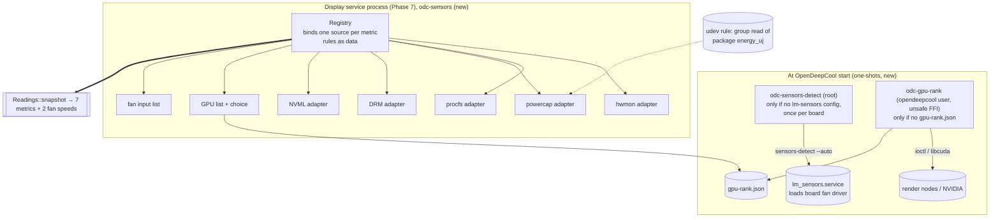

# Phase 6: every value the display shows, read correctly on any PC by an unprivileged service

**Plan ID:** `phase-6-sensors`
**Source PRD:** `docs/prp/prds/opendeepcool-lp360.prd.md` (repository-relative: an absolute path would name the owner's home folder, AGENTS.md rule 10)
**PRD Phase:** `6 — Sensors`
**Source Issue:** `None`
**Plan Publication:** `None`

## Outcome

**Problem:** The display's values must come from Linux, on any PC with an LP360, read by a sandboxed service that has fewer rights than a user (PRD, Service model). Today nothing reads them. Three problems stand in the way:
- the CPU power counter is root-only (CVE-2020-8694);
- the board's fan driver isn't loaded at boot;
- there is no rule for which GPU feeds the display when a PC has more than one.

**Affected user:** The owner, and anyone with an LP360 on Arch Linux, whatever their CPU, GPU and board.

**User outcome:**
- The seven display values (CPU Temperature, CPU Usage, CPU Power, Gpu temperature, Gpu usage, Gpu power, Memory Load) are read once per second from the right Linux source on Intel or AMD CPUs and on amdgpu, Intel or NVIDIA GPUs.
- So are the speeds of the cooler's fans and pump. A value that can't be read is reported as unavailable with a reason, never drawn wrong.
- A dedicated GPU is chosen before an integrated one, without the long-running service gaining GPU device access.

**Invariant:**
- Every metric is the metric it names (AGENTS.md rule 11). A metric with no matching source is `Unavailable(reason)`, never a number from another source.
- Devices are found by name, driver or PCI address, never by hwmon or DRM index (rule 12).
- Nothing is written to any device or sysfs file except by the two install-time pieces the owner approved: the udev rule (group read of the package energy counters) and the detection unit (lm-sensors' own configuration).
- The long-running display service needs no GPU device node on amdgpu or Intel GPUs, and contains no `unsafe` code.
- Root never reads or writes a file the `opendeepcool` account can change: the detection's record lives in `/var/lib/opendeepcool-detect/`, owned by root with mode 0700 (owner, 2026-10-26).
- Readings are exact: each is a fraction of whole numbers in its source's own units, never a floating-point number (owner, 2026-10-26; `display.md` Values).

**Success signal:**
- Values match the system tools within each metric's resolution on the owner's PC.
- Every rule passes its fake-tree tests (PRD Phase 6).
- All of it runs unattended (AGENTS.md rule 3).

**Approach:**
- **`odc-sensors` (library):** ports and adapters as the PRD describes.
  - A `Readings` port gives one `Snapshot` per call.
  - A registry binds one source per metric from built-in driver rules (data, not code paths), with small adapters for hwmon, procfs, powercap, DRM and NVML.
  - It lists the GPUs and the fan inputs.
- **`odc-gpu-rank` (short-lived helper, owner's design 2026-10-24):** the only crate with `unsafe` code. It asks each GPU's driver whether the GPU is integrated, writes a ranking file, and exits.
  - It runs only when OpenDeepCool starts, and only when no ranking exists.
  - It never runs again once the user has chosen a GPU.
  - The drivers' structures it hands the kernel are generated by bindgen from the kernel's own headers and committed, never written by hand (owner, 2026-10-28).
- **`odc-sensors-detect` (root one-shot):** runs `sensors-detect --auto` once per motherboard, only when the PC has no lm-sensors configuration, and records what it created so uninstall can remove exactly that. The record lives in a root-only directory of its own, `/var/lib/opendeepcool-detect/`, so the unprivileged service account can't change what root later reads (owner, 2026-10-26; solution review OV-01).
- **CPU power:** a line in OpenDeepCool's udev rule lets the `opendeepcool` group read the package energy counters (owner, 2026-10-24).
- **Tests:**
  - fake sysfs/proc trees for every rule and every hardware case the PC doesn't have, including future coolers' fakes when they come;
  - the unattended end-to-end run probes the PC it runs on: real devices where present, the same checks against fakes where absent, and a failure where a device is present but unusable (owner, 2026-10-24).

## Recommendation

**Ports and adapters with rules as data.**
- The PRD already fixes the shape (Architecture Notes, "Sensor architecture: ports and adapters").
- The kernel standardises hwmon file names but not their meaning (docs.kernel.org, hwmon sysfs interface). So a rule is a row: metric, subsystem, match (`name`, label or driver), file and unit. One generic hwmon adapter executes every hwmon row.
- Adding a driver later is one row plus one fake tree, with no new code path.
- Every adapter takes a root directory, so the same code runs against `/` and against fake trees under `CARGO_TARGET_TMPDIR`.

**Exact readings, never floating point** (owner, 2026-10-26; solution review OV-08).
- Every source gives whole numbers: jiffies, kB, millidegrees, µW, mW, µJ, or a whole percent or °C. A reading keeps them as a fraction, `Exact { num, den }`, in the metric's unit, and `odc-render` applies the display rules in integer arithmetic (`display.md` Values).
- Floating point can flip a rounding. Every measurement rounds to the nearest whole number (owner, 2026-10-26), and 23 busy jiffies out of 40 is exactly 57.5 %, which draws `58`. But `23/40 × 100` is 57.49999999999999 in doubles, which would draw `57`.

**GPU kind from each driver's documented interface, in a separate process.**
- Each driver documents the signal only as a query on the GPU's render node or through its library:
  - amdgpu: `AMDGPU_INFO_DEV_INFO`, flag `AMDGPU_IDS_FLAGS_FUSION`, "integrated (a.k.a. fusion) GPU";
  - xe: `DRM_XE_QUERY_CONFIG_FLAG_HAS_VRAM`, "has usable VRAM";
  - i915: a `I915_MEMORY_CLASS_DEVICE` region, "Device local-memory";
  - NVIDIA: CUDA `CU_DEVICE_ATTRIBUTE_INTEGRATED`, "Device is integrated with host memory".
- Asking needs `unsafe` FFI and access to `/dev/dri/renderD*` or the NVIDIA nodes. Opening an amdgpu render node also wakes a sleeping GPU (`pm_runtime_get_sync` in `amdgpu_driver_open_kms`).
- Doing it once, in a helper that exits, keeps the always-running service free of `unsafe` code and of render-node access (owner's decision and design, 2026-10-24).
- The ranking file doubles as the marker: the helper's unit has `ConditionPathExists=!` on it, so systemd doesn't even start the helper once a ranking exists.

**The drivers' structures generated from the kernel headers, once, and committed** (owner, 2026-10-28).
- An ioctl hands the kernel a block of memory laid out as a C structure of the driver's uAPI header. Rust can't include C headers, so the layout has to be written out in Rust.
- bindgen, the Rust project's generator, reads the installed headers through libclang and writes the Rust structures, with checks of their size, alignment and field offsets that fail the build. A dev tool, `odc-bindings` (`tools/bindings/`), runs it and writes `crates/odc-gpu-rank/src/bindings.rs`, which is committed.
- Only `odc-bindings` needs clang, on the PC that regenerates. The build, the tests, CI and the AUR package use the committed file, so the package still builds with Rust alone, without the libclang build dependency the Phase 9 plan avoids.
- Rust's crates for Linux kernel interfaces work this way: `linux-raw-sys` (under `rustix`) and Smithay's `drm-sys` ship bindgen's output and regenerate it with a tool or a feature. bindgen's guide recommends generating in `build.rs`, so that a crate needn't keep one file per target, at the cost of libclang for everyone who builds; OpenDeepCool has one target.
- The kernel never changes the existing fields of its uAPI, so the committed structures stay valid. A field the helper needs later means regenerating.

**CPU power through the udev rule OpenDeepCool already ships.**
- Powercap zones are udev devices (`SUBSYSTEM=powercap`, checked on this PC), so a rule can match the package zones by their `name` attribute, not their index.
- The pattern `RUN+="/usr/bin/chgrp … /sys%p/…"` plus `chmod g+r` is the Arch Wiki's documented way to share a sysfs attribute with a group.
- Only the service account is in `opendeepcool` in the product, so the counter isn't opened to every user (the reason it became root-only).
- The alternative, a root helper serving the value, adds a root process and IPC for one number.

**Detection as a small Rust program, not a shell line in a unit.**
- The "never overwrite, once per board, record what was created" logic must be tested, and uninstall (Phase 11) depends on the record.
- `sensors-detect` writes `/etc/conf.d/lm_sensors` and, when driver options are needed, `/etc/modprobe.d/lm_sensors.conf`. It overwrites either one if present, then enables and starts `lm_sensors.service` (read in the script, 2026-10-24).
- So the program runs it only when **both** files are absent, and records which of them appeared and whether the service was enabled before.
- The record lives in the detection unit's own state directory, `/var/lib/opendeepcool-detect/`, owned by root with mode 0700 (solution review OV-01). The display service's directory belongs to the `opendeepcool` account, and systemd re-owns everything inside it to that account (systemd.exec, `StateDirectory=`). A compromised service could replace a record there, or turn it into a symbolic link, and root would act on it.

### Evidence

- `docs/spec/sensors.md` Metrics: the seven metrics, their meanings, and DeepCreative's labels; the Linux source per metric.
- `docs/spec/sensors.md` Driver rules: driver rules.
  - coretemp `Package id 0`;
  - k10temp `Tdie` else `Tctl`, unavailable before family 17h;
  - `/proc/stat` busy share;
  - powercap `package-0` `energy_uj` with `max_energy_range_uj` wrap;
  - amdgpu `edge`, `gpu_busy_percent`, `power1_average` else `power1_input`, unavailable on integrated AMD;
  - NVML; other drivers;
  - `/proc/meminfo`.
- `docs/spec/sensors.md` Updates and rounding: once per second; CPU usage and power are averages over the interval; GPU values as read.
- `docs/spec/sensors.md` GPU choice: GPU choice rules 1–4, saved by PCI address, missing GPU handling.
- `docs/spec/sensors.md` CPU power: CPU power is root-only; the options were a group rule or a helper; the owner chose the rule on 2026-10-24.
- `docs/spec/sensors.md` Fan and pump speed: fan inputs. Every hwmon `fanN_input` except devices whose parent is PCI class `0x03`; saved as chip name + device path + input number; none by default.
- `docs/prp/prds/opendeepcool-lp360.prd.md` Architecture Notes: Sensors and Sensor architecture (sensor sources, ports and adapters), and Service model (unprivileged, sandboxed; detection as a root one-shot).
- Kernel sources, read 2026-10-24:
  - `drivers/powercap/intel_rapl_msr.c`: AMD families 17h, 19h, 1Ah and Hygon 18h use `rapl_defaults_amd`, under control type `"intel-rapl"`;
  - `drivers/powercap/intel_rapl_common.c`: package zones are named `package-%d`, or `package-%d-die-%d` on multi-die parts;
  - `kernel/sched/cputime.c` `account_guest_time`: guest time is also added to `CPUTIME_USER`/`CPUTIME_NICE`, so the busy total is fields 1–8 of the `cpu` line;
  - `drivers/gpu/drm/amd/amdgpu/amdgpu_kms.c`: `amdgpu_driver_open_kms` calls `pm_runtime_get_sync` and `amdgpu_vm_init`.
- Kernel uAPI headers, read 2026-10-24: `amdgpu_drm.h` (`AMDGPU_IDS_FLAGS_FUSION`, `AMDGPU_INFO_DEV_INFO`), `xe_drm.h` (`DRM_XE_QUERY_CONFIG_FLAG_HAS_VRAM`), `i915_drm.h` (`I915_MEMORY_CLASS_DEVICE`, `DRM_I915_QUERY_MEMORY_REGIONS`).
- Kernel ABI docs, read 2026-10-24:
  - `sysfs-driver-intel-i915-hwmon`: `temp1_input` "GPU package temperature", `energy1_input` (device-level hwmon `name` "i915"), "only supported for particular … platforms";
  - `sysfs-driver-intel-xe-hwmon`: `temp2_input` "Package temperature", `energy1_input` "Card energy", same platform note;
  - neither documents a GPU busy percentage. docs.kernel.org nouveau documents no hwmon readings.
- `proc_stat(5)` (man7.org, read 2026-10-24): `cpu` fields user … steal, guest, guest_nice; iowait "is not reliable".
- NVIDIA, read 2026-10-24: CUDA Driver API, `CU_DEVICE_ATTRIBUTE_INTEGRATED` "Device is integrated with host memory".
  - Arch `nvidia-utils` 615.78.08-1 ships `usr/lib/libcuda.so.1` and `usr/lib/libnvidia-ml.so.1`.
  - `nvml-wrapper` 0.13.0 (Context7) loads `libnvidia-ml.so.1` at run time. A missing library is `NvmlError::LibloadingError`.
    - Read again 2026-10-27 (Context7): `LibloadingError` covers every failure to open the library, not only a missing one. `Nvml::init` can also fail with `FailedToLoadSymbol`, and with `DriverNotLoaded`, `NoPermission` or `Unknown` from `nvmlInit_v2`.
  - It offers `temperature(TemperatureSensor::Gpu)` (°C), `utilization_rates().gpu`, `power_usage()` (mW) and `pci_info().bus_id`.
- `/usr/bin/sensors-detect` (lm_sensors, read 2026-10-24):
  - lines 7404-7423: `/etc/modprobe.d/lm_sensors.conf` is written when driver options are needed;
  - lines 7433-7464: `/etc/conf.d/lm_sensors` is written ("overwrite" if present), then `systemctl enable` and `start lm_sensors.service`.
- This PC, 2026-10-24 (machine facts in `docs/local/`):
  - `udevadm info /sys/class/powercap/intel-rapl:0` shows `SUBSYSTEM=powercap` and zone name `package-0`;
  - `energy_uj` is `root:root 0400`;
  - `/sys/class/dmi/id/board_{vendor,name,version}` are `0444`;
  - the GPU render node is `0666`;
  - opening and closing it takes about 0.07 ms (median of 20, GPU awake);
  - `sensors`, `ffmpeg`, `top` and `free` are installed.
- crates.io, 2026-10-24: `nvml-wrapper` 0.13.0, `libc` 0.2.191, `proptest` 1.12.0 (Phase 5).
  - Read again 2026-10-28 (`cargo tree`): `nvml-wrapper` 0.13.0, still the latest, depends on `libloading` 0.8.9, so the helper takes `libloading` 0.8 too: `deny.toml` refuses two versions of one crate. `libloading` is ISC-licensed.
  - `bindgen` 0.73.2, BSD-3-Clause. Its guide (read 2026-10-28): "bindgen leverages libclang to preprocess, parse, and type check C and C++ header files"; of `build.rs`: "The downside is that everyone building your crate also needs libclang available to run bindgen".
  - Read again 2026-10-29 (`cargo tree -d`): `bindgen` 0.73.2 depends on `syn` 3, while `nvml-wrapper`'s macros depend on `syn` 2. `bindgen` 0.72.1, the previous release, uses `syn` 2, so Task 9 takes `bindgen` 0.72 and the workspace keeps one version of each crate.
- Rust practice for kernel interfaces, read 2026-10-28:
  - `linux-raw-sys` "contains bindgen-generated bindings for Linux's userspace API", regenerated by its `gen` program;
  - `drm-sys` 0.8.1 ships pre-generated bindings and runs bindgen only with its `use_bindgen` feature;
  - the Linux kernel's own Rust code uses bindgen, whose libclang "is used by bindgen to understand the C code in the kernel" (docs.kernel.org, Rust quick start).
- The installed DRM uAPI headers, read 2026-10-28: `amdgpu_drm.h` and `i915_drm.h` carry MIT permission notices, and `xe_drm.h` is `SPDX-License-Identifier: MIT`. The generated file keeps their notices. `DRM_IOCTL_AMDGPU_INFO` is built with `DRM_IOW`, `DRM_IOCTL_XE_DEVICE_QUERY` and `DRM_IOCTL_I915_QUERY` with `DRM_IOWR`.
- DeepCreative, static strings, 2026-10-24: its helper takes the GPU list and a GPU type from HWiNFO (`getGpuList`, `GPU Type`) and selects by index (`setCurrentGpu`). How it picks the default isn't traced, and there's no Linux equivalent to copy.

### Alternatives considered

- **Kind queries inside the display service:** the service would need render-node access and `unsafe` code for its whole life. Rejected by the owner, 2026-10-24.
- **No automatic ranking (first by PCI address):** breaks the owner's "dedicated before integrated" rule.
- **Root helper for CPU power:** a root process plus IPC for one value; the udev rule needs neither.
- **A user-editable rules file:** rejected in the PRD (Decisions Log, "Sensor architecture").
- **Reading the GPU busy percentage of Intel GPUs from the i915/xe PMU (perf events):** not a documented sysfs reading, and it needs perf privileges. Gpu usage stays unavailable on Intel until a documented source exists.
- **Hand-written copies of the drivers' structures, checked by compiling C against the headers** (this plan until 2026-10-28): a person copies each layout, and the only check that catches a misreading compiles C, which would need a rule 13 exception. Replaced by generated structures (owner, 2026-10-28).
- **bindgen at every build (`build.rs`):** clang on every PC that builds OpenDeepCool, CI and AUR users included, for structures that never change.

## Visuals



The display service reads sysfs, procfs and NVML only. Render-node access and our own `unsafe` code exist only in `odc-gpu-rank`, which exits. The one exception is NVIDIA's closed NVML library, which the service loads only when the chosen GPU uses the `nvidia` driver (owner, 2026-10-27; solution review P6-06).

## Implementation Context

### Mandatory reading

| File | Why it matters |
|---|---|
| `docs/spec/sensors.md` (all) | Metrics, driver rules, refresh, GPU choice, CPU power, fan inputs: the contract this phase implements |
| `docs/spec/display.md` Values | Values keep their fraction until drawn; rounding is Phase 7's |
| `docs/spec/settings.md` Settings, OpenDeepCool's defaults, What the settings app must offer | Fan inputs and GPU choice as settings; defaults; what the app shows (Phase 10 consumer) |
| `docs/prp/prds/opendeepcool-lp360.prd.md` Architecture Notes (Sensors, Sensor architecture, Service model) | Sensor sources, architecture, service model |
| `docs/prp/plans/phase-5-device-protocol-core.plan.md` (Tasks 1, 8, 10) | Workspace, lints, `packaging/udev/70-opendeepcool.rules`, the dev tool `odc-dev` (`tools/dev/`), CI and the guard this phase extends |
| `docs/prp/reports/phase-5-device-protocol-core.report.md` | What Phase 5 built and where it differs from its plan; a re-trigger can't take back a udev rule's `chgrp` and `chmod` |
| `AGENTS.md` rules 3, 7, 8, 10 (exception for driver names), 11, 12 | The constraints every task checks |
| `docs/local/machine.md` (local only) | The owner's devices: only for the `odc-e2e --require` list on the owner's PC, never in code or commits |

### Existing patterns and primitives

- **Fake trees:** Phase 5 built `odc_testkit::fake_tree::FakeTree` (`create(root)`, `roots()`, `hidraw`, `usb_device`). Each test picks its folder under `CARGO_TARGET_TMPDIR`, which Cargo sets only when it builds integration tests, so the library can't choose it. This phase adds generic methods and the sensor fixtures.
- **The probe and `odc-e2e`:** `odc_testkit::hardware` (`Capability`, `Probe`, `Roots`, `Summary`) and `odc-e2e`'s `Area`, `--only` and `--require` (Phase 5 Task 9). This phase adds capabilities and areas.
- **Product files plus the dev tool:** Phase 5 Task 8 (`packaging/udev/70-opendeepcool.rules`, and `odc-dev`'s `setup`, `teardown` and `check` in `tools/dev/`). This phase adds to the same files rather than new installers.
- **Lints:** the workspace forbids `unsafe_code` (Phase 5 Task 1). `odc-gpu-rank` alone opts out (Task 9), so the boundary is visible in its `Cargo.toml`.

### Integration points

- `odc_sensors::Readings`: the readings port Phase 7's scheduler calls once per second.
- `odc_sensors::gpus()`, `GpuChoice`, `fan_inputs()`, `FanInput`: the lists and saved identities Phase 7 (settings file) and Phase 10 (pickers) use.
- `/var/lib/opendeepcool/gpu-rank.json`: written by `odc-gpu-rank`, read by the registry, deleted by the service when the GPU set changes and the user hasn't chosen (Task 7).
- `/var/lib/opendeepcool-detect/sensors-detect.json` (root only): the detection record that Phase 11's uninstall reads.
- `packaging/systemd/opendeepcool-gpu-rank.service`, `packaging/systemd/opendeepcool-sensors-detect.service`: ordered before `opendeepcool.service`, which Phase 7 creates.

## Scope

### In scope

- `odc-sensors`:
  - metric model, `Readings` port, clock, registry;
  - adapters: hwmon, procfs, powercap, DRM, NVML;
  - driver rules for coretemp, k10temp, amdgpu, i915, xe and NVIDIA (NVML);
  - GPU list and choice;
  - fan-input list;
  - fakes for Phase 7.
- `odc-gpu-rank` and its unit, and `odc-bindings`, the dev tool that generates the helper's kernel structures.
- `odc-sensors-detect` and its unit.
- The udev rule line for CPU power, and the dev tool's new steps (`odc-dev`).
- Spec, PRD and checklist records of the 2026-10-24 decisions.
- Tests in all layers that apply: unit, integration with fake trees, and an unattended end-to-end run that uses each real device the PC has and fakes for the rest. Layer 2 (DeepCreative captures) doesn't apply: sensors aren't in the captures.

### Not building

- **The settings file, the scheduler, the `doctor` command, and logging to the journal:** Phase 7. This phase exposes `Registry::bindings()` for them.
- **The pickers and GPU dropdown UI:** Phase 10.
- **Packaging and the uninstall removal script:** Phase 11. This phase writes the record it needs.
- **Gpu usage on Intel GPUs:** no documented sysfs reading; unavailable with a reason.
- **nouveau and other GPU drivers:** no documented readings or kind signal. Listed last, all metrics unavailable with "no reading for this GPU's driver".
- **Fan or pump control, any `pwm*` write:** out of scope (rule 8).
- **Other DeepCool coolers:** after v1. Recorded in the PRD by Task 1; their tests will be fakes when they come.

## Implementation

Each task ends with its own commit (rule 4) after its tests pass. The guard and CI from Phase 5 run on each.

### 1. The spec and PRD record the 2026-10-24 sensor decisions

**Files and integration points**
- `docs/spec/sensors.md`: UPDATE.
  - **Driver rules table:**
    - AMD CPU power is verified in the kernel source (families 17h, 19h, 1Ah, Hygon 18h; zone `package-N`). Only zones under control type `intel-rapl` count, never `intel-rapl-mmio`.
    - Rows for i915 (`temp1_input`, `energy1_input` of hwmon `name` `i915`), xe (`temp2_input`, `energy1_input` of `xe`) and NVML (the calls above).
    - Intel Gpu usage: unavailable.
    - No row says which rules ran on the owner's PC (rule 10; owner, 2026-10-27).
  - **GPU choice:**
    - the kind signal per driver, with the uAPI names and the CUDA attribute (recorded at the overview review's cross-check, 2026-10-27: check it against what's built);
    - the `odc-gpu-rank` helper and when it runs;
    - the ranking order: dedicated, then integrated, then unknown, then by PCI address;
    - the hardware-change rule.
  - **CPU power:** the decision (udev rule, group read), recorded at the overview review's cross-check (2026-10-27): check it against what's built.
  - **Board sensor driver:** the second file `sensors-detect` may write; "runs only when both files are absent".
- `docs/spec/parity-checklist.md`: UPDATE. S4's chosen access was recorded at the overview review's cross-check (2026-10-27); S10 gets the kind signals and the helper. Each row is "reviewed 2026-10-24: owner decision".
- `docs/prp/prds/opendeepcool-lp360.prd.md`: UPDATE.
  - The open questions on the GPU kind signal and CPU power access were answered at the overview review's cross-check (2026-10-27): check that the answers still match what this phase builds.
  - System Footprint: the GPU-rank unit and helper; `/etc/modprobe.d/lm_sensors.conf` (only if created); the udev rule's powercap line; `gpu-rank.json` in the service's state directory, and `sensors-detect.json` in the detection's own root-only directory, `/var/lib/opendeepcool-detect/`. Each is removed by the removal script.
  - What We're NOT Building: "Other DeepCool water coolers: after v1 (owner, 2026-10-24)".

**Tests**
- None (docs). The owner reviews the diff before the commit.

**Validation**
- `.githooks/pre-commit` passes.

### 2. The metric model, the `Readings` port and a fake for Phase 7

**Files and integration points**
- `crates/odc-sensors/`: CREATE, a library. `lints.workspace = true`. It depends on `nvml-wrapper = "0.13"` (Task 8) and nothing else beyond `std`.
- `crates/odc-sensors/src/model.rs`: CREATE.
- `crates/odc-sensors/src/registry.rs`: CREATE, the registry's core: binding, rescans and `bindings()`. The sources it binds come with Tasks 4–8 (owner, 2026-10-28: the plan's order put this test before the fake trees and the first sources).

**Implementation**
- `Metric`: `CpuTemperature`, `CpuUsage`, `CpuPower`, `GpuTemperature`, `GpuUsage`, `GpuPower`, `MemoryLoad`. `Metric::spec_name()` returns DeepCreative's exact names (`CPU Temperature`, `Gpu usage`, …). These are the names `docs/spec/frames/` headings use, which Phase 7 maps.
- `Reading`: `Value(Exact)` or `Unavailable(Unavailable)` (owner, 2026-10-26: no floating point between a source and a digit; `display.md` Values, `sensors.md` Updates and rounding).
  - `Exact { num: i64, den: u64 }`, with `den > 0`, is the reading's exact value as a fraction of whole numbers, in °C, %, W or RPM.
  - Adapters build it from their source's integer units: millidegrees → `m / 1000`; jiffies → `100 · busy / total`; kB → `100 · used / total`; µW → `µW / 1 000 000`; mW → `mW / 1000`; energy → `ΔµJ / Δµs`; a whole percent, °C or RPM → `n / 1`.
  - `Exact` has no conversion from or to `f64` on the service's path. The end-to-end comparisons with `sensors -j` convert only to compare.
  - The reasons are an enum: `NoRule { driver }`, `NoDevice`, `PermissionDenied { path }`, `ReadFailed { path }`, `NotYet` (the first sample of a rate metric), `IntegratedGpuPower`, `UnknownGpuKind` (an AMD GPU whose kind is unknown, so its power might include the CPU; solution review P8-06), `DriverUpdated` (the GPU driver changed since boot; a reboot fixes it; solution review P6-12), `LibraryFailed { library, error }` (a driver's library that can't be loaded or started, with the loader's or the library's own message; NVML; overview cross-check, 2026-10-27).
  - `Display` gives the one-line reason the app shows (`settings.md` What the settings app must offer).
- `Snapshot`: one `Reading` per `Metric`, plus `cooler_fans` and `pump`, each a `Reading` in RPM, or `NotChosen`.
- `trait Readings { fn snapshot(&mut self) -> Snapshot; fn restart_intervals(&mut self); }`
  - `restart_intervals()` drops the last sample of every reading averaged over the interval: CPU Usage, and power from an energy counter (CPU Power, and Gpu power on i915 and xe). Their next reading is `NotYet` again, as at start-up.
  - Phase 7 calls it after every wake-up from standby, so no average spans the sleep, whatever the counters did meanwhile (owner, 2026-10-26; `sensors.md` Updates and rounding).
- **Binding and rescans** (owner, 2026-10-27; solution review P6-04): the registry, which implements `Readings`, binds each metric's source at its first scan. A metric left without a source is looked for again every 5 s for the first two minutes after start-up or `restart_intervals()` (a wake-up), then every 60 s, so a driver that loads late (`lm_sensors.service`, a GPU driver) is found without a restart. A read that fails looks for that metric's source again at once. Each new binding shows in `bindings()`, which Phase 7 logs.
  - Each metric has an ordered list of candidate sources, which the rule rows of Tasks 4–8 fill. At a scan, the registry tries them in order and binds the first one found.
- `trait Clock { fn now(&self) -> Instant; }`, with `SystemClock`.
- `FakeReadings`: public; scripted snapshots for Phase 7's tests, and a count of `restart_intervals()` calls.

**Tests**
- `spec_name()` round-trips for all seven, and the names match the headings in `docs/spec/frames/` (read through `odc_testkit::expected`).
- Each `Unavailable` reason has a non-empty one-line `Display`.
- Integral sources give integral values: 57 000 m°C is exactly 57 °C; 2 000 000 µW is exactly 2 W.
- **Late sources** (P6-04), with a fake clock and a scripted fake source:
  - a source that appears after 30 s is bound at the next 5 s scan, and one that appears after 3 minutes at the next 60 s scan;
  - a source that stays missing is looked for at exactly those times and no more often;
  - `restart_intervals()` starts the 5 s rescans again;
  - a read that fails looks for the source again at once.
- The same test over fake trees comes with the first real sources: Task 4 (the CPU temperature driver appears late) and Task 8 (the GPU's hwmon appears late).

**Validation**
- `cargo test -p odc-sensors`: passes.

### 3. Fake sysfs and proc trees for every rule, built from the kernel docs

**Files and integration points**
- `crates/odc-testkit/src/fake_tree.rs`: UPDATE. Phase 5's `FakeTree::create(root)` gains `.file(path, contents)`, `.symlink(path, target)`, `.mode(path, 0o400)` and `.remove(path)`. The caller still picks `root` under `CARGO_TARGET_TMPDIR`.
- `crates/odc-testkit/src/hardware.rs`: UPDATE. `Roots` gains `proc`, the procfs root (`/proc`, or the fake tree's `proc/`), for the sensor checks of Task 11.
- `crates/odc-testkit/src/fixtures.rs`: CREATE. Named fixture functions, each citing the kernel doc it follows:
  - `coretemp(package_millic)`;
  - `k10temp(tctl, Some(tdie))`, and `k10temp_pre17h()`;
  - `amdgpu_dgpu(pci, edge, busy, power_avg_uw)`, `amdgpu_apu(…)`, and `amdgpu_power_input_only(…)`;
  - `i915(pci, temp, energy)`, `xe(pci, temp2, energy1)`, and `nvidia_proprietary(pci)` (PCI device, no hwmon);
  - `nouveau(pci)`;
  - `rapl(zones: &[("intel-rapl:0", "package-0", energy, max)])`, plus an `intel-rapl-mmio:0` zone also named `package-0`, and the control type's own entry, `class/powercap/intel-rapl`, which has no `name` file, as on real systems;
  - `proc_stat(lines)`, `proc_meminfo(total, available)`;
  - `board_fans(chip = "fakeboardchip", inputs)`: a made-up chip name (rule 10). The `device` is a platform device.
- The fixtures follow the real sysfs layout:
  - `class/hwmon/hwmonN` → `devices/…/hwmon/hwmonN`, with a `name` file and a `device` link to the parent;
  - the parent's `class` file (`0x030000` for display controllers);
  - `class/drm/cardN/device` → the PCI device, with its `driver` link;
  - `bus/pci/devices/<addr>`;
  - `class/powercap/<zone>` → `devices/virtual/powercap/<control type>/<zone>`.

**Tests**
- Each fixture produces the paths its doc names. A smoke test per fixture lists the tree.

**Validation**
- `cargo test -p odc-testkit`: passes.

### 4. CPU Temperature from coretemp or k10temp

**Files and integration points**
- `crates/odc-sensors/src/rules.rs`: CREATE, the rule table as data.
- `crates/odc-sensors/src/hwmon.rs`: CREATE, the generic hwmon adapter.

**Implementation**
- A rule row is `{ metric, source: Hwmon { name, label_any_of: &[..], file_suffix, scale } | … , applies_to }`.
- `hwmon.rs`:
  - scans `<sys>/class/hwmon/*`, reads `name`;
  - for each `tempN_label` / `fanN_label` / `powerN_label` it pairs the channel's `_input` (or `_average`);
  - builds `Exact` from the integer it reads: millidegrees → `m / 1000` °C, microwatts → `µW / 1 000 000` W, never through floating point.
- **CPU Temperature rows:**
  - coretemp, label `Package id 0`;
  - k10temp, label `Tdie`, else `Tctl`.
  - k10temp on a family before 17h → `Unavailable(NoRule)`. The family is read from `/proc/cpuinfo` `cpu family` (the k10temp doc: `Tctl` isn't a temperature there).
- Several CPU packages: rule 1 matches the first package by hwmon `name` order, and `Package id 0` is by definition package 0.

**Tests** (integration, fake trees)
- coretemp: 57000 → exactly 57 (`Exact { num: 57000, den: 1000 }`).
- k10temp: `Tdie` is preferred over `Tctl`; with `Tctl` only → `Tctl`; family 0x15 → unavailable.
- No CPU driver → `Unavailable(NoDevice)`.
- An hwmon index change between scans (`hwmon2` → `hwmon5`) still binds by name.
- A board chip with a `temp1_label` of `Package id 0` but `name` `fakeboardchip` isn't matched.
- **Late source** (P6-04), with a fake clock: the CPU temperature driver's hwmon appears after 30 s and is bound at the next 5 s scan; appearing after 3 minutes, it's bound at the next 60 s scan.

**Validation**
- `cargo test -p odc-sensors --test cpu_temperature`: passes.

### 5. CPU Usage and Memory Load from procfs

**Files and integration points**
- `crates/odc-sensors/src/procfs.rs`: CREATE.

**Implementation**
- **CPU Usage:**
  - parse the aggregate `cpu` line's first eight fields (user … steal). Guest time is already inside user and nice (`account_guest_time`).
  - busy = Δtotal − Δ(idle + iowait) over the interval, and CPU Usage = `Exact { num: 100 · busy, den: Δtotal }`, in whole numbers (`sensors.md` driver rules).
  - The first call returns `Unavailable(NotYet)`, and so does the first call after `restart_intervals()`.
  - Δtotal = 0 → keep the previous value.
- **Memory Load:** `Exact { num: 100 · (MemTotal − MemAvailable), den: MemTotal }` from `/proc/meminfo` (kB). If `MemAvailable` is missing → `Unavailable(ReadFailed)`. It has been present since Linux 3.14; this rule is defensive only for malformed input.

**Tests**
- Hand-computed vectors: two `cpu` lines with known deltas → exact percentages: 0 %, 50 % and 100 %, and iowait counted as idle. 23 busy jiffies out of 40 → exactly 57.5, drawn `58%`; floating point would give 57.49999999999999, drawn `57%`.
- Property test: the result always lies in [0, 100] for monotonically increasing counters.
- After `restart_intervals()`, the next call → `NotYet`, and the one after it uses only the new interval's counters.
- meminfo: 31,000,000 kB total, 7,750,000 kB available → exactly 75 %.

**Validation**
- `cargo test -p odc-sensors --test procfs`: passes.

### 6. CPU Power from the package energy counters, readable only by the service's group

**Files and integration points**
- `crates/odc-sensors/src/powercap.rs`: CREATE.
- `packaging/udev/70-opendeepcool.rules`: UPDATE, adding:

  ```
  ACTION=="add|change", SUBSYSTEM=="powercap", KERNEL=="intel-rapl:*", ATTR{name}=="package-*", RUN+="/usr/bin/chgrp opendeepcool /sys%p/energy_uj", RUN+="/usr/bin/chmod g+r /sys%p/energy_uj"
  ```

- `tools/dev/` (`odc-dev`'s `setup`, `teardown` and `check`): UPDATE.
  - setup re-triggers the package zones, found by name, so the new line applies at once;
  - teardown undoes the line on each package zone's `energy_uj`: group back to `root`, group read removed. A re-trigger can't take back a rule's `chgrp` and `chmod`: Phase 5 found that for the USB switch, which teardown resets by hand;
  - check verifies `energy_uj` is group `opendeepcool` and group-readable;
  - setup installs no new file: the rule file it already installs, and records in the dev manifest, gains the line.

**Implementation**
- **Zones:** every `<sys>/class/powercap/*` whose resolved path's parent directory is `intel-rapl` (control type), whose `name` starts with `package-`, and which isn't a sub-zone.
  - Power = `Exact { num: Σ ΔµJ over the zones, den: Δµs }`: µJ per µs is watts, and Δµs is the monotonic interval in whole microseconds. Wrap: if a reading is lower than the last, add `max_energy_range_uj`.
  - The first call → `NotYet`, and so does the first call after `restart_intervals()`.
  - `EACCES` → `Unavailable(PermissionDenied { path })`.
- `KERNEL=="intel-rapl:*"` excludes `intel-rapl-mmio:*`, and `ATTR{name}=="package-*"` excludes the `core`, `uncore` and `dram` sub-zones.

**Tests** (fake trees)
- One package: 2,000,000 µJ over 1,000,000 µs of fake clock → exactly 2 W.
- Wrap-around → a correct positive power.
- Two packages → the sum.
- A counter that dropped to 0 during a sleep: after `restart_intervals()`, the next call → `NotYet`, never a power computed across the sleep (and never a false wrap-around).
- An `intel-rapl-mmio:0` zone named `package-0` is ignored.
- A `0400` file the test user can't read → `PermissionDenied`.
- `udevadm verify --resolve-names=never` passes on the updated rule (guard and CI from Phase 5).

**Validation**
- `cargo test -p odc-sensors --test cpu_power`: passes.
- After `odc-dev setup` (system change, shown to the owner first), `odc-dev check`: exit 0.

### 7. The GPU list, the saved choice and the fan inputs

**Files and integration points**
- `crates/odc-sensors/src/gpu.rs`: CREATE.
- `crates/odc-sensors/src/fans.rs`: CREATE.

**Implementation**
- **`gpus(root) -> Vec<Gpu>`:** every `<sys>/bus/pci/devices/*` whose `class` has base class `0x03` and that has a `driver` link.
  - `Gpu` holds: `pci` (domain:bus:device.function), `driver`, and `kind`.
  - `kind` comes from `gpu-rank.json` when listed there, else `Unknown`.
- **`GpuKind`:** `Dedicated`, `Integrated` or `Unknown`, and an `Unknown` says why: `NoSignal` (the driver has none, such as nouveau) or `QueryFailed { error }` (owner, 2026-10-27; solution review P6-07). Both rank as unknown; a failed query is logged as a warning and named in the GPU list.
  - Rank order: Dedicated, then Integrated, then Unknown; ties broken by PCI address (`sensors.md` GPU choice details).
  - NVIDIA's proprietary driver gets its kind from `odc-gpu-rank` (CUDA), like the others.
- **`choose(gpus, saved: Option<PciAddr>) -> Option<&Gpu>`:**
  - the saved GPU if present;
  - otherwise the best ranked. The saved choice is kept for when that GPU returns (rules 1–4 and details).
- **`rank_is_stale(gpus, rank_file, user_has_chosen) -> bool`:** true when the set of PCI addresses differs from the one recorded in `gpu-rank.json` **and** the user hasn't chosen. The service then deletes the file, so the helper ranks again at the next start (owner, 2026-10-24).
  - If the user has chosen, the helper never reruns. A new GPU still appears in the list, as `Unknown`, ranked last.
- **A broken ranking file** (overview cross-check, 2026-10-27; AGENTS.md rule 5): a `gpu-rank.json` that doesn't parse, or doesn't match its form (the PCI set, and for each GPU a well-formed address and a known kind), is treated as stale whether or not the user has chosen. The service logs it once and deletes it, so the helper ranks again at the next start. Until then every GPU's kind is `Unknown`, as for a GPU the file doesn't list.
- **`fan_inputs(root) -> Vec<FanInput>`:**
  - every `fanN_input` of every hwmon device, except devices whose `device` parent is PCI base class `0x03` (`sensors.md` fan inputs);
  - `FanInput { chip: name, device_path, input: N, label: Option }`.
  - `rpm(&FanInput)` re-resolves by chip name + device path + N on every read. A missing input → `Unavailable(NoDevice)`, never another input's value.

**Tests** (fake trees)
- **One GPU, any kind** → it's chosen. With one GPU, the list API reports `len() == 1`, so Phase 10 shows no dropdown.
- **A dedicated amdgpu and an integrated i915** → the amdgpu is chosen.
- **Two dedicated GPUs** → the lower PCI address wins.
- **Unknown kinds:** nouveau plus an integrated amdgpu → the APU wins, and nouveau is listed last.
- **A failed kind query** (P6-07): an NVIDIA GPU whose query failed plus an integrated i915 → the i915 is chosen, as the rule says; the NVIDIA GPU is `Unknown(QueryFailed)` with its error, distinct from nouveau's `NoSignal`.
- **Saved choice missing** → the best ranked GPU, and the saved choice is kept.
- **Stale ranking:** the GPU set changed and nothing was chosen → stale; the set changed but the user had chosen → not stale.
- **A broken ranking file** (rule 5): truncated JSON, an unknown kind and a malformed PCI address are each logged and deleted, whether or not the user has chosen, and every GPU's kind is `Unknown` until the next ranking.
- **Fans:**
  - a board chip with 3 inputs plus an amdgpu fan → 3 inputs, no amdgpu fan;
  - the board chip's hwmon index changes → the same `FanInput` reads the same file;
  - the chosen input is removed → `NoDevice`.

**Validation**
- `cargo test -p odc-sensors --test gpu_choice --test fans`: passes.

### 8. GPU temperature, usage and power for amdgpu, Intel and NVIDIA

**Files and integration points**
- `crates/odc-sensors/src/drm.rs`: CREATE, `gpu_busy_percent`.
- `crates/odc-sensors/src/nvml.rs`: CREATE. `trait NvmlSource`, with `RealNvml`, which wraps `nvml_wrapper::Nvml` initialised once, and only when the chosen GPU's driver is `nvidia` (owner, 2026-10-27; solution review P6-06), and `FakeNvml`.
- `crates/odc-sensors/src/rules.rs`: UPDATE, the GPU rows.
- `deny.toml`: UPDATE. ISC joins the allowed licences: `nvml-wrapper` loads NVML through `libloading`, which is ISC-licensed (owner, 2026-10-28).

**Implementation**
- The rules bind to the **chosen** GPU's PCI device only, matching hwmon devices whose `device` resolves to that PCI address.
- **amdgpu:**
  - temperature: label `edge`;
  - usage: `device/gpu_busy_percent`;
  - power: `power1_average` else `power1_input`, as `µW / 1 000 000` W. Shown only on a GPU ranked `Dedicated` (owner, 2026-10-27; solution review P8-06). On one ranked `Integrated` → `Unavailable(IntegratedGpuPower)`, because amdgpu's integrated reading includes the CPU (`sensors.md`, rule 11); on one of unknown kind → `Unavailable(UnknownGpuKind)`, because it might be integrated.
- **i915:** temperature from `temp1_input`; power = `ΔµJ / Δµs` from `energy1_input`, `NotYet` on the first call and after `restart_intervals()`; usage → `Unavailable(NoRule)` with the reason "this GPU's driver doesn't report usage".
- **xe:** temperature from `temp2_input` (package); power = `ΔµJ / Δµs` from `energy1_input` (card); usage unavailable as for i915.
- **NVIDIA proprietary** (driver `nvidia`): through `NvmlSource`, matched by `pci_info().bus_id` to the chosen PCI address.
  - temperature: `temperature(Gpu)`, whole °C, as `n / 1`;
  - usage: `utilization_rates().gpu`, whole percent, as `n / 1`;
  - power: `power_usage()` in mW, as `mW / 1000`.
  - NVML failures give their real cause (solution review P6-12; `nvml-wrapper`'s errors read with Context7, 2026-10-27):
    - the library can't be loaded (`LibloadingError`, `FailedToLoadSymbol`) → `Unavailable(LibraryFailed { library: "NVML", error })`. One error covers both a missing library and one that is there but refused, for example by the service's sandbox, where NVML is untested (overview cross-check, 2026-10-27). The loader's own message, kept in `error`, tells them apart;
    - `DriverNotLoaded` → `NoDevice`, and NVML is started again while the registry looks for late sources, so a driver that loads late is still found (solution review P6-04);
    - `LibRmVersionMismatch`, after a driver update without a reboot → `DriverUpdated`;
    - `NoPermission` → `PermissionDenied`, naming NVML;
    - any other error starting NVML → `LibraryFailed`, with NVML's own message.
    - The exact `nvml-wrapper` error names are checked again with Context7 when this is built.
- **Any other driver** → all three `Unavailable(NoRule { driver })`.

**Tests**
- Fake trees for amdgpu dGPU, amdgpu APU (power unavailable), amdgpu of unknown kind (power `UnknownGpuKind`, P8-06), amdgpu with only `power1_input`, i915, xe and nouveau.
- **Late source** (P6-04), with a fake clock: the chosen GPU's hwmon appears after 30 s and is bound at the next 5 s scan; appearing after 3 minutes, it's bound at the next 60 s scan.
- `FakeNvml` with a matching bus ID and a non-matching one.
- **NVML only for NVIDIA** (P6-06): with a counting fake, a PC whose chosen GPU isn't NVIDIA's never initialises NVML, not even once.
- **NVML's reasons** (P6-12; overview cross-check, 2026-10-27): the fake's two load errors, a missing library and a refused one, each give `LibraryFailed` with its own message; driver not loaded gives `NoDevice`; version mismatch and no permission give `DriverUpdated` and `PermissionDenied`; any other start error gives `LibraryFailed` with NVML's message.
- Rule 11 check: in every fixture, each metric's value is distinct, and the test asserts each one comes from its own file. For example, an amdgpu fixture with `edge` 41 °C, `junction` 77 °C and `mem` 66 °C must read 41.

**Validation**
- `cargo test -p odc-sensors --test gpu_metrics`: passes.

### 9. `odc-gpu-rank`: a short-lived helper ranks the GPUs once

**Files and integration points**
- `crates/odc-gpu-rank/`: CREATE, a binary crate with a library, so the tests and `odc-e2e` use its code:
  - `src/lib.rs`: each driver's signal, the `KindSource` port, `rank` and the atomic write;
  - `src/drivers.rs`: the drivers' answers through `ffi`, after checking that the render node it opens is the character device sysfs names for the GPU (`drm/renderDN/dev`), so no request reaches another file;
  - `src/fake.rs`: the fake `KindSource`, shared with `odc-e2e`.
  - `Cargo.toml` declares `[lints.rust] unsafe_code = "deny"` instead of the workspace's `forbid`. Only `src/bindings.rs` and `src/ffi.rs` carry `#[allow(unsafe_code)]`.
  - Dependencies: `odc-sensors` (the GPU list), `libc = "0.2"` (ioctl) and `libloading = "0.8"` (libcuda). That's the `libloading` version `nvml-wrapper` 0.13.0 uses, so the workspace has one copy of it, as `deny.toml` requires.
- `tools/bindings/` (`odc-bindings`): CREATE, a dev-only program, never shipped (owner, 2026-10-28; AGENTS.md rule 13).
  - It runs `bindgen` (as a library, `bindgen = "0.72"`: 0.73 would add a second version of `syn`, see Evidence) on the installed `drm/amdgpu_drm.h`, `drm/xe_drm.h` and `drm/i915_drm.h`, keeps only the structures and constants listed below, and writes `crates/odc-gpu-rank/src/bindings.rs`.
  - The file starts with a note that it's generated and mustn't be edited, the command that made it, and the headers' MIT notices.
  - `--check` regenerates in memory and fails if the committed file differs.
  - It needs clang (libclang) on the PC that runs it. Nothing else does: the build, the tests, CI and the package use the committed file.
- `crates/odc-gpu-rank/src/bindings.rs`: GENERATED by `odc-bindings`, and committed:
  - `drm_amdgpu_info` and `drm_amdgpu_info_device` (the kernel fills `return_size` bytes);
  - `drm_xe_device_query` and `drm_xe_query_config`;
  - `drm_i915_query`, `drm_i915_query_item` and `drm_i915_query_memory_regions`, with the structures they contain;
  - the constants the requests and flags need: `DRM_IOCTL_BASE` (the ioctl base the requests are built from), `DRM_COMMAND_BASE`, `DRM_AMDGPU_INFO`, `AMDGPU_INFO_DEV_INFO`, `AMDGPU_IDS_FLAGS_FUSION`, `DRM_XE_DEVICE_QUERY`, `DRM_XE_DEVICE_QUERY_CONFIG`, `DRM_XE_QUERY_CONFIG_FLAGS`, `DRM_XE_QUERY_CONFIG_FLAG_HAS_VRAM`, `DRM_I915_QUERY`, `DRM_I915_QUERY_MEMORY_REGIONS` and `I915_MEMORY_CLASS_DEVICE`;
  - bindgen's layout checks for each structure, which in this version are compile-time assertions.
- `crates/odc-gpu-rank/src/ffi.rs`: CREATE.
  - The ioctl numbers, built from the generated sizes and constants as the headers' `DRM_IOW` and `DRM_IOWR` build them, and the `unsafe` calls.
  - `libcuda`'s `cuInit`, `cuDeviceGetCount`, `cuDeviceGet`, `cuDeviceGetAttribute(CU_DEVICE_ATTRIBUTE_INTEGRATED)` and `cuDeviceGetPCIBusId`, declared by hand from NVIDIA's CUDA Driver API documentation. Their header comes with NVIDIA's developer toolkit, not with the driver (unverified), so there's nothing to generate from on a normal PC.
- `crates/odc-testkit/src/hardware.rs`: UPDATE, the GPU capabilities `GpuAmdgpu`, `GpuI915`, `GpuXe`, `GpuNvidia` and `GpuOther`, each found by PCI class and driver, for this task's end-to-end run (Task 11 adds the rest). A DRM driver's GPU is usable when this account can open its render node for reading and writing.
- `crates/odc-testkit/src/sysfs.rs`, `fixtures.rs`: UPDATE, the PCI display controllers for the probe, and a render node fixture whose `/dev/dri` stand-in is a regular file.
- `crates/odc-e2e/src/lib.rs`: UPDATE, the area `gpu-rank`.
- `deny.toml`: UPDATE. BSD-3-Clause joins the allowed licences, for `bindgen` in the dev tool (owner, 2026-10-28). bindgen's dependencies are checked like any other's, one version of each crate.
- `AGENTS.md`: UPDATE, the repository layout and the commands gain `odc-bindings`.
- `crates/odc-gpu-rank/src/main.rs`: CREATE. It lists GPUs (Task 7), queries each driver's signal, and writes `gpu-rank.json` atomically (temp file + rename) into `--state-dir`, which defaults to `/var/lib/opendeepcool`. `--sys` and `--dev` name the roots, `/sys` and `/dev` by default, so the tests run the program on fake trees, as Task 10's flags do. The file holds the PCI set and each GPU's kind with the signal used. Then it exits.
  - A GPU whose query fails, or whose driver has no signal (nouveau), is `Unknown`, with the reason in the file, and the two stay apart: `query-failed` with its error, or `no-signal` (P6-07). A failed query is logged as a warning. The helper never fails the boot.
- `packaging/systemd/opendeepcool-gpu-rank.service`: CREATE.
  - `Type=oneshot`, `User=opendeepcool`, `TimeoutStartSec=30` (a one-shot has no start time limit by default, systemd.service; solution review P6-03);
  - `StateDirectory=opendeepcool`, so systemd creates the directory on a fresh install, before the display service ever ran (same user; solution review P6-14);
  - `ConditionPathExists=!/var/lib/opendeepcool/gpu-rank.json`;
  - `Before=opendeepcool.service`, `WantedBy=opendeepcool.service`;
  - sandbox: `ProtectSystem=strict` (the state directory stays writable), `ProtectHome=yes`, `NoNewPrivileges=yes`, `PrivateNetwork=yes`, `CapabilityBoundingSet=`, `DevicePolicy=closed`, `DeviceAllow=char-drm rw`, plus NVIDIA's device groups, `DeviceAllow=char-nvidia* rw` (systemd.resource-control matches device groups with wildcards; unverified until checked against a PC with NVIDIA's driver, in Phase 11).
  - The exact set is re-checked in Phase 11. It's written now so Phase 7 can order it.

**Tests**
- **Unit (CI):** bindgen's layout checks in `bindings.rs` assert every structure's size, alignment and field offsets at compile time, so a hand edit of the generated file fails the build, and with it `cargo test`. The three request numbers are checked against the values the headers' own macros give, printed by a C program built with clang (2026-10-29).
- **Regeneration (local, needs clang):** `cargo run -p odc-bindings -- --check` passes, so the committed file is what the installed headers give. A header update that grows one of the structures fails it, and regenerating fixes it.
- **Integration:** a `KindSource` trait with a fake gives the JSON contents for:
  - one dGPU;
  - an iGPU plus a dGPU;
  - a failed query, recorded as `query-failed` with its error;
  - nouveau, recorded as `no-signal`.
- **Unit files (CI):** a test reads both helper units: `TimeoutStartSec=` is set on each (30 s here, 120 s for detection), the rank helper has `StateDirectory=opendeepcool`, and the detection unit has no `Before=opendeepcool.service` (P6-02, P6-03, P6-14).
- **End to end (local, `odc-e2e --only gpu-rank`, `crates/odc-e2e/src/gpu_rank.rs`):** the probe decides per GPU driver.
  - **Real GPUs:** the helper's library runs twice, as the owner's account, a member of `opendeepcool`, against the real render nodes or NVIDIA's library, and writes into `target/e2e/gpu-rank/real/state` as the program does. The program itself runs in `cargo test` on fake trees (`--sys`, `--dev`), which never reach a driver.
    - Every PCI display device in sysfs gets a kind.
    - A driver with a documented signal must not end up `Unknown`.
    - Both runs give identical files.
    - No tool can say independently whether a real GPU is integrated, so correctness rests on the fakes, which cover each driver's integrated and dedicated answers.
  - **Absent drivers:** the same checks through the fake `KindSource`.
  - Nothing about the owner's GPUs is written into the code.

**Validation**
- `cargo run -p odc-bindings -- --check`, `cargo test -p odc-gpu-rank`, then `cargo run -p odc-e2e -- --only gpu-rank`: all pass.
- **System change, approved 2026-10-28:** before `odc-bindings` first runs, `clang` is installed on the owner's PC with `sudo pacman -S clang`, shown to the owner first (rule 7). The PRD's dev footprint lists it.
  - Done 2026-10-29 through the polkit dialog, as the owner asked: `pkexec pacman -S --needed --noconfirm clang`. pacman added `clang-libs`, `llvm`, `llvm-lit` and `compiler-rt` with it; `llvm-lit` wasn't in the list first shown.

### 10. `odc-sensors-detect`: lm-sensors finds the board's fan driver once, and nothing it didn't create is ever touched

**Files and integration points**
- `crates/odc-sensors-detect/`: CREATE, a binary. `lints.workspace = true`; `std` only.
- `packaging/systemd/opendeepcool-sensors-detect.service`: CREATE.
  - `Type=oneshot`; runs as root (the only root part, PRD Service model);
  - `StateDirectory=opendeepcool-detect` and `StateDirectoryMode=0700`: its own root-only directory for the record (solution review OV-01);
  - `ConditionPathExists=!/etc/conf.d/lm_sensors`;
  - `ConditionPathExists=!/etc/modprobe.d/lm_sensors.conf`;
  - `TimeoutStartSec=120`, so a probe that hangs ends (solution review P6-03);
  - `WantedBy=opendeepcool.service`, with no `Before=`: the display service starts without waiting for it, at boot and inside `pacman` (owner, 2026-10-27; solution review P6-02). The cooler's fan and pump speeds appear once the driver is loaded, because the registry looks for them again (Task 2);
  - stdout and stderr go to the journal.
- `AGENTS.md`: UPDATE, the repository layout gains `odc-sensors-detect`.
- `docs/spec/sensors.md`: UPDATE, the real run's evidence (Board sensor driver).

**Implementation**
- Paths come from flags with real defaults (`--etc`, `--sys`, `--state-dir` defaulting to `/var/lib/opendeepcool-detect`, `--sensors-detect`, and `--systemctl` for the `is-enabled` question), so the tests use fake roots and fake programs.
- **The state directory is root's alone** (owner, 2026-10-26; solution review OV-01):
  - it's owned by root with mode 0700: by the account that runs the program, which is root in the unit and through `pkexec`, so the tests can run it unprivileged on their own folders;
  - the program creates it so when it's missing, since it also runs outside the unit (the end-to-end run below), and refuses to run when it exists with another owner or mode;
  - it refuses a record that is a symbolic link;
  - it writes a new record through a temporary file created exclusively (`create_new`) in the same directory, then `rename`s it.
- **Steps:**
  1. If either lm-sensors file exists → record nothing and exit 0. The unit's conditions normally prevent this; the check is repeated here because the binary can be run on its own. Likewise if a fan input outside a graphics card already exists (the fan picker's rule, Task 7): the chip that measures the cooler's fans and pump is already readable, so there's nothing to find (owner, 2026-10-27; solution review P6-13).
  2. Read the board identity from `<sys>/class/dmi/id/board_vendor`, `board_name` and `board_version`. If `sensors-detect.json` already lists this identity → exit 0 (once per motherboard).
  3. Note whether `lm_sensors.service` is enabled (`systemctl is-enabled`, path injectable).
  4. Run `sensors-detect --auto`.
  5. Write `sensors-detect.json` with fixed fields only, after `"version": 1`: the board identity, the date, `created_conf_d` and `created_modprobe_d` (yes/no: did this run create `/etc/conf.d/lm_sensors`, `/etc/modprobe.d/lm_sensors.conf`), and `lm_sensors_enabled_before` (yes/no). It never holds a path.

  Phase 11's removal script acts only on those yes/no fields, on the two fixed paths, and disables the service only if it wasn't enabled before.
- `sensors-detect` exiting non-zero is logged, and the record is still written, so it doesn't run again at every boot (`sensors.md` driver rules). One that can't be started at all is an error, with no record, so it runs once lm-sensors is installed.
- A record that doesn't read as the program writes it is replaced by the run's own, with a warning in the journal.

**Tests** (integration; the fake `sensors-detect` is a small Rust test program that writes the files a scenario needs, AGENTS.md rule 13. It's the test binary itself, `harness = false`, which plays the fake `sensors-detect` or `systemctl` when started under that name from a case's folder)
- **Fresh PC** → it runs once, the record lists `/etc/conf.d/lm_sensors` as created, and a second run doesn't run it.
- **Fan readings already exist** (a board chip with fan inputs in the fake tree, no lm-sensors files) → never run, nothing recorded (P6-13). An amdgpu fan alone doesn't count: then it runs.
- **Existing `/etc/conf.d/lm_sensors`** → never run, nothing recorded, and the file is unchanged (byte-compared).
- **Existing `/etc/modprobe.d/lm_sensors.conf` only** → never run; the file is unchanged.
- **A run that also writes `modprobe.d`** → both files are recorded.
- **A different board identity** (motherboard replaced) with both files absent → it runs again.
- **The fake script fails** → the record is still written.
- **A state directory that isn't root's alone** (another owner, or mode 0755) → refused; nothing runs and nothing is written.
- **A record that is a symbolic link** → refused; the link's target is never read or written.
- **The record's fields** are the identity, the date and the three booleans; a test parses it with an exact schema that has no path-valued field.

**Validation**
- `cargo test -p odc-sensors-detect`: passes.
- **End to end (owner approved 2026-10-24, a system change done once):**
  - shown to the owner, then `pkexec target/debug/odc-sensors-detect` (its state directory defaults to `/var/lib/opendeepcool-detect`);
  - right after it, unattended and without a reboot (owner, 2026-10-25: no boot tests):
    - `/etc/conf.d/lm_sensors` exists;
    - `lm_sensors.service` is enabled, so it loads the driver at every boot, and active, because `sensors-detect` starts it (the script, read 2026-10-28);
    - the record lists what was created;
    - the board's fan chip is in `/sys/class/hwmon` without a manual `modprobe`.
  - The PRD dev footprint lists the created files and the enabled service, until Phase 11's package takes over.
  - The record in `/var/lib/opendeepcool-detect/` isn't part of the dev manifest. The Phase 11 package takes it over, so its uninstall still knows what the detection created.

### 11. Layer 4 end to end: real sensors where the PC has them, fakes where it doesn't

**Files and integration points**
- `crates/odc-testkit/src/hardware.rs`: UPDATE, the probe from Phase 5 Task 9. Task 9 added the GPU capabilities; this task adds the rest. Each is shown with the name `--require` takes:
  - `CpuTemp` (`cpu-temp`), `CpuPower` (`cpu-power`), `ProcStat` (`proc-stat`), `Meminfo` (`meminfo`);
  - from Task 9: `GpuAmdgpu` (`gpu-amdgpu`), `GpuI915` (`gpu-i915`), `GpuXe` (`gpu-xe`), `GpuNvidia` (`gpu-nvidia`), `GpuOther` (`gpu-other`);
  - `BoardFans` (`board-fans`);
  - `SensorsTool` (`sensors-tool`: `sensors -j`), `GpuLoadTool` (`gpu-load-tool`: `ffmpeg` with Vulkan).

  Each is found the way the product finds it: hwmon `name`, powercap zone name, PCI class and driver, an NVML load.
  - **`Unusable` cases**, each failing with its fix:
    - CPU power present but not readable → run `cargo run -p odc-dev -- setup`;
    - a GPU present but its tool missing → install `ffmpeg`;
    - `sensors` missing → install `lm_sensors`.
- `crates/odc-e2e/src/sensors.rs`: CREATE, this phase's checks in the `odc-e2e` program (Phase 5 Task 9), run with `--only sensors`.
- `crates/odc-e2e/src/lib.rs`: UPDATE, the area `sensors`. `crates/odc-e2e/tests/flags_and_fakes.rs`: UPDATE, its example of an unknown area is `sensors`, which becomes valid, so it takes a name that stays unknown.
- No file describes the owner's PC. The tests learn the hardware from the probe (owner, 2026-10-24). `odc-e2e --require` (Phase 5 Task 9) lists what must run real on a given PC; on the owner's PC the list comes from `docs/local/`.

**Implementation** (`Real` capabilities run `Registry` over the real `/sys` and `/proc` as a member of `opendeepcool`; `Absent` ones run the same checks over the Task 3 fixtures, with values chosen to satisfy them)
- **Every metric bound:**
  - each of the seven metrics is `Value` when its capabilities are `Real` or faked;
  - `Unavailable` appears only where the rules say so (for example Intel Gpu usage), with the documented reason;
  - `Registry::bindings()` names each source.
- **Against `sensors -j`, in the same second (real), or the fixture's file (fake):**
  - CPU Temperature equals the CPU driver's package input within 1 °C;
  - Gpu temperature equals the chosen GPU's main temperature within 1 °C;
  - Gpu power within 10 % or 5 W, whichever is larger. The driver's value moves within a second (`sensors.md`).
- **Fans:** **every** hwmon fan input the product lists equals `sensors -j`'s reading of the same chip and input within 3 %. No knowledge of which input is the pump is needed. With no board fan driver, `BoardFans` is `Absent` and the fake chip is used.
- **Memory Load** equals `free -b`'s (total − available) ÷ total within 0.5 points.
- **CPU Usage:**
  - the test loads every logical CPU with busy threads for 5 s → ≥ 95 %;
  - it agrees with `top -b -n 2 -d 1`'s `%Cpu(s)` busy share in the same window within 5 points.
- **CPU Power:**
  - readable without root, through the group;
  - under the same load, it rises above its idle reading;
  - it stays between 1 W and 1000 W.

  No independent reference exists without root; the unit tests of Task 6 cover the arithmetic.
- **Gpu usage, for each real GPU whose rule reads usage:** an `ffmpeg` Vulkan filter run on that GPU for 5 s → ≥ 90 %, then back below 50 % within 5 s of stopping (`sensors.md`, observed 2026-10-23).
- **NVIDIA (real only where NVML loads):** the three NVML readings are `Value` and lie in plausible ranges. Otherwise `FakeNvml` runs the same checks.
- **The summary** (Phase 5's `Summary`) prints every capability's mode at the end.

**Tests**
- These are the tests, plus probe unit tests over fake trees:
  - no CPU temperature driver → `Absent`;
  - `energy_uj` `0400` → `Unusable` with the setup fix;
  - NVML not loadable → `GpuNvidia` `Absent`.

**Validation**
- `cargo run -p odc-e2e -- --only sensors`: passes, and prints the summary.
- On the owner's PC, with a `--require` list from `docs/local/` covering its CPU, power counter, GPU and board fans, every one of those runs real.
- `AGENTS.md` Commands: add this, to run before any commit touching `odc-sensors`. Task 9 added the `odc-gpu-rank` one.

## Acceptance

1. **AC1 — The metric it names:**
   - each of the seven metrics is read from its rule's source;
   - in every fixture, a distinct value per metric proves no metric is read from another's file;
   - integrated amdgpu power and CPU-as-GPU readings are never used (Tasks 4–8).
2. **AC2 — Any PC:**
   - rules for coretemp, k10temp, amdgpu, i915, xe and NVIDIA (NVML) pass their fake-tree tests;
   - devices bind by name, driver or PCI address, never by index;
   - a missing driver gives `Unavailable` with a reason (Tasks 3–8).
3. **AC3 — Rates over the interval, exact:** CPU Usage and CPU Power are averages between two samples. The first sample is `NotYet`, and so is the first after `restart_intervals()` (a wake-up from standby); energy wrap-around is handled. Every reading is an exact fraction of whole numbers: 23 busy jiffies out of 40 read exactly 57.5 (Tasks 2, 5, 6).
4. **AC4 — CPU power without root, for the group only:**
   - the udev rule grants group `opendeepcool` read access to the `intel-rapl` package zones only;
   - the real-PC test reads CPU Power as a group member (Tasks 6, 11).
5. **AC5 — GPU choice:**
   - dedicated, then integrated, then unknown, then by PCI address;
   - the saved choice wins when present and is kept when absent;
   - one GPU gives a list of one;
   - the ranking reruns only when the GPU set changed and the user hasn't chosen (Task 7).
6. **AC6 — The helper boundary:**
   - only `odc-gpu-rank` contains `unsafe` code and opens render nodes or NVIDIA devices;
   - it runs only while `gpu-rank.json` is absent, and exits;
   - its kernel structures are generated from the kernel headers by bindgen, never written by hand, and their layout tests pass (Task 9).
7. **AC7 — Detection never overwrites:**
   - `odc-sensors-detect` runs `sensors-detect --auto` only when both lm-sensors files are absent, once per board;
   - it records exactly what it created, as yes/no facts, in its own root-only directory, and refuses a record or a directory that isn't root's alone;
   - on the owner's PC, right after it runs, `lm_sensors.service` is enabled and active and the board's fan chip is readable without a manual `modprobe`, with no reboot (Task 10).
8. **AC8 — Fan inputs:**
   - every hwmon fan input except a graphics card's is listed;
   - a chosen input is re-found across hwmon index changes;
   - a missing one is `NoDevice` (Task 7).
9. **AC9 — Real where present, fake where absent, unattended:**
   - the layer 4 run probes every sensor capability on the PC it runs on;
   - real values agree with `sensors`, `free` and `top` within the stated tolerances, under loads the test creates itself;
   - absent hardware runs the same checks against fakes;
   - present-but-unusable fails with its fix;
   - the summary shows each capability's mode (Tasks 9, 11).
10. **AC10 — Records:**
    - `sensors.md`, the parity checklist, the PRD (open questions, footprint, other coolers after v1) and AGENTS.md (layout, commands) match what was built;
    - the dev footprint lists every system change made (Tasks 1, 6, 10, 11).

## Validation

| Gate | Command or procedure | Proves |
|---|---|---|
| Format, lint | `cargo fmt --all --check`; `cargo clippy --workspace --all-targets -- -D warnings` | Style; no warnings |
| Layers 1 + 3 | `cargo test --workspace` | AC1, AC2, AC3, AC5, AC6 (layout tests, fakes), AC7 (fakes), AC8 |
| udev rules | `udevadm verify --resolve-names=never packaging/udev/70-opendeepcool.rules tools/dev/reconnect.rules` | AC4 (syntax) |
| Units | `systemd-analyze verify packaging/systemd/opendeepcool-gpu-rank.service packaging/systemd/opendeepcool-sensors-detect.service`, run locally; it reports the helpers' binaries missing from `/usr/bin/` until a package installs them, which is expected and listed (2026-10-29) | AC6, AC7 (unit syntax) |
| Dev access | `cargo run -p odc-dev -- check` | AC4 |
| Kernel structures | `cargo run -p odc-bindings -- --check`, run locally (needs clang) | AC6 |
| GPU helper, layer 4 | `cargo run -p odc-e2e -- --only gpu-rank` | AC6 |
| Detection, once | `pkexec target/debug/odc-sensors-detect`, then the Task 10 checks | AC7 |
| Sensors, layer 4 | `cargo run -p odc-e2e -- --only sensors` | AC4, AC9 |
| CI | GitHub Actions on the pushed branch | Layers 1 + 3 |

### Test matrix covered in this phase

Phase 6 draws no frames, so it covers none of the 112 display cases. Its own matrix is the driver rules × hardware cases:

| Rule | Fake-tree cases |
|---|---|
| coretemp | package, index change, foreign `Package id 0` |
| k10temp | Tdie, Tctl only, pre-17h |
| `/proc/stat`, `/proc/meminfo` | vectors, property |
| powercap | one, two packages, wrap, mmio twin, denied |
| amdgpu | dGPU, APU, `power1_input` only |
| i915, xe | temperature and energy, usage unavailable |
| NVIDIA (NVML) | matching, non-matching bus ID, library missing or refused |
| nouveau, other | all unavailable, ranked last |
| GPU choice | 1 GPU, dGPU + iGPU, 2 dGPU, unknown kinds, saved missing, stale, broken ranking file |
| Fan inputs | board chip + GPU fan, index change, removed |
| Detection | fresh, existing conf.d, existing modprobe.d, both written, new board, failure |

Each rule also runs on real hardware wherever the PC running the tests has its device (rule 5). On the owner's PC, the `--require` list in `docs/local/` names what must run real, and detection runs real once (Task 10). Which rules that covers stays in `docs/local/`: the drivers a PC uses reveal its parts' makes (rule 10; owner, 2026-10-27).

## Risks and Decisions

| Decision or risk | Recommendation | Evidence / mitigation | Consequence if different |
|---|---|---|---|
| Crate names `odc-sensors`, `odc-gpu-rank`, `odc-sensors-detect` | Keep: same pattern as Phase 5 | PRD leaves names to the plans | Renames touch manifests and units |
| How the helper's kernel structures are written | Generated once by bindgen from the installed headers and committed; `odc-bindings` regenerates them (owner, 2026-10-28) | Rust's crates for kernel interfaces do the same (`linux-raw-sys`, `drm-sys`); bindgen's guide prefers `build.rs` only to spare a file per target | Hand copies need a C check, a rule 13 exception; bindgen in `build.rs` puts clang on CI and on every AUR builder's PC |
| The kernel structures come from the headers installed when they were generated | Generate only the structures the helper reads; pass `return_size`; regenerate when a header update changes them (`odc-bindings --check`) | The kernel never changes existing uAPI fields; the amdgpu INFO ioctl copies at most `return_size` bytes; the xe and i915 queries report the needed length first | A wrong size could corrupt the helper's memory. The helper is short-lived, sandboxed and unprivileged, and the display service is unaffected |
| bindgen's dependencies in the workspace | `cargo deny check` covers the dev tool like any crate: BSD-3-Clause allowed (owner, 2026-10-28), one version of each crate | Checked when Task 9 adds it. 2026-10-29: `bindgen` 0.73 needs `syn` 3 beside `nvml-wrapper`'s `syn` 2; aligned by taking `bindgen` 0.72.1 | A duplicate version is aligned, or allowed with its reason |
| GPU kinds are tested on hardware only for the drivers the test PC has | Accept: fakes cover every driver's integrated and dedicated answers; `sensors.md` doesn't say which drivers ran real (rule 10; owner, 2026-10-27) | The owner's GPU: `docs/local/` | A driver that behaves differently from its uAPI docs ranks wrongly; the user can still pick in the app |
| `sensors-detect` probing on other PCs | Run only when both lm-sensors files are absent and no fan reading exists yet, once per board, within 120 s, without the display service waiting; output to the journal; the README and the AUR page say, before install, that installing probes the sensor buses (owner, 2026-10-27; solution review P6-02, P6-03, P6-13) | lm-sensors' own warning and default skips (`sensors.md`) | A board that misbehaves when probed; the PRD's risk table already lists it |
| The CPU usage formula treats iowait as idle | Keep; `proc_stat(5)` calls iowait unreliable, and the e2e test compares with `top` | `sensors.md` driver rules; parity S3 checked against `top` | A few points' difference from tools that count iowait as busy |
| `systemd-analyze verify` warns about what isn't installed yet | Expected until a package installs the helpers; the gate lists the expected warning | 2026-10-29: for the GPU-rank unit it names only the missing `/usr/bin/odc-gpu-rank`, not `opendeepcool.service`, which Phase 7 creates | — |

## Agent Notes

- The end-to-end tests read no description of the PC: the probe decides. Only the `odc-e2e --require` list is given on the owner's PC, from `docs/local/`.
- Before the Task 10 real run, show the owner the exact command and the two files it may create. It's approved, but it is a system change (rule 7).
- Before installing clang (Task 9), show the owner the command, `sudo pacman -S clang`. It's approved (2026-10-28), but it is a system change (rule 7). Done 2026-10-29, through the polkit dialog as the owner asked.
- The 2026-10-28 comparison with what Phase 5 built decided (owner): the helper's kernel structures are generated by bindgen and committed; ISC and BSD-3-Clause join the allowed licences.
- The 2026-10-24 conversation decided:
  - the rank helper's design (owner);
  - NVIDIA kind through CUDA's documented attribute;
  - real devices where present and fakes otherwise (owner);
  - the udev rule for CPU power (owner).

  Task 1 writes these into the spec before any code.
