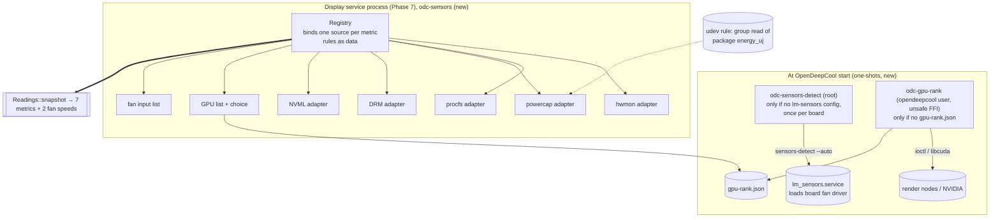

# Phase 6: every value the display shows, read correctly on any PC by an unprivileged service

**Plan ID:** `phase-6-sensors`
**Source PRD:** `docs/prp/prds/opendeepcool-lp360.prd.md` (repository-relative: an absolute path would name the owner's home folder, AGENTS.md rule 10)
**PRD Phase:** `6 — Sensors`
**Source Issue:** `None`
**Plan Publication:** `None`

## Outcome

**Problem:** The display's values must come from Linux, on any PC with an LP360, read by a sandboxed service that has fewer rights than a user (PRD, Service model). Today nothing reads them. Three problems stand in the way:
- the CPU power counter is root-only (CVE-2020-8694);
- the board's fan driver isn't loaded at boot;
- there is no rule for which GPU feeds the display when a PC has more than one.

**Affected user:** The owner, and anyone with an LP360 on Arch Linux, whatever their CPU, GPU and board.

**User outcome:**
- The seven display values (CPU Temperature, CPU Usage, CPU Power, Gpu temperature, Gpu usage, Gpu power, Memory Load) are read once per second from the right Linux source on Intel or AMD CPUs and on amdgpu, Intel or NVIDIA GPUs.
- So are the speeds of the cooler's fans and pump. A value that can't be read is reported as unavailable with a reason, never drawn wrong.
- A dedicated GPU is chosen before an integrated one, without the long-running service gaining GPU device access.

**Invariant:**
- Every metric is the metric it names (AGENTS.md rule 11). A metric with no matching source is `Unavailable(reason)`, never a number from another source.
- Devices are found by name, driver or PCI address, never by hwmon or DRM index (rule 12).
- Nothing is written to any device or sysfs file except by the two install-time pieces the owner approved: the udev rule (group read of the package energy counters) and the detection unit (lm-sensors' own configuration).
- The long-running display service needs no GPU device node on amdgpu or Intel GPUs, and contains no `unsafe` code.

**Success signal:**
- Values match the system tools within each metric's resolution on the owner's PC.
- Every rule passes its fake-tree tests (PRD Phase 6).
- All of it runs unattended (AGENTS.md rule 3).

**Approach:**
- **`odc-sensors` (library):** ports and adapters as the PRD describes.
  - A `Readings` port gives one `Snapshot` per call.
  - A registry binds one source per metric from built-in driver rules (data, not code paths), with small adapters for hwmon, procfs, powercap, DRM and NVML.
  - It lists the GPUs and the fan inputs.
- **`odc-gpu-rank` (short-lived helper, owner's design 2026-10-24):** the only crate with `unsafe` code. It asks each GPU's driver whether the GPU is integrated, writes a ranking file, and exits.
  - It runs only when OpenDeepCool starts, and only when no ranking exists.
  - It never runs again once the user has chosen a GPU.
- **`odc-sensors-detect` (root one-shot):** runs `sensors-detect --auto` once per motherboard, only when the PC has no lm-sensors configuration, and records what it created so uninstall can remove exactly that.
- **CPU power:** a line in OpenDeepCool's udev rule lets the `opendeepcool` group read the package energy counters (owner, 2026-10-24).
- **Tests:**
  - fake sysfs/proc trees for every rule and every hardware case the PC doesn't have, including future coolers' fakes when they come;
  - the unattended end-to-end run probes the PC it runs on: real devices where present, the same checks against fakes where absent, and a failure where a device is present but unusable (owner, 2026-10-24).

## Recommendation

**Ports and adapters with rules as data.**
- The PRD already fixes the shape (Architecture Notes, "Sensor architecture: ports and adapters").
- The kernel standardises hwmon file names but not their meaning (docs.kernel.org, hwmon sysfs interface). So a rule is a row: metric, subsystem, match (`name`, label or driver), file and unit. One generic hwmon adapter executes every hwmon row.
- Adding a driver later is one row plus one fake tree, with no new code path.
- Every adapter takes a root directory, so the same code runs against `/` and against fake trees under `CARGO_TARGET_TMPDIR`.

**GPU kind from each driver's documented interface, in a separate process.**
- Each driver documents the signal only as a query on the GPU's render node or through its library:
  - amdgpu: `AMDGPU_INFO_DEV_INFO`, flag `AMDGPU_IDS_FLAGS_FUSION`, "integrated (a.k.a. fusion) GPU";
  - xe: `DRM_XE_QUERY_CONFIG_FLAG_HAS_VRAM`, "has usable VRAM";
  - i915: a `I915_MEMORY_CLASS_DEVICE` region, "Device local-memory";
  - NVIDIA: CUDA `CU_DEVICE_ATTRIBUTE_INTEGRATED`, "Device is integrated with host memory".
- Asking needs `unsafe` FFI and access to `/dev/dri/renderD*` or the NVIDIA nodes. Opening an amdgpu render node also wakes a sleeping GPU (`pm_runtime_get_sync` in `amdgpu_driver_open_kms`).
- Doing it once, in a helper that exits, keeps the always-running service free of `unsafe` code and of render-node access (owner's decision and design, 2026-10-24).
- The ranking file doubles as the marker: the helper's unit has `ConditionPathExists=!` on it, so systemd doesn't even start the helper once a ranking exists.

**CPU power through the udev rule OpenDeepCool already ships.**
- Powercap zones are udev devices (`SUBSYSTEM=powercap`, checked on this PC), so a rule can match the package zones by their `name` attribute, not their index.
- The pattern `RUN+="/usr/bin/chgrp … /sys%p/…"` plus `chmod g+r` is the Arch Wiki's documented way to share a sysfs attribute with a group.
- Only the service account is in `opendeepcool` in the product, so the counter isn't opened to every user (the reason it became root-only).
- The alternative, a root helper serving the value, adds a root process and IPC for one number.

**Detection as a small Rust program, not a shell line in a unit.**
- The "never overwrite, once per board, record what was created" logic must be tested, and uninstall (Phase 12) depends on the record.
- `sensors-detect` writes `/etc/conf.d/lm_sensors` and, when driver options are needed, `/etc/modprobe.d/lm_sensors.conf`. It overwrites either one if present, then enables and starts `lm_sensors.service` (read in the script, 2026-10-24).
- So the program runs it only when **both** files are absent, and records which of them appeared and whether the service was enabled before.

### Evidence

- `docs/spec/sensors.md:16-35`: the seven metrics, their meanings, and DeepCreative's labels; the Linux source per metric.
- `docs/spec/sensors.md:37-66`: driver rules.
  - coretemp `Package id 0`;
  - k10temp `Tdie` else `Tctl`, unavailable before family 17h;
  - `/proc/stat` busy share;
  - powercap `package-0` `energy_uj` with `max_energy_range_uj` wrap;
  - amdgpu `edge`, `gpu_busy_percent`, `power1_average` else `power1_input`, unavailable on integrated AMD;
  - NVML; other drivers;
  - `/proc/meminfo`.
- `docs/spec/sensors.md:68-73`: once per second; CPU usage and power are averages over the interval; GPU values as read.
- `docs/spec/sensors.md:75-89`: GPU choice rules 1–4, saved by PCI address, missing GPU handling.
- `docs/spec/sensors.md:91-98`: CPU power is root-only; the options were a group rule or a helper; the owner chose the rule on 2026-10-24.
- `docs/spec/sensors.md:100-118`: fan inputs. Every hwmon `fanN_input` except devices whose parent is PCI class `0x03`; saved as chip name + device path + input number; none by default.
- `docs/prp/prds/opendeepcool-lp360.prd.md:168-193`: sensor sources and the ports-and-adapters architecture. `:194-204`: the service model (unprivileged, sandboxed; detection as a root one-shot).
- Kernel sources, read 2026-10-24:
  - `drivers/powercap/intel_rapl_msr.c`: AMD families 17h, 19h, 1Ah and Hygon 18h use `rapl_defaults_amd`, under control type `"intel-rapl"`;
  - `drivers/powercap/intel_rapl_common.c`: package zones are named `package-%d`, or `package-%d-die-%d` on multi-die parts;
  - `kernel/sched/cputime.c` `account_guest_time`: guest time is also added to `CPUTIME_USER`/`CPUTIME_NICE`, so the busy total is fields 1–8 of the `cpu` line;
  - `drivers/gpu/drm/amd/amdgpu/amdgpu_kms.c`: `amdgpu_driver_open_kms` calls `pm_runtime_get_sync` and `amdgpu_vm_init`.
- Kernel uAPI headers, read 2026-10-24: `amdgpu_drm.h` (`AMDGPU_IDS_FLAGS_FUSION`, `AMDGPU_INFO_DEV_INFO`), `xe_drm.h` (`DRM_XE_QUERY_CONFIG_FLAG_HAS_VRAM`), `i915_drm.h` (`I915_MEMORY_CLASS_DEVICE`, `DRM_I915_QUERY_MEMORY_REGIONS`).
- Kernel ABI docs, read 2026-10-24:
  - `sysfs-driver-intel-i915-hwmon`: `temp1_input` "GPU package temperature", `energy1_input` (device-level hwmon `name` "i915"), "only supported for particular … platforms";
  - `sysfs-driver-intel-xe-hwmon`: `temp2_input` "Package temperature", `energy1_input` "Card energy", same platform note;
  - neither documents a GPU busy percentage. docs.kernel.org nouveau documents no hwmon readings.
- `proc_stat(5)` (man7.org, read 2026-10-24): `cpu` fields user … steal, guest, guest_nice; iowait "is not reliable".
- NVIDIA, read 2026-10-24: CUDA Driver API, `CU_DEVICE_ATTRIBUTE_INTEGRATED` "Device is integrated with host memory".
  - Arch `nvidia-utils` 615.78.08-1 ships `usr/lib/libcuda.so.1` and `usr/lib/libnvidia-ml.so.1`.
  - `nvml-wrapper` 0.13.0 (Context7) loads `libnvidia-ml.so.1` at run time. A missing library is `NvmlError::LibloadingError`.
  - It offers `temperature(TemperatureSensor::Gpu)` (°C), `utilization_rates().gpu`, `power_usage()` (mW) and `pci_info().bus_id`.
- `/usr/bin/sensors-detect` (lm_sensors, read 2026-10-24):
  - lines 7404-7423: `/etc/modprobe.d/lm_sensors.conf` is written when driver options are needed;
  - lines 7433-7464: `/etc/conf.d/lm_sensors` is written ("overwrite" if present), then `systemctl enable` and `start lm_sensors.service`.
- This PC, 2026-10-24 (machine facts in `docs/local/`):
  - `udevadm info /sys/class/powercap/intel-rapl:0` shows `SUBSYSTEM=powercap` and zone name `package-0`;
  - `energy_uj` is `root:root 0400`;
  - `/sys/class/dmi/id/board_{vendor,name,version}` are `0444`;
  - the GPU render node is `0666`;
  - opening and closing it takes about 0.07 ms (median of 20, GPU awake);
  - `sensors`, `ffmpeg`, `top` and `free` are installed.
- crates.io, 2026-10-24: `nvml-wrapper` 0.13.0, `libc` 0.2.191, `libloading` 0.9.0, `proptest` 1.12.0 (Phase 5).
- DeepCreative, static strings, 2026-10-24: its helper takes the GPU list and a GPU type from HWiNFO (`getGpuList`, `GPU Type`) and selects by index (`setCurrentGpu`). How it picks the default isn't traced, and there's no Linux equivalent to copy.

### Alternatives considered

- **Kind queries inside the display service:** the service would need render-node access and `unsafe` code for its whole life. Rejected by the owner, 2026-10-24.
- **No automatic ranking (first by PCI address):** breaks the owner's "dedicated before integrated" rule.
- **Root helper for CPU power:** a root process plus IPC for one value; the udev rule needs neither.
- **A user-editable rules file:** rejected in the PRD (Decisions Log, "Sensor architecture").
- **Reading the GPU busy percentage of Intel GPUs from the i915/xe PMU (perf events):** not a documented sysfs reading, and it needs perf privileges. Gpu usage stays unavailable on Intel until a documented source exists.

## Visuals



The display service reads sysfs, procfs and NVML only. Render-node access and `unsafe` code exist only in `odc-gpu-rank`, which exits.

## Implementation Context

### Mandatory reading

| File | Why it matters |
|---|---|
| `docs/spec/sensors.md` (all) | Metrics, driver rules, refresh, GPU choice, CPU power, fan inputs: the contract this phase implements |
| `docs/spec/display.md:35-47` | Values keep their fraction until drawn; rounding is Phase 7's |
| `docs/spec/settings.md:5-23`, `:41-45`, `:47-73` | Fan inputs and GPU choice as settings; defaults; what the app shows (Phase 11 consumer) |
| `docs/prp/prds/opendeepcool-lp360.prd.md:168-204` | Sensor sources, architecture, service model |
| `docs/prp/plans/phase-5-device-protocol-core.plan.md` (Tasks 1, 8, 10) | Workspace, lints, `packaging/udev/70-opendeepcool.rules`, `scripts/dev/*`, CI and the guard this phase extends |
| `AGENTS.md` rules 3, 7, 8, 10 (exception for driver names), 11, 12 | The constraints every task checks |
| `docs/local/machine.md` (local only) | The owner's devices: only for setting `ODC_E2E_REQUIRE` on the owner's PC, never in code or commits |

### Existing patterns and primitives

- **Fake trees under `CARGO_TARGET_TMPDIR`:** introduced by Phase 5 Task 7 for hidraw. This phase moves the builder into `odc-testkit::faketree` so every adapter's tests share it.
- **Product files plus dev scripts:** Phase 5 Task 8 (`packaging/udev/70-opendeepcool.rules`, `scripts/dev/setup.sh`, `teardown.sh`, `check.sh`). This phase adds lines to the same files rather than new installers.
- **Lints:** the workspace forbids `unsafe_code` (Phase 5 Task 1). `odc-gpu-rank` alone opts out (Task 9), so the boundary is visible in its `Cargo.toml`.

### Integration points

- `odc_sensors::Readings`: the readings port Phase 7's scheduler calls once per second.
- `odc_sensors::gpus()`, `GpuChoice`, `fan_inputs()`, `FanInput`: the lists and saved identities Phase 7 (settings file) and Phase 11 (pickers) use.
- `/var/lib/opendeepcool/gpu-rank.json`: written by `odc-gpu-rank`, read by the registry, deleted by the service when the GPU set changes and the user hasn't chosen (Task 7).
- `/var/lib/opendeepcool/sensors-detect.json`: the detection record that Phase 12's uninstall reads.
- `packaging/systemd/opendeepcool-gpu-rank.service`, `packaging/systemd/opendeepcool-sensors-detect.service`: ordered before `opendeepcool.service`, which Phase 7 creates.

## Scope

### In scope

- `odc-sensors`:
  - metric model, `Readings` port, clock, registry;
  - adapters: hwmon, procfs, powercap, DRM, NVML;
  - driver rules for coretemp, k10temp, amdgpu, i915, xe and NVIDIA (NVML);
  - GPU list and choice;
  - fan-input list;
  - fakes for Phase 7.
- `odc-gpu-rank` and its unit.
- `odc-sensors-detect` and its unit.
- The udev rule line for CPU power, and the dev scripts' new steps.
- Spec, PRD and checklist records of the 2026-10-24 decisions.
- Tests in all layers that apply: unit, integration with fake trees, and an unattended end-to-end run that uses each real device the PC has and fakes for the rest. Layer 2 (DeepCreative captures) doesn't apply: sensors aren't in the captures.

### Not building

- **The settings file, the scheduler, the `doctor` command, and logging to the journal:** Phase 7. This phase exposes `Registry::bindings()` for them.
- **The pickers and GPU dropdown UI:** Phase 11.
- **Packaging and the uninstall removal script:** Phase 12. This phase writes the record it needs.
- **Gpu usage on Intel GPUs:** no documented sysfs reading; unavailable with a reason.
- **nouveau and other GPU drivers:** no documented readings or kind signal. Listed last, all metrics unavailable with "no reading for this GPU's driver".
- **Fan or pump control, any `pwm*` write:** out of scope (rule 8).
- **Other DeepCool coolers:** after v1. Recorded in the PRD by Task 1; their tests will be fakes when they come.

## Implementation

Each task ends with its own commit (rule 4) after its tests pass. The guard and CI from Phase 5 run on each.

### 1. The spec and PRD record the 2026-10-24 sensor decisions

**Files and integration points**
- `docs/spec/sensors.md`: UPDATE.
  - **Driver rules table:**
    - AMD CPU power is verified in the kernel source (families 17h, 19h, 1Ah, Hygon 18h; zone `package-N`). Only zones under control type `intel-rapl` count, never `intel-rapl-mmio`.
    - Rows for i915 (`temp1_input`, `energy1_input` of hwmon `name` `i915`), xe (`temp2_input`, `energy1_input` of `xe`) and NVML (the calls above).
    - Intel Gpu usage: unavailable.
  - **GPU choice:**
    - the kind signal per driver, with the uAPI names and the CUDA attribute;
    - the `odc-gpu-rank` helper and when it runs;
    - the ranking order: dedicated, then integrated, then unknown, then by PCI address;
    - the hardware-change rule.
  - **CPU power:** the decision (udev rule, group read).
  - **Board sensor driver:** the second file `sensors-detect` may write; "runs only when both files are absent".
- `docs/spec/parity-checklist.md`: UPDATE. S4 gets the chosen access; S10 gets the kind signals and the helper. Each row is "reviewed 2026-10-24: owner decision".
- `docs/prp/prds/opendeepcool-lp360.prd.md`: UPDATE.
  - The open questions on the GPU kind signal and CPU power access are answered.
  - System Footprint: the GPU-rank unit and helper; `/etc/modprobe.d/lm_sensors.conf` (only if created); the udev rule's powercap line; `gpu-rank.json` and `sensors-detect.json` in the state directory. Each is removed by the removal script.
  - What We're NOT Building: "Other DeepCool water coolers: after v1 (owner, 2026-10-24)".

**Tests**
- None (docs). The owner reviews the diff before the commit.

**Validation**
- `.githooks/pre-commit` passes.

### 2. The metric model, the `Readings` port and a fake for Phase 7

**Files and integration points**
- `crates/odc-sensors/`: CREATE, a library. `lints.workspace = true`. It depends on `nvml-wrapper = "0.13"` (Task 8) and nothing else beyond `std`.
- `crates/odc-sensors/src/model.rs`: CREATE.

**Implementation**
- `Metric`: `CpuTemperature`, `CpuUsage`, `CpuPower`, `GpuTemperature`, `GpuUsage`, `GpuPower`, `MemoryLoad`. `Metric::spec_name()` returns DeepCreative's exact names (`CPU Temperature`, `Gpu usage`, …). These are the names `docs/spec/frames/` headings use, which Phase 7 maps.
- `Reading`: `Value(f64)`, in °C, %, or W, with the fraction kept (`sensors.md` Updates and rounding), or `Unavailable(Unavailable)`.
  - The reasons are an enum: `NoRule { driver }`, `NoDevice`, `PermissionDenied { path }`, `ReadFailed { path }`, `NotYet` (the first sample of a rate metric), `IntegratedGpuPower`.
  - `Display` gives the one-line reason the app shows (`settings.md:66-69`).
- `Snapshot`: one `Reading` per `Metric`, plus `cooler_fans` and `pump`, each a `Reading` in RPM, or `NotChosen`.
- `trait Readings { fn snapshot(&mut self) -> Snapshot; }`
- `trait Clock { fn now(&self) -> Instant; }`, with `SystemClock`.
- `FakeReadings`: public; scripted snapshots for Phase 7's tests.

**Tests**
- `spec_name()` round-trips for all seven, and the names match the headings in `docs/spec/frames/` (read through `odc_testkit::expected`).
- Each `Unavailable` reason has a non-empty one-line `Display`.

**Validation**
- `cargo test -p odc-sensors`: passes.

### 3. Fake sysfs and proc trees for every rule, built from the kernel docs

**Files and integration points**
- `crates/odc-testkit/src/faketree.rs`: CREATE. It's a builder: `FakeTree::new(test_name)` under `CARGO_TARGET_TMPDIR`, with `.file(path, contents)`, `.symlink(path, target)`, `.mode(path, 0o400)` and `.remove(path)`.
- `crates/odc-testkit/src/fixtures.rs`: CREATE. Named fixture functions, each citing the kernel doc it follows:
  - `coretemp(package_millic)`;
  - `k10temp(tctl, Some(tdie))`, and `k10temp_pre17h()`;
  - `amdgpu_dgpu(pci, edge, busy, power_avg_uw)`, `amdgpu_apu(…)`, and `amdgpu_power_input_only(…)`;
  - `i915(pci, temp, energy)`, `xe(pci, temp2, energy1)`, and `nvidia_proprietary(pci)` (PCI device, no hwmon);
  - `nouveau(pci)`;
  - `rapl(zones: &[("intel-rapl:0", "package-0", energy, max)])`, plus an `intel-rapl-mmio:0` zone also named `package-0`;
  - `proc_stat(lines)`, `proc_meminfo(total, available)`;
  - `board_fans(chip = "fakeboardchip", inputs)`: a made-up chip name (rule 10). The `device` is a platform device.
  - Moving the Phase 5 hidraw tree builder in here is part of this task.
- The fixtures follow the real sysfs layout:
  - `class/hwmon/hwmonN` → `devices/…/hwmon/hwmonN`, with a `name` file and a `device` link to the parent;
  - the parent's `class` file (`0x030000` for display controllers);
  - `class/drm/cardN/device` → the PCI device, with its `driver` link;
  - `bus/pci/devices/<addr>`;
  - `class/powercap/<zone>` → `devices/virtual/powercap/<control type>/<zone>`.

**Tests**
- Each fixture produces the paths its doc names. A smoke test per fixture lists the tree.

**Validation**
- `cargo test -p odc-testkit`: passes.

### 4. CPU Temperature from coretemp or k10temp

**Files and integration points**
- `crates/odc-sensors/src/rules.rs`: CREATE, the rule table as data.
- `crates/odc-sensors/src/hwmon.rs`: CREATE, the generic hwmon adapter.

**Implementation**
- A rule row is `{ metric, source: Hwmon { name, label_any_of: &[..], file_suffix, scale } | … , applies_to }`.
- `hwmon.rs`:
  - scans `<sys>/class/hwmon/*`, reads `name`;
  - for each `tempN_label` / `fanN_label` / `powerN_label` it pairs the channel's `_input` (or `_average`);
  - reads with a scale: millidegrees → °C, microwatts → W.
- **CPU Temperature rows:**
  - coretemp, label `Package id 0`;
  - k10temp, label `Tdie`, else `Tctl`.
  - k10temp on a family before 17h → `Unavailable(NoRule)`. The family is read from `/proc/cpuinfo` `cpu family` (the k10temp doc: `Tctl` isn't a temperature there).
- Several CPU packages: rule 1 matches the first package by hwmon `name` order, and `Package id 0` is by definition package 0.

**Tests** (integration, fake trees)
- coretemp: 57000 → 57.0.
- k10temp: `Tdie` is preferred over `Tctl`; with `Tctl` only → `Tctl`; family 0x15 → unavailable.
- No CPU driver → `Unavailable(NoDevice)`.
- An hwmon index change between scans (`hwmon2` → `hwmon5`) still binds by name.
- A board chip with a `temp1_label` of `Package id 0` but `name` `fakeboardchip` isn't matched.

**Validation**
- `cargo test -p odc-sensors --test cpu_temperature`: passes.

### 5. CPU Usage and Memory Load from procfs

**Files and integration points**
- `crates/odc-sensors/src/procfs.rs`: CREATE.

**Implementation**
- **CPU Usage:**
  - parse the aggregate `cpu` line's first eight fields (user … steal). Guest time is already inside user and nice (`account_guest_time`).
  - Busy share over the interval = 1 − Δ(idle + iowait) ÷ Δtotal (`sensors.md` driver rules).
  - The first call returns `Unavailable(NotYet)`.
  - Δtotal = 0 → keep the previous value.
- **Memory Load:** (MemTotal − MemAvailable) ÷ MemTotal × 100 from `/proc/meminfo` (kB). If `MemAvailable` is missing → `Unavailable(ReadFailed)`. It has been present since Linux 3.14; this rule is defensive only for malformed input.

**Tests**
- Hand-computed vectors: two `cpu` lines with known deltas → exact percentages: 0 %, 50 % and 100 %, and iowait counted as idle.
- Property test: the result always lies in [0, 100] for monotonically increasing counters.
- meminfo: 31,000,000 kB total, 7,750,000 kB available → 75.0 %.

**Validation**
- `cargo test -p odc-sensors --test procfs`: passes.

### 6. CPU Power from the package energy counters, readable only by the service's group

**Files and integration points**
- `crates/odc-sensors/src/powercap.rs`: CREATE.
- `packaging/udev/70-opendeepcool.rules`: UPDATE, adding:

  ```
  SUBSYSTEM=="powercap", KERNEL=="intel-rapl:*", ATTR{name}=="package-*", RUN+="/usr/bin/chgrp opendeepcool /sys%p/energy_uj", RUN+="/usr/bin/chmod g+r /sys%p/energy_uj"
  ```

- `scripts/dev/setup.sh`, `teardown.sh` and `check.sh`: UPDATE.
  - setup re-triggers the powercap zones;
  - teardown re-triggers them after removing the rule, so the mode returns to `0400 root:root`;
  - check verifies `energy_uj` is group `opendeepcool` and group-readable.
  - every file or directory setup adds is recorded in the dev manifest (Phase 5 Task 8), so teardown and the Phase 12 package remove it.

**Implementation**
- **Zones:** every `<sys>/class/powercap/*` whose resolved path's parent directory is `intel-rapl` (control type), whose `name` starts with `package-`, and which isn't a sub-zone.
  - Power = Σ over zones of Δenergy ÷ Δt. Wrap: if a reading is lower than the last, add `max_energy_range_uj`.
  - The first call → `NotYet`.
  - `EACCES` → `Unavailable(PermissionDenied { path })`.
- `KERNEL=="intel-rapl:*"` excludes `intel-rapl-mmio:*`, and `ATTR{name}=="package-*"` excludes the `core`, `uncore` and `dram` sub-zones.

**Tests** (fake trees)
- One package: 2,000,000 µJ over 1.0 s of fake clock → 2.0 W.
- Wrap-around → a correct positive power.
- Two packages → the sum.
- An `intel-rapl-mmio:0` zone named `package-0` is ignored.
- A `0400` file the test user can't read → `PermissionDenied`.
- `udevadm verify --resolve-names=never` passes on the updated rule (guard and CI from Phase 5).

**Validation**
- `cargo test -p odc-sensors --test cpu_power`: passes.
- After `scripts/dev/setup.sh` (system change, shown to the owner first), `scripts/dev/check.sh`: exit 0.

### 7. The GPU list, the saved choice and the fan inputs

**Files and integration points**
- `crates/odc-sensors/src/gpu.rs`: CREATE.
- `crates/odc-sensors/src/fans.rs`: CREATE.

**Implementation**
- **`gpus(root) -> Vec<Gpu>`:** every `<sys>/bus/pci/devices/*` whose `class` has base class `0x03` and that has a `driver` link.
  - `Gpu` holds: `pci` (domain:bus:device.function), `driver`, and `kind`.
  - `kind` comes from `gpu-rank.json` when listed there, else `Unknown`.
- **`GpuKind`:** `Dedicated`, `Integrated` or `Unknown`.
  - Rank order: Dedicated, then Integrated, then Unknown; ties broken by PCI address (`sensors.md` GPU choice details).
  - NVIDIA's proprietary driver gets its kind from `odc-gpu-rank` (CUDA), like the others.
- **`choose(gpus, saved: Option<PciAddr>) -> Option<&Gpu>`:**
  - the saved GPU if present;
  - otherwise the best ranked. The saved choice is kept for when that GPU returns (rules 1–4 and details).
- **`rank_is_stale(gpus, rank_file, user_has_chosen) -> bool`:** true when the set of PCI addresses differs from the one recorded in `gpu-rank.json` **and** the user hasn't chosen. The service then deletes the file, so the helper ranks again at the next start (owner, 2026-10-24).
  - If the user has chosen, the helper never reruns. A new GPU still appears in the list, as `Unknown`, ranked last.
- **`fan_inputs(root) -> Vec<FanInput>`:**
  - every `fanN_input` of every hwmon device, except devices whose `device` parent is PCI base class `0x03` (`sensors.md` fan inputs);
  - `FanInput { chip: name, device_path, input: N, label: Option }`.
  - `rpm(&FanInput)` re-resolves by chip name + device path + N on every read. A missing input → `Unavailable(NoDevice)`, never another input's value.

**Tests** (fake trees)
- **One GPU, any kind** → it's chosen. With one GPU, the list API reports `len() == 1`, so Phase 11 shows no dropdown.
- **A dedicated amdgpu and an integrated i915** → the amdgpu is chosen.
- **Two dedicated GPUs** → the lower PCI address wins.
- **Unknown kinds:** nouveau plus an integrated amdgpu → the APU wins, and nouveau is listed last.
- **Saved choice missing** → the best ranked GPU, and the saved choice is kept.
- **Stale ranking:** the GPU set changed and nothing was chosen → stale; the set changed but the user had chosen → not stale.
- **Fans:**
  - a board chip with 3 inputs plus an amdgpu fan → 3 inputs, no amdgpu fan;
  - the board chip's hwmon index changes → the same `FanInput` reads the same file;
  - the chosen input is removed → `NoDevice`.

**Validation**
- `cargo test -p odc-sensors --test gpu_choice --test fans`: passes.

### 8. GPU temperature, usage and power for amdgpu, Intel and NVIDIA

**Files and integration points**
- `crates/odc-sensors/src/drm.rs`: CREATE, `gpu_busy_percent`.
- `crates/odc-sensors/src/nvml.rs`: CREATE. `trait NvmlSource`, with `RealNvml`, which wraps `nvml_wrapper::Nvml` initialised once (lazy), and `FakeNvml`.
- `crates/odc-sensors/src/rules.rs`: UPDATE, the GPU rows.

**Implementation**
- The rules bind to the **chosen** GPU's PCI device only, matching hwmon devices whose `device` resolves to that PCI address.
- **amdgpu:**
  - temperature: label `edge`;
  - usage: `device/gpu_busy_percent`;
  - power: `power1_average` else `power1_input`, in W. On a GPU ranked `Integrated` → `Unavailable(IntegratedGpuPower)`, because amdgpu's integrated reading includes the CPU (`sensors.md`, rule 11).
- **i915:** temperature from `temp1_input`; power = Δ`energy1_input` ÷ Δt; usage → `Unavailable(NoRule)` with the reason "this GPU's driver doesn't report usage".
- **xe:** temperature from `temp2_input` (package); power = Δ`energy1_input` (card) ÷ Δt; usage unavailable as for i915.
- **NVIDIA proprietary** (driver `nvidia`): through `NvmlSource`, matched by `pci_info().bus_id` to the chosen PCI address.
  - temperature: `temperature(Gpu)`;
  - usage: `utilization_rates().gpu`;
  - power: `power_usage()` ÷ 1000.
  - NVML failing to load → `Unavailable(NoRule { driver: "nvidia" })`, with the reason naming NVML.
- **Any other driver** → all three `Unavailable(NoRule { driver })`.

**Tests**
- Fake trees for amdgpu dGPU, amdgpu APU (power unavailable), amdgpu with only `power1_input`, i915, xe and nouveau.
- `FakeNvml` with a matching bus ID and a non-matching one.
- Rule 11 check: in every fixture, each metric's value is distinct, and the test asserts each one comes from its own file. For example, an amdgpu fixture with `edge` 41 °C, `junction` 77 °C and `mem` 66 °C must read 41.

**Validation**
- `cargo test -p odc-sensors --test gpu_metrics`: passes.

### 9. `odc-gpu-rank`: a short-lived helper ranks the GPUs once

**Files and integration points**
- `crates/odc-gpu-rank/`: CREATE, a binary crate.
  - `Cargo.toml` declares `[lints.rust] unsafe_code = "deny"` instead of the workspace's `forbid`. Only `src/ffi.rs` carries `#[allow(unsafe_code)]`.
  - Dependencies: `odc-sensors` (the GPU list), `libc = "0.2"` (ioctl) and `libloading = "0.9"` (libcuda).
- `crates/odc-gpu-rank/src/ffi.rs`: CREATE. The minimal `#[repr(C)]` mirrors of:
  - `drm_amdgpu_info` and `drm_amdgpu_info_device` (only up to `ids_flags`; the kernel fills `return_size` bytes);
  - `drm_xe_device_query` and `drm_xe_query_config`;
  - `drm_i915_query`, `drm_i915_query_item` and `drm_i915_query_memory_regions`.

  It also holds the ioctl numbers, built as the headers build them. `libcuda` is used through `cuInit`, `cuDeviceGetCount`, `cuDeviceGet`, `cuDeviceGetAttribute(CU_DEVICE_ATTRIBUTE_INTEGRATED)` and `cuDeviceGetPCIBusId`.
- `crates/odc-gpu-rank/src/main.rs`: CREATE. It lists GPUs (Task 7), queries each driver's signal, and writes `gpu-rank.json` atomically (temp file + rename) into `--state-dir`, which defaults to `/var/lib/opendeepcool`. The file holds the PCI set and each GPU's kind with the signal used. Then it exits.
  - A GPU whose query fails, or whose driver has no signal (nouveau), is `Unknown`, with the reason in the file. The helper never fails the boot.
- `packaging/systemd/opendeepcool-gpu-rank.service`: CREATE.
  - `Type=oneshot`, `User=opendeepcool`;
  - `ConditionPathExists=!/var/lib/opendeepcool/gpu-rank.json`;
  - `Before=opendeepcool.service`, `WantedBy=opendeepcool.service`;
  - sandbox: `ProtectSystem=strict`, `ReadWritePaths=/var/lib/opendeepcool`, `ProtectHome=yes`, `NoNewPrivileges=yes`, `PrivateNetwork=yes`, `CapabilityBoundingSet=`, `DevicePolicy=closed`, `DeviceAllow=char-drm rw`, plus the NVIDIA device nodes (exact `DeviceAllow` entries unverified until checked against a PC with NVIDIA's driver, in Phase 12).
  - The exact set is re-checked in Phase 12. It's written now so Phase 7 can order it.

**Tests**
- **Unit (CI):** `size_of` and the field offsets of every mirrored struct equal constants written from the kernel headers, with each header and struct cited in a comment.
- **Local check (ignored in CI):** a test compiles a tiny C program against the installed `linux-api-headers` with `cc`, prints the same sizes and offsets, and compares them with the constants. It fails if `cc` or the headers are missing.
- **Integration:** a `KindSource` trait with a fake gives the JSON contents for:
  - one dGPU;
  - an iGPU plus a dGPU;
  - a failed query;
  - nouveau.
- **End to end (local, ignored, `crates/odc-gpu-rank/tests/hardware.rs`):** the probe (Task 11) decides per GPU driver.
  - **Real GPUs:** `odc-gpu-rank --state-dir target/e2e/state` runs twice as a member of `opendeepcool`, against the real render nodes or NVIDIA's library.
    - Every PCI display device in sysfs gets a kind.
    - A driver with a documented signal must not end up `Unknown`.
    - Both runs give identical files.
    - No tool can say independently whether a real GPU is integrated, so correctness rests on the fakes, which cover each driver's integrated and dedicated answers.
  - **Absent drivers:** the same checks through the fake `KindSource`.
  - Nothing about the owner's GPUs is written into the code.

**Validation**
- `cargo test -p odc-gpu-rank`, then `cargo test -p odc-gpu-rank --test hardware -- --ignored`: both pass.

### 10. `odc-sensors-detect`: lm-sensors finds the board's fan driver once, and nothing it didn't create is ever touched

**Files and integration points**
- `crates/odc-sensors-detect/`: CREATE, a binary. `lints.workspace = true`; `std` only.
- `packaging/systemd/opendeepcool-sensors-detect.service`: CREATE.
  - `Type=oneshot`; runs as root (the only root part, PRD Service model);
  - `ConditionPathExists=!/etc/conf.d/lm_sensors`;
  - `ConditionPathExists=!/etc/modprobe.d/lm_sensors.conf`;
  - `Before=opendeepcool.service`, `WantedBy=opendeepcool.service`;
  - stdout and stderr go to the journal.

**Implementation**
- Paths come from flags with real defaults (`--etc`, `--sys`, `--state-dir`, `--sensors-detect`), so the tests use fake roots and a fake script.
- **Steps:**
  1. If either lm-sensors file exists → record nothing and exit 0. The unit's conditions normally prevent this; the check is repeated here because the binary can be run on its own.
  2. Read the board identity from `<sys>/class/dmi/id/board_vendor`, `board_name` and `board_version`. If `sensors-detect.json` already lists this identity → exit 0 (once per motherboard).
  3. Note whether `lm_sensors.service` is enabled (`systemctl is-enabled`, path injectable).
  4. Run `sensors-detect --auto`.
  5. Write `sensors-detect.json`: the identity, the date, which of the two files now exist (`created`), and whether the service was enabled before.

  Phase 12's removal script removes only what `created` lists, and disables the service only if it wasn't enabled before.
- `sensors-detect` exiting non-zero is logged, and the record is still written, so it doesn't run again at every boot (`sensors.md` driver rules).

**Tests** (integration; the fake `sensors-detect` is a shell script that writes the files a scenario needs)
- **Fresh PC** → it runs once, the record lists `/etc/conf.d/lm_sensors` as created, and a second run doesn't run it.
- **Existing `/etc/conf.d/lm_sensors`** → never run, nothing recorded, and the file is unchanged (byte-compared).
- **Existing `/etc/modprobe.d/lm_sensors.conf` only** → never run; the file is unchanged.
- **A run that also writes `modprobe.d`** → both files are recorded.
- **A different board identity** (motherboard replaced) with both files absent → it runs again.
- **The fake script fails** → the record is still written.

**Validation**
- `cargo test -p odc-sensors-detect`: passes.
- **End to end (owner approved 2026-10-24, a system change done once):**
  - shown to the owner, then `pkexec target/debug/odc-sensors-detect --state-dir /var/lib/opendeepcool`;
  - afterwards, unattended: `/etc/conf.d/lm_sensors` exists, `lm_sensors.service` is enabled, the record lists what was created, and the board's fan chip appears in `/sys/class/hwmon` after the next boot without a manual `modprobe`.
  - The PRD dev footprint lists the created files and the enabled service, until Phase 12's package takes over.

### 11. Layer 4 end to end: real sensors where the PC has them, fakes where it doesn't

**Files and integration points**
- `crates/odc-testkit/src/hardware.rs`: UPDATE, the probe from Phase 5 Task 9. It adds these capabilities:
  - `CpuTemp`, `CpuPower`, `ProcStat`, `Meminfo`;
  - `GpuAmdgpu`, `GpuI915`, `GpuXe`, `GpuNvidia`, `GpuOther`;
  - `BoardFans`;
  - `SensorsTool` (`sensors -j`), `GpuLoadTool` (`ffmpeg` with Vulkan).

  Each is found the way the product finds it: hwmon `name`, powercap zone name, PCI class and driver, an NVML load.
  - **`Unusable` cases**, each failing with its fix:
    - CPU power present but not readable → run `scripts/dev/setup.sh`;
    - a GPU present but its tool missing → install `ffmpeg`;
    - `sensors` missing → install `lm_sensors`.
- `crates/odc-sensors/tests/hardware.rs`: CREATE. Every test is `#[ignore = "layer 4: run locally with --ignored --test-threads=1"]`.
- No file describes the owner's PC. The tests learn the hardware from the probe (owner, 2026-10-24). `ODC_E2E_REQUIRE` (Phase 5 Task 9) lists what must run real on a given PC; on the owner's PC it's set from `docs/local/`.

**Implementation** (`Real` capabilities run `Registry` over the real `/sys` and `/proc` as a member of `opendeepcool`; `Absent` ones run the same checks over the Task 3 fixtures, with values chosen to satisfy them)
- **Every metric bound:**
  - each of the seven metrics is `Value` when its capabilities are `Real` or faked;
  - `Unavailable` appears only where the rules say so (for example Intel Gpu usage), with the documented reason;
  - `Registry::bindings()` names each source.
- **Against `sensors -j`, in the same second (real), or the fixture's file (fake):**
  - CPU Temperature equals the CPU driver's package input within 1 °C;
  - Gpu temperature equals the chosen GPU's main temperature within 1 °C;
  - Gpu power within 10 % or 5 W, whichever is larger. The driver's value moves within a second (`sensors.md`).
- **Fans:** **every** hwmon fan input the product lists equals `sensors -j`'s reading of the same chip and input within 3 %. No knowledge of which input is the pump is needed. With no board fan driver, `BoardFans` is `Absent` and the fake chip is used.
- **Memory Load** equals `free -b`'s (total − available) ÷ total within 0.5 points.
- **CPU Usage:**
  - the test loads every logical CPU with busy threads for 5 s → ≥ 95 %;
  - it agrees with `top -b -n 2 -d 1`'s `%Cpu(s)` busy share in the same window within 5 points.
- **CPU Power:**
  - readable without root, through the group;
  - under the same load, it rises above its idle reading;
  - it stays between 1 W and 1000 W.

  No independent reference exists without root; the unit tests of Task 6 cover the arithmetic.
- **Gpu usage, for each real GPU whose rule reads usage:** an `ffmpeg` Vulkan filter run on that GPU for 5 s → ≥ 90 %, then back below 50 % within 5 s of stopping (`sensors.md`, observed 2026-10-23).
- **NVIDIA (real only where NVML loads):** the three NVML readings are `Value` and lie in plausible ranges. Otherwise `FakeNvml` runs the same checks.
- **The summary** (Phase 5's `Summary`) prints every capability's mode at the end.

**Tests**
- These are the tests, plus probe unit tests over fake trees:
  - no CPU temperature driver → `Absent`;
  - `energy_uj` `0400` → `Unusable` with the setup fix;
  - NVML not loadable → `GpuNvidia` `Absent`.

**Validation**
- `cargo test -p odc-sensors --test hardware -- --ignored --test-threads=1`: passes, and prints the summary.
- On the owner's PC, with `ODC_E2E_REQUIRE` from `docs/local/` covering its CPU, power counter, GPU and board fans, every one of those runs real.
- `AGENTS.md` Commands: add this and the `odc-gpu-rank` end-to-end command, to run before any commit touching `odc-sensors` or `odc-gpu-rank`.

## Acceptance

1. **AC1 — The metric it names:**
   - each of the seven metrics is read from its rule's source;
   - in every fixture, a distinct value per metric proves no metric is read from another's file;
   - integrated amdgpu power and CPU-as-GPU readings are never used (Tasks 4–8).
2. **AC2 — Any PC:**
   - rules for coretemp, k10temp, amdgpu, i915, xe and NVIDIA (NVML) pass their fake-tree tests;
   - devices bind by name, driver or PCI address, never by index;
   - a missing driver gives `Unavailable` with a reason (Tasks 3–8).
3. **AC3 — Rates over the interval:** CPU Usage and CPU Power are averages between two samples. The first sample is `NotYet`, and energy wrap-around is handled (Tasks 5, 6).
4. **AC4 — CPU power without root, for the group only:**
   - the udev rule grants group `opendeepcool` read access to the `intel-rapl` package zones only;
   - the real-PC test reads CPU Power as a group member (Tasks 6, 11).
5. **AC5 — GPU choice:**
   - dedicated, then integrated, then unknown, then by PCI address;
   - the saved choice wins when present and is kept when absent;
   - one GPU gives a list of one;
   - the ranking reruns only when the GPU set changed and the user hasn't chosen (Task 7).
6. **AC6 — The helper boundary:**
   - only `odc-gpu-rank` contains `unsafe` code and opens render nodes or NVIDIA devices;
   - it runs only while `gpu-rank.json` is absent, and exits;
   - its struct mirrors match the kernel headers (Task 9).
7. **AC7 — Detection never overwrites:**
   - `odc-sensors-detect` runs `sensors-detect --auto` only when both lm-sensors files are absent, once per board;
   - it records exactly what it created;
   - on the owner's PC the board fan driver loads at boot afterwards (Task 10).
8. **AC8 — Fan inputs:**
   - every hwmon fan input except a graphics card's is listed;
   - a chosen input is re-found across hwmon index changes;
   - a missing one is `NoDevice` (Task 7).
9. **AC9 — Real where present, fake where absent, unattended:**
   - the layer 4 run probes every sensor capability on the PC it runs on;
   - real values agree with `sensors`, `free` and `top` within the stated tolerances, under loads the test creates itself;
   - absent hardware runs the same checks against fakes;
   - present-but-unusable fails with its fix;
   - the summary shows each capability's mode (Tasks 9, 11).
10. **AC10 — Records:**
    - `sensors.md`, the parity checklist, the PRD (open questions, footprint, other coolers after v1) and AGENTS.md Commands match what was built;
    - the dev footprint lists every system change made (Tasks 1, 6, 10, 11).

## Validation

| Gate | Command or procedure | Proves |
|---|---|---|
| Format, lint | `cargo fmt --all --check`; `cargo clippy --workspace --all-targets -- -D warnings` | Style; no warnings |
| Layers 1 + 3 | `cargo test --workspace` | AC1, AC2, AC3, AC5, AC6 (sizes, fakes), AC7 (fakes), AC8 |
| udev rules | `udevadm verify --resolve-names=never packaging/udev/70-opendeepcool.rules scripts/dev/reconnect.rules` | AC4 (syntax) |
| Units | `systemd-analyze verify packaging/systemd/opendeepcool-gpu-rank.service packaging/systemd/opendeepcool-sensors-detect.service`, run locally; it reports the missing `opendeepcool.service` until Phase 7, which is expected and listed | AC6, AC7 (unit syntax) |
| Dev access | `scripts/dev/check.sh` | AC4 |
| GPU helper, layer 4 | `cargo test -p odc-gpu-rank --test hardware -- --ignored` | AC6 |
| Detection, once | `pkexec target/debug/odc-sensors-detect --state-dir /var/lib/opendeepcool`, then the Task 10 checks | AC7 |
| Sensors, layer 4 | `cargo test -p odc-sensors --test hardware -- --ignored --test-threads=1` | AC4, AC9 |
| CI | GitHub Actions on the pushed branch | Layers 1 + 3 |

### Test matrix covered in this phase

Phase 6 draws no frames, so it covers none of the 116 display cases. Its own matrix is the driver rules × hardware cases:

| Rule | Fake-tree cases | Real on the owner's PC (any PC: where present) |
|---|---|---|
| coretemp | package, index change, foreign `Package id 0` | owner's PC |
| k10temp | Tdie, Tctl only, pre-17h | — |
| `/proc/stat`, `/proc/meminfo` | vectors, property | owner's PC |
| powercap | one, two packages, wrap, mmio twin, denied | owner's PC (Intel) |
| amdgpu | dGPU, APU, `power1_input` only | owner's PC (dGPU) |
| i915, xe | temperature and energy, usage unavailable | — |
| NVIDIA (NVML) | matching, non-matching bus ID, library missing | — |
| nouveau, other | all unavailable, ranked last | — |
| GPU choice | 1 GPU, dGPU + iGPU, 2 dGPU, unknown kinds, saved missing, stale | owner's PC (1 GPU) |
| Fan inputs | board chip + GPU fan, index change, removed | owner's PC |
| Detection | fresh, existing conf.d, existing modprobe.d, both written, new board, failure | owner's PC, once |

## Risks and Decisions

| Decision or risk | Recommendation | Evidence / mitigation | Consequence if different |
|---|---|---|---|
| Crate names `odc-sensors`, `odc-gpu-rank`, `odc-sensors-detect` | Keep: same pattern as Phase 5 | PRD leaves names to the plans | Renames touch manifests and units |
| The uAPI struct mirrors could drift from a newer kernel | Mirror only the leading fields we read; pass `return_size`; check sizes against the installed headers in Task 9 | The amdgpu INFO ioctl copies at most `return_size` bytes; the xe and i915 queries report the needed length first | A wrong size could corrupt the helper's memory. The helper is short-lived, sandboxed and unprivileged, and the display service is unaffected |
| GPU kinds for i915, xe, NVIDIA and APUs are tested only with fakes | Accept; mark "not tested on hardware" in `sensors.md` | The owner's PC has one dedicated amdgpu GPU | A driver that behaves differently from its uAPI docs ranks wrongly; the user can still pick in the app |
| `sensors-detect` probing on other PCs | Run only when both lm-sensors files are absent, once per board; output to the journal | lm-sensors' own warning and default skips (`sensors.md`) | A board that misbehaves when probed; the PRD's risk table already lists it |
| The CPU usage formula treats iowait as idle | Keep; `proc_stat(5)` calls iowait unreliable, and the e2e test compares with `top` | `sensors.md` driver rules; parity S3 checked against `top` | A few points' difference from tools that count iowait as busy |
| `systemd-analyze verify` warns about the not-yet-existing `opendeepcool.service` | Expected until Phase 7; the gate lists the expected warning | Units are ordered before a service Phase 7 creates | — |
| The dev state directory `/var/lib/opendeepcool` doesn't exist before Phase 7's `StateDirectory=` | `scripts/dev/setup.sh` creates it (`root:opendeepcool 2770`) and teardown removes it; in the dev footprint | Needed by Tasks 9–10 locally | — |

## Agent Notes

- The end-to-end tests read no description of the PC: the probe decides. Only `ODC_E2E_REQUIRE` is set on the owner's PC, from `docs/local/`.
- Before the Task 10 real run, show the owner the exact command and the two files it may create. It's approved, but it is a system change (rule 7).
- The 2026-10-24 conversation decided:
  - the rank helper's design (owner);
  - NVIDIA kind through CUDA's documented attribute;
  - real devices where present and fakes otherwise (owner);
  - the udev rule for CPU power (owner).

  Task 1 writes these into the spec before any code.
