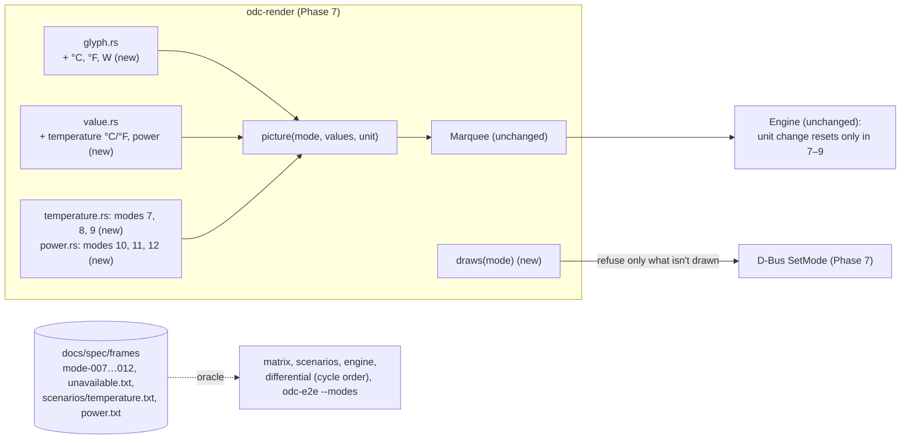

# Phase 8: Temperature and Power on the LP360, drawn in full, in °C and °F, on the Phase 7 service

**Plan ID:** `phase-8-temperature-power`
**Source PRD:** `docs/prp/prds/opendeepcool-lp360.prd.md` (repository-relative: an absolute path would name the owner's home folder, AGENTS.md rule 10)
**PRD Phase:** `8 — Temperature & Power`
**Source Issue:** `None`
**Plan Publication:** `None`

## Outcome

**Problem:** After Phase 7 the service draws only Load (modes 1–6). DeepCreative's Temperature Guardian and Power Guardian (modes 7–12) are refused with "not available yet", so the owner can't see CPU or GPU temperatures or power draw on the cooler. These are the readings the owner most wanted at a glance (PRD, Problem Statement).

**Affected user:**
- The owner, and every user of the PC: the display is shared.
- Phases 9 and 10. Music's value area (modes 18 and 19) reuses this phase's temperature glyphs and rules, and the app's preview reuses its pictures.

**User outcome:**
- The saved mode can be **Temperature** (CPU, GPU, or CPU over GPU) or **Power** (CPU, GPU, or CPU over GPU), from boot, in every rotation.
- Temperatures show in the global unit, `°C` or `°F`. Power shows in `W`.
- Every value is drawn in full up to 9999, and capped at 9999 above it (owner, 2026-10-25). It's static while it fits (99 or less) and scrolls by itself from 100 on. So `65W` and `98°F` are static, and `134°F` and `250W` scroll.
- A temperature mode's picture restarts from home when the unit changes. In a Power mode, a unit change only saves the unit.

**Invariant:**
- Every frame equals the spec's picture for the current mode, readings, unit, rotation and tick (`docs/spec/frames/` is the oracle).
- Each mode shows exactly the metrics it names, top first (rule 11).
- A temperature is drawn in the saved unit. Every number is the nearest whole number to its exact reading, halves up; the °F number is rounded once, from the exact °C reading converted to °F (owner, 2026-10-26).
- A number is never more than 9999: a larger one is drawn `9999`, everywhere (owner, 2026-10-25).
- A value that can't be read, or a reading no sensor can give (a negative one; with exact readings, not-a-number and infinite can't occur), is drawn as dashes with its symbol, never as a number.
- Movement, resets and timing are Phase 7's, unchanged (`display.md` Movement, precisely).

**Success signal:** These modes' parity checklist items pass (PRD Phase 8). These are D2, D5–D7, D10, D17–D25 and D30. Where OpenDeepCool differs on purpose, the owner-decision rows D35–D41 apply instead. The Phase 8 report maps each item to the test that proves it, and the real cooler shows every Temperature and Power case unattended.

**Approach:** no new crate, process or setting.
- **`odc-render`** gets:
  - the `°C`, `°F` and `W` glyphs;
  - the value rules for temperature (both units) and power, capped at 9999;
  - the pictures for modes 7–12, one mode at a time.
- **`picture` and `Marquee`** from Phase 7 draw and move them unchanged.
- **The service** stops refusing modes 7–12. The refusal is derived from what `odc-render` draws, so there is no second list to edit.
- **The oracle** gets the dash cases and the movement scenarios for these modes.
- **The tests:**
  - the differential test learns to compare a scrolling capture with the expected cycle, frame by frame;
  - `odc-e2e` learns `--modes`, so each mode's commit can run its own real-cooler check (rule 4).

## Recommendation

**Reuse Phase 7's strip and movement as they are.**
- `display.md` defines one strip for every mode: digit places of 4 columns, then the symbol. The static picture is that strip stopped at home, and the same movement procedure drives every mode.
- The only things that differ per mode are the metrics, the symbol and the value rule.
- So Phase 8 is data, plus three glyphs and two value rules:
  - `mode_info` already lists modes 7–12 and their metrics (Phase 7 Task 2);
  - the engine already resets on a unit change in a mode that shows a temperature, and does nothing in a mode without one (Phase 7 Task 6).
- Nothing in the engine, D-Bus or settings changes shape. Settings stay `version = 1`, because `temperature_unit` is already a field.

**The value rules, on whole numbers, with the cap applied last** (`display.md` Values: OpenDeepCool's no caps, capped at 9999 everywhere, owner, 2026-10-25; the nearest whole number in exact whole-number arithmetic, owner, 2026-10-26).
- **Not drawable:** a negative reading → dashes, before any rounding. Readings are exact fractions of whole numbers (Phase 6's `Exact`), so not-a-number and infinite can't occur.
- **°C:** the nearest whole number, halves up: (*m* + 500) div 1000 on millidegrees *m*, with intermediates in `i128` as in Phase 7.
- **°F:** rounded once, to the nearest, from the exact °C reading: (9 · *m* + 162 500) div 5000, which is 9/5 · *m*/1000 + 32, halves up. DeepCreative rounded the °C reading up, converted, then dropped the fraction; OpenDeepCool rounds once (owner, 2026-10-26). So 37 °C (98.6) draws `99°F`, and 57 °C (134.6) draws `135°F`.
- **Power:** the nearest whole number, halves up, (2 · num + den) div (2 · den), on µW ÷ 10⁶, mW ÷ 1000, or µJ ÷ µs.
- **The cap:** a number above 9999 → 9999. For °F it's applied to the converted number: 5536 °C gives `9997°F` (9996.8), 5537 °C gives `9999°F` (9998.6), and from 5537.5 °C (10 000 °F) the cap draws `9999°F`.
- **Overflow:** intermediates are `i128`, so even the largest reading an `Exact` can hold (`i64::MAX` millidegrees) can't overflow.
- **The local oracle** (`research/hook/odc_rules.py` `number`) already has the same rule. It regenerated the frames on 2026-10-26, which changed 24 °F cases: 57 °C → `135°F`, 7 °C → `45°F` (`frames/README.md`).

**Lift the refusal through `odc-render`, not a list.**
- Phase 7 refuses later-phase modes with `NotYetAvailable` (Phase 7 Task 7, step 3), and `picture` returns `Err(NotYetImplemented)` for them (Task 2).
- The D-Bus check must ask `odc_render::draws(mode)`, true exactly where `picture` is implemented. Then each mode's commit makes that mode selectable, and nothing else has to be kept in step.
- If the Phase 7 code holds a separate list of implemented modes, this phase deletes it.

**Differential tests for scrolling compare the whole cycle in order.**
- DeepCreative scrolls with a 21-column cycle; it starts at another point of that cycle than OpenDeepCool's home, and it scrolls even values that OpenDeepCool keeps static.
- Where both draw the same strip (three-digit °F and power, and `65W` over `250W`), the frames DeepCreative sent must be consecutive windows of OpenDeepCool's cycle from some starting point.
- A check recounted on 2026-10-26, with the nearest rule and the regenerated frames, found that true for **all 50** such captured steps, each covering at least one full cycle, plus **20** static steps that match exactly. The check is `research/hook/diffcount.py` (local). Run with the old rule, it first reproduced the counts of 2026-10-25: 68 and 24 compared, 99 skipped.

  | Mode | Compared | Skipped on purpose | Under the old rule (2026-10-25) |
  |---|---|---|---|
  | 7 | 17 | 32 | 29 and 20 |
  | 8 | 24 | 17 | 28 and 13 |
  | 9 | 5 | 28 | 11 and 22 |
  | 10 | 6 | 23 | the same |
  | 11 | 12 | 11 | the same |
  | 12 | 6 | 10 | the same |

- The skipped steps differ only by owner decisions:
  - one-digit values centred;
  - DeepCreative's cap at 99 °C and its cut from 1000;
  - °F and power static at 99 or less;
  - `°C` one column further right in mode 9;
  - the rounding (owner, 2026-10-26): DeepCreative rounds temperature and power up and drops °F's fraction, while OpenDeepCool rounds to the nearest. Steps where the two give different numbers (57 °C: DeepCreative `134°F`, OpenDeepCool `135°F`) join the skipped ones.
- So the 22 steps of modes 7–9 that moved to the skipped column all differ by rounding. The power steps don't change, because every power reading they compare is a whole number. The differential tests use the new counts.

**Per-mode real-cooler runs need a mode filter.**
- Rule 4 asks for the unattended end-to-end run before each mode's commit. On the real cooler that run takes one example of each mode and of each test type (owner, 2026-10-26); the whole cross runs in-process.
- A `--modes <list>` flag (`--modes 7`, `--modes 7-9,12`) limits the examples to those modes. One example of a mode switch involving a listed mode is included.
- Without the flag, every mode's examples run. It's a flag, not an environment variable (AGENTS.md rule 5).

### Evidence

- `docs/spec/display.md`:
  - Modes: 7–12, their metrics top first; OpenDeepCool's names; static unless a value doesn't fit.
  - Values: °C, °F and power rules; no caps; every value capped at 9999 everywhere (owner, 2026-10-25).
  - Glyphs: `°C` 4 wide; `°F` and `W` 5 wide; `W` on the lower four rows.
  - Bands and Static layout: alignment; `°C` one column right in two-value modes.
  - Scrolling layout, Unavailable values, Mode switches (unit change), Movement, precisely, Test scenarios S1–S26 (S7 °F rounding, S15 unit change).
- `docs/spec/frames/mode-007.txt` … `mode-012.txt`: 24 cases each for modes 7–9 (4 rotations × °C/°F × 3 value sets), 12 each for 10–12, so 108 in all. They were regenerated 2026-10-24 and are unchanged by the 2026-10-25 cap (checked by regenerating into a scratch folder and diffing). The nearest rule (2026-10-26) changed their °F cases for 57 °C and 7 °C; they were regenerated the same day.
- `docs/spec/settings.md`: Temperature Display is one global setting, Celsius by default; "What the settings app must offer" (mode names, availability).
- `docs/spec/sensors.md`:
  - CPU Power is a rate: dashes in its first second;
  - its counter is readable only through the Phase 6 udev rule;
  - Gpu power is unavailable on integrated AMD graphics (`IntegratedGpuPower`).
- `docs/prp/plans/phase-7-service-settings-load-mode.plan.md`:
  - Task 2: `picture`, `Marquee`, `mode_info`, `NotYetImplemented`.
  - Task 6: resets, including a unit change only in a mode that shows a temperature.
  - Task 7: `NotYetAvailable`; a unit change in a mode without a temperature is only stored.
  - Task 9: `odc-e2e --only service`, `--attended`.
- `docs/prp/plans/phase-6-sensors.plan.md`: `Metric::{CpuTemperature, GpuTemperature, CpuPower, GpuPower}`; `Unavailable { NotYet, PermissionDenied, IntegratedGpuPower, … }`; the powercap group rule (Task 6).
- `docs/spec/parity-checklist.md`: D2, D5–D7, D10, D17–D25, D30, D35–D41.
- Local research tools (`research/`, never committed):
  - `research/hook/render-check.py` `expected` (DeepCreative's rules) and `odc_rules.py` `picture`/`window` (OpenDeepCool's);
  - the 2026-10-25 agreement count above came from these, over `research/logs/sweep-*.json` and `lp360-hidraw.log`.

### Alternatives considered

- **A separate scrolling renderer for °F and power, as DeepCreative has:** two layouts to keep in step. `display.md` makes the static picture the strip at home, so one picture plus one movement covers every mode.
- **Comparing scrolling captures as a set of frames (as `render-check.py` does):** that misses frames in the wrong order. The ordered check passed on every captured step, so it costs nothing.
- **Skipping DeepCreative's scrolling captures, as Phase 7 skips `100%`:** that would leave 50 matching steps unused (recounted 2026-10-26), including every two-value power capture.
- **Floating-point °F (`round(m / 1000 × 1.8 + 32)`):** this risks an off-by-one at exact halves. Integer arithmetic is exact and matches the oracle.

## Visuals

## Implementation Context

### Mandatory reading

| File | Why it matters |
|---|---|
| `docs/spec/display.md` (all) | Every rule this phase draws: Values, Glyphs, Bands, both layouts, Unavailable values, Mode switches, Movement, precisely, Test scenarios |
| `docs/spec/frames/README.md`, `mode-007.txt`–`mode-012.txt` | The oracle and its format; the readings of each value set |
| `docs/prp/plans/phase-7-service-settings-load-mode.plan.md` | Everything this phase extends: `odc-render`'s parts, the engine's resets, the D-Bus refusals, the dev service, `odc-e2e --only service` and `--attended`, the scenario file format (Task 1) |
| `docs/spec/sensors.md` Metrics, CPU power, Updates and rounding | Which readings are rates (first-second dashes), the root-only counter, integrated AMD power |
| `docs/spec/settings.md` Settings, What the settings app must offer | The global unit; availability rules |
| `research/hook/odc_rules.py`, `render-check.py`, `expected-frames.py` (local) | The oracle generator to extend, and the DeepCreative renderer for the differential skip reasons |

### Existing patterns and primitives

- **Phase 7, mode by mode:**
  - Task 3 is the precedent for one commit per mode: the matrix, dash cases, scenarios in four rotations, properties and differential, all for that mode;
  - this phase follows it with `matrix_temperature.rs`, `matrix_power.rs` and their scenario and differential siblings.
- **Phase 7 Task 1:** the generator writes `scenarios/load.txt` from the spec text's movement procedure. This phase runs the same generator for modes 7–12.
- **`odc_testkit::{expected, diff, sweep}`** (Phases 5 and 7): this phase adds a cycle comparison to `diff`.
- **The engine's scenario tests** (Phase 7 Task 6): this phase adds cases to the same `engine` test target.

### Integration points

- `odc_render::mode_info`: already describes 7–12 (kind `Temperature` or `Power`). The engine's unit-change rule reads the kind, so it needs no change.
- `odc_render::picture`: returns `Ok` for 7–12 after this phase.
- The D-Bus `SetMode` refusal step (Phase 7 Task 7, step 3) reads `odc_render::draws`.
- `odc-e2e`'s service area (Phase 7 Task 9): it gets `--modes`, and it reads the new scenario files.
- Music (Phase 9): modes 18 and 19 reuse this phase's temperature value rule and `°C`/`°F` glyphs in the value area (`music.md`).

## Scope

### In scope

- Modes 7, 8, 9 (Temperature: CPU, GPU, CPU over GPU) in °C and °F, and 10, 11, 12 (Power: CPU, GPU, CPU over GPU).
- The `°C`, `°F` and `W` glyphs; the temperature and power value rules, in full up to 9999 and capped at 9999 above it.
- Dashes for unavailable readings in these modes, including CPU Power's first second, `PermissionDenied` and `IntegratedGpuPower`.
- The unit change rule, tested for real: a reset in 7–9, only saved in 10–12 and 1–6.
- Making 7–12 selectable over D-Bus, and in `AvailableModes` when their metrics are available.
- The oracle's dash cases and movement scenarios for these modes.
- Tests in all four layers. The differential cycle comparison. `odc-e2e --modes`. This phase's cases in the attended tour.

### Not building

- **Temperature or power warnings, thresholds or alarms:** after v1 (PRD, What We're NOT Building; owner, 2026-10-24). DeepCreative's Guardian modes only show values.
- **Music's value area (modes 18 and 19):** Phase 9. It reuses this phase's rules there.
- **Any new D-Bus member, setting or settings version.**
- **Reading or changing anything but the display's values** (rule 8): no power limits, no fan control.

## Delivery Considerations

| Concern | Decision and owned work |
|---|---|
| Compatibility / migration | Settings v1 already has `temperature_unit`; a saved `mode = 7`–`12` was impossible before (refused), so no stored data changes |
| Rollout / reversibility | Each mode commit updates the dev copy through `scripts/dev/setup.sh` (the owner approves the `pkexec` run, rule 7); `git revert` of a mode commit makes that mode refused again |
| Observability | The journal line for a refused mode already names the reason; the e2e summary prints each mode's case counts and the time the run took |
| Documentation | README: `busctl` examples for a Temperature mode and the unit; AGENTS.md Commands: `--modes` and the new test targets (Task 9) |

## Implementation

Each task ends with its own commit (rule 4) after its tests pass. Tasks 4–8 are one commit per mode: implement it, run all its tests, including the unattended run on the cooler, then commit.

### 1. The oracle gets the Temperature and Power dash cases and movement scenarios

**Files and integration points**
- `research/hook/odc_rules.py` and `expected-frames.py` (local, never committed): UPDATE. `odc_rules.py` already has the 9999 cap (2026-10-25) and the nearest rule (2026-10-26). The scenario generator built in Phase 7 Task 1 runs for modes 7–12.
- `docs/spec/frames/unavailable.txt`: UPDATE, generated. New cases, each in rotations 0–3:
  - mode 7 with CPU Temperature unavailable, in °C and °F (`--°C`, `--°F`);
  - mode 9 in °F with CPU Temperature 120 and Gpu temperature unavailable (scrolling, `248°F` over `--°F`);
  - mode 10 with CPU Power not yet read (`--W`);
  - mode 12 with CPU Power 1234 and Gpu power unavailable;
  - mode 11 with a negative reading.
- `docs/spec/frames/scenarios/temperature.txt`: CREATE, generated. Every scenario S1–S26 that applies, for modes 7, 8, 9, **in °C and in °F**, in rotation 0:
  - two-value mode 9 with the change in the top value, the bottom value and both;
  - the cycle-position scenarios at every *k* from 0 to *L* − 1;
  - S7 at the °F boundary (37.49 °C → `99°F` static, 37.5 °C → `100°F` scrolling);
  - S15 both ways (`57°C` → `135°F`, `135°F` → `57°C`, static and scrolling);
  - S12 and S20 including 5536 ↔ 5537 °C in °F (`9997°F` ↔ `9999°F`), 5537.49 ↔ 5537.5 °C (`9999°F`, then 10 000 capped) and 10⁹ °C (`9999°C`, `9999°F`).
- `docs/spec/frames/scenarios/power.txt`: CREATE, generated. The same for modes 10, 11, 12:
  - S15 here is "a unit change changes nothing on the cooler" at every *k*;
  - S12 is `9999W` and 123456 W (`9999W`) in one band and in both;
  - S17 includes CPU Power's first-second `--W` turning into `120W`.
- `docs/spec/frames/README.md`: UPDATE, listing the two scenario files and the new dash cases.

**Tests**
- The generator's own checks, as in Phase 7 Task 1: the existing `mode-*.txt` cases, as regenerated on 2026-10-26 with the nearest rule, come out unchanged. Its scenarios keep the owner's movement rules (stop only at home, no jump of more than one column except at a reset). A unit change in a Power mode leaves every frame identical to the run without it.

**Validation**
- `git diff --stat docs/spec/frames/` shows only `unavailable.txt`, the two new scenario files and the README.

### 2. `odc-render`: the `°C`, `°F` and `W` glyphs, and the temperature and power value rules

**Files and integration points**
- `crates/odc-render/src/glyph.rs`: UPDATE, adding `°C` (4 × 5), `°F` (5 × 5) and `W` (5 × 5, top row blank), typed as `#`/`.` rows from `display.md` Glyphs.
- `crates/odc-render/src/value.rs`: UPDATE.
- `crates/odc-render/src/picture.rs`: UPDATE. The symbol comes from the mode's kind and the unit: Load `%`, Temperature `°C` or `°F`, Power `W`.
- `crates/odc-render/src/lib.rs`: UPDATE, adding `draws(mode) -> bool`, true exactly for the modes `picture` implements (1–6 until Task 4).

**Implementation**
- **Temperature** (`display.md` Values), on the exact millidegrees *m*, in integers with `i128` intermediates:
  - a negative reading → dashes;
  - °C → (*m* + 500) div 1000; °F → (9 · *m* + 162 500) div 5000, rounded once from the exact reading;
  - then capped at 9999.
- **Power:** a negative reading → dashes; the nearest whole number, (2 · num + den) div (2 · den); capped at 9999.
- **One cap function** for every metric (Phase 7's usage and Memory Load rules call it too), so the cooler, the D-Bus interface and the journal can't show different numbers (owner: capped everywhere).
- **Readings are exact** (owner, 2026-10-26; solution review OV-08): Phase 6 delivers fractions of whole numbers, so 37 000 m°C is exactly 37 °C (98.6 °F) and draws `99°F`, with no floating point anywhere. The S7 tests below pin it.
- **Phase 7's mode table** isn't touched: modes 7–12 already have their metrics and kind.

**Tests** (layer 1, CI)
- **Glyphs:** each new glyph equals a copy typed independently into the test from `display.md`.
- **Temperature rules:**
  - the nearest rule (owner, 2026-10-26): 37.2 → 37 °C, 37.5 → 38, 57.4 → 57; in °F, 0 → 32, 37.2 → 99 (98.96), 57 → 135 (134.6), 100 → 212, 120 → 248, 537 → 999 (998.6);
  - the no-cap rows: 100 → `100°C`, 120 → `120°C`, 1000 → `1000°C`, 538 °C → `1000°F` (1000.4);
  - the cap: 5536 °C → `9997°F`, 5537 → `9999°F` (9998.6), 5537.5 → 10 000 → `9999°F`, 9999 °C → `9999°C` and `9999°F`; 10 000 °C, and the largest reading an `Exact` can hold (`i64::MAX` m°C), → `9999` in both;
  - S7: 37.49 → `99°F`, 37.5 → `100°F`, 99.49 → `99°C`, 99.5 → `100°C`; 37 000 m°C → `99°F` (98.6);
  - S19: a negative reading → dashes.
- **Power rules,** as exact fractions, to the nearest: 57.2 → 57, 57.5 → 58, 999 → 999, 1000 → 1000, 1234 → 1234, 1999 → 1999, 9999 → 9999, 9999.49 → 9999, 9999.5 → 10 000 → 9999, 123456 → 9999; S7 99.49 and 99.5; S19. From an energy counter, 65,000,000 µJ over 1,000,000 µs → exactly `65W`.
- **Properties:**
  - for every millidegree reading *m* from 0 to 9 999 000, °F equals min((9*m* + 162 500) div 5000, 9999), the nearest whole number to 9/5 · *m*/1000 + 32;
  - any reading of 0 or more gives a number from 0 to 9999; any negative reading gives dashes.
- **Picture:** *w*, *L*, *h* and "must scroll" for `°C` (4 wide) and `°F`/`W` (5 wide), one and two values, every length from dashes to four digits.
  - For example, one-value `57°C` is 12 wide at *h* = 2. One-value `5°C` is 8 wide at *h* = 4. Two-value `57°C` over `38°C` starts at column 3.

**Validation**
- `cargo test -p odc-render`: passes. `draws` is still false for 7–12, so the service behaves as before.

### 3. Test tools: the ordered cycle comparison and `odc-e2e --modes`

**Files and integration points**
- `crates/odc-testkit/src/diff.rs`: UPDATE, adding `cycle_match(captured: &[Frame], cycle: &[Frame]) -> Result<usize, Mismatch>`.
- `crates/odc-e2e/src/main.rs`, `service.rs`, `attended.rs`: UPDATE.

**Implementation**
- **`cycle_match`:**
  1. Find every phase *p* where `cycle[p]` equals `captured[0]`.
  2. Succeed with the first *p* for which every `captured[i]` equals `cycle[(p + i) mod L]`, and the captured run is at least *L* frames, so every window is seen.
  3. Otherwise fail with the first differing frame and its pixel diff, printed with `odc_testkit::diff`'s two-picture output.
- **`--modes <list>`:** numbers and ranges, comma-separated (`7`, `7-9,12`).
  - It limits `--only service`'s examples (one per mode, and one of each test type: rotation, scrolling, dashes, a unit change, a mode switch, each scenario type) to the listed modes.
  - It limits `--attended` to the listed modes' cases.
  - An unknown or not-yet-drawn mode is an error at start.
  - The summary names the modes run.
- **Scenario files:** the service area reads every `docs/spec/frames/scenarios/*.txt`. It runs the scenarios of the modes `odc_render::draws` (the in-process fake run) or the dev service's `AvailableModes` (the real run) accepts, so a mode's scenarios start running in the commit that makes it drawable.

**Tests**
- `cycle_match`:
  - the cycle itself from each phase → `Ok(p)`;
  - a run one frame short of *L* → failure;
  - a run with two frames swapped → failure at the first one;
  - a run that is a different cycle's windows → failure.
- `--modes` parsing: `7`, `7-9,12`, `0`, `9-7`, `x`, and a later phase's `13` (error until Phase 9).

**Validation**
- `cargo test -p odc-testkit -p odc-e2e`: passes.
- `cargo run -p odc-e2e -- --only service --modes 1`: runs only mode 1's examples, and prints them.

### 4. Temperature, CPU (mode 7)

**Files and integration points**
- `crates/odc-render/src/temperature.rs`: CREATE. Mode 7 → CPU Temperature in the one-value band (rows 6–10), with the unit's symbol. `draws(7)` becomes true.
- `crates/odc-render/tests/matrix_temperature.rs`, `scenarios_temperature.rs`, `differential_temperature.rs`: CREATE.
- `crates/odc-service/tests/engine.rs`, `dbus.rs`: UPDATE.
- `crates/odc-e2e/src/attended.rs`: UPDATE.

**Implementation**
- A CPU option reads only CPU metrics (rule 11). Mode 7 shows CPU Temperature, never Gpu temperature.
- If Phase 7 implemented the D-Bus refusal with its own list of implemented modes, replace it here with `odc_render::draws`, and delete the list.

**Tests**
- **Layer 1, matrix:** all 24 cases of `mode-007.txt` (4 rotations × °C/°F × 3 value sets).
  - Every metric gets a distinct non-zero value, including the ones mode 7 doesn't show, so drawing the Gpu temperature fails (rule 5).
  - Scrolling cases are compared frame by frame from home over the whole cycle.
- **Dash cases:** mode 7's in `unavailable.txt`.
- **Layer 1, scenarios:** mode 7's in `scenarios/temperature.txt`, both units, all four rotations (the expected frames turned).
- **Properties:** only rows 6–10 ever light; the °F number of a reading is the nearest whole number to its exact °F value.
- **Layer 2 (local, `#[ignore]`):** every captured mode-7 sweep step.
  - Two-digit °C steps must equal the picture at home in every steady frame.
  - Three-digit °F steps must pass `cycle_match` against the cycle.
  - Every other step is skipped with its reason (one-digit centred, DeepCreative's 99 °C cap, °F static at 99 or less, a different number from the rounding).
  - The test prints compared and skipped counts, and fails if no °C or no °F step was compared.
- **Layer 3:**
  - every ordered switch between mode 7 and modes 1–6, at every *k*, below and above 100;
  - S15: a unit change in mode 7 resets to home in the new unit, static and scrolling, at every *k*; a unit change in modes 1–6 changes no frame and only saves the unit;
  - S17 start-up into mode 7 in each unit;
  - `AvailableModes` drops 7 when CPU Temperature is `NoRule` (for example k10temp before family 17h), with its reason.
- **D-Bus:** `SetMode(7)` succeeds and is applied. The `NotYetAvailable` test moves to mode 13.
- **Layer 4:**
  - `odc-e2e --only service --modes 7 --require dev-service`: on the real cooler, one case of mode 7 in each unit, its dash case, and one example of each test type it adds (S7, the °F boundary; S15, the unit change), unattended;
  - the attended tour gains mode 7: `5°C`, `57°C`, `120°C`, `39°F`, `135°F`, `--°C`, and one variant each of S7 (°F boundary) and S15 (unit change).

**Validation**
- `cargo test -p odc-render --test matrix_temperature --test scenarios_temperature`, `cargo test -p odc-service`: pass.
- `cargo test -p odc-render --test differential_temperature -- --ignored`: passes and prints its counts.
- After the owner approves the dev copy update: `cargo run -p odc-e2e -- --only service --modes 7 --require dev-service` passes.

### 5. Temperature, GPU (mode 8)

As Task 4, for mode 8: Gpu temperature, from the chosen GPU (Phase 6 `choose`).

**Tests, beyond Task 4's pattern**
- **Matrix:** all 24 cases of `mode-008.txt`.
- **S25:** another GPU in mode 8 resets to home, with that GPU's temperature.
- **Availability:** `AvailableModes` drops 8 when the GPU is missing, or its driver has no rule (`NoRule`), each with its reason.
- **Switch pairs:** every ordered switch between mode 8 and modes 1–7.
- **Layer 4:** `--modes 8`. The tour gains mode 8's cases.

### 6. Temperature, CPU over GPU (mode 9)

As Task 4, for mode 9: CPU Temperature in rows 2–6 over Gpu temperature in rows 9–13, both ending at column 14 (`°C` one column right of DeepCreative's place).

**Tests, beyond Task 4's pattern**
- **Matrix:** all 24 cases of `mode-009.txt`.
- **Scenarios:** with the change in the top value, the bottom value and both. This includes S10 (one value crosses 100 while the other doesn't) and S10b (lengths change while scrolling).
- **Layer 2:**
  - °F steps through `cycle_match`;
  - every °C step is skipped. Its reason: "OpenDeepCool ends `°C` at column 14 in two-value modes (owner, 2026-10-24)".
  - So the test fails only if no °F step was compared.
- **Availability:** `AvailableModes` drops 9 when either metric is persistently unavailable, and gives the first metric's reason.
- **Switch pairs:** every ordered switch between mode 9 and modes 1–8.
- **Layer 4:** `--modes 9`. The tour gains mode 9's cases.

### 7. Power, CPU (mode 10)

**Files and integration points**
- `crates/odc-render/src/power.rs`: CREATE.
- `crates/odc-render/tests/matrix_power.rs`, `scenarios_power.rs`, `differential_power.rs`: CREATE.
- `engine.rs`, `dbus.rs`, `attended.rs`: UPDATE, as in Task 4.

**Implementation**
- Mode 10 → CPU Power in rows 6–10, with `W`. `draws(10)` becomes true.

**Tests**
- **Layer 1:**
  - all 12 cases of `mode-010.txt`;
  - mode 10's dash cases;
  - `scenarios/power.txt` for mode 10 in four rotations, including S12 `9999W` and S20 `10000` → `9999W`.
- **Layer 2:**
  - three-digit steps through `cycle_match`;
  - skipped:
    - one- and two-digit power, static in OpenDeepCool;
    - four digits or more, which DeepCreative cuts to the last two.
- **Layer 3:**
  - S15 in mode 10: a unit change changes no frame at every *k*, and the unit is saved;
  - S17: start-up into mode 10 shows `--W` while CPU Power is `NotYet`, then `120W` scrolling from where `--` was;
  - `AvailableModes` drops 10 when CPU Power is `PermissionDenied` (the udev rule missing), with the reason;
  - every ordered switch between mode 10 and modes 1–9.
- **D-Bus:** `SetMode(10)` succeeds. `SetTemperatureUnit` in mode 10 is stored and sends `StateChanged` to the watchers (Phase 7: addressed to each alone), and the engine gets nothing that touches the picture.
- **Layer 4:**
  - `--modes 10`;
  - the tour gains `7W`, `65W`, `250W`, `1234W`, `--W`, and one variant of S3 (`120W` → `95W` stops at home).

### 8. Power, GPU (mode 11) and Power, CPU over GPU (mode 12)

Two sub-steps, **each its own commit** (rule 4), as Task 7.

- **Mode 11:** Gpu power of the chosen GPU, rows 6–10.
  - Matrix: all 12 cases of `mode-011.txt`.
  - Availability: `AvailableModes` drops 11 on integrated AMD graphics (`IntegratedGpuPower`, reason "this GPU's power reading includes the CPU"), on a missing GPU, and on a driver without a power rule.
  - S25: another GPU resets.
  - Switch pairs with modes 1–10.
  - Layer 4: `--modes 11`.
- **Mode 12:** CPU Power in rows 2–6 over Gpu power in rows 9–13.
  - Matrix: all 12 cases of `mode-012.txt`.
  - Scenarios with the change in the top value, the bottom value and both, including S10b `1000` over `65` → `99` over `1500`.
  - Layer 2 compares the captured steps where both values have at most three digits, `65W` over `250W` among them.
  - Availability: `AvailableModes` drops 12 when either power metric is persistently unavailable.
  - Switch pairs with modes 1–11, so all 132 ordered pairs among modes 1–12 have run by the end.
  - Layer 4: `--modes 12`, then one `--only service` run with no `--modes`: one example of each mode 1–12 and of each test type, unattended.

### 9. Records

**Files and integration points**
- `AGENTS.md` Commands: the `--modes` flag; the new test targets; that a mode's commit runs `odc-e2e --only service --modes <n>`.
- `README.md`:
  - Status;
  - `busctl` examples for `SetMode 7`, `SetTemperatureUnit fahrenheit`, `SetMode 10`.
- `docs/spec/parity-checklist.md`: unchanged rows. The Phase 8 report carries the evidence (below).
- `docs/prp/prds/opendeepcool-lp360.prd.md`: the Phase 8 row's report link, through `/prp-core:prp-prd-update`.

**Implementation**
- **The report's parity table:** each item with the test that proves it:
  - D2: glyph tests;
  - D5–D7, as OpenDeepCool's no-cap rules (D36), and D10;
  - D17–D25: the matrix and differential counts per mode;
  - D30: the rotation scenarios;
  - D35–D41 for the owner's own rules.
  - Each DeepCreative behaviour that OpenDeepCool replaces is named with the row that replaces it.
- **The full layer 4 run:** its duration is recorded in the report.

**Validation**
- `.githooks/pre-commit` and CI pass.

## Acceptance

1. **AC1 — Temperature and Power as the spec draws them:**
   - all 108 cases of `mode-007.txt`–`mode-012.txt` match in unit tests, scrolling cases over the whole cycle;
   - a metric the mode doesn't show never appears (Tasks 4–8).
2. **AC2 — Units:**
   - temperatures follow the saved unit, with the °F rule exact at every boundary (37.49 → `99°F`, 37.5 → `100°F`, 5536 → `9997°F`, 5537 → `9999°F`);
   - a unit change resets to home in modes 7–9 and changes no frame in modes 1–6 and 10–12, where it is only saved (Tasks 2, 4, 7).
3. **AC3 — Values in full, the cap, and dashes:**
   - every value up to 9999 is drawn in full, and anything larger is drawn `9999`;
   - a negative or unavailable reading → dashes with the symbol kept and the mode unchanged;
   - CPU Power's first second shows `--W` (Tasks 1, 2, 7).
4. **AC4 — Movement and resets:** every scenario S1–S26 that applies passes for modes 7–12, in both units where a temperature is shown, single and combined values (the change in the top, the bottom and both), in all four rotations, at every listed cycle position; all 132 ordered mode switches among 1–12 show the new picture at home on the next frame (Tasks 1, 4–8).
5. **AC5 — DeepCreative's captures:** every captured step of modes 7–12 where the two sets of rules agree matches with 0 differing pixels: static steps frame for frame, scrolling steps as consecutive windows of the cycle. Every other step is listed with its reason (Tasks 3–8).
6. **AC6 — Selectable and available:** `SetMode` accepts 7–12, refusing only through `odc_render::draws` and availability. `AvailableModes` drops each of these modes with the first reason of a persistently unavailable metric (`PermissionDenied` CPU Power, `IntegratedGpuPower`, a missing GPU) (Tasks 4–8).
7. **AC7 — Real cooler, unattended:**
   - each mode's `odc-e2e --only service --modes <n>` run passed before its commit;
   - the final run without `--modes` passes one example of each mode 1–12 and of each test type, while every case runs in-process;
   - other computers run the same checks against fakes (Tasks 3–8).
8. **AC8 — Records:** README, AGENTS.md Commands and the Phase 8 report's parity table match what was built (Task 9).

## Validation

| Gate | Command or procedure | Proves |
|---|---|---|
| Format, lint | `cargo fmt --all --check`; `cargo clippy --workspace --all-targets -- -D warnings` | Style; no warnings |
| Layers 1 + 3 | `cargo test --workspace` | AC1, AC2, AC3, AC4, AC6 |
| Layer 2 (local) | `cargo test -p odc-render --test differential_temperature --test differential_power -- --ignored` | AC5 |
| Layer 4, per mode (local, unattended) | `cargo run -p odc-e2e -- --only service --modes <n> --require dev-service` | AC7, before each mode's commit |
| Layer 4, every mode's examples (local, unattended) | `cargo run -p odc-e2e -- --only service --require dev-service` | AC7 |
| Attended tour (optional, the owner) | `cargo run -p odc-e2e -- --attended --modes 7-12` | The owner's own look; never a gate |
| CI | GitHub Actions on the pushed branch | Layers 1 + 3 |

### Test matrix covered in this phase

| Matrix cases | Layer 1 | Layer 2 | Layer 4 |
|---|---|---|---|
| Modes 7–9 × rotations 0–3 × °C/°F × value sets 1–3 (24 of the 112 mode, rotation and unit cases; 72 sections) | `matrix_temperature` | the steps where both rules agree (46 with the nearest rule, recounted 2026-10-26; 68 under the old rule) | one case per mode and unit, on the dev service, or fakes where absent |
| Modes 10–12 × rotations 0–3 × value sets 1–3 (12 cases; 36 sections) | `matrix_power` | the steps where both rules agree (24 on 2026-10-25; recounted with the nearest rule) | one case per mode, on the dev service, or fakes |
| Dash and impossible-reading cases (`unavailable.txt`) | both matrix targets | — (DeepCreative has no dashes) | one dash case |
| Movement scenarios S1–S13, S19, S20, S22 × modes 7–12 × units × top, bottom, both × 4 rotations × every listed cycle position | `scenarios_temperature`, `scenarios_power` | — (OpenDeepCool's own rules) | one variant of each scenario type |
| Resets and settings: S14–S18, S21, S23–S26 (132 ordered mode pairs among 1–12, unit in and out of temperature modes, rotation, GPU, Refresh, start-up with `NotYet`, reconnect) × 4 rotations | `engine` | — | one variant of each scenario type |

After this phase, 60 of the 112 matrix combinations are covered: modes 1–12 in every rotation and unit.

## Risks and Decisions

| Decision or risk | Recommendation | Evidence / mitigation | Consequence if different |
|---|---|---|---|
| Every value capped at 9999, everywhere (owner, 2026-10-25) | Done: in every metric, °F capped after conversion, the same number on the cooler, over D-Bus and in the journal. The spec, PRD, Phase 7 plan, UI brief and oracle follow it | `display.md` Values; commit `e1988cb` | — |
| Phase 7 isn't implemented yet; its final names may differ from its plan (`picture`, `Marquee`, `mode_info`, `odc_testkit::sweep`, the refusal step) | Before Task 1, check this plan against the Phase 7 code and report; update names here with the owner's OK if they differ | AGENTS.md: a plan that contradicts what you see is stopped and fixed first | Tasks would cite files that don't exist |
| The real-cooler run before each mode's commit | One example of each mode and test type on the cooler (owner, 2026-10-26), limited by `--modes`; the whole cross runs in-process; the run prints its duration | Rule 4 needs the run before each mode's commit; rule 3 needs no person | At the real 100 ms tick, the whole cross would take many hours per commit |
| DeepCreative's capture of mode 9 °C can't be compared (column shift) | Rely on layer 1's 12 °C cases of `mode-009.txt` and the scenarios; list the skip reason | Owner, 2026-10-24: two values end at column 14 | — |
| Comparing scrolling captures in order could fail on a dropped captured frame | It didn't on any of the 50 scrolling steps (recounted 2026-10-26; 68 under the old rule); a failure stops the commit and is investigated, never loosened to a set comparison | `display.md` Scrolling layout point 3: every frame-to-frame change is a one-column shift | A weaker check would accept frames out of order |
| The CPU Power counter needs the Phase 6 udev rule on every PC | Without it, modes 10 and 12 are unavailable with the reason, never `0W` | Phase 6 Task 6; `display.md` Unavailable values | — |

## Related Plans

- **Depends on:** `docs/prp/plans/phase-7-service-settings-load-mode.plan.md` (service, settings, Load); through it, Phases 5 and 6.
- **Followed by:** the Phase 9 plan (Music), whose modes 18 and 19 reuse this phase's temperature rules and glyphs.

## Agent Notes

- Mode names in code and in anything a user reads (journal lines, D-Bus errors, `--help`, the tour's prompts): **Temperature** and **Power**, never "Guardian" or "… Mode" (owner, 2026-10-24). DeepCreative's names appear only where the spec or a test's skip reason describes DeepCreative.
- File and test names follow: `temperature.rs`, `power.rs`, `matrix_temperature`, `scenarios_power`, and so on.
- Updating the dev copy for a mode is a `pkexec` system change: show the owner the command first (rule 7). The e2e run restores the owner's saved mode, unit and rotation afterwards and never leaves the readings override active.
- Test fixtures use made-up chip names; nothing from `docs/local/` goes into tests or commits (rule 10).
