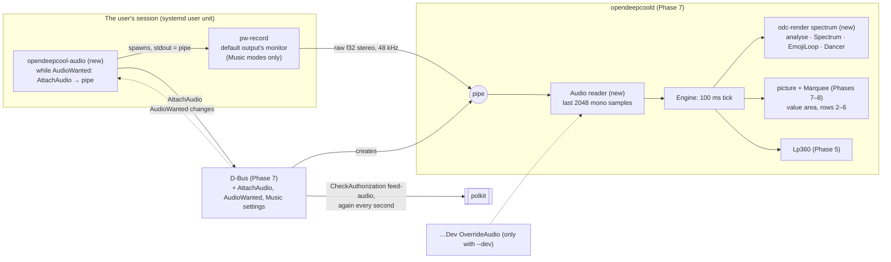

# Phase 9: Music on the LP360: the session's sound as a Winamp-style spectrum with peak dots, under emojis or a value, and a dancer

**Plan ID:** `phase-9-music`
**Source PRD:** `docs/prp/prds/opendeepcool-lp360.prd.md` (repository-relative: an absolute path would name the owner's home folder, AGENTS.md rule 10)
**PRD Phase:** `9 — Music`
**Source Issue:** `None`
**Plan Publication:** `None`

## Outcome

**Problem:** After Phases 7 and 8 the service draws Load, Temperature and Power, but refuses modes 13–23. The cooler can't show music. The audio belongs to the logged-in user's session, while the display service is a sandboxed system service that can't reach that session's sound by itself.

**Affected user:**
- The owner, and whoever is at the PC: the spectrum follows the sound of the active local session.
- Phase 10: the app's configuration screen sets peak dots, bar fall and peak fall, and its preview draws the same spectrum.

**User outcome:**
- **Music** can be the saved mode:
  - full-screen spectrum (13);
  - an emoji animation over the spectrum (14–17);
  - a temperature or usage value over the spectrum (18–22);
  - a stick figure dancing to the music on the whole grid (23, OpenDeepCool's own).
- **The spectrum** shows what the PC plays on its default output, across 40 Hz–16 kHz in 14 columns:
  - bars rise at once and fall smoothly;
  - peak dots hold above them, then drop.
- **Timing:** sound reaches the cooler within 150 ms for 95 % of frames.
- **No setup:** it starts at login. Before anyone logs in, or while the session isn't the active local one, the spectrum is the silent floor line.
- **Sound only when it's used** (owner, 2026-10-26; solution review OV-05): sound is taken only while a Music mode is shown. In every other mode nothing is captured, and no capture stream exists.

**Invariant:**
- **Spectrum:** every spectrum frame is the result of `music.md` "OpenDeepCool's spectrum, precisely" applied to the last 2048 mono samples at that tick: bands, loudness, bar fall, peak dots and continuity.
- **Top area:**
  - mode 13's rows 1–2 stay off;
  - the emoji loops are exact, and restart on a reset;
  - the value area (rows 2–6) follows `display.md` for its metric and unit, the 9999 cap and dashes included, and only it scrolls.
- **Dancer:** mode 23's pose at every tick is the one `music.md` Dancer gives for the column levels so far. In silence he stands still and straight.
- **Sources of sound:** the service takes audio only from a caller polkit authorizes as being in the active local session. Losing that authorization stops the sound within one second. It takes audio only while a Music mode is shown: leaving Music closes the pipe at once.
- **Timing:** one frame per 100 ms tick. Music never delays a frame or changes a non-Music mode.

**Success signal:** These modes' checklist items pass (M1–M20), and the measured delay from sound to frame is at most 150 ms for 95 % of frames (PRD Phase 9; owner, 2026-10-25), on the real cooler, unattended.

**Approach:**
- **The service does all the sound analysis**, as pure code in `odc-render`:
  - the FFT;
  - the bands;
  - the bars and peaks;
  - the emoji loops;
  - the dancer.
- **A tiny user-session helper**, `opendeepcool-audio`:
  - asks the service for a pipe over D-Bus;
  - runs PipeWire's own `pw-record` on the default output's monitor, writing raw samples straight into that pipe;
  - does both only while the service says it wants sound (`AudioWanted`, true exactly in Music modes), and waits for events rather than polling.
- **polkit authorizes the helper**, through a new `feed-audio` action (`allow_active` only).
- **Three new settings** (peak dots, bar fall, peak fall) join settings v1, as state keys with setters for Phase 10's configuration screen (Phase 7: no D-Bus properties; owner, 2026-10-26).

## Recommendation

**The service analyses; the helper only connects the sound.**
- The PRD left open where the FFT runs (PRD, Music Mode). Putting it in the service keeps every rule that decides a pixel in one pure crate, next to `picture` and `Marquee`. The same rules then serve the preview (Phase 10) and the tests.
- **The helper only follows events** (owner, 2026-10-26; solution review OV-05):
  1. It watches three things on the system bus:
     - the service's `AudioWanted` state key, which reaches it in `StateChanged` after `Watch()` (Phase 7: polkit `use`, active local session only; a refused `Watch()` is retried like a refused attach);
     - whether the service's bus name has an owner;
     - logind's seat0, the PC's only seat, which announces when its `ActiveSession` changes (org.freedesktop.login1(5)). The PC has one user at a time, so there's no multi-seat handling (owner, 2026-10-26).
  2. While `AudioWanted` is true, it calls `AttachAudio()`, which returns the write end of a pipe the service created.
  3. It starts `pw-record --raw --format f32 --rate 48000 --channels 2 --latency 20ms -P '{ "stream.capture.sink": true, "node.name": "opendeepcool-audio" }' -`, with that pipe as its standard output, and waits for it to exit.
  4. When `AudioWanted` turns false, the service closes the pipe and `pw-record` ends; the helper also stops it.
  5. A refused attach, from an inactive or remote session, is retried only when one of the watched things changes. While `AudioWanted` stays true there's also a slow fallback timer, backing off from 2 s to 60 s.
  6. It logs only changes of state (attached, refused, waiting for Music, `pw-record` missing), never every attempt.
  7. Its unit has `ConditionUser=!@system`, so system accounts never run it, for example a display manager's greeter (systemd.unit(5): `@system` matches the system user range).
- **When the service stops reading, `pw-record` ends.** If the service closes the pipe (restart, lost authorization, a newer helper attached, leaving Music), `pw-record` gets `SIGPIPE` and exits. So the helper never needs to know why.
- **Sound only in Music modes** (owner, 2026-10-26):
  - the service's `AudioWanted` (b) is true exactly while the mode is 13–23;
  - leaving Music closes the pipe at once, and `AttachAudio()` outside Music is refused with `AudioNotWanted`;
  - on entering Music, the helper attaches within a few hundred milliseconds. The spectrum starts from level 0 anyway (`music.md` point 8).
- **Checked on this PC, 2026-10-25:**
  - `pw-record` with `stream.capture.sink` linked to the default sink's monitor and wrote 24 000 raw stereo frames to standard output;
  - WirePlumber's `linking.follow-default-target` is on by default ("Streams connected to the default device follow when default changes", `/usr/share/wireplumber/wireplumber.conf`), so the capture follows a change of default output with no code.
- **Data rate:** 48 000 × 2 × 4 bytes = 384 kB/s through a pipe. It's negligible, and the sandboxed service parses nothing but floats.

**No PipeWire library in Rust.**
- The `pipewire` crate (0.10.1) and cpal's `pipewire` feature (cpal 0.18.2) both need `libspa-sys`, which runs `bindgen` and so needs libclang to build. Clang isn't installed here, and it would become a build dependency of the package.
- `pw-record` ships with PipeWire itself (`pipewire-audio` on this PC), so it's already wherever this phase can work at all.
- The FFT is `realfft` 3.5.0 on `rustfft` 6.4.1, pure Rust (crates.io, 2026-10-25). Look its API up in Context7 before use (CLAUDE.md).

**Authorization through polkit, as for settings.**
- `AttachAudio` checks a new action, `io.github.dtmarangoni.OpenDeepCool1.feed-audio`: `allow_active` yes, `allow_inactive` no, `allow_any` no.
- **Checked on this PC, 2026-10-25:** a process in a systemd user unit (cgroup `user@1000.service/app.slice/…`, outside the login session's scope) passed `pkcheck` for an `allow_active`-only action exactly like a terminal process did (polkit 128, exit 0 both). So polkit gives a user-unit process its user's active session.
- **Re-check every second:** in Phase 7's one-second re-check, never on the engine thread, the D-Bus side checks the attached caller again. When it fails (a user switch made the session inactive), it closes the pipe. The new active session's helper attaches on its next retry. This needs no logind code.
- **The latest authorized attach wins:** a new `AttachAudio` from an authorized caller replaces the current pipe. Only active-session callers pass, so this covers a helper restart without a race.
- **Back from standby** (owner, 2026-10-26: when the PC comes back, OpenDeepCool must be back): nothing special is needed. If `pw-record` ended during the sleep while `AudioWanted` is still true, the helper starts it again, first after 2 s; a pipe the service closed is attached anew. The helper's watch survives the sleep, because the bus connection does.

**Pure spectrum code with an independent oracle.**
- `music.md` "OpenDeepCool's spectrum, precisely" fixes every step:
  - the window and its scaling (W3C `AnalyserNode`);
  - the band edges and the loudness range;
  - the bar fall per tick;
  - the peak recurrence;
  - continuity.
- **In Rust:** `odc_render::spectrum` implements it as `analyse(&[f32; 2048]) -> [f64; 14]` plus a `Spectrum` state machine (`update`, `draw(h, peaks)`), with no clock or I/O, like `Marquee`.
- **The oracle:** the local generator implements the same text in plain Python, with its own radix-2 FFT, because numpy isn't installed. Rust is never compared with Rust (PRD Testing Strategy).

**The delay budget fits, narrowly.**
- Most of the delay is the wait for the next 100 ms tick: up to 100 ms, 95 ms or less for 95 % of frames.
- On top of that:
  - the capture latency of 20 ms;
  - the analysis window's half-length, 2048 ÷ 2 ÷ 48 000 = 21 ms;
  - the USB write.
- That gives about 140 ms for 95 % of frames, under the 150 ms target. `music.md` uses 2048 samples, not the preview page's 4096, for this reason.
- The real-cooler run measures the delay. If it fails, the plan stops and goes back to the owner, never loosening the target.

**Settings v1 grows, without a version change.**
- Phase 7 adds later phases' fields with defaults (Phase 7 Plan, Settings in TOML):
  - `music_peaks = true`;
  - `music_bar_fall = "moderate"` and `music_peak_fall = "slow"`, each one of Winamp's five stops (`slower`, `slow`, `moderate`, `fast`, `faster`; `music.md` point 4).
- A Music setting change is not a reset (`music.md` point 7). In a mode without a spectrum, it's only saved.

### Evidence

- `docs/spec/music.md`:
  - Modes 13–22, and OpenDeepCool's mode 23;
  - Dancer (mode 23): the eleven poses and the rules (owner, 2026-10-25, approved on the preview page);
  - Spectrum: layout, with OpenDeepCool's peak dots;
  - OpenDeepCool's spectrum, precisely (owner, 2026-10-25);
  - Value area (modes 18–22), with no caps and DeepCreative's mode 18 °F quirk not reproduced;
  - Emoji animations, with the loops and "a reset restarts the loop".
- `docs/spec/display.md`: Values (the 9999 cap), Unavailable values, Mode switches and Movement, precisely (resets), Test scenarios (S14–S18 for modes without values; every scenario for 18–22), Rotation.
- `docs/spec/settings.md`: OpenDeepCool's defaults; What the settings app must offer (the configuration screen, Music settings, "Music Mode audio comes from the session of the user at the PC").
- `docs/spec/frames/mode-013.txt` … `mode-022.txt`: the matrix, with `?` for spectrum pixels.
- `docs/spec/parity-checklist.md`: M1–M20.
- PRD:
  - Service model (audio helper as a user unit enabled for all users);
  - Music Mode;
  - System Footprint (`/usr/lib/systemd/user/opendeepcool-audio.service`);
  - Testing Strategy (Music spectrum; e2e with a virtual output).
- `docs/prp/plans/phase-7-service-settings-load-mode.plan.md`: the engine, `Apply`, the D-Bus change steps, `Authorizer`, the dev interface and `ClearOverride`, the dev recording, `odc-e2e`.
- `docs/prp/plans/phase-8-temperature-power.plan.md`: `odc_render::draws`, `odc_testkit::diff::cycle_match`, `odc-e2e --modes`, the temperature rules that modes 18–19 reuse.
- This PC, 2026-10-25:
  - **PipeWire:** PipeWire 1.6.9, WirePlumber 0.5.18, `pw-record` from `pipewire-audio`. The `pw-cat(1)` manual covers `-` for standard output, `--raw`, `--format`, `--latency`, `--target` and `-P` JSON properties.
  - **polkit:** 128, with the `pkcheck` result above.
  - **Not installed:** clang and numpy.
- **External sources:**
  - W3C Web Audio API 1.1, AnalyserNode: the Blackman window (α = 0.16) and X[k] = (1/N) Σ … (read 2026-10-25);
  - Webamp `packages/webamp/js/components/VisPainter.ts` (read 2026-10-25): Winamp's bar and peak falloff options, the source of the peak recurrence's shape;
  - zbus (Context7, 2026-10-25): file descriptors pass as `Fd`/`OwnedFd`, D-Bus type `h`.
  - org.freedesktop.login1(5), read 2026-10-26: "Whenever ActiveSession, Sessions, CanGraphical, CanTTY, or the idle state changes, PropertyChanged signals are sent out" for a seat.
  - systemd.unit(5), read 2026-10-26: `ConditionUser=` takes "the special value `@system`", which "can be used to check if the user id is within the system user range".
- **DeepCreative's Music captures,** compared with OpenDeepCool's rules by a scratch check on 2026-10-25 (session scratchpad, not kept). **79 steps agree** in the top area. Recounted on 2026-10-26 with the nearest rule and the regenerated frames by `research/hook/diffcount-music.py` (local), which first reproduced the old count: still 79, and every one matches the capture. No Music step's numbers change with the rounding:

  | Mode | Steps that agree | What agrees |
  |---|---|---|
  | 13 | 6 | rows 1–2 empty |
  | 14–17 | 24 (6 each) | emoji pictures |
  | 18 | 6 | °C |
  | 19 | 10 + 9 | °C, and °F scrolling |
  | 20 | 6 | two-digit values |
  | 21 | 8 | two-digit values |
  | 22 | 10 | two-digit values |

  The rest differ only by owner decisions:
  - one-digit values centred;
  - DeepCreative's 99 cap;
  - °F static at 99 or less;
  - mode 18 in °F, where DeepCreative draws the GPU.

### Alternatives considered

- **FFT in the helper, sending 14 levels over D-Bus:** the analysis would be split across two processes, and the "audio file → frames" integration test (PRD) would need both. The spectrum's rules would also live outside `odc-render`, where the preview can't reuse them.
- **The `pipewire` crate in the helper:** this adds a libclang build dependency and a native binding for one stream that `pw-record` already provides.
- **PulseAudio's `@DEFAULT_MONITOR@` through libpulse:** that names the monitor at connect time only. The PipeWire stream follows a default change by WirePlumber's own rule.
- **Checking the session through logind instead of polkit:** a second mechanism next to the one Phase 7 already uses, and it misses polkit's local and active rules.
- **A faster frame tick for a lower delay:** it sends more often than any documented use of the cooler (AGENTS.md rule 9). The 150 ms target fits the 100 ms tick.

## Visuals

## Implementation Context

### Mandatory reading

| File | Why it matters |
|---|---|
| `docs/spec/music.md` (all) | Every Music rule: layout, the spectrum procedure, settings, continuity, delay, emoji loops and reset, value area |
| `docs/spec/display.md` Values, Unavailable values, Mode switches, Movement, precisely, Test scenarios, Rotation | The value area's rules and the reset list |
| `docs/spec/settings.md` OpenDeepCool's defaults, What the settings app must offer | The new settings, the configuration screen, audio from the session at the PC |
| `docs/spec/frames/README.md`, `mode-013.txt`–`mode-022.txt` | The matrix and its `?` pixels |
| `docs/prp/plans/phase-7-service-settings-load-mode.plan.md` Tasks 5–9 | Settings, engine, D-Bus change steps, polkit, the dev interface, the dev copy, `odc-e2e` |
| `docs/prp/plans/phase-8-temperature-power.plan.md` Tasks 2–3 | `draws`, the temperature rules, `cycle_match`, `--modes` |
| `tools/oracle/odc_rules.py`, `expected-frames.py`; `research/hook/render-check.py` (local) | The oracle generator (committed from Phase 5), and the DeepCreative renderer behind the differential skip reasons |
| `man pw-cat` | The exact `pw-record` and `pw-play` options |

### Existing patterns and primitives

- **Pure state machines without a clock:** `Marquee` (Phase 7 Task 2). `Spectrum`, `EmojiLoop` and `Dancer` follow it, so every behaviour runs as a unit test.
- **Readings override for the real service:** `OverrideReadings` (Phase 7 Task 7). `OverrideAudio` is its audio twin, cleared by the same `ClearOverride`.
- **A polkit-checked change:** the seven steps of Phase 7 Task 7, which the three Music setters follow.
- **The dev copy and manifest:** Phase 5 Task 8 and Phase 7 Task 8. The helper's unit goes through them.
- **Per-mode commits and real-cooler runs:** Phase 8 Tasks 4–8 with `--modes`.

### Integration points

- `odc_render::{draws, picture, mode_info}`: Music modes become drawable one at a time.
- The engine tick (Phase 7 Task 6) gets one more input, the audio reader's latest window, used only when the mode is 13–23.
- The `odc-ipc` contract: new members. `docs/spec/settings.md` is updated in the same commit (Phase 7 Agent Notes).
- `scripts/dev/setup.sh`, `teardown.sh`, `check.sh`: the helper binary, its user unit and its global enable.

## Scope

### In scope

- Modes 13–23, each drawable and selectable: full screen, the four emoji loops with the spectrum, the five value modes with the spectrum, and the Dancer.
- The spectrum procedure, peak dots, bar fall and peak fall settings, and continuity across switches.
- The emoji loops' restart on a reset.
- The audio path:
  - the audio reader in the service;
  - `AttachAudio` with polkit `feed-audio` and the once-a-second re-check;
  - the helper `opendeepcool-audio` and its user unit, enabled for all users in the dev copy.
- D-Bus:
  - `MusicPeaks`, `MusicBarFall`, `MusicPeakFall` and their setters;
  - `AudioConnected`;
  - the dev interface's `OverrideAudio`.
- Tests in all four layers: the spectrum oracle, scenarios, captures, the real-cooler matrix, the real capture through a virtual output, and the delay measurement.

### Not building

- **The settings app and its configuration screen:** Phase 10. Its contract (the new state keys and setters) ships here.
- **Choosing an audio source other than the default output's monitor:** not asked for by the user. The owner does want to try capturing only the sound tagged as music; Task 0 researches it first. The helper's `--target` flag exists only for the end-to-end test.
- **Tuning the bands or the loudness range:** they're spec values (`music.md` points 2–3). Changing them is a spec change with the owner.
- **Audio before login:** silence, as the spec says.

## Delivery Considerations

| Concern | Decision and owned work |
|---|---|
| Compatibility / migration | Settings v1 gains three fields with defaults; an existing file without them loads with the defaults, and the next store writes them (Task 3 test) |
| Rollout / reversibility | The dev copy adds the helper binary, `/etc/systemd/user/opendeepcool-audio.service` and its global enable, all in the manifest; `teardown.sh` removes them, `systemctl --global disable` included. Each `pkexec` run is shown to the owner first (rule 7) |
| Observability | The journal logs, without any sample data: each attach (the caller's unit name, from the bus name's PID), each refusal or lost authorization with its reason, and the pipe closing. The helper logs only changes of state. `AudioConnected` tells the app whether sound is coming in |
| Documentation | README: what the helper is and how to see it (`systemctl --user status opendeepcool-audio`); the PRD System Footprint: the helper binary, the user unit's dev path and the polkit action (Task 10) |

## Implementation

Each task ends with its own commit (rule 4) after its tests pass. Tasks 6–9 are one commit per mode, eleven in all: implement it, run all its tests, including the unattended run on the cooler, then commit.

### 0. Research: can the helper take only the sound tagged as music?

The owner wants to try it (2026-10-26; solution review OV-06). This task only researches and reports; the owner decides before Task 1, and this plan is updated to match.

**Questions**
- Which common players and browsers tag their PipeWire streams with `media.role` Music, and what do the others set? Players to check include mpv, VLC, Spotify, Firefox and Chromium. The property exists in PipeWire's `keys.h` ("Role: Movie, Music, Camera, Screen, Communication, Game, Notification, …"); which applications set it is unverified.
- Can the helper capture only those streams? Options: `pw-record --target` aimed at each stream, or a small PipeWire client that links to tagged streams as they appear and disappear. Does a native binding then become necessary?
- Does the delay target (150 ms for 95 % of frames) still hold?
- What happens when nothing tagged Music plays: silence, or a fall-back to the monitor?

**Method**
- Read the tags with `pw-dump` while each player plays a test tone.
- Try a capture limited to tagged streams in a throwaway program in the session scratchpad, never committed.
- Read PipeWire's and WirePlumber's documentation for the linking rules.

**Result**
- A report in `docs/research/` with the evidence and a recommendation.
- The owner's decision recorded in `music.md` (Source), the PRD (Open Questions, Decisions Log: Audio source), and this plan.
- Until the decision, the source stays the default output's monitor.

### 1. The oracle gets the spectrum, the emoji resets and the Music scenarios

**Files and integration points**
- `tools/oracle/odc_rules.py` (committed since Phase 5 Task 0): UPDATE, with the spectrum procedure of `music.md`, written from the spec text:
  - a plain-Python radix-2 FFT;
  - the Blackman window;
  - the band edges and loudness;
  - the bar and peak state;
  - the emoji loop with its restart.
- `tools/oracle/expected-frames.py`: UPDATE, writing the files below, in the same commit as them.
- `docs/spec/frames/spectrum/signals.txt`: CREATE. The test signals as text, so the Rust tests synthesize the same samples. Each signal is a list of segments: frequency in Hz, peak amplitude in dBFS, length in ticks, or silence. A sample is `A · sin(2π f n / 48000)` computed in `f64`, then stored as `f32`, the same in both channels. The signals:
  - silence;
  - one tone at the centre of each column, at −20, −45 and −70 dBFS;
  - a tone at each band edge, from both sides;
  - two tones in two columns;
  - a burst train (100 ms on, 400 ms off) for the bars' and peaks' fall;
  - a sweep of stepped tones from 40 Hz to 16 kHz;
  - full-scale white noise from a fixed linear congruential generator given in the file.
- `docs/spec/frames/spectrum/expected.txt`: CREATE, generated. For each signal, the expected spectrum rows of every tick:
  - for *H* = 12 and *H* = 6;
  - with peaks on and off;
  - with every bar fall stop and every peak fall stop.
- `docs/spec/frames/scenarios/music.txt`: CREATE, generated.
  - Every scenario S1–S26 that applies, for the value modes 18–22, both units for 18–19, in silence: the spectrum is then the floor line, so every pixel is exact.
  - S14–S18 for modes 13–17. S14 here is a switch at every loop position, and the next frame is the loop's first picture.
  - Switches between Music modes while a burst train plays, at every *k*: the spectrum's levels continue and the top area resets.
  - Switches into Music from Load: the levels start at 0.
- `docs/spec/frames/mode-023.txt`: CREATE, generated. The Dancer in silence (pose 0, standing still) in rotations 0–3.
- `docs/spec/frames/spectrum/dancer.txt`: CREATE, generated. The pose at every tick for each signal of `signals.txt`, plus beat trains of a 60 Hz tone at levels around each threshold (0.35 and 0.6 of the scale, and rises just above and below 0.12), and resets at chosen ticks.
- `odc_rules.py` gets the Dancer's poses (drawn from the skeleton, then checked against the pictures in `music.md`) and its rules, step for step.
- `docs/spec/frames/README.md`: UPDATE, describing the three files.

**Implementation**
- The generator flags a signal and tick whose level lies within 10⁻⁶ of a rounding boundary of `round(level × H)`, or of the −75/−25 dB clamps, and moves that signal's amplitude by 0.5 dB.
  - This keeps last-bit differences between Python's and Rust's `sin` and FFT from deciding a pixel.
  - The files say which signals were moved.

**Tests**
- The generator's own checks:
  - the existing `mode-*.txt` cases are reproduced unchanged (as regenerated on 2026-10-26 with the nearest rule);
  - a −20 dBFS tone at a column's centre lights that column and no column two or more away;
  - with peaks off, every frame meets the DeepCreative layout (solid bars, floor lit);
  - with peaks on, at most one lit pixel above each bar.

**Validation**
- `git diff --stat docs/spec/frames/` shows only the new files and the README.

### 2. `odc-render`: the spectrum, the emoji loop and the Music pictures, none drawable yet

**Files and integration points**
- `crates/odc-render/src/spectrum.rs`: CREATE.
  - `analyse(&[f32; 2048]) -> [f64; 14]` (levels 0–1).
  - `Spectrum` with three methods:
    - `enter()`: levels 0;
    - `update(levels, &MusicSettings)`;
    - `draw(h: u8, peaks: bool) -> Columns`.
- `crates/odc-render/src/emoji.rs`: CREATE. The four loops typed from `music.md` as `#`/`.` rows and durations. `EmojiLoop` has `reset()` and `tick() -> picture`.
- `crates/odc-render/src/dancer.rs`: CREATE. The eleven poses typed from `music.md`'s pictures as `#`/`.` rows. `Dancer` has `reset()` and `tick(levels: &[f64; 14]) -> pose`: the rules of `music.md` Dancer, in order, with no clock.
- `crates/odc-render/src/music.rs`: CREATE. It composes one frame:
  - mode 13: the spectrum in rows 3–14;
  - 14–17: the emoji picture in rows 1–7 and the spectrum in rows 9–14;
  - 18–22: the value area through `picture` and `Marquee`, with the band at rows 2–6, and the spectrum in rows 9–14;
  - 23: the Dancer's pose on the whole grid.
- `crates/odc-render/Cargo.toml`: UPDATE, `realfft = "3.5"`.

**Implementation**
- `analyse` follows `music.md` point 1 exactly:
  - the Blackman window with α = 0.16;
  - X[k] scaled by 1/N;
  - 20 log₁₀ |X[k]| dB;
  - bins at 48 000 ÷ 2048 Hz each;
  - the highest level in each band, with at least the bin nearest the lower edge;
  - −75 to −25 dB mapped to 0–1.
- `MusicSettings { peaks, bar_fall: Stop, peak_fall: Stop }`, with `Stop` the five Winamp stops and their values (`music.md` point 4):
  - the bar falls *b* ÷ 72 of the height per tick (point 5);
  - the peak is *p₀* − (3 ÷ 3840) × (*g*^(*t* × 10/3) − 1) ÷ (*g* − 1) after *t* ticks (point 6), computed in `f64`.
- Levels are kept as 0–1, so a switch between *H* = 12 and *H* = 6 keeps them (point 8).
- `draws` stays false for 13–23 in this task.

**Tests** (layer 1, CI)
- **Every signal of `spectrum/expected.txt`,** at every tick, for every listed *H*, peaks setting and stop: the spectrum rows match.
- **`analyse` properties:**
  - silence → all zeros;
  - a tone moving from 40 Hz to 16 kHz moves its highest column monotonically from 1 to 14.
- **`Spectrum` properties:**
  - a bar never falls faster than its setting;
  - a peak is never below its bar's level;
  - with peaks off, every drawn column is a solid run from the floor;
  - with them on, at most one pixel above it;
  - every column is at least 1 row high.
- **Emoji:** each picture equals a copy typed independently from `music.md`, and each loop's durations add up to 900 ms (1100 ms for emoji 4).
- **Dancer:**
  - each pose equals a copy typed independently from `music.md`;
  - every sequence of `spectrum/dancer.txt` gives the expected pose at every tick;
  - properties: 3 quiet ticks always give pose 0; two beats are never less than 2 ticks apart; a reset gives pose 0 and the next sway goes right.

**Validation**
- `cargo test -p odc-render`: passes.

### 3. The service takes sound: the audio reader, `AttachAudio`, polkit, the Music settings

**Files and integration points**
- `crates/odc-ipc/`: UPDATE.
  - **Methods:**
    - `AttachAudio() -> h`, polkit `feed-audio`;
    - `SetMusicPeaks(b)`, `SetMusicBarFall(s)` and `SetMusicPeakFall(s)`, each stop by its name, polkit `change-settings`.
  - **Properties:** `MusicPeaks` (b), `MusicBarFall` (s), `MusicPeakFall` (s), `AudioConnected` (b), `AudioWanted` (b: true exactly in Music modes 13–23).
  - **The dev interface:** `OverrideAudio(h)`, cleared by `ClearOverride`, at the dev object path, with Phase 7's three checks.
  - **The action:** `…OpenDeepCool1.feed-audio`.
  - **Errors:** `InvalidArgument` for a name that isn't one of the five stops; `AudioNotWanted` for `AttachAudio` outside a Music mode.
- `crates/odc-service/src/audio.rs`: CREATE.
  - `trait AudioSource` keeps the latest 2048 mono samples, each with the monotonic time it was read.
  - `PipeAudio` reads `f32` stereo frames from the pipe's read end on its own thread and averages the channels.
  - `FakeAudio` is for the tests.
- `crates/odc-service/src/settings.rs`, `engine.rs`, `dbus.rs`, `polkit.rs`: UPDATE.
- `packaging/polkit/io.github.dtmarangoni.OpenDeepCool1.policy`: UPDATE, adding `feed-audio` (`allow_active` yes, `allow_inactive` no, `allow_any` no).
- `docs/spec/settings.md` "What the settings app must offer": UPDATE. Status gains "whether Music sound is coming in from the session at the PC" (`AudioConnected`), so the UI designer sees it (owner's rule, 2026-10-24).

**Implementation**
- **`AttachAudio`:**
  1. Outside a Music mode → `AudioNotWanted` (owner, 2026-10-26: sound only in Music modes).
  2. Authorize `header.sender()` for `feed-audio`.
  3. Create a pipe (`O_CLOEXEC`).
  4. Hand the read end to `PipeAudio`, closing any previous one.
  5. Return the write end.
  6. Log the attach, and set `AudioConnected`.
- **Re-check:** every second, on its own timer, the D-Bus side checks the current sender again. It also listens for `NameOwnerChanged` of that sender.
  - Failing the check or losing the name closes the read end and logs why. The spectrum then hears silence.
- **The reader** drains the pipe for as long as it's attached, so `pw-record` never blocks. It's attached only in Music modes: when the mode leaves 13–23, the D-Bus side closes the read end, sets `AudioConnected` and `AudioWanted` false, and logs it. Entering 13–23 sets `AudioWanted` true.
  - A read error or end of file closes the pipe, sets `AudioConnected` false, and leaves silence.
- **Engine:**
  - entering 13–22 from another mode calls `Spectrum::enter`;
  - each tick in a Music mode runs `analyse` on the window, then `Spectrum::update`;
  - a Music setting change is applied on the next tick with no reset;
  - the emoji loop restarts on every reset in the Phase 7 list.
- **Settings v1:** the three fields with their defaults; validation of the stop names.
- **Dev recording:** each report also carries its monotonic write time (`CLOCK_MONOTONIC`, ns), for the delay measurement in Task 5.

**Tests** (layer 3, CI; p2p D-Bus and a fake `Authorizer`, as Phase 7 Task 7)
- **`AttachAudio`:**
  - allowed → a pipe, and samples written to it reach the engine's window;
  - denied → `NotAuthorized` and no pipe.
- **Re-check:** the authorizer flips to "no" → the pipe is closed within 10 ticks, and the spectrum falls to the floor at its bar fall rate.
- **Attachments:** a second authorized attach replaces the first, whose writer gets `EPIPE`. The caller leaving the bus closes the pipe.
- **Only in Music:**
  - in mode 1, `AttachAudio` → `AudioNotWanted`, and no pipe;
  - switching from mode 13 to mode 1 closes the pipe within one tick and sets `AudioWanted` false;
  - switching back sets it true and sends `StateChanged` to the watchers.
- **Setters:** each Music setter validates, stores and sends `StateChanged` to the watchers. A value already set changes nothing. A change while mode 1 is shown changes no frame.
- **Old settings file:** a v1 file without the Music fields loads with the defaults.
- **"Audio file → frames"** (PRD layer 3): `FakeAudio` plays each signal of `spectrum/signals.txt` through the engine. The recorded frames' spectrum rows match `expected.txt` tick for tick. This needs mode 13 drawable, so it lands with Task 6 and is written here against a test-only switch.
- **The `PipeAudio` reader:** a pipe that delivers half a frame then the rest; a writer that closes; a burst of a whole second at once. None loses or duplicates a sample.

**Validation**
- `cargo test -p odc-ipc -p odc-service`: passes.

### 4. The helper `opendeepcool-audio` and its user unit, in the dev copy

**Files and integration points**
- `crates/odc-audio/`: CREATE, the binary `opendeepcool-audio` (zbus blocking, no other dependency).
- `packaging/systemd-user/opendeepcool-audio.service`: CREATE.
  - `ExecStart=` the helper; `Restart=on-failure`;
  - `ConditionUser=!@system`: never for system accounts (owner, 2026-10-26);
  - `WantedBy=default.target`;
  - `NoNewPrivileges=yes`, `PrivateTmp=yes`, `ProtectSystem=strict`, `RestrictAddressFamilies=AF_UNIX`, `LockPersonality=yes`, `RestrictRealtime=no` (PipeWire's client may ask for realtime scheduling: unverified, so not restricted).
- `scripts/dev/setup.sh`, `teardown.sh`, `check.sh`: UPDATE.
  - **setup** installs the helper to `/usr/local/libexec/opendeepcool-dev/` and the unit to `/etc/systemd/user/`, with `ExecStart` pointing there, then runs `systemctl --global enable opendeepcool-audio.service`, all recorded in the manifest.
  - **teardown** runs `systemctl --global disable` and removes them.
  - **check** verifies, in the owner's session, `systemctl --user is-active opendeepcool-audio` and, while a Music mode is shown, `AudioConnected = true`.

**Implementation**
- **Loop** (events, not polling; owner, 2026-10-26):
  1. Connect to the system bus and subscribe to three things:
     - the service's `StateChanged` (`AudioWanted`), after a `Watch()` that passed;
     - `NameOwnerChanged` for the service's name;
     - logind's seat `PropertiesChanged` (`ActiveSession`).
  2. While `AudioWanted` is true and nothing is attached, call `AttachAudio`. On success:
     - spawn `pw-record --raw --format f32 --rate 48000 --channels 2 --latency 20ms -P '{ "stream.capture.sink": true, "node.name": "opendeepcool-audio", "node.description": "OpenDeepCool cooler display" }' -`, with standard output set to the returned descriptor;
     - close the helper's own copy of the descriptor.
  3. When `AudioWanted` turns false, or the service leaves the bus, stop `pw-record`. The service closes its end too.
  4. A refused attach waits for the next watched change, or for the fallback timer (2 s, doubling to 60 s) while `AudioWanted` stays true.
  5. Log only changes of state.
- **Flags:**
  - `--target <node>` passes `--target` to `pw-record`, for the end-to-end test only;
  - anything else is an error.
- **Missing `pw-record`:** the helper logs "pw-record not found (package pipewire-audio)" once, then waits for the next watched change, or the fallback timer while `AudioWanted` is true.

**Tests**
- **Unit tests** cover:
  - the exact `pw-record` argument list;
  - flag parsing.
- **A fake `pw-record` script**, placed first on `PATH` in the test, writes known floats. Through a p2p fake service, they arrive in the pipe. When the fake service closes the pipe, the child exits, and the helper attaches again only if `AudioWanted` is still true.
- **Events, not polling:**
  - with `AudioWanted` false, no `pw-record` runs; turning it true attaches and starts the fake one; turning it false stops it within one second;
  - a refused attach logs one line, then retries only on a watched change or the fallback timer: a minute of refusals writes one line, not 30;
  - a change of seat0's `ActiveSession` triggers an immediate retry, of a refused `Watch()` too;
  - after a wake-up: a fake `pw-record` that exits while `AudioWanted` stays true is started again within 2 s, and attaches anew if the service closed the pipe.
- `systemd-analyze verify --user packaging/systemd-user/opendeepcool-audio.service` passes.

**Validation**
- After the owner approves the `pkexec scripts/dev/setup.sh` run:
  - `scripts/dev/check.sh` exits 0;
  - `busctl call … GetState` shows `AudioConnected` as `b true` while the owner is logged in and a Music mode is shown. In mode 1 it shows `b false`, and no `opendeepcool-audio` node exists.

### 5. Layer 4 tools: the virtual output, the real capture check and the delay measurement

**Files and integration points**
- `crates/odc-testkit/src/hardware.rs`: UPDATE, with the capability `pipewire`: Real when the user's PipeWire runs and `pw-record`, `pw-play` and `pactl` exist.
- `crates/odc-e2e/src/music.rs`: CREATE, run with `--only music`.

**Implementation**
- **Harness** (`pipewire` Real), always restored by a drop guard:
  1. `pactl load-module module-null-sink sink_name=odc-e2e`, keeping the module index.
  2. `systemctl --user stop opendeepcool-audio`.
  3. Start the dev helper with `--target odc-e2e.monitor`. Which node name the null sink's monitor has is unverified: Task 5 reads it from `pw-dump` and uses that.
  4. Afterwards: stop it, `pactl unload-module <index>`, `systemctl --user start opendeepcool-audio`.

  The owner's own sound keeps playing on their output, unchanged, during the run.
- **Only in Music:** in mode 1, `pw-dump` shows no `opendeepcool-audio` node. Switching to mode 13 creates it within 1 s, and switching back to mode 1 removes it within 1 s.
- **Real capture check:**
  - `pw-play --raw --format f32 --rate 48000 --channels 2 --latency 10ms --target odc-e2e -` plays one example signal of `spectrum/signals.txt`, a steady −20 dBFS tone at column 7's centre, then silence. It's fed from `odc-e2e` in 5 ms chunks paced by the monotonic clock. Every signal runs in-process (Task 3) (owner, 2026-10-26: one example of each test type on the real cooler);
  - in mode 13, the recorded frames must show the expected spectrum rows for each steady tone (the tone segments' middle ticks), and the floor line in silence.
- **Delay measurement:**
  - 200 bursts of a −20 dBFS tone at column 7's centre, 400 ms apart, after silence;
  - for each burst, the delay is the dev recording's write time of the first frame where column 7 rises above the floor, minus the time `odc-e2e` wrote the burst's first sample;
  - the run reports the median and 95th percentile, and **fails if the 95th percentile is above 150 ms**.
  - Writing ahead of playback can only make the measured value larger than the true one, so a pass is safe. The report states the pacing (10 ms or less queued).
- **Fake mode** (`pipewire` Absent): the same signals through `FakeAudio` in an in-process engine. The delay check is reported as not run, never as passed.

**Tests**
- Parsing of the null sink's module index and of `pw-dump`'s monitor node; the drop guard restores the unit even when a check panics (tested with a fake `systemctl` and `pactl` on `PATH`).

**Validation**
- `cargo test -p odc-e2e`: passes. The real run comes with Task 6.

### 6. Music, full screen (mode 13)

**Files and integration points**
- `crates/odc-render/src/music.rs`: UPDATE, `draws(13)` true.
- `crates/odc-render/tests/matrix_music.rs`, `scenarios_music.rs`, `differential_music.rs`: CREATE.
- `engine.rs`, `dbus.rs`, `attended.rs` tests: UPDATE.

**Tests**
- **Layer 1:**
  - all cases of `mode-013.txt` in silence, with `?` resolved by the floor line; the spectrum signals at *H* = 12;
  - rows 1–2 always off.
- **Layer 1, scenarios:** S14–S18 for mode 13 from `scenarios/music.txt`, in all four rotations.
- **Layer 2 (local):**
  - every captured mode-13 step has rows 1–2 off;
  - every frame meets the DeepCreative layout (solid bars, floor lit), compared with peaks off. DeepCreative draws no peaks.
- **Layer 3:**
  - the "audio file → frames" run of Task 3;
  - every ordered switch between mode 13 and modes 1–12 at every *k*;
  - entering 13 from Load starts the levels at 0.
- **D-Bus:** `SetMode(13)` succeeds; the `NotYetAvailable` test moves to mode 14.
- **Layer 4:**
  - `odc-e2e --only service --modes 13`: one case of mode 13 through `OverrideAudio`, in silence and with one signal, plus one example of each test type it adds;
  - `odc-e2e --only music`: the real capture check, with one signal, and **the delay measurement**, whose 200 bursts are one test that needs that many samples for its 95th percentile;
  - the tour gains mode 13 with the burst train, peaks on and off, and the slowest and fastest stops.

**Validation**
- `cargo test -p odc-render --test matrix_music --test scenarios_music`, `cargo test -p odc-service`: pass.
- `cargo test -p odc-render --test differential_music -- --ignored`: passes and prints its counts.
- `cargo run -p odc-e2e -- --only service --modes 13 --require dev-service` and `cargo run -p odc-e2e -- --only music --require dev-service,pipewire`: pass, with the delay's 95th percentile at 150 ms or less.

### 7. Music, emojis over the spectrum (modes 14, 15, 16, 17)

Four sub-steps, **each its own commit** (rule 4).

**Tests per mode**
- **Layer 1:** all cases of `mode-01N.txt`, the loop compared frame by frame from its first picture, with the spectrum in rows 9–14 at *H* = 6, in silence and with the signals.
- **Scenarios:** S14–S18 for that mode. The loop restarts on a switch into it, on a rotation change, on another GPU and on Refresh, at every loop position. A unit change and a Music setting change don't restart it.
- **Layer 2 (local):** the captured steps' top areas (rows 1–8) are exactly the loop's pictures, and pass `cycle_match` against the loop in order. 6 steps per mode agreed on 2026-10-25.
- **Layer 3:** every ordered switch between this mode and the modes drawable before it, at every *k*.
- **Layer 4:** `--modes 1N`. The tour gains this emoji, with one Refresh mid-loop.

### 8. Music, a value over the spectrum (modes 18, 19, 20, 21, 22)

Five sub-steps, **each its own commit** (rule 4):

| Mode | Value |
|---|---|
| 18 | CPU Temperature |
| 19 | Gpu temperature |
| 20 | CPU Usage |
| 21 | Gpu usage |
| 22 | Memory Load |

18 and 19 are in both units; all five use Phase 7–8's value rules in rows 2–6, and only the value area moves.

**Tests per mode**
- **Layer 1:**
  - all cases of `mode-0NN.txt`: the value area exact, the spectrum in silence and with the signals;
  - mode 18 in °F shows the CPU Temperature, never the GPU's (rule 11; `music.md` quirk).
- **Scenarios:**
  - every scenario S1–S26 from `scenarios/music.txt` for this mode, in all four rotations;
  - the property that rows 9–14 are always exactly the spectrum's rows, whatever the value area does.
- **Layer 2 (local):** the captured steps where both sets of rules agree. Static steps are compared frame for frame; scrolling °F steps (mode 19) with `cycle_match` on rows 1–8. Every other step is listed with its reason; mode 18 °F's reason is "DeepCreative draws the Gpu temperature".
- **Layer 3:**
  - S15: a unit change resets the value area in 18–19 and changes nothing in 20–22;
  - S25: another GPU resets 19 and 21;
  - availability: `AvailableModes` drops the mode with its metric's reason, as in Phase 8;
  - every ordered switch with the modes drawable before it.
- **Layer 4:** `--modes 18` … `--modes 22`. The tour gains each mode with a `100%` or `135°F` value scrolling over the burst train.

### 9. Music, the Dancer (mode 23)

**Files and integration points**
- `crates/odc-render/src/music.rs`: UPDATE, `draws(23)` true.
- `matrix_music.rs`, `scenarios_music.rs`, `engine.rs`, `dbus.rs`, `attended.rs` tests: UPDATE.

**Implementation**
- The engine calls `Dancer::tick` with the levels of `analyse` (before any bar fall) at every tick in mode 23. It calls `Dancer::reset` on every reset in the Phase 7 list, as for the emoji loops.
- The Music settings (peak dots, bar fall, peak fall) don't touch mode 23. A change while it's shown is only saved.

**Tests**
- **Layer 1:**
  - all cases of `mode-023.txt`: standing still in silence, in all four rotations;
  - every sequence of `spectrum/dancer.txt` through `analyse` and `Dancer`, from the samples.
- **Scenarios:** S14–S18 for mode 23 at every point of a beat train: a switch into it, a rotation change, another GPU and Refresh each give pose 0 on the next frame; a unit change and a Music setting change change nothing.
- **Layer 3:**
  - "audio file → frames" for the dancer signals, through the engine;
  - every ordered switch with modes 1–22, so all 506 ordered pairs among modes 1–23 have run;
  - `SetMode(23)` succeeds. Every mode in the table is now drawable, so `NotYetAvailable` is no longer returned; its test becomes a mode outside the table (0, 24, 100) → `InvalidArgument`.
- **Layer 2:** none: DeepCreative has no Dancer.
- **Layer 4:**
  - `--modes 23`: one case of mode 23 through `OverrideAudio`, in silence and with one dancer signal;
  - then one `--only service` run with no `--modes`, one example of each mode 1–23 and of each test type, and one `--only music` run;
  - the tour gains the Dancer with the demo burst train, soft then loud, then silence.

### 10. Records

**Files and integration points**
- `AGENTS.md` Commands: `--only music`, the `pipewire` capability, the new test targets.
- `README.md`:
  - Status;
  - what the audio helper is, that it starts at login for every user, and `systemctl --user status opendeepcool-audio`;
  - `busctl` examples for `SetMode 13` and `SetMusicPeaks false`.
- `docs/prp/prds/opendeepcool-lp360.prd.md` System Footprint:
  - the helper binary;
  - the user unit, at its dev path in the dev table;
  - the global enable symlink;
  - the polkit action `feed-audio`;
  - runtime dependency `pipewire-audio` (for `pw-record`), noted for Phase 11's package.

**Implementation**
- **The Phase 9 report's parity table:** M1–M20, each with the test that proves it. Where DeepCreative differs (M1 with peaks, M10), the row says what OpenDeepCool does.
- **The report also records:** the delay's measured median and 95th percentile; the null sink's monitor node name found in Task 5; and whether `RestrictRealtime` could be set.

**Validation**
- `.githooks/pre-commit` and CI pass.

## Acceptance

1. **AC1 — Spectrum as the spec draws it:** every signal of `spectrum/expected.txt` produces the expected spectrum rows at every tick, for *H* 12 and 6, peaks on and off, and every bar fall and peak fall stop, in unit tests and through the engine from audio samples (Tasks 1–3, 6).
2. **AC2 — Top areas:**
   - mode 13's rows 1–2 stay off;
   - each emoji loop is exact and restarts on a reset;
   - each value area follows `display.md` for its metric and unit, with the 9999 cap and dashes;
   - mode 18 shows the CPU Temperature in both units;
   - the Dancer's pose follows `music.md` at every tick, standing still in silence (Tasks 6–9).
3. **AC3 — Settings:**
   - peak dots, bar fall and peak fall are stored, validated (one of Winamp's five stops) and served over D-Bus;
   - a change shows on the next frame without a reset;
   - in other modes it's only saved;
   - an older v1 file gets the defaults (Task 3).
4. **AC4 — Sound only from the active local session, and only in Music modes:**
   - `AttachAudio` needs polkit `feed-audio`;
   - outside a Music mode, `AttachAudio` is refused, the pipe is closed and no capture stream exists;
   - losing it closes the pipe within one second;
   - a newer authorized attach replaces the old one;
   - before login the spectrum is the floor line (Tasks 3–4).
5. **AC5 — The helper:**
   - it starts at login for every user except system accounts, in the dev copy, and captures only while `AudioWanted` is true;
   - a refused attach is retried on events, not every 2 s, and logged once;
   - it captures the default output's monitor through `pw-record`, and follows a change of default output;
   - it reconnects after a service restart, and after a wake-up from standby, with no action (Task 4).
6. **AC6 — Movement and resets:**
   - every scenario that applies passes for modes 13–23, in both units for 18–19, in all four rotations, at every listed cycle or loop position;
   - all 506 ordered mode switches among 1–23 show the new top area at home on the next frame;
   - the spectrum's levels continue between Music modes and start at 0 when entering from another family (Tasks 1, 6–9).
7. **AC7 — DeepCreative's captures:** the agreeing steps (79, unchanged by the nearest rule, recounted 2026-10-26) match in the top area (0 differing pixels, emoji and scrolling steps in order), every Music frame captured meets the layout with peaks off, and every other step is listed with its reason (Tasks 6–8).
8. **AC8 — Real cooler, unattended:**
   - each mode's `--modes` run passes before its commit;
   - the real capture through a virtual output draws the expected spectrum;
   - **the delay is at most 150 ms for 95 % of 200 bursts**;
   - the owner's own audio and units are left as they were;
   - other computers run the same checks against fakes and report the delay as not run (Tasks 5–9).
9. **AC9 — Records:** README, AGENTS.md Commands, the PRD footprint and the Phase 9 report (parity table, measured delay) match what was built (Task 10).

## Validation

| Gate | Command or procedure | Proves |
|---|---|---|
| Format, lint | `cargo fmt --all --check`; `cargo clippy --workspace --all-targets -- -D warnings` | Style; no warnings |
| Layers 1 + 3 | `cargo test --workspace` | AC1, AC2, AC3, AC4, AC6 |
| Layer 2 (local) | `cargo test -p odc-render --test differential_music -- --ignored` | AC7 |
| User unit | `systemd-analyze verify --user packaging/systemd-user/opendeepcool-audio.service`; `xmllint --noout packaging/polkit/*.policy` | AC5 (syntax), AC4 (policy) |
| Dev copy | `scripts/dev/check.sh`; `busctl call … GetState` (`AudioConnected`) | AC5 |
| Layer 4, per mode (local, unattended) | `cargo run -p odc-e2e -- --only service --modes <n> --require dev-service` | AC8, before each mode's commit |
| Layer 4, sound and delay (local, unattended) | `cargo run -p odc-e2e -- --only music --require dev-service,pipewire` | AC5, AC8 (delay) |
| Attended tour (optional, the owner) | `cargo run -p odc-e2e -- --attended --modes 13-23` | The owner's own look; never a gate |
| CI | GitHub Actions on the pushed branch | Layers 1 + 3 |

### Test matrix covered in this phase

| Matrix cases | Layer 1 | Layer 2 | Layer 4 |
|---|---|---|---|
| Modes 13–23 × rotations 0–3 (× °C/°F for 18–19) × value sets (52 of the 112 combinations) | `matrix_music`, spectrum in silence and with the signals | the steps that agree (79 under the old rounding; recounted), top area | one case per mode, through `OverrideAudio` on the dev service, or fakes |
| Spectrum signals × *H* 12/6 × peaks on/off × 5 bar fall stops × 5 peak fall stops | `spectrum` unit tests; the engine from samples | — (OpenDeepCool's own analysis) | one signal through a virtual output, for the real capture |
| Movement scenarios for 18–22, and S14–S18 for 13–17 and 23, × 4 rotations | `scenarios_music` | — | one variant of each scenario type |
| Dancer sequences: signals, beat trains around each threshold, resets | `dancer` unit tests; the engine from samples | — (OpenDeepCool's own) | one dancer signal through `OverrideAudio` on the dev service |
| Mode switches: 506 ordered pairs among 1–23, continuity of the spectrum | `engine` | — | one example of a switch into and out of Music |
| Delay: 200 bursts | — | — | `--only music` |

After this phase, all 112 matrix combinations are covered.

## Risks and Decisions

| Decision or risk | Recommendation | Evidence / mitigation | Consequence if different |
|---|---|---|---|
| Peak dots, Winamp's falloff stops and defaults on two sliders, ≤150 ms delay, emoji loop restart, the configuration screen (owner, 2026-10-25) | Done: `music.md`, `settings.md`, the UI brief, the parity checklist (M16–M19) and the PRD follow them | Commits `7a9e9e2`, `bd6ed5d`; the preview page | — |
| The 150 ms target leaves about 10 ms of headroom over the budget | Measure in Task 6. If the 95th percentile is over 150 ms, stop and bring the measurement to the owner; never loosen the target or speed up the tick on our own | Budget above; AGENTS.md rules 2 and 9 | A failing measurement blocks the phase until the owner decides |
| The owner approved the Dancer on the preview page, whose levels came from the browser's 4096-sample analyser; mode 23 uses the spec's 2048 samples | Keep the spec's thresholds; the attended tour (optional) lets the owner look at mode 23 on the cooler, and any change is a spec change | Tone levels are the same at both sizes (1/N scaling); noise levels differ by about 3 dB | He could react slightly more to noisy music than on the preview |
| Winamp's frame rate is undocumented; 30 ms per Winamp frame is a derived anchor | Keep: it makes Winamp's default bar fall the owner's 0.6 s and keeps Winamp's ratios; the spec marks it unverified | `music.md` point 4 | Another anchor would scale every stop's time |
| Python's and Rust's `sin` and FFT could differ in the last bit at a rounding boundary | The generator moves any signal that comes within 10⁻⁶ of a boundary, and says so | Task 1 | Without it, a rare pixel would flip and fail a test that's really right |
| The null sink's monitor node name for `--target` is unverified | Task 5 reads it from `pw-dump` and records it in the report | `pw-cat(1)`: `--target` takes a `node.name` or `object.serial` | — |
| `RestrictRealtime` for the helper | Leave it unset until a run shows whether PipeWire's client asks for realtime; record the finding | Unverified | A setting that breaks capture would show as `AudioConnected` false |
| `pw-record` is a program, not a library | Keep: it ships with PipeWire, follows the default output by WirePlumber's rule, and avoids a libclang build dependency | Checked on this PC, 2026-10-25 | The `pipewire` crate would add `bindgen` and a native binding |
| Capture starts a few hundred milliseconds after entering Music | Accept: the spectrum starts from level 0 on entering Music anyway (`music.md` point 8) | Owner, 2026-10-26 (sound only in Music modes) | — |
| A polkit check every second for the attached helper | Cheap (one call per second, on the D-Bus thread, never on the tick) | Phase 7: the engine never waits on D-Bus | — |

## Related Plans

- **Depends on:** `docs/prp/plans/phase-7-service-settings-load-mode.plan.md`; `docs/prp/plans/phase-8-temperature-power.plan.md` (`draws`, `cycle_match`, `--modes`, the temperature rules for 18–19).
- **Followed by:** the Phase 10 plan (the configuration screen and the preview reuse `odc_render::spectrum` and these D-Bus members).

## Agent Notes

- Mode names in code and anything a user reads: **Music**, never "Music Mode" (owner, 2026-10-24). The helper's unit description and journal lines say "OpenDeepCool cooler display".
- The helper and the service never log or store audio samples. The dev recording holds frames only.
- The e2e run stops the owner's helper for its duration and always restarts it. It never changes the owner's default output or volume.
- Test fixtures use made-up chip names, and nothing from `docs/local/` goes into tests or commits (rule 10).
