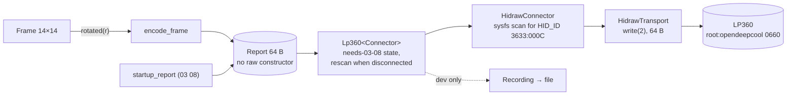

# Phase 5 review: device and protocol core

**Review ID:** `phase-5-device-protocol-core`
**Reviewed:** 2026-10-26, at commit `3ec34b7`
**Phase status in the PRD:** pending (planned)
**Inputs:** [Phase 5 plan](../plans/phase-5-device-protocol-core.plan.md); `docs/spec/protocol.md`, `display.md` Rotation, `frames/README.md`; PRD (Phase 5, Architecture Notes, Testing Strategy, System Footprint dev rows); `.githooks/pre-commit`
**Overview:** [project-overview.review.md](project-overview.review.md)

## Verdict

A clean, well-argued core:

- direct `write(2)` on hidraw, with the kernel's contract cited;
- a `Report` type that can only come from the encoder;
- reconnect owned by one struct, with no background thread;
- fakes that run the real adapter against fake sysfs trees;
- an end-to-end program that probes the PC and refuses to fall back to fakes when a device is present but unusable.

The main risk is that the design assumes a write returns quickly: the kernel allows it to block for up to 5 s, and Phase 7 calls it on the tick thread (P5-01). The `Link` type also throws away the one distinction this plan says Phase 7 needs, "no cooler" versus "no access" (P5-02). The dev setup, run with `pkexec`, will build the workspace as root once Phase 7 extends it (P5-03).

## What the phase builds

Plus `odc-testkit` (expected-frame loader, picture diff, capture reader, hardware probe), `odc-e2e` (layer 4), the product udev rule and group, the dev scripts and their manifest, the GitHub Actions workflow, and the Rust checks in the pre-commit guard.

## Strengths

- **Rule 9 enforced by the type system.** `Report` has no public raw constructor, and `Transport::write_report` takes only `&Report`. A `compile_fail` test pins it.
- **The oracle is the spec, not Rust.** Encoder test vectors are typed from the spec's bit table, and the differential test replays every captured DeepCreative message (176,354 lines locally).
- **Strict parsing of the oracle.** A malformed expected-frame file panics with the file and line, so a mis-parsed oracle can't pass silently.
- **Device lookup by USB ID**, parsing the `HID_ID` fields as numbers, so letter case can't matter. Matching nodes that can't be opened are an error, not "absent".
- **Injectable roots** (`/sys`, `/dev`), so the real adapter runs in CI without root and without uhid.
- **The real/absent/unusable probe and `--require`.** A broken setup fails with its fix instead of quietly testing fakes.

## Analysis

### Architecture

- **Ports.** `DisplayPort::show(&Frame) -> Link` is the right seam for Phase 7. `Link` is a bare `Connected`/`Disconnected`, though, while `HidrawConnector::connect` carefully distinguishes `Ok(None)` (no cooler) from `Err(path, error)` (a cooler that can't be opened, "so Phase 7 can tell 'no cooler' from 'no access'"). `Lp360::show` maps both to `Disconnected`, so that information never reaches Phase 7 (P5-02). Phase 7's status has only `CoolerConnected` (b), so the app would say "Cooler not connected" when the real problem is a missing udev rule.
- **No thread, the caller paces.** That's simple and testable, as long as `show` is fast. See the next section.
- **Rescanning every tick while disconnected** costs a directory listing and a few small reads, about ten times a second. That's acceptable. Two details:
  - "the lowest hidraw number" must compare numbers, not strings (`hidraw10` sorts before `hidraw9` as text) (P5-10);
  - an `Err` on every tick (no access) must not log every tick. `state_changed()` covers transitions only if the reason is part of the state (P5-02).

### Blocking writes

For a USB HID device with an interrupt-OUT endpoint, the kernel sends a hidraw output report through `usbhid_output_report`, which calls `usb_interrupt_msg(dev, …, USB_CTRL_SET_TIMEOUT)`, and `USB_CTRL_SET_TIMEOUT` is 5000 ms (kernel source, read 2026-10-26). A cooler that stops acknowledging, after a USB hiccup or a firmware hang, can therefore hold `write()` for up to 5 s before it returns an error.

| Consumer | Effect of a 5 s write |
|---|---|
| Phase 7 engine (tick thread) | Up to 50 ticks missed; the plan logs and skips them, so no bunching, but status and readings stall too |
| Phase 7 `Refresh` and settings | Applied late; the D-Bus side stays responsive, because it's another thread |
| Phase 9 Music delay | The 150 ms target is broken during the stall |
| Reconnect detection | Each failed attempt can take seconds instead of one tick |

The plan's "no background thread" choice and Phase 7's "one engine thread owns the display" are both reasonable. They just need the I/O moved off the tick: a device-writer thread that owns `Lp360` and takes the newest frame from a one-slot mailbox, so a stalled write drops intermediate frames instead of delaying the tick. A systemd watchdog (P7-01) covers a write that never returns. Neither changes the `DisplayPort` contract seen by the tests.

In dev mode, the `Recording` wrapper adds a file write per frame on the same path. Buffer it (P7-07).

### Resume from suspend

On resume, the hidraw node of a USB device often survives (the device is resumed or reset-resumed rather than removed). The cooler may still have been unpowered during suspend, depending on the board's standby power. Then no write fails, no reconnect happens, and no `03 08` is sent, while the cooler possibly expects one (its meaning is unverified, `protocol.md`). Neither the spec nor the plan covers this; the reconnect tests use device removal only.

A cheap, defensive rule would be: after a resume, treat the next `show` as a new connection and send `03 08` first. Two details matter:

- **How to notice a resume.** The service is already on the system bus, and logind sends `PrepareForSleep(false)` right after a resume (org.freedesktop.login1(5)).
- **Not with a gap on `Instant`.** Rust's `Instant` uses `CLOCK_MONOTONIC` on Linux, which "does not count time that the system is suspended" (clock_gettime(2)). Only `CLOCK_BOOTTIME` includes it.

It's a protocol behaviour, so the owner decides (P5-05).

### Security

- **Product udev rule:** `SUBSYSTEM=="hidraw", ATTRS{idVendor}=="3633", ATTRS{idProduct}=="000c", GROUP="opendeepcool", MODE="0660"`. It's narrow, and only the service account is in the group in the product. The ID is the LP series' (`protocol.md`: product string "LP-Series"), so other LP models with the same ID would be opened too. Whether they exist is unverified; a note in the spec is enough (P5-11).
- **Dev reconnect rule:** gives the group write access to the LP360's USB `authorized` file. In the dev setup the owner's account is in the group, so every process of the owner's session can write to the cooler, deauthorize it, and from Phase 6 on, read the RAPL energy counters. That last one is the Platypus side channel (CVE-2020-8694) that the kernel closed for unprivileged users. It's acceptable for a development PC and undone by teardown and by the Phase 11 package, but it's worth stating in the PRD's dev footprint, which today lists the membership without its consequences (P5-04). Running the tests through `sg opendeepcool -c …` instead of keeping the group in the login session would limit it to the test processes.
- **Dev scripts under `pkexec`:** `setup.sh` runs entirely as root. Today it installs files. From Phase 7, "setup builds `--release`" (Phase 7 Task 8), which means `cargo build` as root:
  - every dependency's build script and procedural macro executes with root privileges;
  - `target/` gets root-owned files in the owner's checkout;
  - `pkexec`'s clean environment may not even find the mise-managed toolchain.

  The script should build as the invoking user and use `pkexec` only to install prebuilt artefacts (P5-03).
- **CI supply chain:** the workflow references `actions/checkout@v7` and `jdx/mise-action@v5` by tag. GitHub's hardening guide recommends pinning third-party actions to a full commit SHA, and setting the token's default permission to read-only contents (P5-06). There's no dependency audit (P5-07).
- **`unsafe_code = "forbid"`** across the workspace: good.

### Testing

- **Layer 4 deauthorizes the real cooler** and relies on a drop guard to authorize it again. A `SIGKILL`, an OOM kill or a power cut during the test leaves the cooler deauthorized until it's replugged or the PC reboots, and the display service, if running, sees no cooler. `odc-e2e` could check `authorized` at start and restore it (P5-09).
- **The pre-commit guard grows** to `cargo fmt`, `clippy` and `cargo test --workspace` on every commit, documentation commits included. It runs on the working tree, which the plan documents. By Phase 10 this includes headless-weston UI tests. Scoping the Rust checks to commits that touch `crates/`, `Cargo.*`, `packaging/` or `scripts/` keeps documentation commits fast (P5-08).
- **The differential test fails when the captures are missing,** rather than skipping. That's good, and it runs only with `--ignored`.

### Coherence with other phases

- **Phase 6 is planned "with 5"**, but extends this phase's workspace, `odc-testkit` (it moves the hidraw tree builder), udev rule, dev scripts, hardware probe and CI (P5-12, P4-01).
- **CI starts on Ubuntu.** Phase 10 adds GTK crates to the workspace, and Phase 11 builds in an Arch container. Starting in an `archlinux` container now avoids a migration (P4-05).
- **`Lp360::state_changed()`** is the hook Phase 7 uses for journal lines. It should carry the reason (P5-02).

## Findings

| ID | Severity | Category | Title |
|---|---|---|---|
| P5-01 | Medium | Bottleneck, availability | A hidraw write can block for up to 5 s; `show` runs on the caller's tick thread |
| P5-02 | Medium | Diagnosability | `Link` drops the reason, so "no access" looks like "no cooler" |
| P5-03 | Medium | Development security | `setup.sh` runs under `pkexec`; from Phase 7 it builds the workspace as root |
| P5-04 | Low | Development security | Dev group membership gives every process of the owner's session the cooler, its USB switch and the power counter |
| P5-05 | Low–Medium | Robustness | No rule for resume from suspend; `03 08` isn't re-sent when the node survives |
| P5-06 | Low–Medium | Supply chain | Actions pinned by tag; no least-privilege `permissions:` |
| P5-07 | Low | Supply chain | No `cargo deny` or `cargo audit` |
| P5-08 | Low | Developer experience | The guard runs the whole Rust suite on every commit, documentation included |
| P5-09 | Low | Test robustness | A killed reconnect test leaves the cooler deauthorized |
| P5-10 | Low | Correctness | "Lowest hidraw number" must compare numbers, not text |
| P5-11 | Low | Scope | The USB ID names the LP series; other models would be driven as an LP360 (unverified) |
| P5-12 | Medium | Coherence | Planned in parallel with Phase 6, which builds on this phase's files |
| P5-13 | Note | Protocol | `03 08` is re-sent on every new connection, including after a transient write error on the same node: consistent with the owner's decision |

### P5-01: Blocking writes on the tick thread

- **Evidence:** plan Recommendation ("No timer and no background thread … the caller … calls `show(frame)` once per 100 ms tick"); Phase 7 Task 6 (engine thread calls `display.show`); kernel `drivers/hid/usbhid/hid-core.c` `usbhid_output_report`; `include/linux/usb.h` `USB_CTRL_SET_TIMEOUT` 5000.
- **Recommendation:**
  - keep `Lp360` as designed, and run it on a dedicated device thread fed by a one-slot "latest frame" mailbox;
  - measure write latency in the layer 4 run (p50, p99, max) and record it in the report;
  - Phase 7 adds a systemd watchdog fed by the tick, for writes that never return.
- **Outcome (2026-10-26):** accepted through OV-03. The Phase 5 plan records the 5 s bound and measures write durations; the Phase 7 plan runs `Lp360` on its own device thread, with a watchdog.

### P5-02: `Link` drops the reason

- **Evidence:** plan Task 7 ("so Phase 7 can tell 'no cooler' from 'no access'"); Task 6 (`show` returns `Disconnected` for `Ok(None)` and `Err`); Phase 7 status `CoolerConnected` (b).
- **Recommendation:** `Link::Disconnected(Reason)` with `Absent`, `NoAccess { path }` and `WriteFailed { errno }`; `state_changed()` compares the reason too. Phase 7 then exposes a `CoolerState` instead of a boolean (P7-14), and the app can say "Cooler found, but the service can't open it".

### P5-03: Building as root

- **Evidence:** plan Task 8 (`setup.sh`, run with `pkexec`); Phase 7 Task 8 ("setup builds `--release`").
- **Recommendation:** split the script. `setup.sh` runs as the user, builds, and then calls `pkexec scripts/dev/install-root.sh <artefacts…>`, which only copies files, checks them against the manifest and refuses to run `cargo`. The same split helps Phases 9 and 10, which add binaries.

### P5-04: Dev group membership

- **Evidence:** PRD dev footprint ("The owner's account in group `opendeepcool`"); plan Task 8 (reconnect rule); Phase 6 Task 6 (power counter group read).
- **Recommendation:**
  - state the consequences in the PRD's dev footprint;
  - prefer `sg opendeepcool -c '<test command>'` for test runs over permanent membership in the login session;
  - keep the teardown and Phase 11 removal as planned.

### P5-05: Resume from suspend

- **Evidence:** `protocol.md` Disconnect and reconnect (removal only); plan Task 6 (a new connection only after a failed write).
- **Recommendation:** owner decision (overview Q7). If accepted:
  - `Lp360` gets a `reset_connection()` that makes the next `show` start with `03 08`;
  - Phase 7's D-Bus side calls it when logind signals `PrepareForSleep(false)`;
  - a fake-connector test pins it.
- **Outcome (2026-10-26):** accepted (the owner: OpenDeepCool must be back after standby). The Phase 5 plan adds `reset_connection()`, its fake test and a real `reset` check; Phase 7 calls it on logind's `PrepareForSleep(false)`, with a fake `SleepWatcher` in CI, and Phase 6 restarts the interval readings.

### P5-06: Actions pinning and token permissions

- **Evidence:** plan Task 10 (`actions/checkout@v7`, `jdx/mise-action@v5`); GitHub Docs, Secure use reference.
- **Recommendation:** pin both to full commit SHAs (with the tag in a comment), add `permissions: contents: read`, and add Dependabot for actions to keep the pins current.

### P5-07: Dependency audit

- **Recommendation:** `cargo deny check` in CI, covering:
  - advisories (RustSec);
  - licences: an allow-list compatible with MIT distribution;
  - sources: crates.io only;
  - duplicate versions (`zbus` 5 and 6 will both appear from Phase 10; allow that one explicitly).

### P5-08: Guard cost

- **Recommendation:** run the Rust checks only when the staged paths include `crates/`, `Cargo.toml`, `Cargo.lock`, `packaging/` or `scripts/`, and print which checks ran. CI still runs everything on every push.

### P5-09: A deauthorized cooler after a killed test

- **Recommendation:** at start, `odc-e2e` checks the LP360's `authorized` file and restores `1` with a printed note, before any probe. A deauthorized cooler is otherwise invisible to the probe, which would report it absent.

### P5-10: Numeric ordering

- **Recommendation:** parse the number after `hidraw` and compare integers. Add a fake-tree test with `hidraw9` and `hidraw10` both matching.

### P5-11: One ID for the LP series

- **Recommendation:** one sentence in `protocol.md` (P3-05). No code change.

### P5-12: Parallel with Phase 6

- **Recommendation:** see P4-01. Run Phase 6 after Phase 5's Tasks 1 and 7–10 are merged, or sequentially.

## Questions for the owner

1. Re-send `03 08` after a long gap such as a resume (P5-05; overview Q7)? **Answered 2026-10-26:** yes (P5-05 outcome).
2. Keep the dev group in the login session, or use `sg` for test runs only (P5-04)?
3. Run CI in an Arch container from this phase on (P4-05)?

## Sources

- Linux kernel source, read 2026-10-26: `drivers/hid/usbhid/hid-core.c` (`usbhid_output_report` calls `usb_interrupt_msg(…, USB_CTRL_SET_TIMEOUT)`); `include/linux/usb.h` (`USB_CTRL_SET_TIMEOUT` is 5000).
- GitHub Docs, "Secure use reference", read 2026-10-26: pin actions to a full-length commit SHA; read-only `GITHUB_TOKEN` by default.
- clock_gettime(2), man7.org, read 2026-10-26: `CLOCK_MONOTONIC` "does not count time that the system is suspended"; `CLOCK_BOOTTIME` includes it.
- Rust `std::time::Instant` documentation, read 2026-10-26: on UNIX, `clock_gettime` with `CLOCK_MONOTONIC`; "not specified whether system suspends count as elapsed time".
- org.freedesktop.login1(5), read 2026-10-26: `PrepareForSleep()` is sent "right before (with the argument "true") or after (with the argument "false")" suspend or hibernation.
- The Phase 5 plan's own evidence (hidraw docs, `hidraw_write`, `hid_uevent`, Arch Wiki Backlight pattern).
