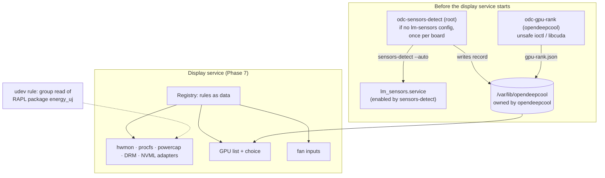

# Phase 6 review: sensors

**Review ID:** `phase-6-sensors`
**Reviewed:** 2026-10-26, at commit `3ec34b7`
**Phase status in the PRD:** pending (planned)
**Inputs:** [Phase 6 plan](../plans/phase-6-sensors.plan.md); `docs/spec/sensors.md`, `settings.md` (GPU choice, availability); PRD (Sensor architecture, Service model, Technical Risks, System Footprint); the Phase 7 and 11 plans where they consume this phase
**Overview:** [project-overview.review.md](project-overview.review.md)

## Verdict

The sensor architecture is the right one: ports and adapters, driver rules as data drawn from kernel documentation, one generic hwmon adapter, binding by name, driver or PCI address, and fake trees for every driver the owner's PC doesn't have. Isolating the GPU-kind queries (the only `unsafe` FFI, and the only render-node access) in a helper that runs once and exits is good least-privilege design. So is opening the CPU power counter to one group rather than to every user.

Four things need changes before implementation:

1. **The root detection program keeps its record in a directory the service account owns** (P6-01, High). That lets a compromised display service steer root.
2. **Two one-shots without a start timeout** sit in front of the display service (P6-03), and one of them can't write its state on a fresh install (P6-14).
3. **Devices that appear after start-up stay "unavailable"** until a restart (P6-04).
4. **Readings are floating point**, which breaks "round up" downstream (P6-05).

The NVIDIA path is the weakest-tested part: NVML runs inside the long-running service (P6-06), and a failed CUDA query in the sandbox would rank an NVIDIA card below an integrated GPU (P6-07).

## What the phase builds



## Strengths

- **Rules as rows.** Supporting a new driver is one rule plus one fake tree, with no new code path.
- **Rule 11 is tested.** Every fixture gives each metric its own distinct value, for example `edge` 41 °C, `junction` 77 °C and `mem` 66 °C, and the test asserts that 41 is read. A metric with no source is `Unavailable(reason)`, never a number from another source.
- **Precise kernel reading:**
  - guest time already inside user and nice (`account_guest_time`);
  - energy wrap at `max_energy_range_uj`;
  - `intel-rapl` vs `intel-rapl-mmio` zones;
  - AMD families using the RAPL MSR driver;
  - `k10temp` before family 17h not being a temperature.
- **The rank helper's struct mirrors** are checked against the installed kernel headers by compiling a C program. That's the right guard for hand-written `#[repr(C)]`.
- **Detection never overwrites** an existing configuration, records what it created, and runs at most once per board.

## Analysis

### Security

**The detection record lives where the service account can change it.** `odc-sensors-detect` runs as root. It reads `/var/lib/opendeepcool/sensors-detect.json` (step 2, "already lists this identity → exit") and writes it (step 5). The Phase 11 removal script, also root, reads it to decide what to delete and disable. That directory is the display service's `StateDirectory=`:

- systemd makes it owned by `User=opendeepcool`;
- if the ownership doesn't match, systemd changes it recursively, files below included (systemd.exec).

So the service account can rename, replace or symlink the record at will: write permission on a directory allows replacing any entry in it. `fs.protected_symlinks` doesn't help, because it only applies to sticky world-writable directories (kernel documentation).

| If the display service is compromised, it can… | …and root then… |
|---|---|
| replace the record with a symlink to a system file | writes its JSON through the link at the next run, if the write follows links |
| forge `created` entries | the removal script deletes or disables what the record lists |
| forge the board identity | detection is skipped for ever (harmless) |

This breaks the design's central security claim, that the service "has fewer rights than any user". The fix is cheap:

- give the detection unit its own root-only state directory, `StateDirectory=opendeepcool-detect` with `StateDirectoryMode=0700` on the root unit. That's a separate top-level directory: a subdirectory of the service's directory would be renamed or chowned by the service and by systemd;
- write the record with a temporary file, `O_NOFOLLOW` and `rename` inside that directory;
- read it with `O_NOFOLLOW`;
- in Phase 11, treat its contents as fixed booleans for the two known paths and the service's prior enable state, never as a list of paths.

**CPU power through a group rule.** This re-opens the power side channel of CVE-2020-8694, for the service account only. It's the documented, minimal trade-off the owner chose. Keep only the service account in the group in the product (the plan does); in development the owner's whole session has it too (P5-04).

**NVML inside the long-running service.** The plan's rationale for the rank helper is to keep `unsafe` FFI and GPU device access out of the always-running service. NVML breaks that for NVIDIA PCs:

- `nvml-wrapper` loads NVIDIA's closed-source `libnvidia-ml.so.1` into the service process at run time;
- the service then needs NVIDIA device nodes in its `DeviceAllow=`, deferred to Phase 11;
- compatibility with `MemoryDenyWriteExecute=yes` and `SystemCallFilter=@system-service` is unverified.

The invariant "contains no `unsafe` code" holds only for first-party code. Options:

- (a) accept it and say so in the spec, and load NVML only when the chosen GPU's driver is `nvidia` (the plan already makes it lazy);
- (b) a small NVML reader helper process, like the rank helper, that streams the three values to the service over a pipe.

(a) is proportionate for v1, if it's tested that NVML is never loaded on a PC without an NVIDIA GPU.

**CUDA in the sandboxed rank helper.** `cuInit` is used to learn whether an NVIDIA GPU is integrated. In the helper's sandbox (`NoNewPrivileges=yes`, `DevicePolicy=closed`, `PrivateNetwork=yes`), CUDA's runtime needs device nodes that aren't in the plan's list yet (unverified). The plan maps any query failure to `Unknown`, and `Unknown` ranks after `Integrated`. On the common desktop with an Intel CPU, its integrated GPU enabled and an NVIDIA card, a failed query makes the integrated GPU the default, against the owner's rule 2. Since no NVIDIA hardware is available to test:

- keep "query failed" distinct from "driver has no signal", and log it;
- consider an owner decision on how a failed query on NVIDIA's desktop driver ranks (overview Q6).

### Availability and start-up

**One-shots without a timeout.** Both helpers are `Type=oneshot`, and Phase 7 orders the display service `After=` both. For `Type=oneshot`, systemd disables the start timeout by default (systemd.service). A `sensors-detect` that hangs while probing a bus, or a `cuInit` that never returns, therefore holds the display service back indefinitely, at boot and inside `pacman` (P11-04).

- Add `TimeoutStartSec=` to both (for example 120 s and 30 s).
- Consider not ordering the display service after detection at all: the board's driver is loaded later by `lm_sensors.service` anyway (next point), so waiting for detection gains nothing on later boots.

**Devices that appear late.**

- The board's sensor driver is loaded by `lm_sensors.service`, which has no ordering against the display service.
- GPU drivers can finish binding after `multi-user.target` services start.
- The registry "rescans when a read fails". A metric with no source at the first scan has no read to fail, so it stays `NoDevice`.
- Phase 7 counts `NoDevice` as persistent, so the app disables its modes until the service restarts.

Recommendations:

- the registry rescans unbound metrics periodically, for example every 5 s for the first two minutes and then every 60 s;
- `NoDevice` counts as persistent only after a grace period;
- the display service unit gets `After=lm_sensors.service` (ordering only).

Fan inputs already re-resolve on every read, so they recover; the metrics don't.

**The rank helper's state directory on a fresh install.** The unit has `ReadWritePaths=/var/lib/opendeepcool` without the `-` prefix that systemd.exec documents for paths that may not exist. But that directory is created by the display service's `StateDirectory=`, and the service starts after the helper. On a fresh install, the first helper run is expected to fail its namespace setup (unverified for this exact case), leaving no ranking. With two GPUs, both are `Unknown`, ordered by PCI address, and an integrated GPU usually has the lower address. The default GPU is then wrong until the next restart. Two fixes:

- give the helper unit `StateDirectory=opendeepcool` too, since it's the same user;
- or create the directory with a `tmpfiles.d` line shipped by the package.

**Polling wakes GPUs.** Reading `gpu_busy_percent`, hwmon or NVML once a second may keep a runtime-suspended discrete GPU awake. That matters on laptops and hybrid desktops, not on the usual LP360 desktop. Note only.

### Correctness

**Exactness.** `Reading::Value(f64)` carries every metric as a float, but the display rounds up (`display.md` Values). CPU usage computed as `1 − Δidle/Δtotal` in doubles is `30.000000000000004` for 700 idle jiffies out of 1000, and `ceil` gives `31` (Phase 3 review, P3-03). The cleanest fix keeps the integer source in the reading:

```rust
enum Reading {
    Ratio { num: u64, den: u64 }, // CPU usage (jiffies), Memory Load (kB)
    Milli(i64),                   // temperatures (m°C)
    Micro(i64),                   // power (µW)
    // …
}
```

That way `odc-render` applies the exact integer rule. For RAPL power (µJ over ns), the value is inherently continuous; the spec should say so.

**NVML failure reasons.** "NVML failing to load → `Unavailable(NoRule { driver: "nvidia" })`" conflates several cases:

- the library is missing: `NoRule` is right;
- a driver/library version mismatch after a driver update without a reboot, which is common on a rolling distribution: the cause is the update;
- `NoPermission` from the sandbox: `PermissionDenied`.

The app shows the reason, so it should be the real one.

**Detection when sensors already work.** Detection runs whenever both lm-sensors files are absent. A PC whose user already loads the board's driver another way, for example through `/etc/modules-load.d/`, would still be probed and gain a second, broader driver configuration. If at least one hwmon fan input other than a graphics card's already exists, detection has nothing to find for the cooler. That's observable, not guessed, so skip it then.

**Board identity.** The once-per-board record keys on DMI `board_vendor`, `board_name` and `board_version`. Some boards report placeholder strings, so after a board swap detection might wrongly think it already ran. That's rare; adding `product_uuid` would need root, and the detection runs as root anyway.

**The udev power line.** It matches `KERNEL=="intel-rapl:*"` with `ATTR{name}=="package-*"`, so the `RUN` commands also run on `change` events. That's harmless, but `ACTION=="add|change"` states the intent. The rule restores the group after a zone is re-created (module reload), which is good.

### The decision to run `sensors-detect` automatically

Running `sensors-detect --auto` unattended, at first boot or install, on any PC, goes beyond "only the cooler":

- it probes buses that lm-sensors itself warns about;
- it writes system configuration;
- it enables a root service that loads drivers for every sensor chip found, not only the board's fan chip.

The plan's mitigations are good: only when no configuration exists, once per board, never overwrite, everything recorded. The owner decided it on 2026-10-23. The alternative worth re-confirming (overview Q2) is to make it an explicit action in the settings app, "Find fan sensors…" with `auth_admin_keep`, offered when no fan inputs exist. That also takes the probing out of the `pacman` transaction.

## Findings

| ID | Severity | Category | Title |
|---|---|---|---|
| P6-01 | High | Security | Root reads and writes its record in a directory the service account owns |
| P6-02 | Medium | Safety, scope | `sensors-detect --auto` runs automatically on any PC; re-confirm or make it explicit |
| P6-03 | Medium | Availability | One-shots have no start timeout, and the service is ordered after them |
| P6-04 | Medium | Robustness | Devices that appear after start-up stay `NoDevice` (persistent) until a restart |
| P6-05 | Medium | Correctness | Floating-point readings break "round up" (off-by-one digits) |
| P6-06 | Medium | Security, architecture | NVML runs inside the long-running service, contrary to the helper's rationale |
| P6-07 | Medium | Correctness | A failed CUDA query ranks an NVIDIA card below an integrated GPU |
| P6-08 | Note | Security | RAPL group read: accepted, minimal trade-off (CVE-2020-8694) |
| P6-09 | Low | Robustness | The udev power line has no `ACTION`; state the intent |
| P6-10 | Note | Performance | Polling may keep a suspended discrete GPU awake (laptops) |
| P6-11 | Low | Correctness | Placeholder DMI strings can defeat "once per board" |
| P6-12 | Low | Diagnosability | NVML failures all map to `NoRule` |
| P6-13 | Low | Safety | Detection runs even when fan inputs already exist |
| P6-14 | Medium | Availability, correctness | The rank helper's `ReadWritePaths=` names a directory that doesn't exist yet on a fresh install |

### P6-01: Root's record in the service's directory

- **Evidence:** plan Task 10 (steps 2 and 5, `--state-dir` default `/var/lib/opendeepcool`); Phase 7 Task 8 (`StateDirectory=opendeepcool`, `User=opendeepcool`); Phase 11 (`post_remove` reads the record); systemd.exec `StateDirectory=` ownership; kernel `protected_symlinks`.
- **Recommendation:** a root-only state directory for the detection record; symlink-safe reads and writes; fixed booleans instead of path lists; Phase 11 validates. Add a test where the service-owned directory holds a symlink named like the record, and assert root never follows it.
- **Outcome (2026-10-26):** accepted through OV-01. The record lives in `/var/lib/opendeepcool-detect/` (root, 0700) and holds yes/no facts only, and the program refuses a link or a lax directory: Phase 6 plan Task 10, Phase 11 plan `post_remove`.

### P6-02: Automatic detection

- **Recommendation:** owner decision (overview Q2). If it stays automatic: skip it when fan inputs exist (P6-13), bound it with a timeout (P6-03), and say in the README and the AUR description, before install, that installing probes the PC's sensor buses.

### P6-03: One-shot timeouts

- **Recommendation:** `TimeoutStartSec=120` on detection and `TimeoutStartSec=30` on ranking (values to tune). Drop the display service's `After=` on detection, or keep it with the timeout. Test with a fake `sensors-detect` that sleeps forever: the service still starts.

### P6-04: Late devices

- **Recommendation:** periodic rescans of unbound metrics, a grace period before `NoDevice` counts as persistent, and `After=lm_sensors.service` on the display service. Test with a fake tree that gains the GPU's hwmon after N ticks.

### P6-05: Exact readings

- **Recommendation:** integer-carrying readings, with the rounding rules applied on integers in `odc-render` (P3-03). Add tests with raw counters: 700 of 1000 idle jiffies → `30`; 57 of 100 → `43`.
- **Outcome (2026-10-26):** accepted through OV-08. `Reading::Value(Exact { num, den })` in the Phase 6 plan, with integer rules in Phases 7 and 8.

### P6-06: NVML in the service

- **Recommendation:** load NVML only when the chosen GPU uses `nvidia`, and test that it isn't loaded otherwise. State the exception in `sensors.md` and in the plan's invariant. Revisit a reader helper if NVML proves incompatible with the sandbox.

### P6-07: CUDA failure ranking

- **Recommendation:** record "query failed: <error>" separately from "no signal"; log it at warning level; add the CUDA device-node groups to the helper's `DeviceAllow=` once verified on NVIDIA hardware (Phase 11). Ask the owner how a failed NVIDIA query should rank (overview Q6).

### P6-09: The udev power line

- **Recommendation:** add `ACTION=="add|change"` and keep `udevadm verify` in CI.

### P6-11: Board identity

- **Recommendation:** accept, or include more DMI fields; document the placeholder case.

### P6-12: NVML reasons

- **Recommendation:** map library missing → `NoRule`; version mismatch → a reason naming the driver update; permission → `PermissionDenied`.

### P6-13: Detection with working sensors

- **Recommendation:** skip detection, without writing a record, when any non-GPU hwmon fan input exists. Test it with a fake tree.

### P6-14: The rank helper's directory

- **Recommendation:** `StateDirectory=opendeepcool` in the helper unit, the same user, instead of `ReadWritePaths=`. Phase 11's container test should check the helper's first run on a fresh root, at least by unit inspection, since nothing boots there.

## Questions for the owner

1. Keep automatic detection, or move it into the app as an explicit, admin-authorized action (P6-02; overview Q2)?
2. How should an NVIDIA card rank when its kind query fails (P6-07; overview Q6)?
3. Accept NVML inside the service, loaded only on NVIDIA PCs (P6-06)?

## Sources

- systemd.exec(5), read 2026-10-26: `StateDirectory=` ownership ("…will have their file ownership recursively changed to match what is configured"); `ReadWritePaths=` and the `-` prefix.
- systemd.service(5), read 2026-10-26: `TimeoutStartSec=` "disabled by default" for `Type=oneshot`.
- Linux kernel documentation, `/proc/sys/fs`, read 2026-10-26: `protected_symlinks`.
- The plan's own evidence (kernel sources and uAPI headers, NVML and CUDA documentation, `sensors-detect`).
