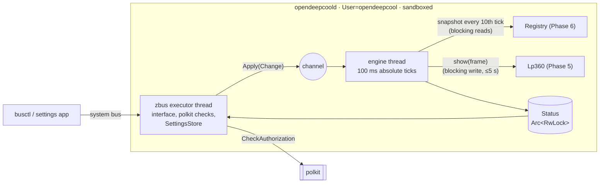

# Phase 7 review: service, settings and Load (the MVP)

**Review ID:** `phase-7-service-settings-load-mode`
**Reviewed:** 2026-10-26, at commit `3ec34b7`
**Phase status in the PRD:** pending (planned)
**Inputs:** [Phase 7 plan](../plans/phase-7-service-settings-load-mode.plan.md); `docs/spec/display.md` (all), `settings.md`, `protocol.md` Timing; PRD (Service model, Settings app ↔ service, Testing Strategy, System Footprint, Success Metrics); the Phase 5, 6, 8–11 plans where they meet this one
**Overview:** [project-overview.review.md](project-overview.review.md)

## Verdict

The core design is right:

- one engine thread owns the display;
- the D-Bus side validates, stores and sends `Apply` over a channel, so a slow polkit check can't delay a frame;
- the picture and its movement are pure (`picture`, `Marquee`), with every scenario a unit test;
- ticks run on absolute monotonic deadlines;
- polkit is asked with the `system-bus-name` subject;
- settings are written atomically, by the service only;
- the unit is sandboxed, runs as a locked system account, and gets a measured exposure rating.

What's missing is **liveness**. An engine-thread panic leaves the process up, the unit "active" and the cooler blank (P7-01). The default start limit gives up after five quick failures (P7-02). Device writes and sensor reads run on the tick thread (P7-06, P5-01).

On security, three points need care:

- the dev interface ships in the product binary, and its group restriction relies on the bus policy (P7-03, P7-04);
- D-Bus arguments are validated as "non-empty" only (P7-05);
- the sandbox can be tightened further (P7-09).

The real-cooler scenario run is likely much longer than "a few hours" (P7-08), and a crashed run can leave fake readings on the owner's cooler (P7-16).

## What the phase builds



The two "blocking" labels mark where the tick can stall (P7-06, P5-01).

## Strengths

- **Separation of concerns.** The D-Bus side owns settings, the engine owns the display, and status flows back read-only. Nothing is shared mutably in both directions.
- **A pure movement procedure** (`Marquee`) with property tests:
  - one-column shifts between resets;
  - stopping only at home;
  - an update never moves the copy on screen.
- **Absolute deadlines.** A late frame doesn't shift later ones, and skipped ticks are logged, not bunched. That matches DeepCreative's long-run 100.0 ms.
- **polkit done right:** `system-bus-name` subject, no interactive prompt, one action, `allow_active` only, and `Refresh()` held to the same rule as a change.
- **Strict start-up:** `--dev` is the only switch, and any other argument is an error, "so a typo can't start a different service".
- **Settings safety:** a temporary file, `fsync` and `rename`; an invalid file moved aside, never silently downgraded.
- **A measured security posture:** `systemd-analyze security` must rate it "OK" or better, with every exception explained.

## Analysis

### Liveness and recovery

- **A panic in the engine thread.** Rust unwinds only that thread. The process lives on through the zbus thread, so systemd sees an active service, `Restart=on-failure` never fires, and the cooler blanks about 10 s later (`protocol.md`). The plans deliberately panic on programming errors (out-of-range `Frame` indexes, Phase 5), so any rendering bug triggers this. Two fixes:
  - abort the process on any panic, with `panic = "abort"` in the release profile or a panic hook in `opendeepcoold`;
  - add a systemd watchdog: `Type=notify` and `WatchdogSec=`, with the engine sending `WATCHDOG=1` once per second. The watchdog also catches a write or read that never returns (P5-01).
- **The start limit.** `RestartSec=1` with the manager's defaults (`StartLimitIntervalSec=10s`, `StartLimitBurst=5`, systemd-system.conf) means five quick failures stop restarts for good: a missing account at install (P11-01), a bad settings path, a bus-name race. The cooler then stays blank until someone intervenes. `StartLimitIntervalSec=0` with `RestartSteps=` and `RestartMaxDelaySec=` (systemd ≥ 254, systemd.service) keeps retrying with backoff.
- **Readiness.** With the default `Type=simple`, "started" means "forked". `Type=notify`, sending `READY=1` after the bus name is owned and the first tick is scheduled, makes `systemctl start` (and Phase 11's start check) meaningful.

### Threading and blocking calls

The engine thread makes two calls that can block:

- **`display.show(frame)`:** a USB write, up to 5 s on a stuck device (P5-01);
- **`Readings::snapshot()` every 10th tick:** sysfs reads, which can take milliseconds on drivers that query firmware or a slow bus; NVML calls on NVIDIA PCs; `/proc` parsing.

Neither shows up in tests with fakes. Recommendations:

- a device thread with a one-slot latest-frame mailbox (P5-01);
- a sensor thread that publishes the latest `Snapshot`, so the engine takes whatever is newest at its tick;
- measuring both durations (p50, p99, max) in the layer 4 run and the resource baseline.

The engine keeps exactly the same pure logic; only where the I/O happens changes.

### The D-Bus interface

- **Policy rules.** The plan's policy allows the main interface to everyone and the `.Dev` interface to group `opendeepcool` only. dbus-daemon warns that "the interface field in messages is optional", and recommends pairing every `send_interface` rule with `send_destination`. A method call without an interface field matches no interface rule. Whether zbus then dispatches it to a `.Dev` method by member name is unverified. The dev interface's group restriction therefore shouldn't rest on the bus policy:
  - register `.Dev` at its own object path;
  - in each `.Dev` method, check the caller's Unix user (`GetConnectionUnixUser`) and its group membership itself;
  - keep polkit as the second check;
  - add a test that calls `OverrideReadings` without an interface field as a user outside the group.
- **The dev interface in the product binary.** It's off unless `--dev` is passed, which only a drop-in can do. That's root's choice, so the residual risk is code surface rather than exposure. The alternative is a cargo feature (`dev`) built into the dev copy and the parity-run build only. That trades away "the parity run tests the very binary that ships" (Phase 11). The owner should choose explicitly (overview Q5).
- **Input validation.** "Fan input fields non-empty" and a free-form `ChooseGpu(s)` let any active-session user store arbitrary strings in the settings file. The plans resolve inputs by scanning, so no path is built from them, but nothing guarantees that later code won't. Validate against the service's own state:
  - `ChooseGpu` takes a well-formed PCI address that appears in `Gpus`;
  - `SetCoolerFanInput` and `SetPumpInput` take a triple that appears in `FanInputs`, or the empty "none";
  - every string has a length limit;
  - tests cover a path-like string (`../../etc`), an unknown address and an over-long string.
- **Writable properties.** zbus generates a property setter for any `#[zbus(property)]` setter method, and `org.freedesktop.DBus.Properties.Set` reaches it without passing through the change steps. The plan uses methods for every change. A test that every property is read-only (from the introspection data) keeps it that way.
- **Status as a boolean.** `CoolerConnected` (b) can't say "the cooler is there but the service can't open it" (P5-02). A `CoolerState` (s: `connected`, `absent`, `no-access`) lets the app and the journal name the fix.
- **One contract document.** The property and method list lives in an `odc-ipc` doc comment and in `settings.md`, and Phases 9 and 10 change it. One committed description plus an introspection conformance test (P4-04).

### The sandbox

The plan's list is already strong. Additions to try, each checked with `systemd-analyze security` and the layer 4 run. They're illustrative, not verified together:

```ini
[Unit]
After=opendeepcool-gpu-rank.service lm_sensors.service
StartLimitIntervalSec=0

[Service]
Type=notify
NotifyAccess=main
WatchdogSec=5
Restart=on-failure
RestartSec=1
RestartSteps=5
RestartMaxDelaySec=30
StateDirectoryMode=0700
UMask=0077
PrivateNetwork=yes          # the system bus is a file-system socket: still reachable (systemd.exec)
IPAddressDeny=any
RestrictSUIDSGID=yes
RemoveIPC=yes
ProtectProc=invisible       # see P9-11 before adding
SystemCallFilter=~@privileged @resources
SystemCallErrorNumber=EPERM
```

`ProcSubset=pid` must **not** be used: the service reads `/proc/stat` and `/proc/meminfo`. `DeviceAllow=char-hidraw rw` admits every hidraw device at the cgroup level. File permissions still limit the service to the LP360's node, and a path rule can't follow the node's changing number, so the group form is the right choice. NVIDIA's `DeviceAllow=` entries and NVML's compatibility with `MemoryDenyWriteExecute=yes` are open (P6-06, Phase 11).

### Settings

- **Unknown fields.** Phases 9 and 10 add fields to `version = 1`. Decide what a binary does with fields it doesn't know: keep them and write them back, or reject the file. Rejecting means a downgrade moves the user's settings aside. Dropping them means an upgrade, downgrade and upgrade loses the Music settings.
- **Durability.** After the `rename`, `fsync` the directory too; otherwise the rename itself may not survive a power cut.
- **Invalid copies.** Each invalid file is kept as `settings.toml.invalid-<time>`. Keep the last few.

### The dev copy and the recording

- **Size.** The recording writes about 170 bytes per frame, 10 frames a second, while the dev service runs at every boot from this phase until Phase 11: about 6 MB an hour, roughly 150 MB a day, never rotated. Record only while an `odc-e2e` run holds a recording lease (a dev method), cap the file, and always keep the instance's first frames for the start check.
- **A buffered writer** (P5-01): the recording's file write sits on the same path as the device write.

### The real-cooler tests

- **Duration.** The plan runs "every scenario in every rotation, every run", with the cycle-position scenarios at every *k* and all 30 ordered mode pairs at every *k*, on the real service at 100 ms per tick. By the overview's estimate that's about 10,000 real runs, roughly 12 h, for Load alone, against "a few hours" in the plan. Measure the first run, record the per-scenario time, and let the owner choose a tiering (overview Q1).
- **Exclusivity.** A multi-hour unattended run on the owner's own PC can be disturbed by the owner using the app or `busctl`. Each such change looks like a test failure. A dev "test session" lease that makes ordinary changes return `Busy`, or a run that detects foreign `PropertiesChanged` and restarts the case, keeps it deterministic.
- **Override lifetime.** `OverrideReadings` lasts until `ClearOverride`. A killed `odc-e2e` (OOM, `SIGKILL`) leaves fake readings on the owner's cooler until the service restarts, and that looks like real data. Tie the override to the caller's bus name, as Phase 10 does for frame watchers: when the caller leaves the bus, the override ends.
- **Timing.** The PRD's success metric "same timing as DeepCreative" isn't measured on the real service: the fake-clock tests prove the schedule, not the real intervals. The monotonic write timestamp arrives only in Phase 9. Moving it here and adding a check (mean interval and p99 jitter over 10 minutes, compared with the capture's 99.98–100.06 ms) closes the metric.

## Findings

| ID | Severity | Category | Title |
|---|---|---|---|
| P7-01 | High | Availability | An engine-thread panic leaves the unit "active" and the cooler blank; there's no watchdog |
| P7-02 | Medium | Availability | `RestartSec=1` with the default start limit stops retrying after five quick failures |
| P7-03 | Medium | Security | The dev interface ships in the product binary (owner trade-off) |
| P7-04 | Medium | Security | The dev interface's group restriction relies on the bus policy; messages may omit the interface |
| P7-05 | Medium | Security | D-Bus arguments are validated as "non-empty" only |
| P7-06 | Medium | Bottleneck | Sensor snapshots (and device writes) block the tick thread |
| P7-07 | Low–Medium | Resources | The dev recording grows about 150 MB a day without limit |
| P7-08 | Medium | Process | The real scenario run is likely much longer than planned |
| P7-09 | Low–Medium | Security | Further sandbox hardening is available |
| P7-10 | Medium | Robustness | No readiness signal; no ordering after the board's sensor driver |
| P7-11 | Note | Privacy | `Diagnostics()` is open to everyone; acceptable (paths and driver names are public in sysfs) |
| P7-12 | Low | Correctness | Settings: unknown-field policy, directory `fsync`, invalid copies |
| P7-13 | Low–Medium | Coherence | The PRD's timing metric isn't measured on the real service |
| P7-14 | Low | Diagnosability | `CoolerConnected` (b) can't express "present but no access" |
| P7-15 | Low | Concurrency | `Apply` as a queue of changes; coalescing state is simpler under a stall |
| P7-16 | Low–Medium | Test robustness | Real runs aren't exclusive, and a crashed run leaves the readings override active |
| P7-17 | Low | Maintainability | The D-Bus contract lives in a doc comment and in `settings.md`, with no conformance test |
| P7-18 | Note | Naming | The bus name, polkit actions, desktop ID and icon name carry the GitHub account name (owner decision, 2026-10-24; already public in `LICENSE`) |
| P7-19 | Medium | Correctness | Usage is rounded up from a floating-point reading, so a steady 30 % CPU can show `31%` (P3-03, P6-05) |

### P7-01: No liveness supervision

- **Evidence:** plan Task 6 (engine thread), Task 8 (`Restart=on-failure`, no watchdog, default `Type=`); Phase 5 Task 2 (panics on programming errors).
- **Recommendation:**
  - abort on panic in `opendeepcoold`;
  - `Type=notify` with `WatchdogSec=5` and `NotifyAccess=main`, the engine sending `WATCHDOG=1` from its loop (an `AF_UNIX` datagram to `$NOTIFY_SOCKET`, no extra crate needed);
  - a test that injects a panic into a fake renderer and asserts the process exits.
- **Outcome (2026-10-26):** accepted through OV-03. The plan now has the panic hook and `panic = "abort"`, `Type=notify` with `WatchdogSec=15`, and a watchdog fed only while the device and sensor threads progress.

### P7-02: Start limit

- **Recommendation:** `StartLimitIntervalSec=0`, `RestartSteps=5` and `RestartMaxDelaySec=30` (tune), and a unit test of the unit file's values. Verify on the dev copy by making the binary exit non-zero ten times.
- **Outcome (2026-10-26):** accepted through OV-03, with these values in the plan's unit and a unit-file test.

### P7-03: The dev interface in the product

- **Recommendation:** owner decision (overview Q5). If it stays in the product binary, apply P7-04 and P7-16 so it's safe even when enabled.
- **Outcome (2026-10-26):** the owner keeps it in the shipped binary (OV-13), with P7-04 applied. P7-16 comes with OV-24.

### P7-04: The policy caveat

- **Evidence:** dbus-daemon(1) ("the interface field in messages is optional"; pair `send_interface` with `send_destination`).
- **Recommendation:** pair interface and destination in every policy rule; give `.Dev` its own object path; check the caller's Unix user and group inside each `.Dev` method; test a call without an interface field.
- **Outcome (2026-10-26):** accepted through OV-13. The in-method check uses `GetConnectionCredentials` `UnixGroupIDs` (absent means no), behind a `Credentials` trait.

### P7-05: Input validation

- **Recommendation:** validate against `Gpus` and `FanInputs`, with length limits, and add the refusal tests listed above. Phase 10's app only offers listed values, so nothing legitimate is refused.
- **Outcome (2026-10-26):** accepted through OV-14. The settings file is checked for form only, because a saved GPU or input may be missing and is kept.

### P7-06: Blocking calls on the tick thread

- **Recommendation:** a sensor thread and a device thread (P5-01), plus duration measurements in the baseline. Keep the engine's pure logic as is.
- **Outcome (2026-10-26):** accepted through OV-03. `Refresh` asks the sensor thread for a snapshot at once, and its reset lands on the first tick that has it.

### P7-07: Dev recording

- **Recommendation:** a recording lease, a size cap, a buffered writer, and the instance's first N frames always kept for the start check.

### P7-08: Real-run duration

- **Recommendation:** measure and report the per-scenario time on the first real run and extrapolate before committing to "every scenario in every rotation, every run". The owner chooses the tiering (overview Q1).
- **Outcome (2026-10-26):** decided through OV-04. Task 9 now runs, on the real cooler, one case of each Load mode, one rotated, one scrolling and one dash case, and one variant of each scenario type. Every case runs in-process.

### P7-09: Sandbox

- **Recommendation:** try the additions above, one at a time, against `systemd-analyze security` and the layer 4 run; record each that had to be dropped and why.

### P7-10: Readiness and ordering

- **Recommendation:** `Type=notify` with `READY=1` after the bus name is owned; `After=lm_sensors.service`; together with Phase 6's periodic rescan (P6-04).
- **Outcome (2026-10-26):** partly applied. `Type=notify` and `READY=1` came with OV-03; the ordering and the rescan wait for OV-11.

### P7-12: Settings details

- **Recommendation:** decide the unknown-field policy in `settings.md`; `fsync` the directory; keep at most three invalid copies.

### P7-13: Timing metric

- **Recommendation:** monotonic write timestamps in the dev recording from this phase on, and a layer 4 timing check: mean interval, p99 jitter, and the first frame's delay after `03 08`.

### P7-14: Cooler state

- **Recommendation:** `CoolerState` (s) next to, or instead of, `CoolerConnected`, fed by P5-02's reason. Update `settings.md` and the design.

### P7-15: `Apply` semantics

- **Recommendation:** keep "the latest settings" plus a "refresh pending" flag rather than a queue. The engine adopts them at the next tick, which is S21's rule anyway.

### P7-16: Exclusive, self-clearing test runs

- **Recommendation:** a dev test-session lease, or detection of foreign changes; tie the override (and Phase 9's `OverrideAudio`) to the caller's bus name, cleared on `NameOwnerChanged`.

### P7-17: Contract document

- **Recommendation:** see P4-04.

### P7-19: Rounding up floating-point usage

- **Evidence:** plan Task 2 (value rules "on `f64` readings": usage rounds up); Phase 6 Task 5 (busy share = 1 − Δ(idle + iowait) ÷ Δtotal); the Phase 3 review's table (`(1 − 700/1000) × 100` is `30.000000000000004` in doubles, so `ceil` gives 31).
- **Why it matters:** Load mode 1 is the MVP's default picture. Off-by-one digits on the default mode would be the first thing the owner sees, and the matrix tests inject literal values, so they can't notice.
- **Recommendation:** apply the usage and Memory Load rules to the integer counters (P6-05). Add raw-counter cases to the value-rule tests (700 of 1000 idle → `30`).
- **Outcome (2026-10-26):** accepted through OV-08. The value rules run on exact readings with `i128` intermediates, and the tests include raw-counter cases. Every measurement rounds to the nearest whole number (owner, the same day); the example is now 23 busy jiffies of 40 → 57.5 → `58`, where floating point gives `57`.

## Questions for the owner

1. Real-hardware tiering for the scenario run (P7-08; overview Q1).
2. Dev interface in the product binary, or behind a cargo feature (P7-03; overview Q5).
3. Re-send `03 08` after a resume (P5-05; overview Q7). The D-Bus side here is where logind's signal would be handled. **Answered 2026-10-26:** yes; the plan's Recommendation, "Back from standby", and Task 7 do it.

## Sources

- systemd.service(5), read 2026-10-26: `RestartSteps=`, `RestartMaxDelaySec=` (version 254); `WatchdogSec=` and `NotifyAccess=`.
- systemd-system.conf(5), read 2026-10-26: `DefaultStartLimitIntervalSec=` 10 s and `DefaultStartLimitBurst=` 5.
- systemd.exec(5), read 2026-10-26: `PrivateNetwork=` keeps file-system `AF_UNIX` sockets reachable; `ProtectProc=invisible` "generally recommended".
- dbus-daemon(1), read 2026-10-26: the `send_interface` caveat.
- zbus book (Context7, 2026-10-26): `#[zbus(property)]` setters make a property writable ("emits-change writable" in `busctl introspect`).
