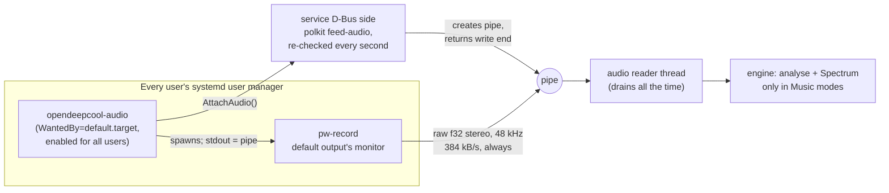

# Phase 9 review: Music

**Review ID:** `phase-9-music`
**Reviewed:** 2026-10-26, at commit `3ec34b7`
**Phase status in the PRD:** pending (planned)
**Inputs:** [Phase 9 plan](../plans/phase-9-music.plan.md); `docs/spec/music.md` (all), `display.md` (Values, Mode switches, Movement, scenarios), `settings.md`; the Phase 7, 8 and 10 plans; PRD (Service model → Audio helper, Music Mode, Phase 9, System Footprint)
**Overview:** [project-overview.review.md](project-overview.review.md)

## Verdict

The audio architecture is elegant:

- a tiny helper per user session that only connects sound;
- `pw-record` instead of a native PipeWire binding;
- a pipe the service creates and hands out through D-Bus;
- polkit's active-session rule re-checked every second.

All analysis is pure code in `odc-render`, shared by the service, the tests and the app's preview. The spectrum is specified to the formula, and the oracle is an independent Python implementation, with a guard against last-bit differences at rounding boundaries. That's careful work.

The main issue is **data minimisation** (P9-01, Medium). The active user's audio output is captured and streamed into a system service for as long as their session is the active one, even when the cooler isn't showing a Music mode. Every other user's helper retries every 2 s, logging each time, wherever polkit refuses it (P9-02). Two smaller ones:

- audio samples aren't sanitised (P9-03);
- the user unit's sandbox implicitly turns on user namespaces, which is untested with PipeWire (P9-04).

The 150 ms delay target has about 10 ms of headroom, measured on one PC (P9-06).

## What the phase builds

## Strengths

- **No native PipeWire binding**, so there's no `bindgen`/libclang build dependency. The capture follows a change of default output by WirePlumber's own rule (checked on the owner's PC).
- **One place for every rule that decides a pixel.** The FFT, bands, falloff, peaks, emoji loops and the Dancer are all in `odc-render`, so the preview (Phase 10) and the tests reuse them.
- **The pipe is created by the service.** The helper never chooses where the sound goes, and when the service closes the read end, `pw-record` exits by itself (`SIGPIPE`).
- **polkit for sound too:** a separate `feed-audio` action, `allow_active` only, re-checked every second, with the newest authorized attach winning.
- **The delay is measured, not assumed:** 200 bursts on the real output path, with the 95th percentile gating the phase. A failure goes back to the owner, never loosens the target.
- **No samples are logged or stored**, anywhere.

## Analysis

### Privacy and efficiency of the capture

As planned, the helper of the active session attaches at login and captures **for as long as that session stays active**: "the reader drains the pipe all the time … the engine uses the window only in a Music mode". Helpers of inactive or remote sessions are refused by polkit, so only one session captures at a time. So:

- every sound the active user's PC plays (calls, media, notifications) flows into a system service, all day, whatever mode the cooler shows;
- the active session keeps a capture stream running, plus 384 kB/s through a pipe, for nothing outside Music modes;
- a capture stream on the default output's monitor may keep that output from suspending, and desktop privacy indicators that watch audio capture streams may show a permanent "recording" mark (both unverified).

The service already knows when it needs sound. A property `AudioWanted` (b), true only while a Music mode (13–23) is shown, lets the helper keep a bus connection open but run `pw-record` only while it's true:

- the helper starts and stops `pw-record` on `PropertiesChanged`;
- or the service closes the pipe when leaving Music modes, and the helper waits for `AudioWanted` before attaching again.

The first second of sound after switching into Music would then be a short silence: the spectrum's levels start at 0 on entering Music anyway (`music.md` point 8).

### Retry behaviour in sessions polkit refuses

The helper is enabled for all users, so it runs in every user manager:

- inactive local sessions;
- remote sessions, which also start a user manager;
- system accounts with a user manager, such as a display manager's greeter.

Wherever polkit refuses `feed-audio`, the loop is: call `AttachAudio`, get `NotAuthorized`, log one line, wait 2 s, repeat. That's about 43,000 journal lines a day per such user, plus a polkit check every 2 s. Where `pw-record` is missing, it's a line every 30 s. Recommendations:

- `ConditionUser=!@system` in the user unit, so system accounts never start it (systemd.unit: `@system` matches the system user range);
- log only when the state changes (attached, refused, missing tool), not every attempt;
- back off, 2 s up to 60 s, and retry at once when something that could change the answer happens: `AudioWanted` becoming true, the service's bus name appearing, or the session becoming active.

### Trust in the samples

`PipeAudio` reads raw `f32` frames from whichever authorized process holds the write end. A buggy or hostile client in the active session can send `NaN`, `±∞` or values far outside ±1. `NaN` propagates through the FFT, so the levels become `NaN`. Rust's float-to-integer casts saturate (`NaN` becomes 0), so there's no undefined behaviour, but the spectrum and the Dancer freeze in an undefined state. Map non-finite samples to 0 and clamp to [−1, 1] in the reader, and test it with a pipe that sends `NaN`s.

### The helper's sandbox

The user unit sets `ProtectSystem=strict`, `PrivateTmp=yes` and similar. For per-user managers, systemd.exec says these options make `PrivateUsers=` implicit and need unprivileged user namespaces. Running `pw-record` in a user namespace hasn't been tested, and neither has its PipeWire socket, RTKit (if PipeWire asks for realtime) or polkit's view of the process. The plan already leaves `RestrictRealtime` open. Test the unit as written in Task 4, keep the options that work, and record the rest in the report.

### Delay budget

The budget is a 100 ms tick wait (95 ms or less for 95 % of frames), 20 ms of requested capture latency, a 21 ms half-window and the USB write: about 140 ms against a 150 ms target. That's thin:

- 20 ms is the latency `pw-record` asks for. PipeWire's actual buffering also depends on the graph and on what other applications request, so it varies between PCs and with what else is playing (unverified in detail);
- a USB write that stalls (P5-01) or a slow sensor snapshot on the tick thread (P7-06) eats the margin.

The measurement runs on the owner's PC only, so other PCs may miss the target. Cheap levers that don't change the tick:

- analyse the newest samples right before each frame is written, so the half-window counts from the write rather than from the tick's start;
- move the device and sensor I/O off the tick thread (P5-01, P7-06).

### Multi-seat and fast user switching

"The newest authorized attach wins" handles helper restarts. On a PC with two seats, two active sessions both pass `allow_active`, and their helpers would take the pipe from each other every couple of seconds. That's rare for an LP360 desktop. A tie-break, "keep the current attachment while it stays authorized; a different session may attach only when it's gone", fixes it without hurting restarts, because the old `pw-record` ends when its pipe closes.

### Observability versus hardening

The plan logs "each attach (the caller's unit name, from the bus name's PID)". Finding a unit from a PID means reading another user's `/proc/<pid>/cgroup`, which `ProtectProc=invisible` (P7-09) forbids. Log what D-Bus provides instead: `GetConnectionCredentials` gives the Unix user and the PID.

### Tests on the owner's PC

The music harness loads a null sink with `pactl`, stops the owner's helper and restarts it from a drop guard. A killed run leaves the null sink loaded until PipeWire restarts, and the owner's helper stopped until the next login. The next `odc-e2e` start could check for both and repair them. `OverrideAudio`, like `OverrideReadings`, should end when its caller leaves the bus (P7-16).

### Coherence

- This phase depends on Phase 8 (`draws`, `cycle_match`, `--modes`, the temperature rules for modes 18–19). The PRD table lists it as parallel with 8 (P4-01).
- The 506 ordered mode pairs at every cycle position on the real cooler dominate the whole cross (overview estimate: about 45 h for this phase's share) (P9-14).
- The `Frame` signal that Phase 10 adds carries this phase's spectrum to every bus client, remote users included (P10-01).
- `AudioConnected` goes into `settings.md` for the designer, as the plan says. `AudioWanted` (P9-01) would need the same.

## Findings

| ID | Severity | Category | Title |
|---|---|---|---|
| P9-01 | Medium | Privacy, efficiency | The active user's audio is captured and streamed continuously, even outside Music modes |
| P9-02 | Medium | Robustness, log hygiene | The helper retries and logs every 2 s wherever polkit refuses; it also runs for system accounts |
| P9-03 | Medium | Security robustness | Audio samples aren't sanitised (`NaN`, `±∞`, out of range) |
| P9-04 | Low–Medium | Compatibility | The user unit's sandbox implies `PrivateUsers=`; untested with PipeWire, RTKit and polkit |
| P9-05 | Low | Privacy | Frames carrying the spectrum reach every bus client (see P10-01) |
| P9-06 | Medium | Performance | The 150 ms target has about 10 ms of headroom, measured on one PC |
| P9-07 | Low | Robustness | Two active seats would take the pipe from each other every couple of seconds |
| P9-08 | Low | Packaging | Without PipeWire, the helper loops every 30 s for ever; make it quiet and declare the dependency |
| P9-09 | Note | Robustness | The default pipe (64 KiB, pipe(7)) holds about 170 ms of this stream; enough, but worth stating |
| P9-10 | Low–Medium | Test robustness | A killed music run leaves a null sink loaded, the owner's helper stopped and the audio override active |
| P9-11 | Low | Hardening conflict | Logging the caller's unit needs other users' `/proc`, which `ProtectProc=invisible` forbids |
| P9-12 | Note | Spec | The Dancer's thresholds were approved on a 4096-sample preview, while the spec uses 2048 (the plan records it) |
| P9-13 | Medium | Coherence | Depends on Phase 8, but the PRD lists it as parallel (P4-01) |
| P9-14 | Medium | Process | 506 ordered mode pairs at every cycle position on the real cooler dominate the whole cross |

### P9-01: Capture only when it's needed

- **Evidence:** plan Task 3 ("The reader drains the pipe all the time … The engine uses the window only in a Music mode"); Task 4 (the helper loop); PRD Service model → Audio helper.
- **Recommendation:** add `AudioWanted` (b) to the contract. The helper runs `pw-record` only while it's true, and the service closes the pipe when leaving Music modes. Test it: switching from mode 13 to mode 1 stops the capture within a second; switching back starts it. Owner decision (overview Q3).
- **Outcome (2026-10-26):** accepted through OV-05 (Q3: yes). `AudioWanted`, `AudioNotWanted` and the pipe closed on leaving Music, in the Phase 9 plan; `music.md`, `settings.md` and checklist M21 record it.

### P9-02: Retry and logging

- **Recommendation:**
  - `ConditionUser=!@system` in the user unit;
  - log on state changes only;
  - exponential backoff from 2 s to 60 s;
  - an immediate retry on `AudioWanted`, the service appearing, or the session becoming active.

  Test with a fake authorizer that refuses for a minute: the log holds one line, not 30.
- **Outcome (2026-10-26):** accepted through OV-05, as part of the event-driven helper: watched `AudioWanted`, service name and seats; a 2 s to 60 s fallback; logging on changes only; `ConditionUser=!@system`.

### P9-03: Sanitise samples

- **Recommendation:** in `PipeAudio`, non-finite → 0, then clamp to [−1, 1]; tests with `NaN`, `±∞` and 10⁶ samples.
- **Outcome (2026-10-27):** accepted. The non-finite rule came first, with P4-08 (owner-confirmed); the clip to ±1 is added now (owner), in `music.md` (Samples out of range) and Phase 9 Task 3, with tests for both.

### P9-04: The user unit's sandbox

- **Evidence:** systemd.exec ("only available for system services, or for services running in per-user instances of the service manager in which case `PrivateUsers=` is implicitly enabled").
- **Recommendation:** test the unit as written in Task 4 (capture works, polkit passes, `AudioConnected` is true), and record which options had to go.
- **Outcome (2026-10-27):** accepted: Task 4 states the implied `PrivateUsers=` (systemd.exec(5), re-read 2026-10-27) and tests the unit as written; the report lists every setting that had to go, `RestrictRealtime` included.

### P9-06: Delay headroom

- **Recommendation:** analyse right before each write; move I/O off the tick thread (P5-01, P7-06); report the delay distribution, not only the 95th percentile, so the margin is visible.
- **Outcome (2026-10-27):** accepted. The first two parts came with OV-03: the engine draws the frame and hands it straight to its own device thread, so the analysis is already right before the write, and no I/O runs on the tick. The delay report now adds the 99th percentile and the maximum.

### P9-07: Two active seats

- **Recommendation:** keep the current attachment while it stays authorized; accept another session's attach only after it ends. Test with two fake callers.
- **Outcome (2026-10-26):** not needed. The owner confirmed a PC has one user at a time on one seat, and only the active user needs access; the plan watches seat0 only.

### P9-08: No PipeWire

- **Recommendation:** with `pw-record` missing, log once and wait for a change instead of retrying every 30 s. Phase 11 lists `pipewire-audio` as a dependency, which makes this rare.
- **Outcome (2026-10-27):** already in the plan since OV-05: with `pw-record` missing, the helper logs once and waits for the next watched change or its fallback timer; Phase 11's PKGBUILD depends on `pipewire-audio`. No change.

### P9-09: Pipe size

- **Evidence:** 48,000 frames × 2 channels × 4 bytes is 384,000 bytes a second; the default pipe capacity is 65,536 bytes on a 4 KiB-page system (pipe(7)), about 170 ms.
- **Note:** a reader that stalls longer than that blocks `pw-record` and causes capture overruns, not data corruption. Record the capacity as a design value; `F_SETPIPE_SZ` can raise it if the reader ever needs more slack.
- **Outcome (2026-10-27):** recorded in Phase 9 Task 3 as a design value, measured on this PC (65,536 bytes with 4 KiB pages, `F_GETPIPE_SZ`), since pipe(7) isn't installed here to re-read.

### P9-10: Leftovers from a killed run

- **Recommendation:** at start, `odc-e2e --only music` removes a leftover `odc-e2e` null sink and restarts the owner's helper if it's stopped. `OverrideAudio` ends with its caller (P7-16).
- **Outcome (2026-10-27):** accepted. The override part was settled with P7-16 (it ends with the test session); Task 5 now repairs the leftover null sink and a stopped helper at start, with fake `pactl` and `systemctl` tests.

### P9-11: Logging the caller

- **Recommendation:** log the Unix user and PID from `GetConnectionCredentials`, not the unit name.
- **Outcome (2026-10-27):** accepted (owner): Phase 9 logs the caller's Unix user and PID from its D-Bus credentials, and Phase 7's sandbox list now tries `ProtectProc=invisible` with the other additions (P7-09).

### P9-13 and P9-14

- See P4-01, P4-02 and overview Q1.
- **Outcome for P9-14 (2026-10-26):** decided through OV-04. On the real cooler, one example of each Music mode and test type: one capture signal, and the 200-burst delay test as one test. The 506 switch pairs run in-process.
- **Outcome for P9-13 (2026-10-27):** settled with P4-01: phases run one at a time, and Phase 9 depends on Phases 7 and 8.

### P9-05 and P9-12: notes

- **Outcome (2026-10-27):** no action. P9-05 no longer applies: since the overview round, frames go only to authorized watchers in the active local session (P10-01, OV-06). P9-12 is recorded in the plan's risks, with the optional attended tour for the owner's look.

### New from the overview cross-check (2026-10-26)

- **Music-only capture:** the owner wants to try taking only the sound tagged as music (PipeWire `media.role` Music) instead of everything the PC plays. The plan's new Task 0 researches it first; nothing changes until the owner decides.

## Questions for the owner

1. Capture sound only while a Music mode is shown (P9-01; overview Q3)?
2. Real-hardware tiering for the 506 mode pairs (P9-14; overview Q1).

## Sources

- systemd.exec(5), read 2026-10-26: sandboxing in per-user managers implies `PrivateUsers=`.
- systemd.unit(5), local man page, read 2026-10-26: `ConditionUser=` accepts "the special value `@system`", which "can be used to check if the user id is within the system user range".
- pipe(7), man7.org, read 2026-10-26: "Since Linux 2.6.11, the pipe capacity is 16 pages (i.e., 65,536 bytes in a system with a page size of 4096 bytes)".
- The plan's own evidence (`pw-cat(1)`, WirePlumber's `linking.follow-default-target`, the `pkcheck` spike, W3C `AnalyserNode`, Webamp's `VisPainter.ts`).
