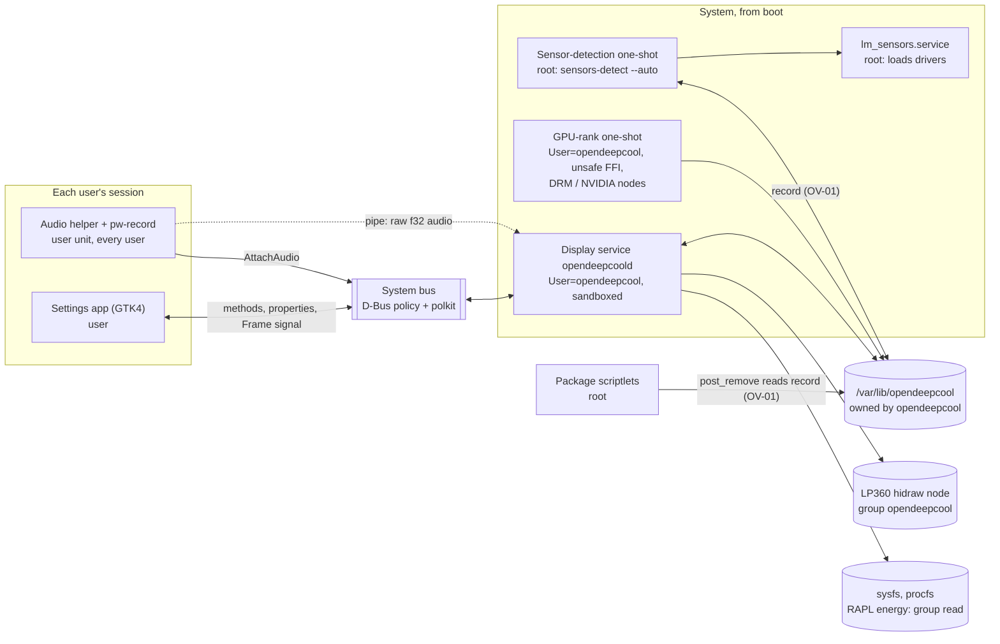

# Solution review: the whole of OpenDeepCool v1

**Review ID:** `project-overview`
**Kind:** solution review, done after the plans and before implementation ([README](README.md))
**Reviewed:** 2026-10-26, at commit `3ec34b7` (Phase 4 complete; Phases 5–11 planned, nothing implemented)
**Inputs:** the [PRD](../prds/opendeepcool-lp360.prd.md); the plans of Phases 3 and 5–11; the reports of Phases 3 and 4; [`docs/spec/`](../../spec/); [`docs/design/settings-app.md`](../../design/settings-app.md); [`docs/research/phase1-wine-spike.md`](../../research/phase1-wine-spike.md); `AGENTS.md`, `CLAUDE.md`, `README.md`, `.githooks/`, `.gitignore`, `mise.toml`
**Status:** cross-check paused. On 2026-10-26 the owner went through OV-01 to OV-14: eight were accepted and applied, OV-06 is partly decided, OV-11 is still open, and OV-07, OV-09, OV-10 and OV-12 weren't covered.
- **Order from here** (owner, 2026-10-26): the phase reviews first, Phase 1 to 11, one at a time, because they hold the deep analysis. This overview comes last, for what's still open: OV-07, OV-09 to OV-12, and OV-15 onward, except OV-19 (decided 2026-10-26).
- Many of those are settled on the way, through the phase findings behind them. See [Cross-check outcomes](#cross-check-outcomes).

The phase reviews go deeper on each point: [Phase 1](phase-1-wine-reference-spike.review.md), [2](phase-2-repository-bootstrap.review.md), [3](phase-3-functionality-protocol-spec.review.md), [4](phase-4-implementation-plans.review.md), [5](phase-5-device-protocol-core.review.md), [6](phase-6-sensors.review.md), [7](phase-7-service-settings-load-mode.review.md), [8](phase-8-temperature-power.review.md), [9](phase-9-music.review.md), [10](phase-10-settings-app.review.md), [11](phase-11-packaging-final-validation.review.md).

## Verdict

The solution is well designed for its size. Its strongest parts are the evidence discipline (every fact labelled or marked unverified), a pure and exhaustively tested drawing core, a type that makes undocumented USB messages impossible, a sandboxed unprivileged system service, and a rootless install test. None of the findings needs a change of direction.

Four things should be fixed in the plans before the phases that carry them are implemented:

1. **Root trusts files the service account can change** (OV-01, High). Two root programs, the sensor-detection one-shot and the package's removal script, read and write a record inside `/var/lib/opendeepcool`, a directory systemd hands to the `opendeepcool` account. A compromised display service could then make root clobber or delete files. The fix is a root-only directory for root's records, plus strict validation.
2. **The package starts the service too early** (OV-02, High). pacman runs `post_install` before its post-transaction hooks, which create the account, load the D-Bus policy and the udev rule. `systemctl enable --now` inside `post_install` therefore starts a service whose user doesn't exist yet. Whether the restarts catch up before systemd's start limit gives up depends on timing, so on a fresh install the cooler can stay blank until the next boot.
3. **The display can stop while the service still looks healthy** (OV-03, High). A panic in the engine thread leaves the process, and so the unit, alive; a USB write can block for up to 5 s on the tick thread; and the default start limit gives up after 5 failed starts in 10 s. A watchdog, `panic = "abort"`, a separate device-I/O thread and a backoff restart policy close this.
4. **The real-hardware test plan has no time budget** (OV-04, Medium–High). By this review's estimate, the "whole cross on the real cooler, every time" rule adds up to days per full run once all 23 modes exist. It needs a measured budget and an owner decision on tiers before Phase 7's run becomes the template.

The other findings are hardening, coherence between plans, and smaller correctness traps, such as rounding up floating-point values (OV-08), which show up as off-by-one digits on the cooler.

## How this review was done

- Every document in the inputs list was read in full. Cross-references between plans were followed to their targets.
- External facts behind a finding were checked against primary sources on 2026-10-26 (listed in [Sources](#sources)). Anything not checked is marked **unverified**.
- The review describes risks and recommends changes. It doesn't decide: every recommendation that changes scope, a rule or an owner decision is listed under [Questions for the owner](#questions-for-the-owner).
- Machine facts stay in `docs/local/` (AGENTS.md rule 10); this review names none.

### Severity scale

| Severity | Meaning |
|---|---|
| Critical | Exploitable as designed, or a core promise fails with no workaround. None found |
| High | A privilege boundary can be crossed, or a core promise (display from boot, clean install) fails in a likely case. Fix in the plan before its phase is implemented |
| Medium | A realistic failure, privacy, performance or maintainability risk. Fix in the phase's plan |
| Low | Hardening, hygiene or a rare edge case |
| Note | An observation; no action needed |

## The solution in one picture

### Components, privileges and inputs

| Component | Runs as | Privileges beyond a plain account | Untrusted inputs | Phase |
|---|---|---|---|---|
| Display service `opendeepcoold` | `opendeepcool`, systemd sandbox | write to the LP360 node; read of the RAPL package counters; owns the bus name | D-Bus calls from any local user; the audio pipe; its own state files | 5–10 |
| GPU-rank one-shot | `opendeepcool` | DRM render nodes, NVIDIA nodes; the only `unsafe` code | sysfs | 6 |
| Sensor detection | **root** | everything; runs `sensors-detect --auto` | its record in the service-owned state directory (OV-01) | 6 |
| `lm_sensors.service` | root | loads kernel modules at every boot | `/etc/conf.d/lm_sensors` | 6 (enabled by detection) |
| Audio helper | each user | none | the service's pipe; PipeWire | 9 |
| Settings app | each user | none | D-Bus replies; the user's own theme files; `pci.ids` | 10 |
| Package scriptlets | **root** | everything | the dev manifest; the detection record (OV-01) | 11 |
| Dev setup scripts (development only) | **root** through `pkexec` | everything | the repository's working tree; from Phase 7 they also build it (P5-03) | 5–10 |

## What the solution does well

These are worth keeping as the plans change:

- **Evidence discipline.** The spec labels every fact with its evidence or marks it unverified, and plans cite primary sources with dates. This review could check most claims quickly because of it.
- **Rule 9 by construction.** `Report` has no public constructor from bytes (Phase 5), so only the start-up command and frames can reach the cooler. A `compile_fail` test keeps it that way.
- **A pure, exhaustively testable core.** `picture` + `Marquee` (Phase 7) and `analyse` + `Spectrum` + `Dancer` (Phase 9) have no clock and no I/O, so every scenario runs as a unit test. The oracle is generated independently, so Rust output is never compared with Rust output.
- **Ports and adapters for sensors**, with rules as data and fake sysfs trees for drivers the owner's PC doesn't have (Phase 6).
- **Least privilege by default.** The service is a sandboxed system user rather than root or a user service. `unsafe` FFI and render-node access are isolated in a short-lived helper. CPU power is opened to one group instead of to everyone (CVE-2020-8694).
- **polkit with the `system-bus-name` subject** for every change: the race-free way for D-Bus callers. The app asks the service whether it may change settings, so there's one authority.
- **Absolute-deadline timing.** The 100 ms tick is on the monotonic clock, and a late frame doesn't shift the next ones. The engine and the D-Bus side communicate through a channel, so a slow polkit check can't delay a frame.
- **Clean lifecycle as a requirement.** A manifest for the dev copy, a record of what detection created, and a rootless install-and-uninstall test that compares the whole root.
- **Privacy guard.** A commit guard backs up rule 10 with the owner's own list of sensitive values, which stays local.

## Architecture assessment

### Structure and layering

The crate split follows concerns cleanly: `odc-protocol` (pure), `odc-device` (I/O behind `DisplayPort`), `odc-sensors` (behind `Readings`), `odc-render` (pure), `odc-ipc` (the contract), `odc-service`, `odc-app`, plus test-only crates (`odc-testkit`, `odc-e2e`, `odc-ui-e2e`, `odc-pkg-test`) and two helpers. Dependencies point inward to the pure crates. The app reuses `odc-render` for its tiles instead of keeping a second copy. That's sound.

Two structural points to watch:

- **The D-Bus contract has no single home** (OV-20). It's described in an `odc-ipc` doc comment (Phase 7), in `settings.md` and in the design document. It also changes shape in Phases 9 and 10 under the same `…OpenDeepCool1` name. That's fine before a release, but it needs one committed description that a test compares with what the service actually serves, frozen at v1.0.0.
- **The oracle generator lives outside the repository** (OV-07). Every expected frame, dash case, scenario file and spectrum file is produced by local scripts in the git-ignored `research/` folder. Phases 7–9 extend those scripts, and Phase 11 Task 8 commits them only at the very end, in the same task that cleans out the rest of `research/`. Until then the project's ground truth depends on one unversioned copy.

### Processes, threads and timing

- **Service:** one engine thread (tick, readings, drawing, device write), zbus's executor thread for D-Bus, and in Phase 9 an audio reader thread. Shared state is a channel in one direction and an `Arc<RwLock<Status>>` in the other. This is simple and correct.
- **The weak spot is the engine thread doing blocking I/O** (OV-03). Two calls on that thread can block:
  - The USB write. A hidraw write on a USB HID device with an interrupt-OUT endpoint goes through `usbhid_output_report`, which calls `usb_interrupt_msg(…, USB_CTRL_SET_TIMEOUT)`, and that constant is 5000 ms (kernel source). The tick thread can therefore stall for up to 5 s per frame on a misbehaving device.
  - Sensor reads. Some drivers answer slowly (firmware queries, SMBus chips), and NVML runs in-process (P6-06).
- **No liveness supervision** (OV-03). If the engine thread panics, the process lives on through the D-Bus thread, `systemctl` reports the unit as active, and the cooler goes blank after about 10 s. The plans use panics for programming errors (for example out-of-range `Frame` indexes), so this path is reachable by any bug.

### State and persistence

- Settings are a versioned TOML file written only by the service, atomically. That's good; add an `fsync` of the directory after the rename, and decide the policy for unknown fields (P7-12).
- `gpu-rank.json` is written by the unprivileged helper as the same account. That's fine.
- `sensors-detect.json` is written and read by root in the service-owned directory, and read again by root at uninstall: see OV-01.
- The dev recording `dev-frames.log` has no size limit (OV-21).

### Interfaces

- **D-Bus:** names follow the specification's reversed-domain and major-version advice; reads are open and changes are polkit-checked. Gaps:
  - input validation is "non-empty" only for fan inputs and the GPU (OV-14);
  - the `.Dev` interface ships in the product binary, gated by a switch, a bus policy and polkit (OV-13);
  - the `Frame` signal is broadcast to the whole bus (OV-06).
- **Audio pipe:** a pipe the service creates, whose write end is passed to an authorized caller. That's a good shape. Samples need sanitizing (P9-03).
- **Files the app reads:** the user's own theme files, so a mistake only harms that user's own app; colour values should still be validated before they're written into CSS (P10-05).

### Testing architecture

Four layers with an independent oracle, and fakes for every port, is the right design. Three systemic gaps:

- **Real-hardware duration** (OV-04, below).
- **Environment drift** between CI (Ubuntu), the UI tests (an Arch container), the pre-commit guard (the owner's PC) and the PKGBUILD's `check()` (any user's PC) (OV-10).
- **Untestable-by-design areas aren't named as such:** NVIDIA (OV-15), the service actually starting after install (P11-09), suspend and resume (OV-19), and parity rows that describe the cooler's own behaviour (P11-16).

### Lifecycle and packaging

One PKGBUILD, enable at install (an owner decision against Arch's convention), removal of everything including the account, and a rootless container test. The design is coherent, but the ordering of scriptlets against pacman's hooks is wrong (OV-02). Upgrades aren't specified (OV-18), and the source archive isn't authenticated (OV-16).

## Security assessment

### Threat model used

- **Assets:** the integrity of root-owned files; the cooler (only documented messages, rule 9); the privacy of the active user's sound; the integrity of the shared settings; the privacy of the owner in a public repository.
- **Actors:**
  - local users in active, inactive and remote sessions;
  - any process in the active session;
  - a display service compromised through one of its inputs;
  - the supply chain (crates, GitHub Actions, the AUR source);
  - an AUR user's PC, which isn't the owner's.
- **Entry points:** D-Bus methods and signals; the audio pipe; sysfs and procfs (kernel-trusted); state files; package scriptlets; dev scripts run through `pkexec`.

### Findings in short

- **Privilege boundaries.** The service account can't escalate except through OV-01. The RAPL group read deliberately gives the service account the power side channel that CVE-2020-8694 closed for everyone, and only to that account: an accepted, documented trade-off (P6-08).
- **D-Bus.** Policy rules must always pair `send_interface` with `send_destination`, because the interface field of a message is optional (dbus-daemon(1)). Authorization for the dev interface shouldn't rest on the bus policy alone (OV-13). Inputs need validating against the service's own lists (OV-14).
- **Privacy.**
  - Frames, including the Music spectrum derived from the active user's sound, reach any bus client, remote users included (OV-06).
  - The active user's sound output is captured for as long as their session is the active one, even outside Music modes (OV-05).
- **Supply chain.** GitHub Actions are referenced by tag rather than full commit SHA, which GitHub's own hardening guide recommends against. There's no dependency audit (`cargo deny`/`cargo audit`), and the PKGBUILD trusts an auto-generated GitHub archive by checksum only (OV-16).
- **Development workflow.** `scripts/dev/setup.sh` runs under `pkexec` and, from Phase 7, builds the workspace, so every dependency's build script runs as root (P5-03).
- **Repository privacy.** The commit guard works but is client-side only, with no safety net in CI (OV-22).

## Bottlenecks and performance

| Area | Risk | Where |
|---|---|---|
| USB writes and sensor reads on the tick thread | Frames stall up to 5 s on a stuck device; jitter from slow sensor reads; the Music delay target breaks | OV-03, P5-01, P7-06 |
| Audio capture whenever someone is logged in | A continuous capture stream and 384 kB/s through a pipe for the active session, even when no Music mode is shown | OV-05, P9-01 |
| Helper retries in sessions polkit refuses | One attach attempt and one journal line every 2 s per inactive or remote user, for ever | P9-02 |
| Pre-commit guard | Format, lint and the whole test suite on every commit, documentation commits included, and from Phase 10 headless weston too | P5-08 |
| Real-hardware end-to-end runs | Days per full cross (estimate below) | OV-04 |
| Dev recording | About 150 MB a day of frame log, never rotated | OV-21 |

### The real-hardware run, estimated

The real service ticks at 100 ms and can't be sped up: a faster tick is ruled out by rule 9, as the Phase 9 plan notes. So every scenario on the real cooler costs real time. This is an **estimate, unverified**. It assumes about 4.5 s per scenario run (40 ticks plus D-Bus set-up) and counts only what the plans list.

| Plan | What runs on the real cooler | Runs (approx.) | Time (approx.) |
|---|---|---|---|
| Phase 7 (modes 1–6) | 6 cycle-position scenarios × 21 positions × 12 mode variants; 30 switch pairs × 21 positions; about 25 other scenarios per variant; all × 4 rotations | ~9,800 | ~12 h |
| Phase 8 (adds 7–12) | 15 mode/unit variants; 102 new switch pairs × 21; × 4 rotations | ~17,600 | ~22 h |
| Phase 9 (adds 13–23) | 374 new switch pairs × 21 × 4; value-mode scenarios; loop positions | ~36,000 | ~45 h |
| Whole cross after Phase 9 | everything above | ~63,000 | **~3–4 days** |

The plans say "a few hours" (Phase 7) and "hours" (Phases 8 and 11). Phase 8's `--modes` flag helps each commit, but a mode's switch pairs grow with the number of modes already drawable: mode 22's commit alone runs about 3,500 real switch runs, about 4–5 h by the same assumptions. The real device adds evidence that the in-process engine tests can't give (sandbox, D-Bus, polkit, device path, real timing). It adds little for the 20th cycle position of the same scenario, which runs through the same pure code. See [Questions for the owner](#questions-for-the-owner), Q1.

## Coherence across the plans

| # | Inconsistency | Where | Effect |
|---|---|---|---|
| C1 | The PRD table runs Phases 5 and 6 in parallel, and 8, 9 and 10 in parallel. But Phase 6 extends Phase 5's workspace, `odc-testkit`, udev rule, dev scripts and CI; Phase 9 depends on Phase 8 (`draws`, `cycle_match`, `--modes`, the temperature rules); and Phase 10 depends on 8 and 9 (Music setters, `AudioConnected`, every mode drawable for its real-mode test) | PRD Implementation Phases and Parallelism Notes; the plans' Related Plans sections | Parallel worktrees would conflict, or start before their inputs exist (P4-01) |
| C2 | CI starts on Ubuntu with `cargo test --workspace` (Phase 5). Phase 10 adds GTK crates and moves only the UI jobs to an Arch container | Phase 5 Task 10, Phase 10 Task 10 | The Ubuntu job can't build `odc-app` without GTK 4 development files (P4-05, P10-03) |
| C3 | `check()` in the PKGBUILD runs "the hardware-free tests", but Phase 10's layer-3 tests start headless weston from `cargo test` | Phase 11 Task 2, Phase 10 Tasks 3–7 | Users' `makepkg` fails, or silently skips them (P10-04, P11-08) |
| C4 | The PRD's success metric "same timing as DeepCreative — compare frame timestamps against the Wine capture" has no task in any plan for the real service. The monotonic write time needed to measure it only arrives in Phase 9 | PRD Success Metrics; Phase 7 Task 9; Phase 9 Task 3 | The metric can't be signed off in Phase 11 (P7-13) |
| C5 | Phase 11 promises the checklist at 100 % against OpenDeepCool, but some rows describe DeepCreative-only or cooler-only behaviour (P8 blanking after about 10 s, D28, D31, M10) | `parity-checklist.md`; Phase 11 Task 7 | "100 %" needs categories: proven, replaced by an owner decision, or device behaviour that can't be tested unattended (P11-16) |
| C6 | The gpu-rank unit uses `ReadWritePaths=/var/lib/opendeepcool` without the `-` prefix, but only the display service creates that directory (`StateDirectory=`), and it starts after the helper | Phase 6 Task 9, Phase 7 Task 8 | On a fresh install the ranking is likely missing at the first start, so a PC with two GPUs may default to the integrated one (P6-14) |
| C7 | Integrated amdgpu power is hidden only when the GPU is ranked `Integrated`. When ranking failed (C6, or a failed query), an APU's power, which includes the CPU, would be drawn as Gpu power | Phase 6 Task 8, Phase 8 Task 8 | Breaks rule 11 in a failure case; fail safe instead (P8-06) |
| C8 | The design's decision D8 says the theme monitor watches "the parent of `current/`", while its Theme section and the Phase 10 plan say `current/` | `settings-app.md`; Phase 10 Task 7 | One of them misses the folder move (P10-06) |
| C9 | Line-number references in plans have already drifted (Phase 7 switched to section names; Phases 5 and 6 still cite line ranges) | Phases 5, 6 | Agents land on the wrong lines (P4-03) |
| C10 | Small record drift: README "Next, Phase 4"; `display.md` "sensors.md (to come)"; the checklist's sign-off says 73 rows while it now has 82; `frames/README.md` says "never capped" next to the 9999 cap; the PRD footer still says "DRAFT" | the files named | Low; an errata pass before Phase 5 (P2-08, P3-02) |

## Best-practice checklist

| Practice | Status | Note |
|---|---|---|
| Least privilege for the long-running process | ✓ | Unprivileged system user, empty capability set, sandbox |
| No root process trusts data writable by a less privileged account | ✗ | OV-01 |
| systemd hardening | △ | Good set. Add `PrivateNetwork=yes` (the system bus is a file-system socket and stays reachable, systemd.exec), `ProtectProc=invisible` (recommended by systemd.exec for most services), `UMask=0077`, `RestrictSUIDSGID=yes`, `RemoveIPC=yes`, `SystemCallFilter=~@privileged @resources` (P7-09) |
| Liveness: watchdog, readiness, restart backoff | ✗ | OV-03 |
| Bounded start-up of one-shots | ✗ | `Type=oneshot` has no start timeout by default (systemd.service); the service is ordered after two of them (P6-03) |
| D-Bus policy and polkit | △ | Right subject kind and actions; policy caveat and in-method checks (OV-13); validation (OV-14) |
| Data minimisation | △ | Logs never hold samples or readings (good); audio captured even when unused (OV-05); frames broadcast (OV-06) |
| Input validation at trust boundaries | △ | D-Bus arguments, audio samples, theme values (OV-14, P9-03, P10-05) |
| `unsafe` isolated and audited | ✓ | `forbid` in the workspace; one helper; struct layout tests against the kernel headers |
| Deterministic, exact arithmetic for displayed numbers | ✗ | Rounding up floating-point values (OV-08) |
| Supply chain: pinned actions, dependency audit, signed release | ✗ | OV-16 |
| Reproducible packaging per Arch guidelines | △ | Follow the Rust package guidelines (`cargo fetch --locked` in `prepare()`, `--frozen` in `build()` and `check()`) (P11-07) |
| Install and upgrade scriptlets | ✗ | Ordering (OV-02); upgrade restart (OV-18); validated deletions (P11-03) |
| Tests independent of the implementation | ✓ | Python oracle, spec-driven, distinct values per metric |
| Test pyramid with bounded cost | △ | OV-04 |
| Privacy in a public repository | ✓ | Local-only facts, a guard, identity check; CI safety net missing (OV-22) |
| Accessibility | ✓ | Accessible names, contrast ratios computed, focus never applies a tile |

## Findings register

Each overview finding gathers the phase findings behind it. Details and recommendations are in the phase reviews.

| ID | Severity | Category | Finding | Phase findings |
|---|---|---|---|---|
| OV-01 | High | Security | Root programs (detection one-shot, `post_remove`) read and write a record in the state directory that systemd makes owned by `opendeepcool`. That account can replace or symlink it (`fs.protected_symlinks` only protects sticky world-writable directories), so a compromised service can make root clobber files or act on forged data. Put root's records in a root-only directory, write them symlink-safely, and validate them as fixed booleans | P6-01, P11-02 |
| OV-02 | High | Packaging, correctness | `post_install` runs before pacman's post-transaction hooks (sysusers, D-Bus reload, udev reload and trigger), so `enable --now` starts a service whose account, bus policy and device access don't exist yet. With `RestartSec=1` and the default 5 starts in 10 s, it can end failed until reboot, depending on how long the hooks take | P11-01, P11-04, P8-08 |
| OV-03 | High | Availability | An engine-thread panic leaves the unit "active" with a blank cooler; USB writes can block for up to 5 s on the tick thread; sensor snapshots run on it too; the default start limit stops restarts. Recommend `panic = "abort"`, `Type=notify` with `WatchdogSec=` fed by the tick, a device-I/O thread with a latest-frame mailbox, a sensor thread, and `RestartSteps=`/`RestartMaxDelaySec=` (systemd ≥ 254) with `StartLimitIntervalSec=0` | P5-01, P7-01, P7-02, P7-06 |
| OV-04 | Medium–High | Process, bottleneck | Real-hardware runs aren't budgeted; the whole cross is estimated at days by Phase 9 | P4-02, P7-08, P8-02, P9-14, P11-15 |
| OV-05 | Medium | Privacy, efficiency | The active session's sound output is captured continuously, even when no Music mode is shown; every other user's helper retries every 2 s, with a log line, where polkit refuses it | P9-01, P9-02 |
| OV-06 | Medium | Privacy | `Frame` signals, including spectra derived from the active user's sound, are broadcast to every bus client, remote users included; `WatchFrames` is open to all | P10-01, P10-02 |
| OV-07 | Medium | Process, integrity | The oracle generator, the ground truth of every test, is local, unversioned and scheduled to be committed only in Phase 11 | P3-01, P11-19 |
| OV-08 | Medium | Correctness | "Round up" applied to floating-point values: `(1 − 700/1000) × 100` is `30.000000000000004` in IEEE doubles, so `ceil` draws `31`. Use integer arithmetic for jiffies, millidegrees, kB and µW | P3-03, P6-05, P7-19, P8-01 |
| OV-09 | Medium | Coherence | PRD dependencies and parallelism don't match the plans (C1) | P4-01 |
| OV-10 | Medium | Coherence, CI | CI, the guard, UI tests and `check()` run in different environments that the plans don't reconcile (C2, C3) | P4-05, P10-03, P10-04, P11-08 |
| OV-11 | Medium | Robustness | Boot races: the board's sensor driver loads in `lm_sensors.service` with no ordering against the service; GPU drivers may bind late; the registry rebinds only after a failed read, so a source missing at start stays `NoDevice`, which counts as persistent, and its modes stay disabled until a restart. Also C6 and C7 | P6-04, P6-14, P7-10, P8-06 |
| OV-12 | Medium | Safety, scope | `sensors-detect --auto` runs automatically on any PC, at install time (inside `pacman`) and at boot, probes hardware lm-sensors itself warns about, and enables driver loading for every sensor chip. That reaches past "only the cooler" | P6-02, P6-03, P11-04 |
| OV-13 | Medium | Security | The dev interface ships in the product binary; its group restriction relies on the bus policy, which a message without an interface field can slip past unless rules pair interface and destination (dbus-daemon(1)) and the method checks the caller itself | P7-03, P7-04 |
| OV-14 | Medium | Security | D-Bus arguments (`ChooseGpu`, `SetCoolerFanInput`, `SetPumpInput`) are validated as "non-empty" only. Validate them against the service's own lists and never build paths from them | P7-05 |
| OV-15 | Medium | Security, testability | NVML runs inside the long-running service (closed-source code in its address space, NVIDIA device nodes, compatibility with `MemoryDenyWriteExecute=` unverified). CUDA in the sandboxed rank helper may fail, ranking an NVIDIA card `Unknown`, below an Intel iGPU. None of it can be tested on the owner's PC | P6-06, P6-07, P11-13 |
| OV-16 | Low–Medium | Supply chain | Actions pinned by tag; no `cargo deny`/`cargo audit`; the PKGBUILD trusts an auto-generated archive by checksum | P5-06, P5-07, P11-06 |
| OV-17 | Low–Medium | Development security | `pkexec` dev setup builds as root (P5-03). Group membership gives every process of the owner's session the LP360, the USB `authorized` switch and the power counter (P5-04) | P5-03, P5-04 |
| OV-18 | Low–Medium | Packaging | `post_upgrade` isn't specified: the running service must be restarted on the new binary, and running helpers handled; uninstall leaves helpers retrying until logout | P11-05, P11-20 |
| OV-19 | Low | Robustness | Suspend and resume isn't a scenario. The hidraw node may survive resume while the cooler lost power, so no `03 08` would be sent | P5-05 |
| OV-20 | Low | Maintainability | The D-Bus contract has no single committed source and no conformance test | P4-04, P7-17, P10-11 |
| OV-21 | Low | Resources | The dev recording grows without limit (about 150 MB a day) | P7-07 |
| OV-22 | Low | Privacy control | The guard is client-side only (`--no-verify`, `GIT_AUTHOR_*` overrides, a fresh clone without `core.hooksPath`); there's no CI safety net with generic patterns or GitHub secret scanning | P2-01, P2-02, P2-03 |
| OV-23 | Low | Documentation | Record drift (C9, C10) | P2-08, P3-02, P4-03 |
| OV-24 | Low | Testing | Unattended real runs can be disturbed by the owner using the app or audio during a multi-hour run; overrides survive a crashed `odc-e2e` until the service restarts | P7-16, P9-10 |
| OV-25 | Medium | Security process | No plan carries a threat model or "must be refused" tests (a dev-interface call from outside the group, path-like D-Bus strings, non-finite audio, a forged detection record, a hostile manifest); this review's threat model can serve as the reference | P4-08 |

## Questions for the owner

These need a decision at the cross-check, because the recommendation touches an owner rule or decision:

1. **Real-hardware scope (OV-04).** Keep "the whole cross on the real cooler, every time" (days per full run), or tier it: the exhaustive scenario cross in-process, where the same engine code runs in seconds with a fake clock; on the real cooler, the full matrix plus one variant of each scenario per commit; the whole real cross at phase end?
2. **Sensor detection (OV-12).** Keep the automatic `sensors-detect --auto` at install and boot on every PC, or make it an explicit action in the app (with admin authorization) offered when no fan inputs are found?
3. **Audio capture (OV-05).** Capture only while a Music mode is shown (the service tells the helper when it wants sound)?
4. **Frames on the bus (OV-06).** Send frames only to watchers, and only to active or inactive local sessions, not remote ones?
5. **Dev interface (OV-13).** Keep it in the shipped binary (so the final parity run tests the packaged binary), or put it behind a cargo feature built only for the dev copy and the parity run?
6. **NVIDIA ranking (OV-15).** If the CUDA query fails, should an NVIDIA card rank `Unknown` (after an integrated GPU, as now), or should a failed query on NVIDIA's desktop driver count as an error to surface?
7. **Suspend and resume (OV-19).** Send `03 08` again after every resume, noticed through logind's `PrepareForSleep(false)` signal? It's a protocol behaviour, so it's the owner's call. A gap measured with Rust's `Instant` can't detect it: `CLOCK_MONOTONIC` stops during suspend.

## Cross-check outcomes

Recorded with the owner, 2026-10-26. The findings above keep their original text.

| ID | Outcome | Where the change went |
|---|---|---|
| OV-01 | **Accepted, applied.** The detection's record moves to its own root-only directory, `/var/lib/opendeepcool-detect/` (root, 0700). It holds only yes/no facts, and is refused if it's a link or isn't root's alone. `post_remove` reads only those facts. Nothing else in OpenDeepCool reads the record, so nothing else changes | PRD (Service model, System Footprint, Decisions Log); `sensors.md`; Phase 6 plan (Approach, Invariant, Recommendation, Task 10, AC7, Validation); Phase 11 plan (Recommendation, Task 1, Task 3, Task 5, AC2) |
| OV-02 | **Accepted, applied, with a pacman hook,** the owner's choice of the best practice: • units enabled by symlinks the package ships; • a post-transaction hook starts the service after systemd's hooks; • an upgrade hook restarts it; • a pre-transaction hook stops it before removal; • `post_install` keeps only the dev-copy removal and the message | PRD (Packaging, System Footprint, Decisions Log, Phase 11 details); Phase 11 plan (Approach, Recommendation, Tasks 1–3 and 5, Risks, AC1) |
| OV-03 | **Accepted, applied:** • one thread per job: a tick without I/O, the device writer, the sensor reader, D-Bus, and the audio reader in Phase 9; • a panic ends the process; • a watchdog fed only while every thread progresses; • `Type=notify`; • restarts back off and never stop | PRD (Architecture Notes, Service model, Technical Risks, Decisions Log); Phase 5 plan; Phase 7 plan (Approach, Recommendation, diagram, Tasks 6, 8–10, AC3, AC8, Risks); Phase 9 plan (re-check timer) |
| OV-04 | **Accepted, applied** (Q1). It was explained first: about 63,000 real-time runs, repeating the in-process tests of the same code. On the real cooler: one example of each mode and of each test type. The whole matrix and every scenario, at every position and rotation, run in-process | AGENTS.md rule 5; PRD (Key Hypothesis, Success Metrics, Testing Strategy layer 4, Phase details, Decisions Log: Testing); Phase 5, 7, 8, 9 and 11 plans |
| OV-05 | **Accepted, applied.** Sound only while a Music mode is shown (`AudioWanted`, Q3: yes). The helper follows events instead of retrying every 2 s, logs only changes of state, and doesn't run for system accounts. Owner, the same day: the PC has one user at a time on its one seat, and only the active user needs access, so nothing handles simultaneous users | PRD (Service model, Settings app ↔ service, Music Mode, User Flow, System Footprint, Decisions Log: Audio capture, Users); `music.md`; `settings.md`; checklist M21; Phase 9 plan (seat0 only) |
| OV-06 | **Partly decided.** • The owner wants to try taking only the sound tagged as music (PipeWire `media.role` Music), with research first, before Phase 9. • Frames: decided later the same day (Q4). No remote or inactive user uses the service, only the current logged-in user: every call is checked, and frames and state go to each authorized watcher alone (P10-01 outcome) | PRD (Open Questions, Music Mode, Settings app ↔ service, Decisions Log: Audio source, Who may use OpenDeepCool); `music.md` (Source, planned); `settings.md`; checklist T7; Phase 7, 9 and 10 plans (Task 0 research in Phase 9) |
| OV-07 | **Accepted through the Phase 3 review** (2026-10-27, P3-01): the generator moves to `tools/oracle/`, committed, in Phase 5 Task 0, with a regeneration check in the guard and CI; Phases 7–9 extend it there, and Phase 11 deletes only the DeepCreative parts left in `research/` | Phase 5 plan (Task 0, Task 10, AC4, Validation); Phase 7, 8, 9 and 11 plans; PRD (Testing Strategy, Phase 5, Decisions Log: Oracle generator) |
| OV-08 | **Accepted, applied.** Exact whole-number arithmetic for every number drawn, from the sources' integer units. Owner, the same day: every measurement rounds to the nearest whole number, halves up, °F once from the exact °C (checklist D43). • This changed 24 expected °F frames (57 °C → `135°F`, 7 °C → `45°F`). They were regenerated on 2026-10-26 at the owner's request, and the Phase 8 and 9 capture counts recounted (Phase 8: 70 compared instead of 92; Phase 9: still 79). • The design mockups' generator used DeepCreative's rounding; fixed and the mockups regenerated on 2026-10-26 | PRD (Sensor architecture, Decisions Log: Numbers drawn, Rounding); `display.md` (Values, Unavailable values, S7, S19, S20); `sensors.md`; `frames/README.md` and the regenerated frames; checklist D42, D43; Phase 6, 7, 8 and 9 plans |
| OV-09 | **Accepted through the Phase 4 review** (2026-10-27, P4-01): one phase at a time, 5 to 11 | PRD (Implementation Phases, Parallelism Notes, Decisions Log: Phase order) |
| OV-10 | **Accepted through the Phase 4 review** (2026-10-27, P4-05): every CI job in the `archlinux:base-devel` container from Phase 5; the weston tests behind their own feature, outside `cargo test --workspace`, the guard and `check()` | Phase 5, 10 and 11 plans; PRD (Testing Strategy, Decisions Log: CI environment) |
| OV-11 | **Decided through the Phase 6 and 8 reviews** (2026-10-27): sources missing at start are looked for again (every 5 s for two minutes, then every 60 s), "no device" counts as lasting only after those two minutes, the service starts after `lm_sensors.service`, and the rank helper gets its own state directory (P6-04, P6-14, the rest of P7-10); AMD GPU power is shown only on a GPU ranked dedicated (P8-06) | Phase 6, 7 and 11 plans; `sensors.md`; PRD (Sensor registry, Decisions Log: Sources that appear late) |
| OV-12 | **Decided through the Phase 6 review** (2026-10-27, Q2): detection stays automatic, made safer: not when a fan reading exists, 120 s at most, the service doesn't wait for it, and the install docs say so beforehand | Phase 6, 7 and 11 plans; `sensors.md`; PRD (Must row, Service model, Technical Risks, Decisions Log: Sensor detection) |
| OV-13 | **Accepted, applied.** The dev interface stays in the shipped binary (Q5: keep), at its own object path. It's checked three ways: by the D-Bus policy (every rule paired with the destination), inside each call (the caller's groups), and by polkit | PRD (dev footprint, Decisions Log); Phase 7 plan (Recommendation, Tasks 4, 7, 8, AC6, Risks); Phase 9 plan (`OverrideAudio`) |
| OV-14 | **Accepted, applied.** Every D-Bus argument is checked against the service's own lists, with length limits; the settings file is checked for form; no path is built from a caller's string | PRD (Settings app ↔ service, Decisions Log); Phase 7 plan (Recommendation, Tasks 5, 7, AC6) |
| OV-15 | **Partly decided through the Phase 6 review** (2026-10-27, Q6): NVML stays in the service, loaded only on NVIDIA PCs, with a test (P6-06); a failed kind query stays unknown, logged and named in the GPU list (P6-07). P11-13 comes with its review | Phase 6, 7 and 10 plans; `sensors.md`; `settings.md`; the designer's brief; PRD (Decisions Log) |
| OV-16 | **Partly decided through the Phase 5 review** (2026-10-27): actions pinned to full commit hashes with a read-only token, checked at each phase sign-off without Dependabot (P5-06); `cargo deny check` in CI (P5-07). P11-06 comes with its review | Phase 5 plan (Task 10, Risks); AGENTS.md How to work; PRD (Decisions Log: CI supply chain) |
| OV-17 | **Accepted through the Phase 5 review** (2026-10-27): the dev setup builds as the user, and only `install-root.sh` runs with `pkexec` (P5-03); the dev-group membership's consequences are written down and accepted on the development PC (P5-04) | Phase 5 and 7 plans; PRD (dev footprint, Decisions Log: Dev setup) |
| OV-19 | **Accepted, applied** (Q7). The owner: when the PC comes back from standby, OpenDeepCool must be back; the monitor turning off or the screen locking changes nothing. After every wake-up (logind's `PrepareForSleep(false)`), a new conversation with `03 08` and new reading intervals | PRD (Service model, Decisions Log: Standby, test types); `protocol.md` Standby; `sensors.md`; `display.md` S18; checklist P10, S11; Phase 5, 6, 7, 9 and 11 plans |
| OV-20 | **Accepted through the Phase 4 review** (2026-10-27, P4-04): one contract document, `docs/spec/dbus.md`, from Phase 7, tested against the service and frozen at `v1.0.0` | Phase 7, 9 and 10 plans; PRD (Settings app ↔ service, Decisions Log: D-Bus contract) |
| OV-21 | **Accepted through the Phase 7 review** (2026-10-27, P7-07): the dev copy records the first 100 reports after each start and every report during a test session, buffered and rotated at 64 MB | Phase 7 plan (Approach, Task 7); PRD dev footprint |
| OV-22 | **Accepted through the Phase 2 review** (2026-10-27, P2-01 to P2-03): the guard checks the identity git will record and rejects binary files; a push-time check re-checks every commit and tag; CI checks every commit's identity and the tree for binary files | Phase 5 plan (Task 10, AC10, Validation, Risks); PRD (Enforcement, Decisions Log: Commit guard) |
| OV-23 | **Accepted and applied** through the Phase 2, 3 and 4 reviews (2026-10-27): P2-08, P3-02 and P4-03 | README; PRD footer; `display.md`; `frames/README.md`; the checklist's sign-off note; the Phase 3 plan and report; the Phase 5 and 6 plans' references |
| OV-24 | **Partly decided through the Phase 7 review** (2026-10-27, P7-16): a dev test session refuses other callers' changes as busy, and it ends, with every override, when the test's connection leaves the bus. P9-10's leftover null sink and stopped helper come with the Phase 9 review | Phase 7 and 9 plans; PRD (dev footprint, Decisions Log: Dev test session) |
| OV-25 | **Accepted through the Phase 4 review** (2026-10-27, P4-08): the missing refusal tests (non-finite samples, malformed dev manifests), and AGENTS.md rule 5 asks for refusal tests at every entry point, with this review's threat model as the reference | AGENTS.md rule 5; `music.md`; Phase 5, 9 and 11 plans |

Questions:
- **Answered:** Q1, Q3 and Q5 (above); Q4 and Q7 later the same day (only the user at the PC; back after standby: OV-06, OV-19).
- **Answered in the Phase 6 review** (2026-10-27): Q2 (detection stays automatic, made safer) and Q6 (a failed NVIDIA query stays unknown, made visible).

The plans' HTML companions now lag behind their markdown. They're regenerated once the whole cross-check ends (the phase reviews, then this overview), so they aren't rebuilt after every change.

## Sources

Read on 2026-10-26:

- systemd.service(5), freedesktop.org: `TimeoutStartSec=` "disabled by default" for `Type=oneshot`; `RestartSteps=` and `RestartMaxDelaySec=`, added in version 254; `WatchdogSec=`.
- systemd-system.conf(5): `DefaultStartLimitIntervalSec=` 10 s and `DefaultStartLimitBurst=` 5.
- systemd.exec(5):
  - `StateDirectory=` recursively changes ownership to `User=`/`Group=` when the ownership doesn't match;
  - sandboxing options in per-user managers imply `PrivateUsers=` and need unprivileged user namespaces;
  - `PrivateNetwork=` keeps file-system `AF_UNIX` sockets reachable;
  - `ReadWritePaths=` and the `-` prefix for paths that may not exist;
  - `ProtectProc=invisible` is "generally recommended".
- systemd.resource-control(5): `DeviceAllow=` with `char-<group>` names, and "any device groups not resolvable then are not added".
- dbus-daemon(1): "Be careful with send_interface/receive_interface, because the interface field in messages is optional … Always use rules of the form: `<deny send_interface="org.foo.Bar" send_destination="org.foo.Service"/>`".
- Linux kernel documentation, `/proc/sys/fs`: `protected_symlinks` applies to sticky world-writable directories.
- clock_gettime(2): `CLOCK_MONOTONIC` "does not count time that the system is suspended". Rust's `Instant` uses `CLOCK_MONOTONIC` on UNIX (std documentation). org.freedesktop.login1(5): `PrepareForSleep(false)` is sent after a resume.
- Linux kernel source: `drivers/hid/usbhid/hid-core.c`, `usbhid_output_report` calls `usb_interrupt_msg(…, USB_CTRL_SET_TIMEOUT)`; `include/linux/usb.h` defines `USB_CTRL_SET_TIMEOUT` as 5000.
- Arch Linux developer blog, "On scripts and hooks" (2026): a transaction log showing `post_install` running before ":: Running post-transaction hooks…". Also the systemd pacman hooks on an Arch system: `20-systemd-sysusers.hook`, `35-systemd-udev-reload.hook` (which runs `udevadm control --reload`, then `udevadm trigger -c change`) and `dbus-reload.hook`, all `When = PostTransaction`.
- Arch developer manual, Rust package guidelines: `cargo fetch --locked` in `prepare()`, `cargo build --frozen --release` and `cargo test --frozen`.
- GitHub Docs, "Secure use reference": pin actions to a full-length commit SHA; give `GITHUB_TOKEN` read-only contents permission by default.
- IEEE-754 behaviour of the CPU-usage formula, reproduced with Python's `float`.
- For the cross-check, 2026-10-26:
  - Arch Linux dev blog, "On scripts and hooks" (2026-08-09): minimise custom code in install scripts, and enable units by vendor symlinks or presets. Its log shows a post-transaction hook from the package being installed running on its first install.
  - alpm-hooks(5): "Hooks are run in alphabetical order of their file name".
  - D-Bus specification: `GetConnectionCredentials` returns `UnixGroupIDs`, which is either complete or absent; a signal with a `DESTINATION` field goes to that recipient only.
  - org.freedesktop.login1(5): a seat announces changes of `ActiveSession`.
  - PipeWire `keys.h`: `media.role` (Movie, Music, Camera, Screen, Communication, Game, Notification, …).
